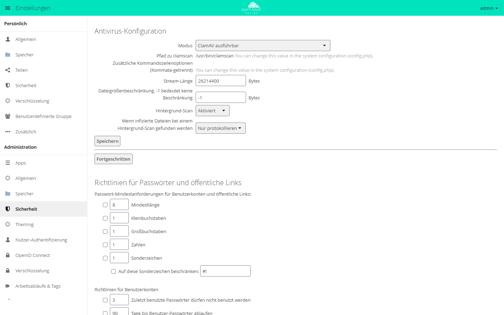

# Virenprüfung

Die Virenprüfung ist keine Kernfunktion, sondern die App `files_antivirus` (im
Markt: „Anti-Virus“, Version 1.3.11). Sie hängt sich in den Schreibpfad und
reicht jeden Upload an einen externen Scanner weiter: ClamAV direkt oder ein
ICAP-fähiges Produkt. Zusätzlich prüft ein Hintergrund-Job bereits gespeicherte
Dateien nach.

## App installieren und aktivieren

Die App steht öffentlich im Marketplace (ohne API-Schlüssel). `market:install`
lädt, installiert und aktiviert sie; liegt sie schon in der Instanz, genügt
`app:enable`:

```bash
sudo -u www-data php8.4 occ market:install files_antivirus
sudo -u www-data php8.4 occ app:enable files_antivirus
```

Bei der Installation probiert die App nacheinander die Modi `daemon` und
`socket` durch und übernimmt den ersten, mit dem ein Testscan gelingt. Schlägt
beides fehl, bleibt `executable` stehen. Dass diese Suche gelaufen ist, merkt
sich die App im Schlüssel `autoprobe`.

Die Oberfläche liegt unter **Einstellungen → Administration → Sicherheit**,
Abschnitt **Antivirus-Konfiguration**. Unter **Fortgeschritten** stehen die
Regeln, nach denen die App die Antworten des Scanners auswertet.

<figure markdown="span">
  
  <figcaption>Unter „Antivirus-Konfiguration“ wählen Sie den Modus und was mit infizierten Dateien geschieht. Der Pfad zu clamscan steht in der config.php.</figcaption>
</figure>

## Betriebsarten

Der Modus steht im Schlüssel `av_mode`. Ein unbekannter Wert führt zur
Fehlermeldung `Please check the settings at the admin page. Invalid mode: "…"`.

| Wert | Beschriftung in der Oberfläche | Ablauf | Benötigte Schlüssel |
| --- | --- | --- | --- |
| `executable` | ClamAV ausführbar | startet pro Datei `clamscan`, schiebt die Daten in dessen Standardeingabe und wertet den Exit-Code aus | `files_antivirus.av_path`, optional `files_antivirus.av_cmd_options` |
| `daemon` | ClamAV Daemon (TCP Socket) | verbindet sich mit `av_host:av_port`, prüft zuerst `PING` (erwartet `PONG`) und `VERSION`, sendet dann `nINSTREAM` | `av_host`, `av_port` |
| `socket` | ClamAV Daemon (Unix Socket) | wie `daemon`, aber über den Unix-Socket | `av_socket` |
| `icap` | ClamAV & Kaspersky (ICAP) | ICAP-**REQMOD** an `av_host:av_port` | `av_host`, `av_port`, `av_request_service`, `av_response_header` |
| `fortinet` | Fortinet (ICAP) | ICAP-**RESPMOD** mit Fortinet-spezifischen Kopfzeilen | wie `icap` |
| `mawgw` | McAfee Webgateway / Skyhigh Secure Web Gateway (ICAP) | ICAP-**RESPMOD** mit McAfee-spezifischen Kopfzeilen | wie `icap` |

Auf `VERSION` muss clamd mit einer Zeile antworten, die mit `ClamAV` beginnt.
ClamAV ab 1.x lässt sich so einstellen, dass es den Befehl abweist
(`EnableVersionCommand no`) und `COMMAND UNAVAILABLE` meldet; diese Antwort
nimmt die App seit Version 1.3.5 ebenfalls an, denn `PING` hat den Dienst schon
bestätigt.

In den ClamAV-Modi wertet die App die Antwort des Scanners über Regeln aus: im
Modus `executable` über den Exit-Code des Programms, bei `daemon` und `socket`
über einen Abgleich mit der Ausgabe des Dienstes. Die Regeln stehen in der
Oberfläche unter **Fortgeschritten**. Die ICAP-Modi verwenden keine Regeln,
sondern die Antwort-Kopfzeile des ICAP-Servers.

Die drei ICAP-Modi verlangen eine gültige Lizenz im Lizenzmanager des Servers.
Ohne gültige Lizenz, nach Ablauf einer Kulanzzeit von 24 Stunden, protokolliert
die App „No valid license found for icap scanner, resetting mode to
executable“ und liefert beim Lesen `executable` zurück. Der Lizenzschlüssel
wird in `config/config.php` unter `'license-key'` hinterlegt.

## Einstellungen und ihre Schlüssel

Alle Werte in der folgenden Tabelle sind App-Konfiguration der App
`files_antivirus`.

| Schlüssel | Beschriftung | Standard | Bedeutung |
| --- | --- | --- | --- |
| `av_mode` | Modus | `executable` | Betriebsart, siehe oben |
| `av_socket` | Socket | `/var/run/clamav/clamd.ctl` | Pfad zum Unix-Socket des clamd |
| `av_host` | Host | `localhost` | Ziel für `daemon` und die ICAP-Modi |
| `av_port` | Port | `3310` | zugehöriger Port |
| `av_stream_max_length` | Stream-Länge (Sprachfassung *Deutsch (Förmlich: Sie)*: Übertragungslänge) | `26214400` | nach so vielen Bytes baut die App die Scanner-Verbindung neu auf; darf nicht größer sein als `StreamMaxLength` in der clamd-Konfiguration |
| `av_max_file_size` | Dateigrößenbeschränkung, -1 bedeutet keine Beschränkung | `-1` | Grenze in Bytes, siehe eigenen Abschnitt |
| `av_infected_action` | Wenn infizierte Dateien bei einem Hintergrund-Scan gefunden werden | `only_log` | `only_log` = *Nur protokollieren* (förmlich: *Nur loggen*), `delete` = *Datei löschen* |
| `av_scan_background` | Hintergrund-Scan | `true` | schaltet den Cron-Job an oder aus |
| `av_request_service` | „ICAP Dienstanforderung. Mögliche Werte sind: …“ (in den Modi Fortinet und McAfee: „ICAP Anfrage-Dienst. …“) | `avscan` | `avscan` für ClamAV, `req` für Kaspersky ScanEngine, `respmod` bei Fortinet und McAfee Webgateway |
| `av_response_header` | „ICAP Antwort-Kopfzeile mit Informationen zum Virus. …“ (in den Modi Fortinet und McAfee: „ICAP Antwort-Kopfzeilen. …“) | `X-Infection-Found` | Alternativen laut Oberfläche: `X-Virus-ID` (Fortinet), `X-Virus-Name` (McAfee Webgateway) |

Auf der Kommandozeile:

```bash
sudo -u www-data php8.4 occ config:app:set files_antivirus av_mode --value daemon
sudo -u www-data php8.4 occ config:app:get files_antivirus av_mode
```

Zwei Werte wirken **nicht** über die Oberfläche oder `config:app:set`. Die App
liest sie ausschließlich aus der Systemkonfiguration und verwirft
Schreibversuche über die App-Konfiguration stillschweigend. Ein per
`config:app:set` geschriebener App-Wert landet zwar in der Datenbank, wird von
der App aber nie gelesen. Die Oberfläche zeigt beide Werte nur an, mit dem
unübersetzten Hinweis „You can change this value in the system configuration
(config.php).“ Sie gehören in `config/config.php`:

```php
'files_antivirus.av_path' => '/usr/bin/clamscan',
'files_antivirus.av_cmd_options' => '',
```

`av_cmd_options` ist eine kommaseparierte Liste; jeder Eintrag wird einzeln
maskiert an den Aufruf angehängt.

Sehr alte Installationen (App-Version bis 0.16) hatten beide Werte noch in der
Datenbank. Seit Version 1.3.10 übernimmt das Update sie nicht mehr in die
`config.php`, sondern protokolliert sie und löscht sie. Wer eigene Werte
brauchte, trägt sie selbst in die `config.php` ein. Ohne Eintrag gelten
`/usr/bin/clamscan` und keine Zusatzoptionen.

## Was bei einem Fund passiert

Der Ablauf hängt davon ab, auf welchem Weg die Datei ankommt.

| Weg | Reaktion |
| --- | --- |
| Upload eines angemeldeten Kontos | Protokolleintrag (Warnung) „Infected file deleted.“ mit Befund, Konto und Pfad; Aktivitätseintrag `virus_detected`; die geschriebene Datei wird gelöscht; der Upload bricht mit „Der Virus %s wurde in der Datei gefunden. Das Hochladen konnte nicht abgeschlossen werden.“ ab |
| Upload über einen öffentlichen Link | Protokolleintrag (Warnung) „Infected file deleted after uploading to the public folder.“; kein Aktivitätseintrag; die Anfrage wird mit derselben Meldung abgewiesen |
| Hintergrundprüfung, `av_infected_action = delete` | Aktivitätseintrag; Datei wird gelöscht; Protokolleintrag „Infected file deleted.“ |
| Hintergrundprüfung, `av_infected_action = only_log` | Aktivitätseintrag; Protokolleintrag „File is infected.“; die Datei bleibt liegen |

Der Aktivitätseintrag lautet in der Oberfläche „Eine **infizierte Datei** wurde
**gefunden**“ beziehungsweise „Datei %s ist infiziert mit %s“. Er ist nur
sichtbar, wenn die App `activity` installiert ist.

Wichtig ist der dritte mögliche Ausgang: Die Prüfung liefert kein eindeutiges
Ergebnis. Das passiert, wenn der Scanner mitten in der Prüfung ausfällt oder
neu startet, wenn der Datenstrom abbricht oder wenn sich die Antwort keiner
Regel zuordnen lässt. Seit Version 1.3.6 weist die App einen solchen Upload ab,
statt die Datei ungeprüft zu speichern. Das Protokoll zeigt „File could not be
checked, upload refused.“ auf Stufe Fehler, der Client erhält „The file could
not be checked for viruses. Upload cannot be completed, please try again.“
Diese Meldung ist nicht übersetzt. Der Upload lässt sich wiederholen. Der
Hintergrundlauf protokolliert ungeprüfte Dateien als „Not Checked.“ und lässt
sie liegen.

Ist der Scanner dagegen gar nicht erreichbar, wird der Upload ebenfalls
**abgewiesen**: Schon das Öffnen der Verbindung scheitert, und der Upload endet
mit „Die owncloud.online antivirus App ist entweder falsch konfiguriert, oder
der externe Virenscanner Dienst ist nicht erreichbar. Bitte kontaktiere deine
System-Administration!“. Im ICAP-Betrieb gilt dasselbe für eine Antwort, die
die App nicht auswerten kann. Ein Scanner-Ausfall blockiert Uploads also.

Das gilt auch für Schreibvorgänge, die der Server selbst auslöst, etwa das
Speichern im Texteditor oder neu erzeugte Vorschaubilder. Solange der Scanner
nicht antwortet, entstehen keine neuen Vorschaubilder.

!!! warning "S3 als Primärspeicher"
    Ein Objektspeicher als Primärspeicher (App `files_primary_s3`) kennt keine
    Teildateien; ein Upload schreibt direkt auf den Zielpfad. Wird eine
    bestehende Datei überschrieben und liefert die Prüfung keinen sauberen
    Befund, entfernt die App deshalb die Zieldatei selbst, samt Eintrag in der
    Dateiliste und ohne Papierkorb. Bis zum erfolgreichen neuen Upload fehlt die
    Datei. Auf lokalem Speicher entfernt die App nur die Teildatei, die
    bestehende Datei bleibt unverändert.

## Größengrenze und größere Dateien

`av_max_file_size` ist eine Byte-Angabe; `-1` (Standard) bedeutet keine Grenze.
Die Grenze wirkt an drei Stellen unterschiedlich:

- **Beim Upload** vergleicht die App die Uploadgröße mit der Grenze. Ist die
  Datei größer, wird der Scan **vollständig übersprungen** und die Datei
  ungeprüft gespeichert (Debug-Protokoll: „Scanning is skipped.“). Es wird also
  nicht etwa der Anfang geprüft.
- **Beim Hintergrundlauf** nimmt die Auswahlabfrage nur Dateien auf, die
  kleiner als die Grenze sind. Dateien der Größe 0 werden nie geprüft.
- **Beim Lesen des Datenstroms** (Hintergrundlauf, Upload über öffentlichen
  Link) schneidet der Scanner nach `av_max_file_size` Bytes ab und bewertet nur
  diesen Anfang.

Schreibvorgänge des Servers selbst (Texteditor, Vorschaubilder) prüft die App
immer, ohne Größengrenze.

Lässt sich die Uploadgröße nicht bestimmen, wird ebenfalls nicht geprüft
(Debug-Protokoll: „No upload in progress or chunk is being uploaded.“). Das
betrifft insbesondere Chunk-Uploads: Einzelne Chunks unterhalb von `uploads/`
werden übersprungen, geprüft wird erst die zusammengesetzte Datei beim
abschließenden `MOVE`. Deren Größe ermittelt die App serverseitig aus der Summe
der gespeicherten Chunks, nicht aus einer vom Client geschickten Kopfzeile, die
sonst zum Umgehen der Grenze taugen würde.

Wer eine Grenze setzt, braucht deshalb eine Antwort auf die Frage, was mit den
größeren Dateien passieren soll: Sie bleiben in owncloud.online ungeprüft.

## Hintergrundprüfung per Cron

Die App registriert den Job `OCA\Files_Antivirus\Cron\Task`. Er läuft nur, wenn
die App aktiviert ist und `av_scan_background` auf `true` steht.

| Eigenschaft | Wert |
| --- | --- |
| Intervall | 15 Minuten |
| Dateien pro Lauf | 10 |
| Auswahl | Dateien unterhalb von `files/`, keine Verzeichnisse, Größe ungleich 0, noch nie geprüft **oder** mit geändertem ETag |
| Buchführung | Tabelle `oc_files_antivirus` mit `fileid`, `check_time`, `etag` |

Daraus folgt die Obergrenze von rund 960 Dateien pro Tag und Instanz. Ein
großer Altbestand ist damit nicht in Tagen durchgeprüft; die Hintergrundprüfung
ist eine Nacharbeit, kein Ersatz für die Prüfung beim Upload. Geänderte Dateien
kommen über den ETag-Vergleich automatisch erneut an die Reihe. Sauber geprüfte
Dateien vermerkt der Lauf in der Tabelle; Funde und ungeprüfte Dateien nicht.

Der Job läuft nur, wenn die Hintergrund-Jobs überhaupt ausgeführt werden, siehe
[Hintergrund-Jobs (Cron)](background-jobs.md). Abschalten:

```bash
sudo -u www-data php8.4 occ config:app:set files_antivirus av_scan_background --value false
```

## Auswirkung auf die Uploadgeschwindigkeit

Die Prüfung läuft synchron im Schreibpfad: Der Upload gilt erst als
abgeschlossen, wenn der Scanner geantwortet hat. Jede Datei durchläuft den
Scanner zusätzlich zum normalen Schreiben, die Uploadzeit steigt entsprechend.
Die Modi unterscheiden sich dabei deutlich:

- `executable` startet für **jede** Datei einen eigenen `clamscan`-Prozess, der
  die Signaturdatenbank neu lädt. Das ist die mit Abstand teuerste Variante und
  für Produktivsysteme ungeeignet. Dort gehören `daemon` oder `socket` hin,
  weil der Dienst die Signaturen einmalig im Speicher hält.
- Bei `daemon` und `socket` wird die Verbindung nach jeweils
  `av_stream_max_length` Bytes geschlossen und neu aufgebaut. Ein zu kleiner
  Wert erzeugt viele Verbindungswechsel pro Datei. Jeder dieser Abschnitte
  braucht ein eindeutiges Ergebnis; scheitert einer, wird der ganze Upload
  abgewiesen. Bei großen Dateien kommt die Ablehnung erst nach dem
  vollständigen Upload, bei Chunk-Uploads beim abschließenden `MOVE`.
- Die ICAP-Modi sammeln die Datei **vollständig im Arbeitsspeicher** und senden
  sie erst am Ende. Mit `av_max_file_size = -1` bestimmt also die größte
  hochgeladene Datei den PHP-Speicherbedarf der Anfrage. Auf Instanzen mit
  großen Dateien ist eine Grenze hier Pflicht, mit der oben beschriebenen
  Nebenwirkung, dass darüber nichts geprüft wird.
- Läuft der Scanner auf derselben Maschine, konkurriert er mit PHP-FPM um CPU
  und Speicher. Ein eigener Scan-Host entlastet den Anwendungsserver, kostet
  aber Netzwerklatenz pro Datei.

Bei sehr großen Dateien fällt die gesamte Prüfzeit in die letzte Anfrage des
Uploads. Die Zeitgrenzen von Reverse-Proxy, PHP-FPM und Client müssen das
tragen, sonst scheitert der Upload auch ohne Befund.

Zusätzlich verursacht die Hintergrundprüfung Lesezugriffe auf den Datenbestand.
Bei Speichersystemen mit Abrechnung nach Zugriffen ist das ein eigener Posten.

## Verbindung prüfen

Das Speichern in der **Antivirus-Konfiguration** löst einen echten Testscan mit
der EICAR-Testzeichenkette aus. Erkennt der Scanner sie nicht als infiziert,
erscheint „Test war nicht erfolgreich. Bitte überprüfe die
Antivirus-Einstellungen“. Der Test sagt damit mehr aus als eine reine
Erreichbarkeitsprüfung: Er schlägt auch fehl, wenn die Regeln oder die
Signaturdatenbank nicht greifen.

Für die Fehlersuche das Protokoll auf `debug` stellen. Auf dieser Stufe schreibt
die App Dateigrößen, die Gründe für übersprungene Prüfungen und die Antworten
des Scanners:

```bash
sudo -u www-data php8.4 occ log:manage --level debug
```

Danach wieder zurückstellen (`--level warning`), siehe
[Serverprotokoll und Fehlermeldungen](logging.md).

## Fehlersuche

| Symptom | Ursache | Abhilfe |
| --- | --- | --- |
| Nach dem Speichern: „Test war nicht erfolgreich. Bitte überprüfe die Antivirus-Einstellungen“ | Der EICAR-Testscan lief nicht durch: Scanner nicht erreichbar, falscher Modus oder Regeln greifen nicht | Protokoll lesen; bei Verbindungs- und Konfigurationsfehlern steht die Ursache dort als Warnung, bei greifenden, aber falschen Regeln meldet der Test nur den Misserfolg |
| Protokoll: „Unexpected response to ping“ oder „Unexpected response to version“ | Auf `av_host:av_port` bzw. am Socket antwortet kein clamd | Ziel korrigieren; die App akzeptiert auf `VERSION` nur eine Antwort, die mit `ClamAV` beginnt, oder `COMMAND UNAVAILABLE` |
| Protokoll: „Could not connect to host … on port …“ / „Could not connect to socket …“ | Dienst läuft nicht, Pfad falsch, oder der Webserver-Benutzer darf den Socket nicht öffnen | Dienst starten, `av_socket` prüfen, Rechte am Socket prüfen |
| Protokoll: „The antivirus executable could not be found at path …“ | `av_path` zeigt ins Leere | `'files_antivirus.av_path'` in `config/config.php` setzen; über die Oberfläche geht das bewusst nicht |
| Uploads scheitern mit „Die owncloud.online antivirus App ist entweder falsch konfiguriert, oder der externe Virenscanner Dienst ist nicht erreichbar. …“ | Der Scanner ließ sich nicht initialisieren; in diesem Fall wird der Upload abgewiesen | Scanner reparieren oder die App vorübergehend mit `occ app:disable files_antivirus` abschalten |
| Uploads scheitern mit „The file could not be checked for viruses. Upload cannot be completed, please try again.“ | Die Prüfung lieferte kein eindeutiges Ergebnis: Scanner überlastet oder neu gestartet, Zeitlimit des clamd überschritten, keine passende Regel | Protokoll auf „File could not be checked, upload refused.“ prüfen, Scanner stabilisieren, Upload wiederholen |
| Protokoll: „Failed to write a chunk. Check if Stream Length matches StreamMaxLength in ClamAV daemon settings“, Uploads oberhalb einer festen Größe scheitern | `av_stream_max_length` ist größer als `StreamMaxLength` im clamd; clamd bricht jeden zu langen Abschnitt ab | Beide Werte angleichen |
| Protokoll: „No matching rules. Please check antivirus rules.“ oder „No matching rule for exit code …“ | Die Regeltabelle ist leer oder verstellt; die Prüfung bleibt ohne Ergebnis, und der Upload wird abgewiesen | In der Oberfläche unter **Fortgeschritten** → **Auf Standard rücksetzen** |
| Keine neuen Vorschaubilder, der Texteditor kann nicht speichern | Der Scanner antwortet nicht; auch diese Schreibvorgänge werden geprüft | Scanner reparieren |
| Modus fällt ohne Zutun auf „ausführbar“ zurück, Protokoll: „No valid license found for icap scanner“ | Die ICAP-Modi verlangen eine Lizenz, die Kulanzzeit ist abgelaufen | Lizenz in `config/config.php` unter `'license-key'` hinterlegen oder einen ClamAV-Modus verwenden |
| Dateien werden nicht geprüft, Debug-Protokoll: „Scanning is skipped.“ | Die Datei ist größer als `av_max_file_size` | Grenze anheben oder auf `-1` setzen |
| Dateien werden nicht geprüft, Debug-Protokoll: „No upload in progress or chunk is being uploaded.“ | Die Größe des Uploads ist an dieser Stelle nicht bestimmbar (typisch für einzelne Chunks) | Normalfall bei Chunk-Uploads: Geprüft wird die zusammengesetzte Datei beim `MOVE`; bleibt es dabei, Hintergrundprüfung aktiv lassen |
| Im ICAP-Betrieb füllt sich das Protokoll mit „ICAP request:“ und „ICAP resp:“ auf Stufe *error* | Die App protokolliert jede ICAP-Kommunikation auf Fehlerstufe, obwohl es keine Fehler sind | Kein Fehlerzustand; beim Dimensionieren von Logrotation und Speicher berücksichtigen |
| Protokoll: „ICAP response unusable“ und der Upload wird abgewiesen | Der ICAP-Server antwortet mit einem Status, den die App nicht auswerten kann | `av_request_service` und `av_response_header` gegen die Dokumentation des Scanners prüfen |
