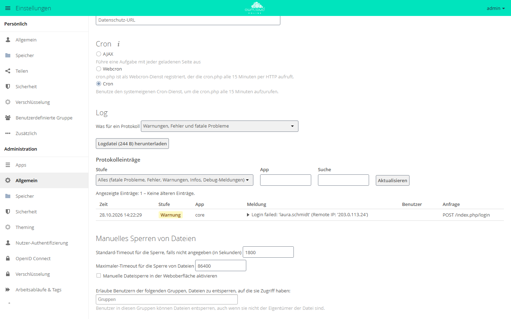

# Hintergrund-Jobs (Cron)

owncloud.online erledigt Aufräum- und Wartungsarbeiten in Hintergrund-Jobs:
Papierkorb und alte Dateiversionen ausräumen, Freigaben ablaufen lassen,
Vorschaubilder erzeugen, Benachrichtigungen und Aktivitäts-Mails versenden,
Verzeichnisse mit externem Speicher aktualisieren. Ist die Ausführung nicht
korrekt eingerichtet, laufen diese Aufgaben nie. Die Instanz wirkt zunächst
normal, wächst aber unbegrenzt und verschickt keine Mails.

## Ausführungsarten



| Modus | Auslöser | Bewertung |
| --- | --- | --- |
| **Cron** | System-Cron ruft `cron.php` auf | **empfohlen**, einzige zuverlässige Variante |
| AJAX | Jeder Seitenaufruf eines angemeldeten Benutzers | Jobs bleiben liegen, solange niemand angemeldet ist |
| Webcron | Externer Dienst ruft `cron.php` per HTTP auf | nur wenn kein System-Cron möglich ist |

Den Modus wählen Sie unter *Einstellungen → Administration → Allgemein* im
Abschnitt *Cron* oder mit `occ`, siehe unten.

## Einrichtung mit System-Cron

```bash
sudo crontab -u www-data -e
```

Eintrag (alle 15 Minuten; ein Lauf arbeitet höchstens 14 Minuten und ist auf
diesen Takt ausgelegt, bei längeren Abständen bleiben Aufgaben liegen):

```
*/15  *  *  *  * /usr/bin/php8.4 -f /var/www/owncloud.online/cron.php
```

`cron.php` startet seinerseits `occ system:cron` und gibt bei jedem Lauf den
Hinweis „Please use ./occ system:cron“ aus. Cron schickt jede Ausgabe als Mail
an den Besitzer der Crontab, sofern auf dem Server ein Mailprogramm
eingerichtet ist. Wer das vermeiden will, trägt `occ` direkt ein:

```
*/15  *  *  *  * /usr/bin/php8.4 /var/www/owncloud.online/occ system:cron
```

Danach den Modus in owncloud.online auf Cron umstellen:

```bash
sudo -u www-data php8.4 /var/www/owncloud.online/occ background:cron
```

Umschalten auf die anderen Modi geht analog mit `background:ajax` bzw.
`background:webcron`. Jeder Lauf von `occ system:cron`, auch über `cron.php`,
stellt den Modus ohnehin selbst auf Cron um, sofern die Hintergrund-Jobs nicht
ganz abgeschaltet sind.

## Prüfen, ob die Jobs laufen

```bash
# Zustand der Warteschlange
sudo -u www-data php8.4 /var/www/owncloud.online/occ background:queue:status

# eingestellter Modus (erwartet: cron)
sudo -u www-data php8.4 /var/www/owncloud.online/occ config:app:get core backgroundjobs_mode

# Zeitpunkt des letzten Laufs (Unix-Zeit)
sudo -u www-data php8.4 /var/www/owncloud.online/occ config:app:get core lastcron
```

`lastcron` sollte nie älter als etwa 15 Minuten sein. In der Weboberfläche
zeigt **Einstellungen → Administration → Allgemein** denselben Zeitpunkt an
(„Letzte Cron-Job-Ausführung: …“). Liegt er mehr als eine Stunde zurück, kommt
der Zusatz „Möglicherweise liegt ein Fehler vor.“ hinzu; ist noch nie ein Lauf
erfolgt, steht dort „Cron wurde bis jetzt noch nicht ausgeführt!“.

Einen Lauf zum Testen manuell anstoßen:

```bash
sudo -u www-data php8.4 /var/www/owncloud.online/cron.php

# gleichwertig, mit Fortschrittsanzeige
sudo -u www-data php8.4 /var/www/owncloud.online/occ system:cron --progress
```

`--progress` ist nur für den Aufruf von Hand gedacht, nicht für die Crontab.

## Typische Fehler

| Symptom | Ursache |
| --- | --- |
| „Letzte Cron-Job-Ausführung: … Möglicherweise liegt ein Fehler vor.“ | Cron-Eintrag fehlt, oder er läuft unter dem falschen Benutzer |
| Jobs laufen nur bei aktiven Benutzern | Modus steht auf AJAX, und kein System-Cron läuft (jeder Cron-Lauf würde den Modus auf Cron stellen) |
| Papierkorb/Versionen wachsen unbegrenzt | Cron läuft nicht, `lastcron` prüfen |
| Keine Benachrichtigungs-Mails | Cron läuft nicht, oder der Mailversand ist nicht eingerichtet (siehe [E-Mail-Versand](email.md)) |
| Cron-Lauf endet mit „Console has to be executed with the user that owns the file config/config.php“ | Der Eintrag steht in der Crontab von root statt von **www-data**. `occ` startet nur unter dem Besitzer von `config.php`; Eintrag mit `crontab -u www-data -e` anlegen |
| Lauf meldet „We are in maintenance mode, skipping cron“ oder „Update required, skipping cron“ | Wartungsmodus ist aktiv bzw. ein `occ upgrade` steht aus; solange laufen keine Jobs |

Hängengebliebene oder fehlerhafte Läufe stehen im Protokoll, siehe
[Serverprotokoll und Fehlermeldungen](logging.md).
