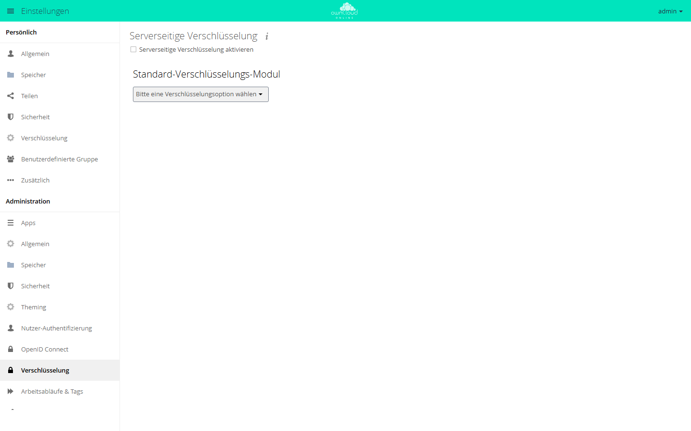

# Verschlüsselung

owncloud.online kann Dateien serverseitig verschlüsselt ablegen. Das schützt die
Inhalte auf dem Speicher, vor allem bei externem Speicher, der nicht unter
eigener Kontrolle steht. Es ist **keine** Ende-zu-Ende-Verschlüsselung: Der
Server verarbeitet die Schlüssel, ein Angreifer mit Zugriff auf den laufenden
Server kann Inhalte lesen.

!!! warning "Vor dem Aktivieren lesen"
    Verschlüsselung lässt sich nachträglich nur mit großem Aufwand rückgängig
    machen: Der Rückweg kostet alle Dateiversionen und alle Papierkörbe (siehe
    [Deaktivieren](#deaktivieren)). Bei Schlüsselverlust sind die Daten
    **endgültig** unlesbar. Vor der Aktivierung ein vollständiges Backup von
    Daten **und** Datenbank anlegen (siehe
    [Backups und Updates](backups-updates.md)) und die Wiederherstellung vorher
    testen.

## Wann sie sinnvoll ist

| Fall | Empfehlung |
| --- | --- |
| Externer Speicher (S3, SMB, andere Anbieter) | sinnvoll: Der fremde Speicher sieht nur verschlüsselte Daten |
| Eigener Server, eigene Festplatten | meist Festplattenverschlüsselung (LUKS) vorziehen: einfacher, keine Schlüsselverwaltung in der Anwendung |
| S3 als Primärspeicher (App `files_primary_s3`) | nicht möglich: Die Verschlüsselung lässt sich dann nicht einschalten, `encryption:enable` meldet „Storage encryption is not compatible with S3 Object Storage.“ Stattdessen die serverseitige Verschlüsselung des Buckets nutzen (`serversideencryption`) |
| Schutz gegen Server-Administratoren | ungeeignet: Der Server hat die Schlüssel |

## Aktivieren

Die App `encryption` heißt im Markt „Default encryption module“. Sie liegt nicht
im Release-Archiv des Servers, sondern kommt aus dem Marketplace (öffentlich,
ohne API-Schlüssel). `market:install` lädt, installiert und aktiviert sie:

```bash
# App aus dem Marketplace installieren und aktivieren
sudo -u www-data php8.4 /var/www/owncloud.online/occ market:install encryption

# Verschlüsselung einschalten
sudo -u www-data php8.4 /var/www/owncloud.online/occ encryption:enable

# Betriebsart Hauptschlüssel festlegen
sudo -u www-data php8.4 /var/www/owncloud.online/occ config:app:set encryption useMasterKey --value 1

# Status prüfen
sudo -u www-data php8.4 /var/www/owncloud.online/occ encryption:status
```

`encryption:enable` meldet am Ende das Standardmodul (`OC_DEFAULT_MODULE`).
Ist die Verschlüsselung eingeschaltet und noch keine Betriebsart gewählt, wählt
die App bei der nächsten Anfrage an den Server selbst den Hauptschlüssel. Der
Befehl `config:app:set` oben legt das ausdrücklich fest.

In der Weboberfläche liegt dasselbe unter **Einstellungen → Administration →
Verschlüsselung**: **Serverseitige Verschlüsselung aktivieren** ankreuzen, unter
**Standard-Verschlüsselungs-Modul** den Eintrag **Hauptschlüssel** wählen und
mit **Diesen Modus immer verwenden** festlegen.

<figure markdown="span">
  
  <figcaption>Serverseitige Verschlüsselung schalten Sie hier ein. Lesen Sie vorher die Hinweise zu Schlüsseln und Sicherung.</figcaption>
</figure>

Wer während der Umstellung angemeldet ist, muss sich einmal ab- und wieder
anmelden, damit die Schlüssel in der Sitzung bereitstehen. Bis dahin zeigt die
Seite den Hinweis, dass die Schlüssel nicht initialisiert sind.

Bereits vorhandene Dateien werden dabei **nicht** automatisch verschlüsselt,
nur neu geschriebene. Bestand nachträglich verschlüsseln:

```bash
sudo -u www-data php8.4 /var/www/owncloud.online/occ encryption:encrypt-all
```

Der Befehl fragt vor dem Start nach (`-y` überspringt die Frage). Während des
Laufs schaltet er selbst den Einzelbenutzermodus ein, in dem nur Mitglieder der
Gruppe `admin` den Server erreichen, und schaltet den Papierkorb vorübergehend
ab. Den Wartungsmodus schalten Sie dafür **nicht** ein: Im Wartungsmodus lädt
`occ` keine Apps, das Verschlüsselungsmodul fehlt dann, und der Befehl bricht
ab.

Je nach Datenmenge dauert der Lauf lange. Starten Sie ihn in einer Sitzung, die
nicht abbricht (`screen`, `tmux` oder eine systemd-Unit).

## Hauptschlüssel oder Benutzerschlüssel

| | Hauptschlüssel | Benutzerschlüssel |
| --- | --- | --- |
| Auswahl in der Oberfläche | einzige angebotene Betriebsart | nicht mehr auswählbar, gilt als veraltet |
| Passwortwechsel eines Benutzers | unkritisch | privater Schlüssel wird mit dem neuen Passwort neu verschlüsselt |
| Passwort vergessen | Daten bleiben lesbar | Daten ohne Wiederherstellungsschlüssel verloren |
| Anmeldung ohne Passwort (OAuth2, OpenID Connect) | funktioniert | verschlüsselte Dateien sind in dieser Sitzung nicht lesbar |
| Freigaben, Federation | unproblematisch | eingeschränkt |
| Empfehlung | **Standard für owncloud.online** | nur für bestehende Installationen |

Benutzerschlüssel gibt es nur noch für Installationen, die sie schon nutzen. Ist
der App-Wert `userSpecificKey` gesetzt, zeigt die Einstellungsseite einen
Hinweis, dass diese Betriebsart nicht mehr unterstützt wird.

Bei Benutzerschlüsseln unbedingt einen Wiederherstellungsschlüssel aktivieren,
sonst führt jedes vergessene Passwort zu Datenverlust. Der Schlüssel wird im
Abschnitt **Standard-Verschlüsselungs-Modul** angelegt; jedes Konto stimmt der
Wiederherstellung unter **Einstellungen → Persönlich → Verschlüsselung** selbst
zu.

## Deaktivieren

```bash
sudo -u www-data php8.4 /var/www/owncloud.online/occ encryption:decrypt-all
sudo -u www-data php8.4 /var/www/owncloud.online/occ encryption:disable
```

`encryption:decrypt-all` schaltet die Verschlüsselung zu Beginn ab, entschlüsselt
die Dateien aller Konten und arbeitet wie `encrypt-all` im
Einzelbenutzermodus, ebenfalls ohne Wartungsmodus. Mit Benutzerschlüsseln
braucht der Befehl die Passwörter der Konten oder den
Wiederherstellungsschlüssel.

Der Befehl bearbeitet nur die Dateien im Bereich `files/` der Konten.
Dateiversionen und Papierkorb bleiben verschlüsselt. `encryption:disable`
bricht ab, solange noch eine verschlüsselte Datei bekannt ist, und meldet „The
system still has encrypted files. Please decrypt them all before disabling
encryption.“ Der Rückweg bedeutet deshalb: alle Dateiversionen
löschen und alle Papierkörbe leeren. Beide Befehle wirken ohne Kontoangabe auf
**alle** Konten und lassen sich nicht rückgängig machen:

```bash
sudo -u www-data php8.4 /var/www/owncloud.online/occ versions:cleanup
sudo -u www-data php8.4 /var/www/owncloud.online/occ trashbin:cleanup
sudo -u www-data php8.4 /var/www/owncloud.online/occ encryption:disable
```

Erst danach die App abschalten: Ohne aktive App sind verschlüsselte Restbestände
nicht mehr lesbar.

## Betriebshinweise

- **Schlüssel mitsichern**: Sie liegen im Datenverzeichnis unter
  `files_encryption/` beziehungsweise `<benutzer>/files_encryption/`. Wurde die
  Ablage mit `encryption:change-key-storage-root` verlegt, liegen sie dort;
  `encryption:show-key-storage-root` zeigt den Ort.
- **`secret` mitsichern**: Der Wert `secret` aus `config/config.php` ist das
  Passwort des privaten Hauptschlüssels. Ein Backup ohne Schlüsselablage oder
  ohne `secret` ist wertlos.
- **Platzbedarf** steigt leicht (Blockstruktur und Kopfdaten je Datei).
- **Vorschaubilder** müssen serverseitig entschlüsselt werden. Das kostet CPU,
  siehe [Performance](performance.md).
- Fehler beim Ver- und Entschlüsseln stehen im Protokoll, siehe
  [Serverprotokoll und Fehlermeldungen](logging.md).
