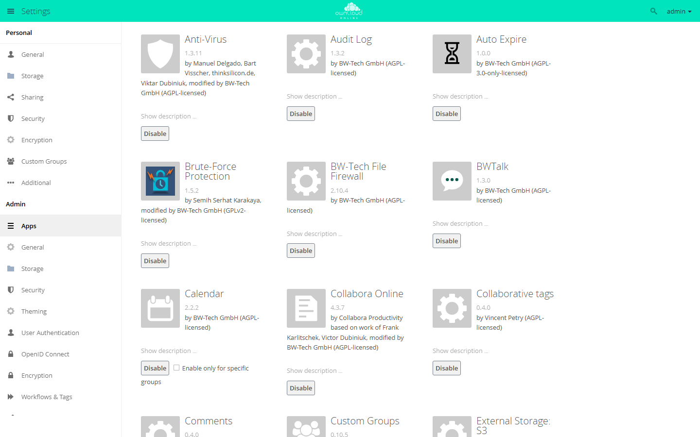

# Administration

Administration covers system health, apps, cron, caching, the database,
security, backups, and updates.

## Daily checks

```bash
sudo -u www-data php8.4 /var/www/owncloud.online/occ status
sudo -u www-data php8.4 /var/www/owncloud.online/occ app:list
sudo -u www-data php8.4 /var/www/owncloud.online/occ background:queue:status
```

## Important paths

| Path | Purpose |
| --- | --- |
| `/var/www/owncloud.online` | Application code |
| `/var/owncloud-online-data` | Data directory with the user data |
| `/var/log/apache2` | Apache web server logs |
| `/var/log/php8.4-fpm.log` | PHP-FPM log |
| `config/config.php` | System configuration |

These paths are examples. The data directory of your instance is set in
`config/config.php` under `datadirectory`:

```bash
sudo -u www-data php8.4 /var/www/owncloud.online/occ config:system:get datadirectory
```

## The admin interface



Open it with *Settings* in the user menu at the top right. The left column
separates personal settings from the admin settings. Everything under *Admin*
applies to the whole instance.

Under *Admin → Apps* you enable and disable installed apps. Some apps can be
limited to specific groups with *Enable only for specific groups*.

## Apps and the Market


Under *Installed Apps*, the Market lists everything installed on this instance,
with version, author, status, and whether the app is compatible with the server
version. *Updates* lists the apps that have a newer version in the catalog.

If the Market shows "Installing and updating Apps is not supported!", the
server cannot install apps on its own. Either the web server cannot write to the
directory marked `writable` in `apps_paths` (usually `apps-external`), or
`operation.mode` is set to `clustered-instance`. `occ market:install` fails in
that case as well. Copy the app package to the server by hand instead and
enable it with `occ app:enable`, see
[Managing apps](apps-market.en.md#write-permissions-on-the-app-directory).
