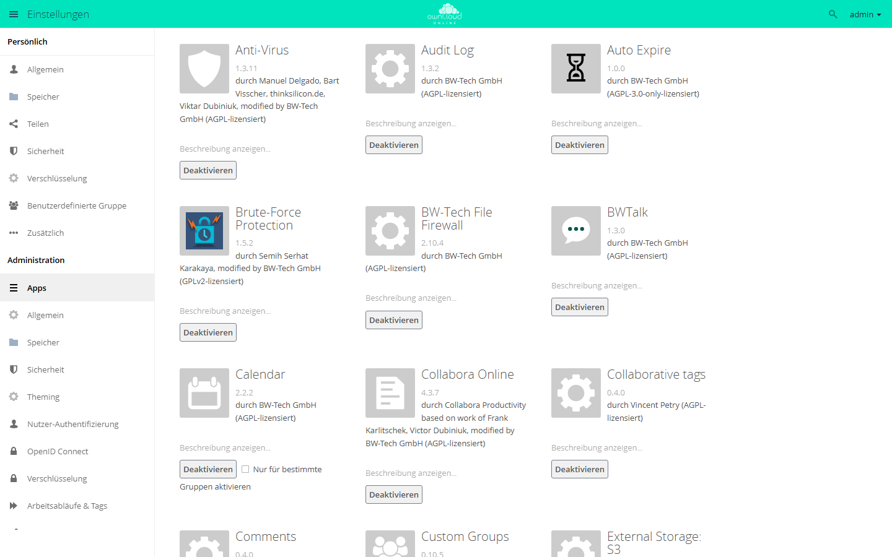
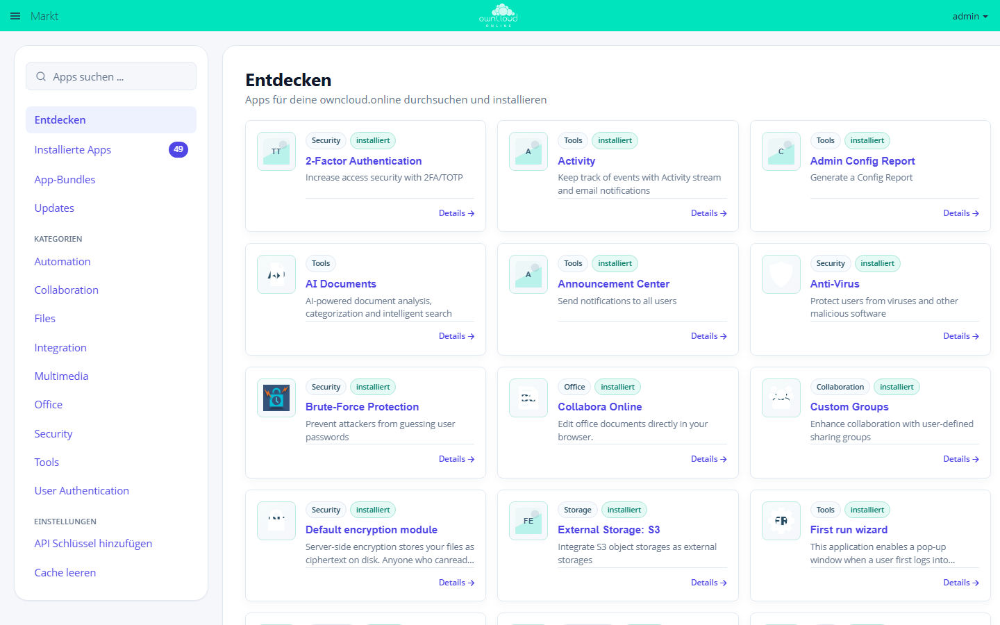

# Administration

Die Administration umfasst Systemzustand, Apps, Cron, Cache, Datenbank,
Sicherheit, Backups und Updates.

## Tägliche Prüfungen

```bash
sudo -u www-data php8.4 /var/www/owncloud.online/occ status
sudo -u www-data php8.4 /var/www/owncloud.online/occ app:list
sudo -u www-data php8.4 /var/www/owncloud.online/occ background:queue:status
```

## Wichtige Pfade

| Pfad | Zweck |
| --- | --- |
| `/var/www/owncloud.online` | Anwendungscode |
| `/var/owncloud-online-data` | Datenverzeichnis mit den Benutzerdaten |
| `/var/log/apache2` | Protokolle des Webservers Apache |
| `/var/log/php8.4-fpm.log` | Protokoll von PHP-FPM |
| `config/config.php` | Systemkonfiguration |

Die Pfade sind Beispiele. Wo das Datenverzeichnis Ihrer Instanz liegt, steht in
`config/config.php` unter `datadirectory`:

```bash
sudo -u www-data php8.4 /var/www/owncloud.online/occ config:system:get datadirectory
```

## Die Verwaltungsoberfläche



Sie öffnen sie über *Einstellungen* im Benutzermenü rechts oben. Die linke
Spalte trennt persönliche Einstellungen von der Administration; alles unterhalb
von *Administration* wirkt auf die ganze Instanz.

Unter *Administration → Apps* schalten Sie installierte Apps ein und aus. Manche
Apps lassen sich mit *Nur für bestimmte Gruppen aktivieren* auf einzelne
Gruppen beschränken.

## Apps und Markt



Der Markt zeigt unter *Installierte Apps*, was in dieser Instanz vorhanden ist,
mit Version, Autor, Zustand und einem Hinweis, ob die App zur Serverversion
passt. *Updates* listet die Apps, für die eine neuere Fassung im Katalog liegt.

Steht im Markt „Installieren und Updaten von Apps nicht unterstützt!“, kann der
Server Apps nicht selbst installieren. Entweder fehlt dem Webserver das
Schreibrecht auf das Verzeichnis, das in `apps_paths` als `writable` markiert
ist (in der Regel `apps-external`), oder `operation.mode` steht auf
`clustered-instance`. Auch `occ market:install` bricht dann ab. Apps kommen in diesem Fall als Paket von
Hand auf den Server und werden mit `occ app:enable` eingeschaltet, siehe
[Apps verwalten](apps-market.md#schreibrechte-auf-das-app-verzeichnis).
