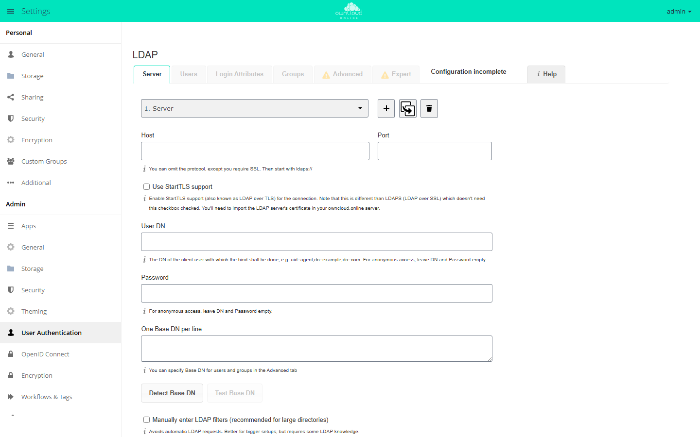

# Directory service (LDAP)

The connection to LDAP or Active Directory is not a core feature. It comes from
the app `user_ldap` (*LDAP Integration*, version 0.21.0, available in the
Marketplace without an API key). The app registers a user backend and a group
backend with the server, reads accounts and groups from the directory, and
checks logins directly against the directory server. Passwords are not stored in
owncloud.online. An account appears in the accounts table only when it logs in
or when a sync runs. Installation and a short overview are on the plugin page
[LDAP Integration](../plugins/apps/user_ldap.en.md); this page describes all
fields, filters, and keys in detail.

## Enabling the app

```bash
sudo -u www-data php8.4 occ market:install user_ldap
```

`market:install` downloads the app from the Marketplace and enables it. If the
app is already in the app directory, `occ app:enable user_ldap` is enough.

The app needs the PHP module `ldap`. Without the module the app cannot be
enabled. If the module goes missing later, the settings page shows the warning
"The PHP LDAP module is not installed, the backend will not work". To check:

```bash
php8.4 -m | grep ldap
```

The settings are under **Settings → Admin → User Authentication**. The page has
four wizard tabs, *Server*, *Users*, *Login Attributes*, and *Groups*, plus the
two areas *Advanced* and *Expert*.

<figure markdown="span">
  
  <figcaption>The LDAP wizard guides you through tabs for server, users, login attributes, and groups.</figcaption>
</figure>

## Multiple directories: configuration IDs

Each connection is stored under its own prefix in `oc_appconfig` for the
`user_ldap` app. New prefixes are assigned in sequence as `s01`, `s02`, and so
on. This ID is the `configID` argument of the configuration commands
`ldap:show-config`, `ldap:set-config`, `ldap:test-config`,
`ldap:create-empty-config`, and `ldap:delete-config`. `ldap:search`,
`ldap:check-user`, and `ldap:invalidate-cache` do not take it.

```bash
# create a new, empty configuration (ID assigned automatically or given)
sudo -u www-data php8.4 occ ldap:create-empty-config
sudo -u www-data php8.4 occ ldap:create-empty-config s02

# show the existing configurations
sudo -u www-data php8.4 occ ldap:show-config
```

Only configurations with `ldap_configuration_active = 1` are used for logins
and searches. The app silently skips all others.

## Connection and credentials

The first six fields are on the *Server* tab, the others in the *Advanced* area,
section *Connection Settings*. The key names in the table are the names that
`ldap:set-config` expects.

| Key | Label | Default | Meaning |
| --- | --- | --- | --- |
| `ldap_host` | Host | empty | Host name; the protocol is optional, use `ldaps://` for SSL |
| `ldap_port` | Port | empty | Port of the directory server |
| `ldap_dn` | User DN | empty | DN of the account used for the bind, for example `uid=agent,dc=example,dc=com` |
| `ldap_agent_password` | Password | empty | Its password; for anonymous access, leave both DN and password empty |
| `ldap_base` | One Base DN per line | empty | Search base, one per line |
| `ldap_tls` | Use StartTLS support | `0` | StartTLS on the existing connection |
| `ldap_turn_off_cert_check` | Turn off SSL certificate validation. | `0` | Sets `LDAPTLS_REQCERT=never`, for testing only |
| `ldap_backup_host` | Backup (Replica) Host | empty | Replica that takes over if the main server fails |
| `ldap_backup_port` | Backup (Replica) Port | empty | If empty, `ldap_port` is used |
| `ldap_override_main_server` | Disable Main Server | empty | Connect to the backup host only |
| `ldap_network_timeout` | Network Timeout | `15` | Seconds for all LDAP network operations |
| `ldap_cache_ttl` | Cache Time-To-Live | `600` | Seconds; changing the value empties the cache |
| `ldap_configuration_active` | Configuration Active | `0` | If `0`, the connection is skipped |

Three things the app corrects or reports by itself when it loads the
configuration:

- If `ldap_host` starts with `ldaps://` and `ldap_tls` is set as well, StartTLS
  is turned off automatically and a log entry is written. The two do not work
  together.
- A user DN without a password, or a password without a user DN, counts as a
  configuration error. For anonymous access, both fields must be empty.
- If `ldap_base_users` or `ldap_base_groups` is empty, `ldap_base` is used.

Setting and checking values on the command line:

```bash
sudo -u www-data php8.4 occ ldap:set-config s01 ldap_host ldaps://dc01.example.org
sudo -u www-data php8.4 occ ldap:set-config s01 ldap_port 636
sudo -u www-data php8.4 occ ldap:set-config s01 ldap_dn "uid=agent,dc=example,dc=org"
sudo -u www-data php8.4 occ ldap:set-config s01 ldap_agent_password "secret"
sudo -u www-data php8.4 occ ldap:set-config s01 ldap_base "dc=example,dc=org"
sudo -u www-data php8.4 occ ldap:set-config s01 ldap_configuration_active 1

sudo -u www-data php8.4 occ ldap:test-config s01
```

`ldap:set-config` accepts both the key as stored in the database (`ldap_host`)
and the internal name (`ldapHost`). It drops unknown keys without an error
message, so check every change with `ldap:show-config`.

`ldap:show-config` shows the values under their internal names, for example
`ldapHost` for `ldap_host` and `ldapAgentName` for `ldap_dn`. It replaces the
bind password with `***`. With `--show-password` the password appears in plain
text; with `--output=json_pretty` you get the configuration as JSON.

## User and group filters

*Users* and *Groups* tabs. Both tabs work the same way: a selection of object
classes, a selection of groups, and below them the field *Edit LDAP Query* for
the raw filter.

| Key | Label | Meaning |
| --- | --- | --- |
| `ldap_userfilter_objectclass` | Only these object classes: | Object classes for users, one per line |
| `ldap_userfilter_groups` | Only from these groups: | Groups whose members get access |
| `ldap_userlist_filter` | Edit LDAP Query | Complete user filter |
| `ldap_user_filter_mode` | – | Remembers whether the filter was built by the wizard or by hand |
| `ldap_groupfilter_objectclass` | Only these object classes: | Object classes for groups |
| `ldap_groupfilter_groups` | Only from these groups: | Selection of individual groups by `cn` |
| `ldap_group_filter` | Edit LDAP Query | Complete group filter |
| `ldap_group_filter_mode` | – | As above, for the group filter |

The wizard builds a filter from the selection fields: the object classes are
combined with `|` (OR), the group memberships as well, and both blocks are
combined with `&` (AND). If everything is left empty for the user filter, the
result is `(objectclass=*)`. The group filter has no such fallback; it stays
empty. For the group selection on the user side, the server must support the
`memberOf` attribute.

For large directories the wizard is the wrong tool: it queries the server for
object classes and groups every time you open a tab. The *Server* tab has the
checkbox **Manually enter LDAP filters (recommended for large directories)**
(`ldap_experienced_admin`), which stops these queries.

You can check the result with the buttons *Verify settings and count users* and
*Verify settings and count groups*, or on the command line:

```bash
sudo -u www-data php8.4 occ ldap:search "doe"
sudo -u www-data php8.4 occ ldap:search "" --limit=50
sudo -u www-data php8.4 occ ldap:search "sales" --group
```

`ldap:search` searches all **active** configurations. For users it prints
"display name (internal ID)", for groups only the name. The default for
`--limit` is 15. `--offset` must be a multiple of `--limit`; otherwise the
command stops with a message.

## Login filter

*Login Attributes* tab. It determines what a user can log in with.

| Key | Label | Default |
| --- | --- | --- |
| `ldap_loginfilter_username` | LDAP / AD Username: | `1` |
| `ldap_loginfilter_email` | LDAP / AD Email Address: | `0` |
| `ldap_loginfilter_attributes` | Other Attributes: | empty |
| `ldap_login_filter` | Edit LDAP Query | empty |
| `ldap_login_filter_mode` | – | `0` |

The wizard combines the user filter and the login part into
`(&<user filter><login part>)`. For the username it picks the first available
attribute from `uid`, `samaccountname`, `cn`; for the email address it uses
`(|(mailPrimaryAddress=%uid)(mail=%uid))`.

At login, the placeholder `%uid` is replaced with the name the user typed.
**A login filter without `%uid` makes the whole configuration invalid.** The app
rejects it and writes "login filter does not contain %uid place holder" to the
log.

The hint next to the *LDAP / AD Email Address* checkbox warns about a common
misconception: turning **off** the login with an email address here only works
together with strict login checking. Otherwise the server also looks up the
email address in the accounts table. The setting is in `config/config.php`:

```php
'strict_login_enforced' => true,
```

With it, the server checks only the login name the user typed against the
backend when it verifies the password; the extra check of the email address in
the accounts table is skipped (see also `config/config.sample.php`).

To test, use the field *Test Loginname* with the button *Verify settings* on the
same tab. It tries to find a DN for the name you enter, using the current login
filter.

## Attribute mapping

*Advanced* area, sections *Directory Settings* and *Special Attributes*.

| Key | Label | Default | Effect |
| --- | --- | --- | --- |
| `ldap_display_name` | User Display Name Field | `displayName` | Source of the display name |
| `ldap_user_display_name_2` | 2nd User Display Name Field | empty | Appended in parentheses: `John Doe (john.doe@example.org)` |
| `ldap_group_display_name` | Group Display Name Field | `cn` | Display name of the group |
| `ldap_email_attr` | Email Field | empty | If empty, `mail` is read |
| `ldap_quota_attr` | Quota Field | empty | Attribute that holds the storage quota |
| `ldap_quota_def` | Quota Default | empty | Applies if the attribute is missing or invalid |
| `home_folder_naming_rule` | User Home Folder Naming Rule | empty | Attribute that holds the home directory path |
| `ldap_attributes_for_user_search` | User Search Attributes | empty | Extra attributes the user search looks in |
| `ldap_attributes_for_group_search` | Group Search Attributes | empty | The same for groups |
| `ldap_exposed_attributes_for_user` | Exposed User Attributes | empty | Attributes that other apps may query |

Display name: if the attribute has no value, the app falls back to the ID of the
account, that is, the value of `ldap_expert_username_attr`, or else the UUID.

Quota: the app checks the value it reads. Valid values are `none`, `default`, a
number of bytes such as `1234`, and values with a unit such as `1234 MB`. The
order is:

1. The value from `ldap_quota_attr`. If it is invalid, "Invalid quota …" goes
   to the log.
2. Otherwise `ldap_quota_def`; if that is invalid too, another log entry.
3. Otherwise the quota set in owncloud.online itself.

Home directory: the value of `home_folder_naming_rule` is stored internally with
the prefix `attr:`. A relative path from the attribute is placed below the data
directory; an absolute path is used as is. Since version 0.20.4, however, the
path must be inside the data directory or inside a directory you allow
explicitly in `config/config.php`:

```php
'user_ldap.home_base_dirs' => ['/srv/homes'],
```

If the path is outside, the app rejects it: the login fails, and the log says
"Home dir <…> for uid <…> is outside of the data directory … - refusing it".
For accounts that already have a home directory, the stored directory counts.
If it is allowed, it stays in use even if the value from LDAP is outside. If it
is not allowed, for example the root `/`, the data directory itself, the
installation directory, or a system directory such as `/etc`, the account stays
locked.

If the attribute is missing from the entry, the login stops with an exception.
You can turn this check off:

```bash
sudo -u www-data php8.4 occ config:app:set user_ldap enforce_home_folder_naming_rule --value=false
```

Below the field *User Search Attributes* there is the hint "Each attribute value
is truncated to 191 characters". It refers to the search terms written from
these attributes to the accounts table: the server cuts each of them off after
191 characters.

### UUID

The UUID identifies an entry permanently, even when its DN changes. By default
the app tries `entryuuid`, `nsuniqueid`, `objectguid`, `guid`, and
`ipauniqueid` in this order and remembers the first attribute that has a value.
You can override this in the *Expert* area, section *Override UUID detection*:

| Key | Label | Default |
| --- | --- | --- |
| `ldap_expert_uuid_user_attr` | UUID Attribute for Users: | empty |
| `ldap_expert_uuid_group_attr` | UUID Attribute for Groups: | empty |

An attribute you choose yourself must be readable and unique for users **and**
groups. If the app cannot find a UUID, it writes "Cannot determine UUID for …
Skipping." to the log and skips the entry. The user then does not exist for
owncloud.online.

## Internal username

*Expert* area, section *Internal Username*. This name is the ID under which an
account is kept internally.

By default it is built from the UUID. If `ldap_expert_username_attr` is set, it
comes from that attribute. In both cases the app cleans up the value:

- transliteration to ASCII (`iconv` with `TRANSLIT`),
- spaces become `_`,
- everything outside `[a-zA-Z0-9+_.@-]` is dropped.

The mapping internal name ↔ UUID ↔ DN is stored in the tables
`oc_ldap_user_mapping` and `oc_ldap_group_mapping`. The DN is only cached;
identification works through the UUID. If an entry moves within the directory
tree, the app finds it again by its UUID and writes the new DN to the mapping.
The account stays the same.

**Why you should not change the internal username later:** the explanation in the
*Expert* area gives the reasons itself. The internal name is the default name of
the home directory, it is part of all remote URLs including the DAV services,
and all metadata is stored and assigned through it. So once the mapping exists,
it stays. Changes to `ldap_expert_username_attr` or to the UUID attributes only
affect **newly** mapped accounts; the app leaves existing mappings alone.

For the same reason, the two buttons *Clear Username-LDAP User Mapping* and
*Clear Groupname-LDAP Group Mapping* in the *Expert* area are not maintenance
tools. They empty the mapping tables for **all** LDAP configurations at once and
leave remnants everywhere. They have no place on a production instance.

If the internal name calculated for a new entry is already used by an account
from another backend, the app refuses the mapping and writes "Mapping collision
for DN … Couldn't map to identifer" to the log. If it is an existing LDAP
account that should be reused, you can allow that:

```bash
sudo -u www-data php8.4 occ config:app:set user_ldap reuse_accounts --value=yes
```

There is also the system setting `ldapIgnoreNamingRules` in `config/config.php`,
which turns the cleanup above off completely. The app sets it to `false` when it
is installed. If it is `true`, any character is allowed in internal names, with
all the consequences for paths and URLs.

## Sync with cron

The app has **no** background job of its own for syncing. Without a sync, an
account is created only at its first login, and an account deleted in the
directory stays in owncloud.online. The sync is done by the core command
`user:sync`:

```bash
# which backends are active?
sudo -u www-data php8.4 occ user:sync --list

# full sync
sudo -u www-data php8.4 occ user:sync ldap --missing-account-action=disable

# one account only
sudo -u www-data php8.4 occ user:sync ldap --uid=jdoe --missing-account-action=disable
```

`ldap` is the short form of `OCA\User_LDAP\User_Proxy`. More options:

| Option | Effect |
| --- | --- |
| `--list` / `-l` | Lists the active backend classes |
| `--uid` / `-u` | Syncs only the given account |
| `--seenOnly` / `-s` | Updates only accounts that are already known instead of going through the whole directory |
| `--showCount` / `-c` | Counts first so that the progress bar has a target |
| `--missing-account-action` / `-m` | `disable` or `remove`, see below |
| `--re-enable` / `-r` | Re-enables disabled accounts that are present in the directory again |

Always pass `--missing-account-action`. Without it, the command asks what to do
with missing accounts. In a terminal it waits for an answer; if no input is
possible, as in cron, it silently uses the default `disable`.

Entry in the crontab of the web server user, here once an hour:

```bash
sudo crontab -u www-data -e
```

```
0  *  *  *  * /usr/bin/php8.4 /var/www/owncloud.online/occ user:sync ldap --missing-account-action=disable
```

The call deliberately does not use `-f`: with `-f`, the command's options would
have to be separated from PHP's options by `--`.

This is independent of the general `cron.php`, see
[Background jobs (cron)](background-jobs.en.md). A full sync of a large
directory takes a long time. In that case, run it hourly with `--seenOnly` and
once a day in full.

## When an account disappears from the directory

The account does not go away by itself. What actually happens:

1. **Right away:** The login fails. The app looks up the entry with the login
   filter, finds no match, and rejects the password.
2. **Still there:** The account row, the mapping in `oc_ldap_user_mapping`, the
   home directory, files, and shares. To other users the account looks
   unchanged, and its shares keep working.
3. **At the next `user:sync`:** The command compares the accounts table with the
   backend and handles the missing account according to
   `--missing-account-action`.

| Value | Result |
| --- | --- |
| `disable` | The account is disabled. Login is impossible; data and shares are kept. If the entry shows up again, `--re-enable` enables the account again. |
| `remove` | The account is deleted, **together with its data and files**. This cannot be undone. |

For regular operation, use `disable`. Use `remove` only once it is clear who
still needs the account's files; `occ files:transfer-ownership` moves them to
another account first.

The app's own command checks a single case:

```bash
sudo -u www-data php8.4 occ ldap:check-user jdoe
```

It answers either "The user is still available on LDAP." or "The user does not
exist on LDAP anymore." and then suggests `occ user:delete`. Two limitations:
the name must be a mapped LDAP user, otherwise you get "The given user is not a
recognized LDAP user.". And as long as there are disabled LDAP configurations,
the command refuses to answer ("Cannot check user existence, because disabled
LDAP configurations are present."), because it cannot rule out the entry
reliably. `--force` overrides this.

An entry that moved is not an entry that disappeared: if only the DN changes,
the app finds the entry again by its UUID and writes the new DN to the mapping.

## occ commands of the app

The app has eight commands:

| Command | Arguments and options | Purpose |
| --- | --- | --- |
| `ldap:show-config` | `[configID]`, `--show-password`, `--output` | Show the configuration; all of them without an ID |
| `ldap:set-config` | `configID configKey configValue` | Set one configuration value |
| `ldap:test-config` | `configID` | Check the configuration and try a bind |
| `ldap:create-empty-config` | `[configID]` | Create an empty configuration |
| `ldap:delete-config` | `configID` | Delete a configuration |
| `ldap:search` | `search`, `--group`, `--limit`, `--offset` | Search users or groups in the active configurations |
| `ldap:check-user` | `ocName`, `--force` | Check whether an account still exists in the directory |
| `ldap:invalidate-cache` | – | Empty the LDAP cache of all backends |

`ldap:test-config` has five possible answers:

| Output | Meaning |
| --- | --- |
| "Invalid configID" | The configuration ID does not exist |
| "The configuration is valid and the connection could be established!" | Everything is fine |
| "The configuration is invalid. …" | Required values are missing, or the login filter does not contain `%uid` |
| "The configuration is valid, but the Bind failed. …" | Server reachable, but the user DN or password is wrong |
| "Your LDAP server was kidnapped by aliens." | Unexpected return value |

The required values are `ldap_host`, `ldap_port`, `ldap_display_name`,
`ldap_group_display_name`, `ldap_login_filter`, and at least one base DN.
`ldap:test-config` treats the configuration as active for the test. A green
result therefore does not mean that `ldap_configuration_active` is set. The exit
code is `1` only for "Invalid configID" and `0` in all other cases, so scripts
have to evaluate the output.

## Other keys

| Key | Where | Default | Effect |
| --- | --- | --- | --- |
| `user_ldap.enable_medial_search` | `config/config.php` | `false` | Also matches in the middle of a name (`*input*` instead of `input*`). Applies to all connections and can slow down large directories considerably without a suitable index. |
| `user_ldap.home_base_dirs` | `config/config.php` | empty | List of additional absolute directories in which a home directory from LDAP may be located. The data directory always counts. |
| `ldapIgnoreNamingRules` | `config/config.php` | `false` | Turns off the cleanup of internal usernames |
| `reuse_accounts` | app setting `user_ldap` | `no` | Allows reusing an existing LDAP account with the same name |
| `resolve_uid_by_legacy_dn` | app setting `user_ldap` | `true` | Recognizes accounts whose DN was stored in an old notation |
| `enforce_home_folder_naming_rule` | app setting `user_ldap` | `true` | Stops the login if the home directory attribute is missing from the entry |

You read and set app settings with the core commands:

```bash
sudo -u www-data php8.4 occ config:app:get user_ldap reuse_accounts
sudo -u www-data php8.4 occ config:app:set user_ldap reuse_accounts --value=yes
```

## Troubleshooting

| Symptom | Cause | Fix |
| --- | --- | --- |
| The `ldap:` commands are missing from `occ` | The app is not enabled | `occ app:enable user_ldap` |
| Warning that the PHP LDAP module is missing | The PHP extension `ldap` is not loaded | Install the module, reload PHP-FPM, check with `php8.4 -m` |
| `ldap:test-config` reports "The configuration is invalid." | A required value is missing, or the login filter does not contain `%uid` | Check the required values with `ldap:show-config`; the log has the line "Configuration Error (prefix …)" with the missing field |
| `ldap:test-config` reports "the Bind failed" | User DN or password wrong, or only one of the two is set | Fill in both fields or leave both empty (anonymous access) |
| Nobody can log in, `ldap:test-config` is green | `ldap_configuration_active` is `0`, so the connection is skipped | `occ ldap:set-config s01 ldap_configuration_active 1` |
| Login with the username works, with the email address it does not | `ldap_loginfilter_email` is `0` (default) | Check *LDAP / AD Email Address* and let the wizard rebuild the login filter |
| A changed quota or email address does not come through | The values are cached, `ldap_cache_ttl` (default 600 s) | `occ ldap:invalidate-cache`, or change `ldap_cache_ttl`; a change also empties the cache |
| The quota is ignored | The value in the attribute is invalid | The log has "Invalid quota <…>"; valid values are `none`, `default`, `1234`, `1234 MB` |
| A user is missing from the list, without an error message | The log has "Cannot determine UUID for … Skipping." | Set the UUID attribute explicitly (`ldap_expert_uuid_user_attr`) |
| A new user is not created | The log has "Mapping collision for DN … Couldn't map to identifer"; the internal name is already taken | Rename the account from the other backend; for an LDAP account, `occ config:app:set user_ldap reuse_accounts --value=yes` |
| The search only finds users by their first characters | Search terms only get a trailing `*` | `'user_ldap.enable_medial_search' => true` in `config/config.php`; mind the performance cost |
| `ldap:check-user` stops with "Cannot check user existence" | There are disabled LDAP configurations | Activate or delete the configuration; otherwise use `--force` |
| `user:sync` waits for input | Without `--missing-account-action` the command asks what to do with missing accounts | Always pass the option; use `disable` for regular operation |
| Login stops with "Home dir attribute can't be read from LDAP" | `home_folder_naming_rule` points to an attribute that the entry does not have | Fill in the attribute, or `occ config:app:set user_ldap enforce_home_folder_naming_rule --value=false` |
| Login fails, the log has "Home dir <…> for uid <…> is outside of the data directory …" | The home directory from LDAP is neither inside the data directory nor below `user_ldap.home_base_dirs` | Add the base directory to `user_ldap.home_base_dirs` or correct the attribute in the directory |
| StartTLS turns itself off | `ldap_host` starts with `ldaps://`; the two do not work together | Leave it as it is; the connection is already encrypted |
| The wizard tabs take very long | The wizard queries object classes and groups from the server | Check *Manually enter LDAP filters* and write the filters yourself |

The app's messages are in the server log under the app ID `user_ldap`, see
[Server log and error messages](logging.en.md).
