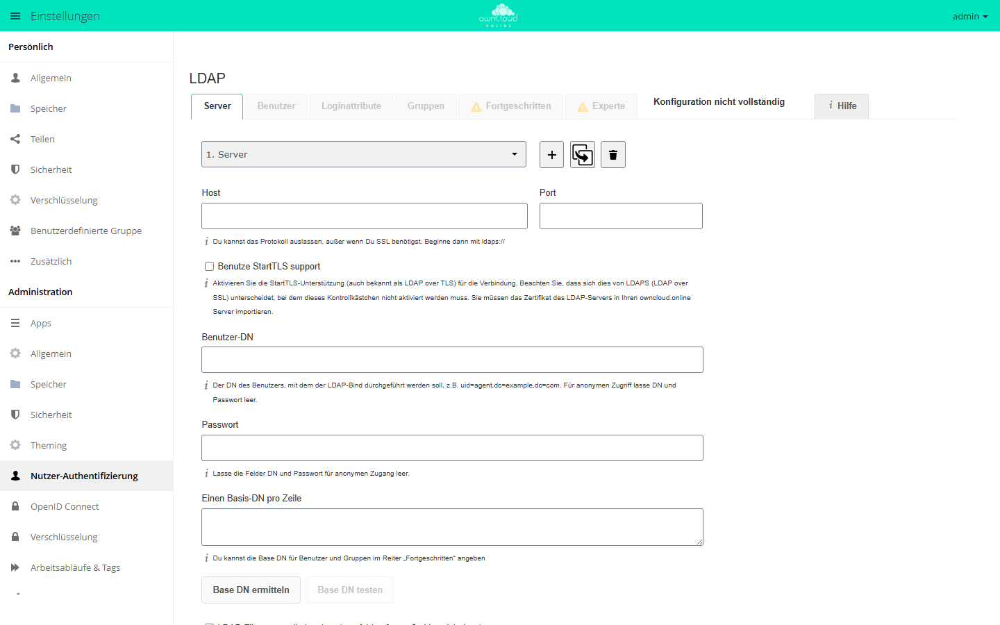

# Verzeichnisdienst (LDAP)

Die Anbindung an LDAP oder Active Directory ist keine Kernfunktion, sondern die
App `user_ldap` (*LDAP Integration*, Version 0.21.0, ohne API-Schlüssel im
Marktplatz). Sie meldet beim Server ein Benutzer- und ein Gruppen-Backend an,
holt Konten und Gruppen aus dem Verzeichnis und prüft Anmeldungen direkt gegen
den Verzeichnisserver. Passwörter werden nicht in owncloud.online gespeichert.
Ein Konto entsteht in der Kontentabelle erst, wenn es sich anmeldet oder wenn
ein Abgleich läuft. Installation und Kurzüberblick stehen auf der Plugin-Seite
[LDAP-Integration](../plugins/apps/user_ldap.md); diese Seite beschreibt alle
Felder, Filter und Schlüssel im Detail.

## App aktivieren

```bash
sudo -u www-data php8.4 occ market:install user_ldap
```

`market:install` lädt die App aus dem Marktplatz und schaltet sie ein. Liegt
sie schon im App-Verzeichnis, genügt `occ app:enable user_ldap`.

Die App braucht das PHP-Modul `ldap`. Ohne das Modul lässt sich die App nicht
einschalten. Fehlt es später, zeigt die Einstellungsseite den Hinweis „Da das
PHP-Modul für LDAP nicht installiert ist, wird das Backend nicht funktionieren“.
Prüfen lässt sich das mit:

```bash
php8.4 -m | grep ldap
```

Die Einstellungen liegen unter **Einstellungen → Administration →
Nutzer-Authentifizierung**. Die Seite hat vier Assistenten-Reiter, *Server*,
*Benutzer*, *Loginattribute* und *Gruppen*, sowie die beiden Bereiche
*Fortgeschritten* und *Experte*.

<figure markdown="span">
  
  <figcaption>Der LDAP-Assistent führt in Reitern durch Server, Benutzer, Loginattribute und Gruppen.</figcaption>
</figure>

## Mehrere Verzeichnisse: Konfigurations-IDs

Jede Verbindung liegt unter einem eigenen Präfix in `oc_appconfig` für die App
`user_ldap`. Neue Präfixe werden fortlaufend als `s01`, `s02`, … vergeben.
Diese ID ist das Argument `configID` der Konfigurationsbefehle
`ldap:show-config`, `ldap:set-config`, `ldap:test-config`,
`ldap:create-empty-config` und `ldap:delete-config`; `ldap:search`,
`ldap:check-user` und `ldap:invalidate-cache` kennen es nicht.

```bash
# neue, leere Konfiguration anlegen (ID wird vergeben oder vorgegeben)
sudo -u www-data php8.4 occ ldap:create-empty-config
sudo -u www-data php8.4 occ ldap:create-empty-config s02

# vorhandene Konfigurationen anzeigen
sudo -u www-data php8.4 occ ldap:show-config
```

Nur Konfigurationen mit `ldap_configuration_active = 1` werden beim Anmelden
und Suchen benutzt. Alle anderen überspringt die App stillschweigend.

## Verbindung und Zugangsdaten

Die ersten sechs Felder stehen im Reiter *Server*, die übrigen im Bereich
*Fortgeschritten*, Abschnitt *Verbindungseinstellungen*. Die Schlüsselnamen in
der Tabelle sind die Namen, die `ldap:set-config` erwartet.

| Schlüssel | Beschriftung | Vorgabe | Bedeutung |
| --- | --- | --- | --- |
| `ldap_host` | Host | leer | Hostname; das Protokoll darf fehlen, für SSL mit `ldaps://` beginnen |
| `ldap_port` | Port | leer | Port des Verzeichnisservers |
| `ldap_dn` | Benutzer-DN | leer | DN des Kontos, mit dem gebunden wird, etwa `uid=agent,dc=example,dc=com` |
| `ldap_agent_password` | Passwort | leer | Passwort dazu; für anonymen Zugriff bleiben DN und Passwort leer |
| `ldap_base` | Einen Basis-DN pro Zeile | leer | Basis der Suche, mehrzeilig |
| `ldap_tls` | Benutze StartTLS support | `0` | StartTLS auf der bestehenden Verbindung |
| `ldap_turn_off_cert_check` | Schalte die SSL-Zertifikatsprüfung aus. | `0` | setzt `LDAPTLS_REQCERT=never`, nur zum Testen |
| `ldap_backup_host` | Backup-Host (Kopie) | leer | Replikat, das bei Ausfall einspringt |
| `ldap_backup_port` | Port des Backup-Hosts (Kopie) | leer | ohne Angabe wird `ldap_port` verwendet |
| `ldap_override_main_server` | Hauptserver deaktivieren | leer | nur den Backup-Host ansprechen |
| `ldap_network_timeout` | Netzwerk-Zeitüberschreitung | `15` | Sekunden für alle LDAP-Netzoperationen |
| `ldap_cache_ttl` | Speichere Time-To-Live zwischen | `600` | Sekunden; eine Änderung leert den Cache |
| `ldap_configuration_active` | Konfiguration aktiv | `0` | ist der Wert `0`, wird die Verbindung übersprungen |

Drei Punkte, die die App beim Laden der Konfiguration selbst korrigiert oder
bemängelt:

- Beginnt `ldap_host` mit `ldaps://` und ist zugleich `ldap_tls` gesetzt, wird
  StartTLS automatisch abgeschaltet und ein Protokolleintrag geschrieben.
  Beides zusammen funktioniert nicht.
- Ein gesetzter Benutzer-DN ohne Passwort, oder umgekehrt, gilt als
  Konfigurationsfehler. Für anonymen Zugriff müssen beide Felder leer sein.
- Sind `ldap_base_users` beziehungsweise `ldap_base_groups` leer, wird
  `ldap_base` übernommen.

Setzen und Prüfen auf der Kommandozeile:

```bash
sudo -u www-data php8.4 occ ldap:set-config s01 ldap_host ldaps://dc01.example.org
sudo -u www-data php8.4 occ ldap:set-config s01 ldap_port 636
sudo -u www-data php8.4 occ ldap:set-config s01 ldap_dn "uid=agent,dc=example,dc=org"
sudo -u www-data php8.4 occ ldap:set-config s01 ldap_agent_password "geheim"
sudo -u www-data php8.4 occ ldap:set-config s01 ldap_base "dc=example,dc=org"
sudo -u www-data php8.4 occ ldap:set-config s01 ldap_configuration_active 1

sudo -u www-data php8.4 occ ldap:test-config s01
```

`ldap:set-config` nimmt sowohl die Datenbankschreibweise (`ldap_host`) als auch
die interne Schreibweise (`ldapHost`) an. Unbekannte Schlüssel verwirft der
Befehl ohne Fehlermeldung. Prüfen Sie deshalb nach jeder Änderung mit
`ldap:show-config`.

`ldap:show-config` zeigt die Werte unter der internen Schreibweise, etwa
`ldapHost` für `ldap_host` und `ldapAgentName` für `ldap_dn`. Das
Bind-Passwort ersetzt der Befehl durch `***`. Mit `--show-password` steht es im
Klartext in der Ausgabe, mit `--output=json_pretty` kommt die Konfiguration als
JSON.

## Benutzer- und Gruppenfilter

Reiter *Benutzer* und *Gruppen*. Beide Reiter bieten dieselbe Mechanik: eine
Auswahl von Objektklassen, eine Auswahl von Gruppen und darunter das Feld
*LDAP-Abfrage bearbeiten* für den Rohfilter.

| Schlüssel | Beschriftung | Bedeutung |
| --- | --- | --- |
| `ldap_userfilter_objectclass` | Nur diese Objektklassen: | Objektklassen für Benutzer, mehrzeilig |
| `ldap_userfilter_groups` | Nur aus diesen Gruppen: | Gruppen, deren Mitglieder Zugang erhalten |
| `ldap_userlist_filter` | LDAP-Abfrage bearbeiten | vollständiger Benutzerfilter |
| `ldap_user_filter_mode` | – | merkt sich, ob der Filter assistiert oder von Hand entstand |
| `ldap_groupfilter_objectclass` | Nur diese Objektklassen: | Objektklassen für Gruppen |
| `ldap_groupfilter_groups` | Nur aus diesen Gruppen: | Auswahl einzelner Gruppen über `cn` |
| `ldap_group_filter` | LDAP-Abfrage bearbeiten | vollständiger Gruppenfilter |
| `ldap_group_filter_mode` | – | wie oben, für den Gruppenfilter |

Der Assistent baut aus den Auswahlfeldern einen Filter zusammen: Die
Objektklassen werden mit `|` oder-verknüpft, die Gruppenzugehörigkeiten
ebenfalls, und beide Blöcke werden mit `&` und-verknüpft. Bleibt beim
Benutzerfilter alles leer, entsteht `(objectclass=*)`. Beim Gruppenfilter gibt
es diesen Ersatz nicht, dort bleibt der Filter dann leer. Für die
Gruppenauswahl auf der Benutzerseite muss der Server das Attribut `memberOf`
unterstützen.

Bei großen Verzeichnissen ist der Assistent der falsche Weg: Er fragt beim
Öffnen jedes Reiters den Server nach Objektklassen und Gruppen ab. Dafür gibt
es im Reiter *Server* das Kästchen **LDAP-Filter manuell eingeben (empfohlen
für große Verzeichnisse)** (`ldap_experienced_admin`), das diese Abfragen
unterbindet.

Prüfen lässt sich das Ergebnis mit den Schaltflächen *Einstellungen überprüfen
und Benutzer zählen* beziehungsweise *Einstellungen überprüfen und Gruppen
zählen* sowie auf der Kommandozeile:

```bash
sudo -u www-data php8.4 occ ldap:search "mustermann"
sudo -u www-data php8.4 occ ldap:search "" --limit=50
sudo -u www-data php8.4 occ ldap:search "vertrieb" --group
```

`ldap:search` durchsucht alle **aktiven** Konfigurationen. Bei Benutzern gibt
der Befehl „Anzeigename (interne Kennung)“ aus, bei Gruppen nur den Namen. Die
Vorgabe für `--limit` ist 15; `--offset` muss ein Vielfaches von `--limit`
sein, sonst bricht der Befehl mit einer Meldung ab.

## Anmeldefilter

Reiter *Loginattribute*. Er bestimmt, womit sich ein Benutzer anmelden darf.

| Schlüssel | Beschriftung | Vorgabe |
| --- | --- | --- |
| `ldap_loginfilter_username` | LDAP-/AD-Benutzername: | `1` |
| `ldap_loginfilter_email` | LDAP-/AD-E-Mail-Adresse: | `0` |
| `ldap_loginfilter_attributes` | Andere Attribute: | leer |
| `ldap_login_filter` | LDAP-Abfrage bearbeiten | leer |
| `ldap_login_filter_mode` | – | `0` |

Der Assistent setzt den Benutzerfilter und den Anmeldeteil zusammen zu
`(&<Benutzerfilter><Anmeldeteil>)`. Für den Benutzernamen wählt er das erste
vorhandene Attribut aus `uid`, `samaccountname`, `cn`; für die E-Mail-Adresse
entsteht `(|(mailPrimaryAddress=%uid)(mail=%uid))`.

Der Platzhalter `%uid` wird beim Anmelden durch den eingegebenen Namen ersetzt.
**Ein Anmeldefilter ohne `%uid` macht die gesamte Konfiguration ungültig.** Die
App lehnt sie ab und schreibt „login filter does not contain %uid place holder“
ins Protokoll.

Der Hinweistext am Kästchen *LDAP-/AD-E-Mail-Adresse* warnt vor einem
Trugschluss: Die Anmeldung per E-Mail-Adresse hier **abzuschalten** wirkt erst
zusammen mit der strengen Anmeldeprüfung, weil der Server andernfalls
zusätzlich über die E-Mail-Adresse in der Kontentabelle sucht. Diese Einstellung
steht in `config/config.php`:

```php
'strict_login_enforced' => true,
```

Damit prüft der Server beim Passwort ausschließlich den eingetippten
Anmeldenamen gegen das Backend; die zusätzliche Prüfung über die E-Mail-Adresse
in der Kontentabelle entfällt (siehe auch `config/config.sample.php`).

Zum Testen dient im selben Reiter das Feld *Loginnamen testen* mit der
Schaltfläche *Einstellungen überprüfen*: Es versucht, für den eingegebenen
Namen mit dem aktuellen Anmeldefilter einen DN zu ermitteln.

## Attributzuordnung

Bereich *Fortgeschritten*, Abschnitte *Ordnereinstellungen* und *Spezielle
Eigenschaften*.

| Schlüssel | Beschriftung | Vorgabe | Wirkung |
| --- | --- | --- | --- |
| `ldap_display_name` | Feld für den Anzeigenamen des Benutzers | `displayName` | Quelle des Anzeigenamens |
| `ldap_user_display_name_2` | 2. Benutzeranzeigename Feld | leer | wird in Klammern angehängt: `John Doe (john.doe@example.org)` |
| `ldap_group_display_name` | Feld für den Anzeigenamen der Gruppe | `cn` | Anzeigename der Gruppe |
| `ldap_email_attr` | E-Mail-Feld | leer | ist es leer, wird `mail` gelesen |
| `ldap_quota_attr` | Kontingent Feld | leer | Attribut mit dem Speicherkontingent |
| `ldap_quota_def` | Standard Kontingent | leer | greift, wenn das Attribut fehlt oder unbrauchbar ist |
| `home_folder_naming_rule` | Benennungsregel für das Home-Verzeichnis des Benutzers | leer | Attribut für den Pfad des Heimatverzeichnisses |
| `ldap_attributes_for_user_search` | Benutzersucheigenschaften | leer | zusätzliche Attribute, in denen die Benutzersuche sucht |
| `ldap_attributes_for_group_search` | Gruppensucheigenschaften | leer | dasselbe für Gruppen |
| `ldap_exposed_attributes_for_user` | Benutzerattribute wurden bloßgelegt | leer | Attribute, die andere Apps abfragen dürfen |

Zum Anzeigenamen: Liefert das Attribut keinen Wert, fällt die App auf die
Kennung des Kontos zurück, also auf den Wert von `ldap_expert_username_attr`,
ersatzweise auf die UUID.

Zum Kontingent prüft die App den gelesenen Wert. Gültig sind `none`,
`default`, eine Byte-Zahl wie `1234` und Angaben mit Einheit wie `1234 MB`. Die
Reihenfolge ist:

1. Wert aus `ldap_quota_attr`. Ist er unbrauchbar, landet
   „Invalid quota …“ im Protokoll.
2. sonst `ldap_quota_def`; ist auch der unbrauchbar, wieder ein
   Protokolleintrag.
3. sonst das Kontingent aus owncloud.online selbst.

Zum Heimatverzeichnis: Der Wert von `home_folder_naming_rule` wird intern mit
vorangestelltem `attr:` gespeichert. Ein relativer Pfad aus dem Attribut wird
unter das Datenverzeichnis gehängt, ein absoluter übernommen. Seit Version
0.20.4 muss der Pfad aber im Datenverzeichnis liegen oder in einem Verzeichnis,
das Sie in `config/config.php` ausdrücklich zulassen:

```php
'user_ldap.home_base_dirs' => ['/srv/homes'],
```

Liegt der Pfad außerhalb, weist die App ihn ab: Die Anmeldung scheitert, und im
Protokoll steht „Home dir <…> for uid <…> is outside of the data directory …
- refusing it“. Für Konten, die bereits ein Heimatverzeichnis haben, zählt das
gespeicherte Verzeichnis. Ist es zulässig, bleibt es in Gebrauch, auch wenn der
Wert aus LDAP außerhalb liegt. Ist es unzulässig, etwa die Wurzel `/`, das
Datenverzeichnis selbst, das Verzeichnis der Installation oder ein
Systemverzeichnis wie `/etc`, bleibt das Konto gesperrt.

Fehlt das Attribut am Eintrag, bricht die Anmeldung mit einer Ausnahme ab.
Diese Prüfung lässt sich abschalten:

```bash
sudo -u www-data php8.4 occ config:app:set user_ldap enforce_home_folder_naming_rule --value=false
```

Unter dem Feld *Benutzersucheigenschaften* steht der Hinweis „Jeder
Attributwert wird auf 191 Zeichen gekürzt“. Er bezieht sich auf die
Suchbegriffe, die aus diesen Attributen in die Kontentabelle geschrieben werden:
Der Server schneidet jeden davon nach 191 Zeichen ab.

### UUID

Die UUID identifiziert einen Eintrag dauerhaft, auch wenn sich sein DN ändert.
Ohne Vorgabe probiert die App der Reihe nach `entryuuid`, `nsuniqueid`,
`objectguid`, `guid` und `ipauniqueid` und merkt sich das erste Attribut, das
einen Wert liefert. Überschreiben lässt sich das im Bereich *Experte*,
Abschnitt *UUID-Erkennung überschreiben*:

| Schlüssel | Beschriftung | Vorgabe |
| --- | --- | --- |
| `ldap_expert_uuid_user_attr` | UUID-Attribute für Benutzer: | leer |
| `ldap_expert_uuid_group_attr` | UUID-Attribute für Gruppen: | leer |

Ein selbst gewähltes Attribut muss für Benutzer **und** Gruppen abrufbar und
eindeutig sein. Findet die App keine UUID, schreibt sie „Cannot determine UUID
for … Skipping.“ ins Protokoll und überspringt den Eintrag. Der Benutzer
existiert für owncloud.online dann nicht.

## Interner Benutzername

Bereich *Experte*, Abschnitt *Interner Benutzername*. Dieser Name ist die
Kennung, unter der ein Konto intern geführt wird.

Ohne Vorgabe wird er aus der UUID gebildet. Ist `ldap_expert_username_attr`
gesetzt, stammt er aus diesem Attribut. In beiden Fällen bereinigt die App den
Wert:

- Umschrift nach ASCII (`iconv` mit `TRANSLIT`),
- Leerzeichen werden zu `_`,
- alles außerhalb von `[a-zA-Z0-9+_.@-]` fällt weg.

Die Zuordnung interner Name ↔ UUID ↔ DN steht in den Tabellen
`oc_ldap_user_mapping` und `oc_ldap_group_mapping`. Der DN wird nur
zwischengespeichert; identifiziert wird über die UUID. Zieht ein Eintrag im
Verzeichnisbaum um, findet ihn die App über die UUID wieder und schreibt den
neuen DN in die Zuordnung. Das Konto bleibt dasselbe.

**Warum Sie den internen Benutzernamen nicht nachträglich ändern sollten:** Der
Erklärungstext im Bereich *Experte* nennt die Gründe selbst. Der interne Name
ist der Vorgabename des Heimatverzeichnisses, er ist Bestandteil aller
entfernten Adressen einschließlich der DAV-Dienste, und über ihn werden alle
Metadaten gespeichert und zugeordnet. Deshalb gilt: Ist die Zuordnung einmal
angelegt, bleibt sie. Änderungen an `ldap_expert_username_attr` oder an den
UUID-Attributen wirken ausschließlich auf **neu** zugeordnete Konten;
bestehende Zuordnungen rührt die App nicht an.

Aus demselben Grund sind die beiden Schaltflächen *LDAP-Benutzernamenzuordnung
löschen* und *LDAP-Gruppennamenzuordnung löschen* im Bereich *Experte* keine
Wartungswerkzeuge. Sie leeren die Zuordnungstabellen für **alle**
LDAP-Konfigurationen gleichzeitig und lassen überall Reste zurück. In einer
Produktivinstanz haben sie nichts zu suchen.

Wird für einen neuen Eintrag ein interner Name errechnet, den bereits ein Konto
aus einem anderen Backend trägt, verweigert die App die Zuordnung und schreibt
„Mapping collision for DN … Couldn't map to identifer“ ins Protokoll. Handelt
es sich um ein bestehendes LDAP-Konto, das wiederverwendet werden soll, lässt
sich das erlauben:

```bash
sudo -u www-data php8.4 occ config:app:set user_ldap reuse_accounts --value=yes
```

Zusätzlich gibt es die Systemeinstellung `ldapIgnoreNamingRules` in
`config/config.php`, die die Bereinigung oben vollständig abschaltet. Sie wird
bei der Installation der App auf `false` gesetzt. Steht sie auf `true`, sind
beliebige Zeichen in internen Namen erlaubt, mit allen Folgen für Pfade und
Adressen.

## Abgleich per Cron

Die App bringt **keinen** eigenen Hintergrund-Job für den Abgleich mit. Ohne
Abgleich entsteht ein Konto erst bei der ersten Anmeldung, und ein im
Verzeichnis gelöschtes Konto bleibt in owncloud.online bestehen. Der Abgleich
ist der Kernbefehl `user:sync`:

```bash
# welche Backends sind aktiv?
sudo -u www-data php8.4 occ user:sync --list

# vollständiger Abgleich
sudo -u www-data php8.4 occ user:sync ldap --missing-account-action=disable

# nur ein Konto
sudo -u www-data php8.4 occ user:sync ldap --uid=mmustermann --missing-account-action=disable
```

`ldap` ist die Kurzform für `OCA\User_LDAP\User_Proxy`. Weitere Optionen:

| Option | Wirkung |
| --- | --- |
| `--list` / `-l` | listet die aktiven Backend-Klassen auf |
| `--uid` / `-u` | gleicht nur das angegebene Konto ab |
| `--seenOnly` / `-s` | aktualisiert nur bereits bekannte Konten, statt das ganze Verzeichnis zu durchlaufen |
| `--showCount` / `-c` | zählt vorab, damit der Fortschrittsbalken ein Ziel hat |
| `--missing-account-action` / `-m` | `disable` oder `remove`, siehe unten |
| `--re-enable` / `-r` | entsperrt gesperrte Konten, die im Verzeichnis wieder vorhanden sind |

Geben Sie `--missing-account-action` immer an. Ohne die Option fragt der Befehl
nach, was mit fehlenden Konten geschehen soll. Im Terminal wartet er auf eine
Antwort; ist keine Eingabe möglich, etwa im Cron, nimmt er stillschweigend die
Vorgabe `disable`.

Eintrag in der Cron-Tabelle des Webserver-Benutzers, hier stündlich:

```bash
sudo crontab -u www-data -e
```

```
0  *  *  *  * /usr/bin/php8.4 /var/www/owncloud.online/occ user:sync ldap --missing-account-action=disable
```

Der Aufruf steht hier bewusst ohne `-f`: Mit `-f` müssten die Optionen des
Befehls durch `--` von den Optionen von PHP getrennt werden.

Das ist unabhängig vom allgemeinen `cron.php`, siehe
[Hintergrund-Jobs (Cron)](background-jobs.md). Bei großen Verzeichnissen läuft
ein voller Abgleich lange. Dann bietet es sich an, stündlich mit `--seenOnly`
und einmal täglich vollständig abzugleichen.

## Wenn ein Konto im Verzeichnis verschwindet

Das Konto verschwindet nicht von selbst. Was tatsächlich passiert:

1. **Sofort:** Die Anmeldung schlägt fehl. Die App sucht den Eintrag über den
   Anmeldefilter, bekommt keinen Treffer und lehnt das Passwort ab.
2. **Weiterhin vorhanden:** Kontozeile, Zuordnung in `oc_ldap_user_mapping`,
   Heimatverzeichnis, Dateien und Freigaben. Für andere Benutzer sieht das
   Konto unverändert aus, seine Freigaben funktionieren weiter.
3. **Beim nächsten `user:sync`:** Der Befehl vergleicht die Kontentabelle mit
   dem Backend und behandelt das fehlende Konto gemäß
   `--missing-account-action`.

| Wert | Folge |
| --- | --- |
| `disable` | Das Konto wird gesperrt. Anmeldung unmöglich, Daten und Freigaben bleiben erhalten. Taucht der Eintrag wieder auf, entsperrt `--re-enable` das Konto. |
| `remove` | Das Konto wird gelöscht, **mitsamt seinen Daten und Dateien**. Nicht rückgängig zu machen. |

Im Regelbetrieb gehört dort `disable` hin. `remove` verwenden Sie erst, wenn
geklärt ist, wer die Dateien des Kontos noch braucht; `occ files:transfer-ownership` überträgt
sie vorher an ein anderes Konto.

Einen Einzelfall klärt der Befehl der App:

```bash
sudo -u www-data php8.4 occ ldap:check-user mmustermann
```

Er antwortet entweder „The user is still available on LDAP.“ oder „The user
does not exist on LDAP anymore.“ und schlägt dann `occ user:delete` vor. Zwei
Einschränkungen: Der Name muss ein zugeordneter LDAP-Benutzer sein, sonst
kommt „The given user is not a recognized LDAP user.“. Und solange es
abgeschaltete LDAP-Konfigurationen gibt, verweigert der Befehl die Auskunft
(„Cannot check user existence, because disabled LDAP configurations are
present.“), weil er den Eintrag dann nicht zuverlässig ausschließen kann.
`--force` übergeht das.

Ein umgezogener Eintrag ist kein verschwundener Eintrag: Ändert sich nur der
DN, findet die App den Eintrag anhand der UUID wieder und schreibt den neuen DN
in die Zuordnung.

## occ-Befehle der App

Die App bringt acht Befehle mit:

| Befehl | Argumente und Optionen | Zweck |
| --- | --- | --- |
| `ldap:show-config` | `[configID]`, `--show-password`, `--output` | Konfiguration anzeigen; ohne ID alle |
| `ldap:set-config` | `configID configKey configValue` | einen Konfigurationswert setzen |
| `ldap:test-config` | `configID` | Konfiguration prüfen und Bind versuchen |
| `ldap:create-empty-config` | `[configID]` | leere Konfiguration anlegen |
| `ldap:delete-config` | `configID` | Konfiguration löschen |
| `ldap:search` | `search`, `--group`, `--limit`, `--offset` | Benutzer- oder Gruppensuche über die aktiven Konfigurationen |
| `ldap:check-user` | `ocName`, `--force` | prüfen, ob ein Konto im Verzeichnis noch existiert |
| `ldap:invalidate-cache` | – | den LDAP-Cache aller Backends leeren |

`ldap:test-config` kennt fünf Antworten:

| Ausgabe | Bedeutung |
| --- | --- |
| „Invalid configID“ | Die angegebene Konfigurations-ID gibt es nicht |
| „The configuration is valid and the connection could be established!“ | Alles in Ordnung |
| „The configuration is invalid. …“ | Pflichtangaben fehlen oder der Anmeldefilter enthält kein `%uid` |
| „The configuration is valid, but the Bind failed. …“ | Server erreichbar, aber Benutzer-DN oder Passwort falsch |
| „Your LDAP server was kidnapped by aliens.“ | unerwarteter Rückgabewert |

Pflichtangaben sind `ldap_host`, `ldap_port`, `ldap_display_name`,
`ldap_group_display_name`, `ldap_login_filter` sowie mindestens ein Basis-DN.
`ldap:test-config` behandelt die Konfiguration für den Test als aktiv. Ein
grünes Ergebnis heißt deshalb nicht, dass `ldap_configuration_active` gesetzt
ist. Der Rückgabewert ist nur bei „Invalid configID“ `1`, sonst immer `0`. In
Skripten werten Sie deshalb die Ausgabe aus.

## Weitere Schlüssel

| Schlüssel | Ort | Vorgabe | Wirkung |
| --- | --- | --- | --- |
| `user_ldap.enable_medial_search` | `config/config.php` | `false` | Suche auch mitten im Namen (`*eingabe*` statt `eingabe*`). Gilt für alle Verbindungen und kann große Verzeichnisse deutlich bremsen, wenn kein passender Index vorhanden ist. |
| `user_ldap.home_base_dirs` | `config/config.php` | leer | Liste zusätzlicher absoluter Verzeichnisse, in denen ein Heimatverzeichnis aus LDAP liegen darf. Das Datenverzeichnis gilt immer. |
| `ldapIgnoreNamingRules` | `config/config.php` | `false` | schaltet die Bereinigung interner Benutzernamen ab |
| `reuse_accounts` | App-Einstellung `user_ldap` | `no` | erlaubt, ein vorhandenes LDAP-Konto gleichen Namens weiterzuverwenden |
| `resolve_uid_by_legacy_dn` | App-Einstellung `user_ldap` | `true` | erkennt Konten wieder, deren DN in alter Schreibweise gespeichert wurde |
| `enforce_home_folder_naming_rule` | App-Einstellung `user_ldap` | `true` | bricht ab, wenn das Attribut für das Heimatverzeichnis am Eintrag fehlt |

App-Einstellungen werden über die Kernbefehle gelesen und gesetzt:

```bash
sudo -u www-data php8.4 occ config:app:get user_ldap reuse_accounts
sudo -u www-data php8.4 occ config:app:set user_ldap reuse_accounts --value=yes
```

## Fehlersuche

| Symptom | Ursache | Abhilfe |
| --- | --- | --- |
| Die `ldap:`-Befehle fehlen in `occ` | App nicht aktiviert | `occ app:enable user_ldap` |
| Warnung, das PHP-Modul für LDAP fehle | PHP-Erweiterung `ldap` nicht geladen | Modul nachinstallieren, PHP-FPM neu laden, mit `php8.4 -m` prüfen |
| `ldap:test-config` meldet „The configuration is invalid.“ | eine Pflichtangabe fehlt, oder der Anmeldefilter enthält kein `%uid` | Pflichtangaben mit `ldap:show-config` gegenprüfen; das Protokoll enthält die Zeile „Configuration Error (prefix …)“ mit dem fehlenden Feld |
| `ldap:test-config` meldet „the Bind failed“ | Benutzer-DN oder Passwort falsch, oder nur eines von beiden gesetzt | beide Felder füllen oder beide leeren (anonymer Zugriff) |
| Niemand kann sich anmelden, `ldap:test-config` ist grün | `ldap_configuration_active` steht auf `0`, die Verbindung wird übersprungen | `occ ldap:set-config s01 ldap_configuration_active 1` |
| Anmeldung mit Benutzernamen geht, mit E-Mail-Adresse nicht | `ldap_loginfilter_email` steht auf `0` (Vorgabe) | Kästchen *LDAP-/AD-E-Mail-Adresse* setzen und den Anmeldefilter neu erzeugen lassen |
| Geändertes Kontingent oder geänderte E-Mail-Adresse kommt nicht an | Werte liegen im Cache, `ldap_cache_ttl` (Vorgabe 600 s) | `occ ldap:invalidate-cache`, oder `ldap_cache_ttl` ändern; eine Änderung leert den Cache ebenfalls |
| Kontingent wird ignoriert | Wert im Attribut ist unbrauchbar | Protokoll enthält „Invalid quota <…>“; gültig sind `none`, `default`, `1234`, `1234 MB` |
| Ein Benutzer fehlt in der Liste, ohne Fehlermeldung | Protokoll enthält „Cannot determine UUID for … Skipping.“ | UUID-Attribut fest vorgeben (`ldap_expert_uuid_user_attr`) |
| Neuer Benutzer wird nicht angelegt | Protokoll enthält „Mapping collision for DN … Couldn't map to identifer“, der interne Name ist schon vergeben | Konto aus dem anderen Backend umbenennen; bei einem LDAP-Konto `occ config:app:set user_ldap reuse_accounts --value=yes` |
| Suche findet Benutzer nur beim Tippen der ersten Zeichen | Suchbegriffe werden nur hinten mit `*` ergänzt | `'user_ldap.enable_medial_search' => true` in `config/config.php`, Leistungsaufwand beachten |
| `ldap:check-user` bricht mit „Cannot check user existence“ ab | es gibt abgeschaltete LDAP-Konfigurationen | Konfiguration aktivieren oder löschen; ersatzweise `--force` |
| `user:sync` wartet auf eine Eingabe | ohne `--missing-account-action` fragt der Befehl, was mit fehlenden Konten geschehen soll | Option immer mitgeben, im Regelbetrieb `disable` |
| Anmeldung bricht mit „Home dir attribute can't be read from LDAP“ ab | `home_folder_naming_rule` verweist auf ein Attribut, das am Eintrag fehlt | Attribut pflegen oder `occ config:app:set user_ldap enforce_home_folder_naming_rule --value=false` |
| Anmeldung scheitert, im Protokoll „Home dir <…> for uid <…> is outside of the data directory …“ | Das Heimatverzeichnis aus LDAP liegt weder im Datenverzeichnis noch unter `user_ldap.home_base_dirs` | das Basisverzeichnis in `user_ldap.home_base_dirs` aufnehmen oder das Attribut im Verzeichnis korrigieren |
| StartTLS schaltet sich selbst ab | `ldap_host` beginnt mit `ldaps://`; beides zusammen geht nicht | so belassen, die Verbindung ist bereits verschlüsselt |
| Die Assistenten-Reiter brauchen sehr lange | der Assistent fragt Objektklassen und Gruppen beim Server ab | Kästchen *LDAP-Filter manuell eingeben* setzen und die Filter selbst schreiben |

Meldungen der App stehen im Serverprotokoll unter der App-Kennung `user_ldap`,
siehe [Serverprotokoll und Fehlermeldungen](logging.md).
