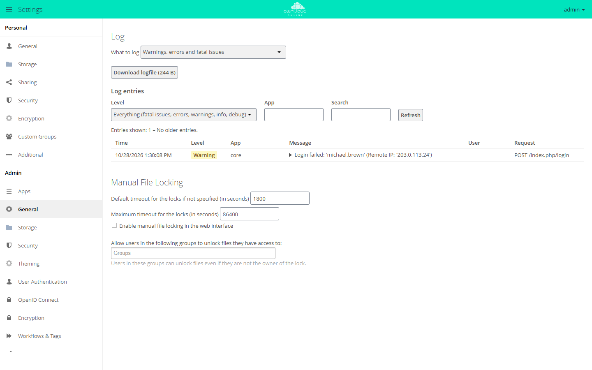

# Server log and error messages

When the interface reports "Internal Server Error", the actual cause is in the
server log. The request ID on the error screen leads you to the matching entry,
even on an instance with heavy traffic.

## Where to find the log

By default in the data directory:

```text
<datadirectory>/owncloud.log
```

The data directory is set in `config/config.php` under `datadirectory`
(`/var/oco-data` in the [installation guide](../installation/linux-server.en.md)).
`logfile` sets a different location:

```php
'logfile' => '/var/log/owncloud.online/owncloud.log',
```

The directory must be writable by the web server user. If the file cannot be
created there, the server keeps writing to `<datadirectory>/owncloud.log`.

Every line is a JSON object with these fields:

| Field | Meaning |
| --- | --- |
| `reqId` | **Request ID**, the same one the error screen shows |
| `level` | 0 = debug, 1 = info, 2 = warning, 3 = error, 4 = fatal |
| `time` | Timestamp |
| `remoteAddr` | Client address (behind a proxy, see [Reverse proxy and TLS](reverse-proxy.en.md)) |
| `user` | Affected account (or `--`) |
| `app` | App or component that wrote the entry |
| `method` / `url` | Endpoint called |
| `message` | Error message, for exceptions with class and stack trace |

## Finding the entry for an error message

The error screen shows a **request ID** under "Technical details" (for example
`ZXXTJzcZ10tDSMNjmlAf`). Use it to find the exact request in the log:

```bash
grep 'ZXXTJzcZ10tDSMNjmlAf' /var/oco-data/owncloud.log
```

Formatted for reading (with `jq`):

```bash
grep 'ZXXTJzcZ10tDSMNjmlAf' /var/oco-data/owncloud.log | jq '{time, level, app, method, url, message}'
```

Only the latest errors, regardless of a request ID:

```bash
tail -n 200 /var/oco-data/owncloud.log | jq 'select(.level >= 3) | {time, app, message}'
```

## The log in the web interface

Since 11.0.24, **Settings → Admin → General** shows the latest entries in the
"Log" section, newest first. At the top, you choose the log level ("What to
log") and download the file with "Download logfile (…)". Under "Log entries",
you filter by "Level" and "App" and search the entries with "Search". The
search also covers request IDs, user names, addresses, exception classes, and
stack traces, so the request ID from the error screen leads straight to the
entry. Clicking a message opens the details with exception, trace, request ID,
and remote address.

<figure markdown="span">



<figcaption>Under "Log" you choose what to log and read the latest entries. Failed logins appear as warnings with the IP address.</figcaption>
</figure>

Only administrators can use this view. It appears only if `log_type` is set to
`owncloud` (log written to a file) and the file already exists. With `syslog`
or `errorlog`, the "Log" section is missing.

For scripts and monitoring, `GET /index.php/settings/admin/log/entries`
returns the same data as JSON, with the parameters `offset`, `count` (1 to
200), `level`, `app`, and `search`. Authenticate with the browser session or
with HTTP basic auth using an administrator's password or app password. With a
memory cache configured, each administrator can make 60 requests per minute;
after that, the server answers with HTTP 429 and `Retry-After`.

## Configuring logging

```bash
# Detail level: 0 = debug ... 4 = fatal (default: 2)
sudo -u www-data php8.4 occ log:manage --level 1

# show the current settings
sudo -u www-data php8.4 occ log:manage

# Rotation: the default is 104857600 bytes (100 MB), here 500 MB
sudo -u www-data php8.4 occ config:system:set log_rotate_size --value 524288000 --type integer

# Turn rotation off if the system's logrotate handles the file
sudo -u www-data php8.4 occ config:system:set log_rotate_size --value 0 --type integer
```

`--level` also accepts the names `debug`, `info`, `warning`, `error`, and
`fatal`.

Rotation happens during a background job run: `owncloud.log` becomes
`owncloud.log.1`, and an older `owncloud.log.1` is overwritten. Together, the
logs therefore take up at most twice the configured size. Rotation at 100 MB
has been on by default since 11.0.20. Before that, the file grew without limit
as long as `log_rotate_size` was not set.

Turn on `--level 0` (debug) only temporarily for troubleshooting: it produces a
lot of entries and can contain details that should not be stored permanently.
Set it back to `2` afterwards.

## What belongs in an error report

So that a problem can be handled without follow-up questions:

1. The **request ID** from the error screen.
2. The **log lines** for this ID (see above), with the complete stack trace.
3. **Versions**: `occ status` (server) and the client version, if a client is
   involved.
4. **What exactly was done**, step by step, and whether it can be reproduced.
5. **When it last worked**, especially before or after an update.

Before sending, redact credentials, tokens, and personal paths. Since
11.0.25, `access_token`, `requesttoken`, and `password` appear in the logged
address only as `***`. Tokens in the path of an address (for example in
password reset links) and in message text are still there, as is everything
in logs from before the update.

## Common causes

### Internal server error right after an update

Almost always, the database migrations have not run yet. The code then expects
columns that do not exist in the database yet. Typical signs: the login or
individual areas fail with error 500, and the log shows an
`InvalidFieldNameException` or "no column named …".

```bash
sudo -u www-data php8.4 occ upgrade
```

If `occ upgrade` reports that the system is up to date even though migrations
are missing, you can run them one by one:

```bash
sudo -u www-data php8.4 occ migrations:status core
sudo -u www-data php8.4 occ migrations:execute core <version>
```

`occ upgrade` is a fixed part of every update, see
[Backups and updates](backups-updates.en.md).

### Maintenance mode stays on

```bash
sudo -u www-data php8.4 occ maintenance:mode --off
```

### Other symptoms

Login loops, JavaScript errors, missing plugin dependencies, and client login
problems are covered in [Troubleshooting](troubleshooting.en.md).
