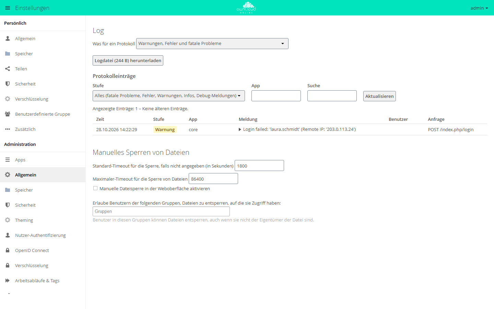

# Serverprotokoll und Fehlermeldungen

Meldet die Oberfläche „Interner Serverfehler“, steht der eigentliche Grund im
Serverprotokoll. Über die Anfragekennung auf dem Fehlerbildschirm finden Sie
den passenden Eintrag, auch auf einer Instanz mit vielen Zugriffen.

## Wo liegt das Protokoll

Standardmäßig im Datenverzeichnis:

```text
<datadirectory>/owncloud.log
```

Das Datenverzeichnis steht in `config/config.php` unter `datadirectory` (in der
[Installationsanleitung](../installation/linux-server.md) `/var/oco-data`).
Einen anderen Ort setzt `logfile`:

```php
'logfile' => '/var/log/owncloud.online/owncloud.log',
```

Das Verzeichnis muss für den Webserver-Benutzer beschreibbar sein. Lässt sich
die Datei dort nicht anlegen, schreibt der Server weiter nach
`<datadirectory>/owncloud.log`.

Jede Zeile ist ein JSON-Objekt mit diesen Feldern:

| Feld | Bedeutung |
| --- | --- |
| `reqId` | **Anfragekennung**, dieselbe, die der Fehlerbildschirm anzeigt |
| `level` | 0 = Debug, 1 = Info, 2 = Warnung, 3 = Fehler, 4 = Fatal |
| `time` | Zeitstempel |
| `remoteAddr` | Client-Adresse (hinter einem Proxy siehe [Reverse-Proxy und TLS](reverse-proxy.md)) |
| `user` | Betroffenes Konto (oder `--`) |
| `app` | App oder Bereich, der den Eintrag geschrieben hat |
| `method` / `url` | Aufgerufener Endpunkt |
| `message` | Fehlermeldung, bei Ausnahmen mit Klasse und Stack-Trace |

## Den Eintrag zu einer Fehlermeldung finden

Der Fehlerbildschirm zeigt unter „Technische Details“ eine **Anfragekennung**
(z. B. `ZXXTJzcZ10tDSMNjmlAf`). Damit finden Sie den genauen Vorgang im
Protokoll:

```bash
grep 'ZXXTJzcZ10tDSMNjmlAf' /var/oco-data/owncloud.log
```

Lesbar formatiert (mit `jq`):

```bash
grep 'ZXXTJzcZ10tDSMNjmlAf' /var/oco-data/owncloud.log | jq '{time, level, app, method, url, message}'
```

Nur die letzten Fehler ansehen, unabhängig von einer Kennung:

```bash
tail -n 200 /var/oco-data/owncloud.log | jq 'select(.level >= 3) | {time, app, message}'
```

## Protokoll in der Weboberfläche

Seit 11.0.24 zeigt **Einstellungen → Administration → Allgemein** im Abschnitt
„Log“ die neuesten Einträge an, neueste zuerst. Oben wählen Sie die
Protokollstufe („Was für ein Protokoll“) und laden die Datei über
„Logdatei (…) herunterladen“. Unter
„Protokolleinträge“ filtern Sie nach „Stufe“ und „App“ und durchsuchen die
Einträge über „Suche“. Die Suche erfasst auch Anfragekennungen, Benutzernamen,
Adressen, Ausnahmeklassen und Stack-Traces. Die Anfragekennung vom
Fehlerbildschirm führt also direkt zum Eintrag. Ein Klick auf eine Meldung
öffnet die Details mit Ausnahme, Trace, Anfragekennung und entfernter Adresse.

<figure markdown="span">



<figcaption>Unter „Log“ wählen Sie, was protokolliert wird, und lesen die letzten Einträge. Fehlgeschlagene Anmeldungen erscheinen als Warnung mit IP-Adresse.</figcaption>
</figure>

Die Ansicht steht nur Administratoren zur Verfügung. Sie erscheint nur, wenn
`log_type` auf `owncloud` steht (Protokoll als Datei) und die Datei schon
existiert. Mit `syslog` oder `errorlog` fehlt der Abschnitt „Log“.

Für Skripte und Überwachungswerkzeuge liefert
`GET /index.php/settings/admin/log/entries` dieselben Daten als JSON, mit den
Parametern `offset`, `count` (1 bis 200), `level`, `app` und `search`. Die
Anmeldung geht über die Browsersitzung oder HTTP-Basic mit Passwort oder
App-Passwort eines Administrators. Ist ein Zwischenspeicher eingerichtet, sind
je Administrator 60 Abfragen pro Minute möglich, danach antwortet der Server
mit HTTP 429 und `Retry-After`.

## Protokollierung einstellen

```bash
# Detailtiefe: 0 = Debug ... 4 = Fatal (Standard: 2)
sudo -u www-data php8.4 occ log:manage --level 1

# aktuelle Einstellungen anzeigen
sudo -u www-data php8.4 occ log:manage

# Rotation: Standard sind 104857600 Bytes (100 MB), hier 500 MB
sudo -u www-data php8.4 occ config:system:set log_rotate_size --value 524288000 --type integer

# Rotation abschalten, wenn das logrotate des Systems die Datei übernimmt
sudo -u www-data php8.4 occ config:system:set log_rotate_size --value 0 --type integer
```

`--level` nimmt auch die Namen `debug`, `info`, `warning`, `error` und `fatal`
an.

Rotiert wird bei einem Lauf der Hintergrund-Jobs: `owncloud.log` wird zu
`owncloud.log.1`, eine ältere `owncloud.log.1` wird dabei überschrieben. Die
Protokolle belegen zusammen also höchstens das Doppelte der eingestellten Größe.
Die Rotation bei 100 MB ist seit 11.0.20 ab Werk aktiv. Vorher wuchs die Datei
ohne Grenze, solange `log_rotate_size` nicht gesetzt war.

Schalten Sie `--level 0` (Debug) nur vorübergehend zur Fehlersuche ein: Es
erzeugt sehr viele Einträge und kann Details enthalten, die nicht dauerhaft
gespeichert werden sollten. Stellen Sie danach wieder `2` ein.

## Was in einen Fehlerbericht gehört

Damit sich ein Problem ohne Rückfragen bearbeiten lässt:

1. **Anfragekennung** vom Fehlerbildschirm.
2. **Protokollzeilen** zu dieser Kennung (siehe oben), mit vollständigem
   Stack-Trace.
3. **Versionen**: `occ status` (Server) und die Client-Version, falls betroffen.
4. **Was genau gemacht wurde**, Schritt für Schritt, und ob es sich wiederholen
   lässt.
5. **Wann es zuletzt funktioniert hat**, insbesondere vor oder nach einem
   Update.

Schwärzen Sie vor dem Versenden Zugangsdaten, Tokens und personenbezogene
Pfade. Seit 11.0.25 stehen `access_token`, `requesttoken` und `password` in der
protokollierten Adresse nur noch als `***`. Tokens im Pfad einer Adresse (etwa in
Links zum Zurücksetzen des Passworts) und im Text von Meldungen bleiben aber
stehen, ebenso alles in Protokollen von vor dem Update.

## Häufige Ursachen

### Interner Serverfehler direkt nach einem Update

Fast immer sind die Datenbank-Migrationen noch nicht gelaufen. Der Code erwartet
dann Spalten, die es in der Datenbank noch nicht gibt. Typisch: Die Anmeldung
oder einzelne Bereiche brechen mit Fehler 500 ab, im Protokoll steht eine
`InvalidFieldNameException` bzw. „no column named …“.

```bash
sudo -u www-data php8.4 occ upgrade
```

Meldet `occ upgrade`, das System sei aktuell, obwohl Migrationen fehlen, lassen
sie sich einzeln nachziehen:

```bash
sudo -u www-data php8.4 occ migrations:status core
sudo -u www-data php8.4 occ migrations:execute core <Version>
```

Nach jedem Update gehört `occ upgrade` fest zum Ablauf, siehe
[Backups und Updates](backups-updates.md).

### Wartungsmodus bleibt aktiv

```bash
sudo -u www-data php8.4 occ maintenance:mode --off
```

### Weitere Symptome

Anmeldeschleifen, JavaScript-Fehler, fehlende Plugin-Abhängigkeiten und
Anmeldeprobleme von Clients beschreibt [Troubleshooting](troubleshooting.md).
