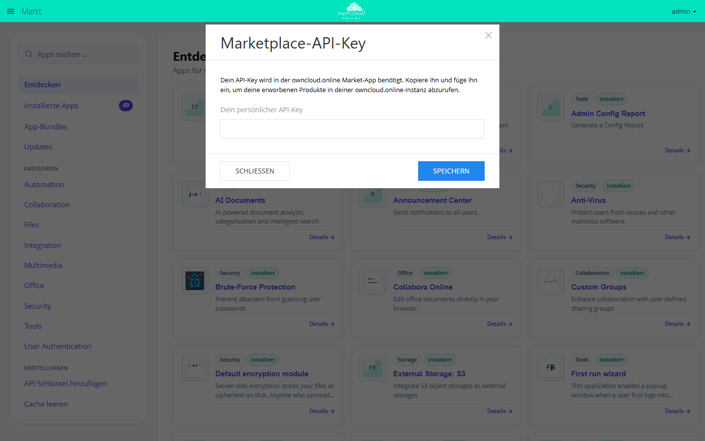

# Umzug auf einen anderen Server

Ein Umzug verschiebt eine bestehende Instanz auf neue Hardware oder zu einem
anderen Hoster. Drei Dinge gehören dabei untrennbar zusammen und müssen vom
**selben Zeitpunkt** stammen: das Datenverzeichnis, die Datenbank und
`config/config.php`. Passen sie nicht zusammen, verweisen Metadaten auf
Dateien, die es nicht gibt, oder umgekehrt.

Wechselt beim Umzug zugleich die Version, etwa von einem Server der Version
10.x auf owncloud.online 11, gelten zusätzlich die Punkte unter
[Umzug mit Versionswechsel](#versionswechsel).

## Voraussetzungen auf dem Zielserver {#voraussetzungen}

| Punkt | Anforderung |
| --- | --- |
| Code-Version | identisch zur Quelle (`occ status`), sonst zusätzlich [Schritt 6](#schritt-upgrade) (`occ upgrade`) |
| PHP | 8.4 mit denselben Erweiterungen |
| Datenbank | derselbe Typ wie in `dbtype`, siehe [Sonderfall](#datenbanktyp-wechseln); eine **leere** Datenbank für den Dump |
| Dienste | alles, worauf `config.php` verweist: `memcache.local` (APCu), `memcache.locking` mit dem Block `redis` |
| Pfade | am einfachsten dieselben Pfade wie bisher, für Code und Datenverzeichnis. Dann muss in [Schritt 7](#schritt-home-pfade) kein Home-Verzeichnis umziehen |

Die alte `config/config.php` wird übernommen, nicht neu erzeugt. Vier Werte
darin binden Datenbank und Datenverzeichnis an genau diese Instanz und dürfen
sich beim Umzug **nicht** ändern:

| Wert | Wofür er gebraucht wird | Folge, wenn ein neuer Wert drinsteht |
| --- | --- | --- |
| `secret` | Schlüssel, mit dem `OC\Security\Crypto` gespeicherte Zugangsdaten (Tabelle `credentials`, etwa für externen Speicher) und Anmelde-Token (Tabelle `authtoken`) ver- und entschlüsselt | App-Passwörter werden mit HTTP 401 abgewiesen, die Zwei-Faktor-Anmeldung per TOTP bricht mit HTTP 500 („HMAC does not match“) ab, externer Speicher meldet Anmeldefehler |
| `passwordsalt` | Prüfung älterer Passwort-Hashes | Konten mit solchen Hashes können sich nicht mehr anmelden |
| `instanceid` | Name des Ordners `appdata_<instanceid>` im Datenverzeichnis (Vorschaubilder, hochgeladene Theme-Bilder) und des Sitzungs-Cookies | hochgeladenes Logo und Anmelde-Hintergrund liefern HTTP 404, die Seiten verweisen aber weiter darauf; Vorschaubilder werden neu erzeugt |
| `version` | daran erkennt `occ upgrade`, von welcher Fassung die Datenbank kommt | bei einem Versionswechsel laufen Reparaturschritte, die nur beim Update von älteren Fassungen greifen, nicht mit, und der Markt wird nicht nach passenden App-Fassungen gefragt |

Eine frisch installierte oder neu bereitgestellte Instanz hat für alle vier
eigene Werte. Ihre `config.php` ist deshalb für einen Umzug unbrauchbar, auch
wenn alles andere darin stimmt.

## 1. Wartungsmodus auf dem alten Server {#schritt-wartungsmodus}

```bash
sudo -u www-data php8.4 /var/www/owncloud.online/occ maintenance:mode --on
```

Der Befehl setzt `maintenance` auf `true`; jede Web-Anfrage wird danach mit
HTTP 503 und der Wartungsseite beantwortet. Ein Abmelden erzwingt er nicht,
bestehende Sitzungen werden nicht verworfen. `occ` rät zusätzlich, den
Webserver anzuhalten („Please also consider to stop the web server …“). Für
eine konsistente Sicherung ist das der sichere Weg:

```bash
systemctl stop apache2
systemctl stop php8.4-fpm
```

Ebenso den Cron-Eintrag des alten Servers stilllegen, damit während der
Übertragung kein Hintergrund-Job mehr schreibt (siehe
[Hintergrund-Jobs (Cron)](background-jobs.md)).

## 2. Sicherung von Datenverzeichnis, Datenbank und config.php {#schritt-sicherung}

```bash
tar -czf /root/oco-data-$(date +%F).tar.gz /var/owncloud-online-data
mysqldump --single-transaction -u root -p owncloud_online \
  > /root/oco-db-$(date +%F).sql
cp /var/www/owncloud.online/config/config.php /root/oco-config-$(date +%F).php
```

Im Datenverzeichnis liegen neben den Benutzerdateien weitere Dateien, die zum
Betrieb gehören:

- die versteckte Markierungsdatei `.ocdata`,
- `.htaccess` (ebenfalls versteckt) und `index.html`, die bei der Installation
  angelegt werden und das Verzeichnis gegen Zugriffe aus dem Web schützen,
- je nach Konfiguration `owncloud.log`,
- bei aktiver Verschlüsselung die Schlüsselverzeichnisse `files_encryption/`,
- wenn `dbtype` auf `sqlite` steht, die Datenbankdatei selbst.

!!! warning "Versteckte Dateien"
    `cp /alt/* /neu/` überträgt keine Dateien, die mit einem Punkt beginnen.
    Fehlt danach `.ocdata`, meldet die Instanz „Dein Daten-Verzeichnis ist
    ungültig“. Immer `tar` oder `rsync -a` mit dem **Verzeichnis** als Quelle
    verwenden, nicht mit einem Platzhalter wie `*`.

Den Datenbankdump und die Sicherung des Datenverzeichnisses aufbewahren, bis
die [Prüfungen nach dem Umzug](#pruefen) erledigt sind. Bei einem
Versionswechsel verändert `occ upgrade` die Datenbank; was dabei verloren
geht, lässt sich nur aus dem alten Dump zurückholen.

## 3. Übertragung {#schritt-uebertragung}

```bash
# Benutzerdaten (Rechte, ACLs und erweiterte Attribute erhalten)
rsync -aAX /var/owncloud-online-data/ neu.example.com:/var/owncloud-online-data/

# Datenbankdump und die alte config.php
scp /root/oco-db-*.sql neu.example.com:/root/
scp /root/oco-config-*.php neu.example.com:/root/
```

Auf dem Zielserver den Dump in eine **leere** Datenbank einspielen und die alte
`config.php` an ihren Platz legen:

```bash
mysql -u root -p -e "DROP DATABASE IF EXISTS owncloud_online;
  CREATE DATABASE owncloud_online CHARACTER SET utf8mb4 COLLATE utf8mb4_general_ci;"
mysql -u root -p owncloud_online < /root/oco-db-2026-08-13.sql
cp /root/oco-config-2026-08-13.php /var/www/owncloud.online/config/config.php
chown www-data:www-data /var/www/owncloud.online/config/config.php
```

`DROP DATABASE` nimmt dem Datenbankbenutzer seine Rechte auf
`owncloud_online.*` nicht; MariaDB und MySQL behalten Rechte, die für eine
Datenbank vergeben wurden, auch über das Löschen hinweg.

!!! warning "Nicht in eine befüllte Datenbank einspielen"
    Der Dump enthält nur die Tabellen, die es auf dem alten Server gab.
    Tabellen, die schon in der Zieldatenbank stehen, etwa aus einer
    Probeinstallation mit `occ maintenance:install`, bleiben neben den
    importierten Daten liegen, und die App-Einträge des Dumps wissen nichts
    von ihnen. Später scheitert `occ app:enable` genau für die Apps, deren
    Tabellen so übrig geblieben sind (etwa `oc_announcements` oder
    `oc_files_antivirus`). Mit einer leeren Datenbank tritt das nicht auf.

!!! warning "Eigentümer von config.php"
    `occ` bricht ab, wenn es nicht unter dem Benutzer läuft, dem
    `config/config.php` gehört: „Console has to be executed with the user that
    owns the file config/config.php“. Bleibt die kopierte Datei bei `root`,
    scheitert schon der erste `sudo -u www-data`-Aufruf in Schritt 4. Deshalb
    folgt der `chown` direkt auf das Kopieren.

Der Anwendungscode wird nicht kopiert, sondern auf dem Zielserver frisch
entpackt (siehe [Leerer Linux-Server](../installation/linux-server.md)). Eine
Installation über `occ maintenance:install` ist für den Umzug nicht nötig.
Wird sie trotzdem ausgeführt, etwa um Webserver und PHP zu prüfen, die
Datenbank danach wie oben leeren.

Das Verzeichnis `apps-external` nimmt alle über den Markt nachinstallierten
Apps auf (`apps_paths`, Eintrag mit `'writable' => true`). Es liegt im
Codebaum und ist deshalb nicht in der Sicherung aus Schritt 2 enthalten:

- **Gleiche Version auf beiden Servern:** die Apps auf dem Zielserver erneut
  über den Markt installieren oder `apps-external` vom alten Server
  mitnehmen. Beides ergibt einen lauffähigen Stand. Aus dem Markt kommt dabei
  die neueste passende Fassung, die neuer sein kann als die auf dem alten
  Server.
- **Versionswechsel:** das alte `apps-external` **nicht** mitkopieren. Die
  Apps darin sind Fassungen für die alte Version. Liegt der Code einer App
  vor, passt aber nicht zur neuen Version, bricht `occ upgrade` mit „Upgrade
  is not possible“ ab, sofern der Markt keine passende Fassung liefert. Fehlt
  der Code dagegen, holt das Upgrade eine passende Fassung aus dem Markt oder
  schaltet die App ab (siehe [Umzug mit Versionswechsel](#versionswechsel)).

## 4. Anpassung der Konfiguration {#schritt-konfiguration}

Zwei Angaben gehören **vor** den ersten `occ`-Aufruf in die Datei: der
Datenbankzugang und das Datenverzeichnis. Ohne gültigen Datenbankzugang bricht
jeder Befehl beim ersten Datenbankzugriff ab. Ein falsches `datadirectory`
fällt nicht in jedem Fall auf. Steht kein Upgrade an, bricht jeder
`occ`-Aufruf außer `occ check` mit „Environment not properly prepared.“ ab,
wenn unter dem Pfad keine `.ocdata` liegt. Bei einem Versionswechsel entfällt
diese Prüfung bis nach dem Upgrade, und jeder Befehl, der Dateien anfasst,
arbeitet am falschen Ort. Beides direkt in `config/config.php` eintragen:

```php
'datadirectory' => '/var/owncloud-online-data',
'dbhost' => '127.0.0.1',
'dbname' => 'owncloud_online',
'dbuser' => 'owncloud_user',
'dbpassword' => 'CHANGE_ME',
```

`datadirectory` bleibt am besten der bisherige Pfad. Soll er sich ändern,
zunächst trotzdem den **alten** Pfad eintragen und das Datenverzeichnis dort
wiederherstellen; der Wechsel folgt in [Schritt 7](#schritt-home-pfade).

Die mitgebrachte Datei enthält auch `apps_paths` des alten Servers. Liegt der
Code auf dem Zielserver unter einem anderen Pfad, beide Einträge in derselben
Datei auf den neuen Code umstellen. Sonst sucht der Server Apps in einem
Verzeichnis, das es nicht gibt:

```php
'apps_paths' => [
  ['path' => '/var/www/owncloud.online/apps', 'url' => '/apps', 'writable' => false],
  ['path' => '/var/www/owncloud.online/apps-external', 'url' => '/apps-external', 'writable' => true],
],
```

`instanceid`, `passwordsalt`, `secret` und `version` bleiben unverändert
(siehe [Voraussetzungen](#voraussetzungen)). Weil die Datei im Wartungsmodus
gesichert wurde, steht darin auch `'maintenance' => true`. Das ist gewollt:
Die Instanz bleibt bis Schritt 8 gesperrt.

Danach lassen sich die übrigen Werte mit `occ` setzen:

```bash
# neuer Hostname (Index 0 überschreibt den ersten Eintrag,
# ein weiterer Index ergänzt die Liste)
sudo -u www-data php8.4 /var/www/owncloud.online/occ \
  config:system:set trusted_domains 0 --value=cloud.example.com

# Basis-URL für Cron, occ und alle darin erzeugten Links
sudo -u www-data php8.4 /var/www/owncloud.online/occ \
  config:system:set overwrite.cli.url --value=https://cloud.example.com

# Kontrolle
sudo -u www-data php8.4 /var/www/owncloud.online/occ config:list system
```

| Schlüssel | Warum er beim Umzug angefasst werden muss |
| --- | --- |
| `trusted_domains` | Fehlt der neue Hostname in der Liste, beantwortet der Server jede Anfrage über diesen Namen mit HTTP 400 und „Du greifst auf den Server über eine nicht vertrauenswürdige Domain zu.“ Die Prüfung greift nur im Web, nicht in `occ`. |
| `datadirectory` | Absoluter Pfad zum Datenverzeichnis auf dem **neuen** Server |
| `dbhost`, `dbname`, `dbuser`, `dbpassword` | Zugang zur neuen Datenbank; `dbtableprefix` unverändert lassen |
| `apps_paths` | Nur wenn der Code woanders liegt als auf dem alten Server |
| `overwrite.cli.url` | Sonst zeigen Links aus Cron-Mails und Benachrichtigungen weiter auf den alten Server |

Ändert sich zusätzlich der Unterpfad (Webroot), danach die `.htaccess` neu
schreiben lassen. Sie enthält die `ErrorDocument`-Pfade, die auf der
Kommandozeile aus `overwrite.cli.url` abgeleitet werden:

```bash
sudo -u www-data php8.4 /var/www/owncloud.online/occ maintenance:update:htaccess
```

Steht die Instanz hinter einem Reverse-Proxy, sind auch `trusted_proxies`,
`overwriteprotocol` und gegebenenfalls `overwritehost` zu prüfen, siehe
[Reverse-Proxy und TLS](reverse-proxy.md).

## 5. Rechte setzen {#schritt-rechte}

Der Webserver-Benutzer muss in das Datenverzeichnis schreiben können; das
Verzeichnis selbst darf für andere Benutzer nicht lesbar sein. Der Server
prüft das und versucht, die Rechte selbst auf 0770 zu setzen. Gelingt das
nicht, etwa weil das Verzeichnis noch `root` gehört, meldet er „Dein
Daten-Verzeichnis ist von anderen Benutzern lesbar“.

```bash
chown -R www-data:www-data /var/owncloud-online-data
chown -R www-data:www-data /var/www/owncloud.online
chmod 0770 /var/owncloud-online-data
chmod 0640 /var/www/owncloud.online/config/config.php
```

## 6. Upgrade bei einem Versionswechsel {#schritt-upgrade}

Stammt die Datenbank von einer älteren Version, meldet jeder `occ`-Aufruf
„… require upgrade - only a limited number of commands are available“. Dann
jetzt das Upgrade ausführen; bei gleicher Version entfällt der Schritt:

```bash
sudo -u www-data php8.4 /var/www/owncloud.online/occ upgrade
```

Weil der Wartungsmodus schon an ist, lässt `occ upgrade` ihn danach an. Die
Ausgabe aufbewahren: Sie nennt jede App, die mangels Code abgeschaltet wurde.
Das steht zusätzlich im Serverprotokoll (siehe
[Was danach zu prüfen ist](#pruefen)).

## 7. Home-Pfade und Reparaturschritte {#schritt-home-pfade}

Dieser Schritt läuft noch im Wartungsmodus.

Das Home-Verzeichnis jedes Kontos steht als absoluter Pfad in der Tabelle
`accounts` (Spalte `home`). Der Wert wird nur beim Anlegen des Kontos
geschrieben; ein späterer `user:sync` korrigiert ihn nicht. Hat sich der Pfad
des Datenverzeichnisses geändert, zeigen diese Einträge also weiter auf den
alten Ort. Zuerst prüfen, welche Wurzelverzeichnisse tatsächlich hinterlegt
sind:

```bash
sudo -u www-data php8.4 /var/www/owncloud.online/occ user:home:list-dirs
sudo -u www-data php8.4 /var/www/owncloud.online/occ user:home:list-users /alter/pfad
```

Stimmt der Pfad nicht, zieht `user:move-home` das Home-Verzeichnis um. Als
Argument wird das **übergeordnete** Verzeichnis angegeben. Der Befehl
deaktiviert das Konto, kopiert per `rsync`, trägt den neuen Pfad ein und
aktiviert das Konto wieder:

```bash
sudo -u www-data php8.4 /var/www/owncloud.online/occ \
  user:move-home alice /var/owncloud-online-data
```

Zwei Bedingungen des Befehls bestimmen die Reihenfolge des Umzugs. Das
bisherige Home-Verzeichnis muss im Dateisystem **noch vorhanden** sein, sonst
bricht er mit „Current user home … does not exist. Not mounted? Non local
storage?“ ab. Außerdem darf unter dem Zielverzeichnis noch **kein gefüllter**
Ordner des Kontos liegen, sonst meldet er „New user folder … is either not
readable or not empty“. Liegen die Dateien bereits am neuen Pfad, hilft der
Befehl deshalb nicht mehr.

Daraus folgt: Soll sich der Pfad des Datenverzeichnisses wirklich ändern, das
Datenverzeichnis zuerst unter dem **alten** Pfad wiederherstellen, dann Konto für
Konto mit `user:move-home` auf den neuen Pfad umziehen und erst danach
`datadirectory` anpassen. Der Befehl kopiert nur Home-Verzeichnisse. Alles
andere im Datenverzeichnis zieht er **nicht** mit um; es muss vor dem Umstellen
von `datadirectory` von Hand an den neuen Ort kopiert werden: `.ocdata`,
`.htaccess`, `index.html`, `appdata_<instanceid>/`, `avatars/`,
`files_encryption/` und `owncloud.log`. Das alte Home-Verzeichnis bleibt liegen
und muss von Hand gelöscht werden. Auf S3-Primärspeicher verweigert der Befehl
den Dienst. Am wenigsten Aufwand macht weiterhin der unveränderte Pfad.

Anschließend die Reparaturschritte laufen lassen. Sie funktionieren **nur** im
Wartungsmodus; ohne ihn bricht der Befehl mit „Turn on maintenance mode to use
this command.“ ab:

```bash
sudo -u www-data php8.4 /var/www/owncloud.online/occ maintenance:repair
```

Stammt der Datenbankdump aus einem laufenden Betrieb, können Sperreinträge aus
abgebrochenen Übertragungen enthalten sein. Das betrifft nur Instanzen ohne
`memcache.locking`: Steht dort Redis, liegen die Sperren im Cache und ziehen gar
nicht erst mit um.

```bash
sudo -u www-data php8.4 /var/www/owncloud.online/occ maintenance:file-locks --cleanup-expired
```

## 8. Wartungsmodus beenden und Dateibestand einlesen {#schritt-dateien-einlesen}

Zuerst den Wartungsmodus beenden, **dann** den Dateibestand einlesen. Der
Befehl `files:scan` gehört zur App `files`, und im Wartungsmodus lädt `occ`
keine Apps. Der Aufruf endet dort mit „There are no commands defined in the
"files" namespace.“ Den Webserver erst danach starten, damit sich niemand
anmeldet, bevor der Dateicache wieder zum Dateisystem passt:

```bash
sudo -u www-data php8.4 /var/www/owncloud.online/occ maintenance:mode --off
sudo -u www-data php8.4 /var/www/owncloud.online/occ files:scan --all
systemctl start php8.4-fpm
systemctl start apache2
```

Bei einem Versionswechsel vor dem Start des Webservers auch die Ersatz-Apps
installieren, siehe [Ersatz für alte Apps](#ersatz-apps).

Fehlen einzelne Dateien danach weiterhin in der Oberfläche, hilft
`occ files:scan --all --repair`. Der Lauf repariert abgehängte Cache-Einträge
und dauert deutlich länger.

## Was nicht mitgenommen wird {#nicht-enthalten}

Datenverzeichnis, Datenbank und `config.php` decken die Instanz ab, nicht aber
ihre Umgebung. Diese Punkte müssen auf dem Zielserver eigens eingerichtet
werden:

| Nicht enthalten | Folge, wenn es vergessen wird |
| --- | --- |
| Webserver- und TLS-Konfiguration | Instanz nicht oder nur unverschlüsselt erreichbar |
| Cron-Eintrag für `cron.php` | Papierkorb und Versionen werden nie aufgeräumt, Freigaben laufen nicht ab, es werden keine Mails verschickt |
| PHP-Erweiterungen und Dienste (APCu, Redis) | `config.php` verweist auf nicht vorhandene Caches |
| `apps-external` (über den Markt installierte Apps) | Apps fehlen oder sind deaktiviert. Bei gleicher Version neu installieren oder mitnehmen, bei einem Versionswechsel **nicht** mitnehmen (siehe [Schritt 3](#schritt-uebertragung)) |
| Protokolldatei außerhalb des Datenverzeichnisses (`logfile`) | Zielpfad existiert nicht, Protokoll läuft ins Leere |
| Systempakete, Firewall, Backup-Aufträge | Betrieb ist nicht abgesichert |

`instanceid`, `passwordsalt`, `secret` und `version` dagegen stehen in der
übernommenen `config.php` und dürfen sich nicht ändern.

## Was danach zu prüfen ist {#pruefen}

```bash
# Version, Installationszustand
sudo -u www-data php8.4 /var/www/owncloud.online/occ status

# Umgebungsabhängigkeiten (leere Ausgabe = in Ordnung)
sudo -u www-data php8.4 /var/www/owncloud.online/occ check

# Apps vollständig und aktiv
sudo -u www-data php8.4 /var/www/owncloud.online/occ app:list

# Apps, die das Upgrade mangels Code abgeschaltet hat (je App eine Zeile)
grep 'Upgrade: disabled app' /var/owncloud-online-data/owncloud.log

# Impressum und Datenschutzerklärung: Adressen zeigen auf die eigenen Seiten
sudo -u www-data php8.4 /var/www/owncloud.online/occ config:app:get core legal.imprint_url
sudo -u www-data php8.4 /var/www/owncloud.online/occ config:app:get core legal.privacy_policy_url

# Job-Liste mit "Last Run" je Job (ISO-Zeitstempel)
sudo -u www-data php8.4 /var/www/owncloud.online/occ background:queue:status

# Zeitpunkt des letzten Cron-Laufs (Unix-Zeit, sollte nur wenige Minuten zurückliegen)
sudo -u www-data php8.4 /var/www/owncloud.online/occ config:app:get core lastcron

# Home-Pfade zeigen auf das neue Datenverzeichnis
sudo -u www-data php8.4 /var/www/owncloud.online/occ user:home:list-dirs
```

Dazu kommen Prüfungen, die nur im laufenden Betrieb möglich sind:

1. Über den neuen Hostnamen anmelden.
2. Eine Datei hoch- und wieder herunterladen.
3. Einen bestehenden öffentlichen Link öffnen.
4. Externen Speicher öffnen, sofern eingerichtet. Dort zeigt sich, ob `secret`
   korrekt übernommen wurde. Ebenso ein App-Passwort und, falls genutzt, die
   Zwei-Faktor-Anmeldung prüfen.
5. Einen Sync-Client verbinden und eine Änderung in beide Richtungen prüfen.
6. Den Abschnitt „Sicherheits- & Einrichtungswarnungen“ unter
   **Einstellungen → Administration → Allgemein** durchgehen.
7. Mit der App [owncloud.online Theme](../plugins/apps/theme-owncloudonline.md):
   Eigenes Logo und Anmelde-Hintergrund müssen auf der Anmeldeseite und in der
   Kopfleiste erscheinen. Liefert das Bild HTTP 404, stimmt `instanceid` nicht
   (siehe [Voraussetzungen](#voraussetzungen)).

`occ maintenance:data-fingerprint` gehört **nicht** zum normalen Umzug. Der
Befehl signalisiert allen Clients, dass eine Sicherung eingespielt wurde, und
löst dort Konfliktdialoge aus. Er ist nur dann richtig, wenn Sie auf einen
älteren Datenstand zurückgegriffen haben.

## Sonderfall: Wechsel des Datenbanktyps {#datenbanktyp-wechseln}

Ein Umzug ist kein guter Anlass, gleichzeitig den Datenbanktyp zu wechseln.
Den früheren Befehl `db:convert-type` gibt es in owncloud.online 11 **nicht
mehr** (Changelog: „This experimental command is untested and unsupported and
therefore removed.“). Eine unterstützte Umwandlung der bestehenden Datenbank
gibt es damit nicht.

Praktisch bleiben zwei Wege:

**Typ beibehalten.** Der Umzug läuft wie oben; nur `dbhost`, `dbname`, `dbuser`
und `dbpassword` ändern sich. Steht `dbtype` auf `sqlite`, liegt die Datenbank
im Datenverzeichnis und zieht mit dem `rsync` aus Schritt 3 automatisch um. Für
den produktiven Betrieb ist SQLite ungeeignet, siehe [Datenbank](database.md).

**Neu aufsetzen.** Eine frische Installation mit dem Zieltyp anlegen:

```bash
sudo -u www-data php8.4 /var/www/owncloud.online/occ maintenance:install \
  --database mysql --database-name owncloud_online \
  --database-host 127.0.0.1 --database-user owncloud_user \
  --admin-user admin --data-dir /var/owncloud-online-data
```

Die Passwörter für Datenbank- und Administratorkonto fragt der Befehl
interaktiv ab, wenn `--database-pass` und `--admin-pass` fehlen. Anschließend die
Benutzerdateien in die Home-Verzeichnisse legen und mit `occ files:scan --all`
einlesen. Dabei geht viel verloren, und das muss vorher klar sein: Alles, was
nur in der Datenbank steht, ist danach weg, also Freigaben (Tabelle `share`),
Kommentare, Tags, Konten des internen Backends, Konfiguration von externem
Speicher sowie sämtliche App-Einstellungen. Auch `instanceid`, `passwordsalt`
und `secret` werden neu erzeugt, womit gespeicherte Zugangsdaten und
Anmelde-Token ungültig sind. Planen Sie diesen Weg getrennt vom Serverumzug und
nicht in derselben Wartung.

## Umzug mit Versionswechsel {#versionswechsel}

Wer beim Umzug zugleich die Version wechselt, bringt eine Datenbank mit, in der
Apps als eingeschaltet vermerkt sind, die es auf dem Ziel nicht gibt. Bei einem
Server der Version 10.x mit vielen Zusatz-Apps sind das leicht ein Dutzend.
Gegenüber dem Umzug ohne Versionswechsel kommt es auf diese Punkte an:

| Punkt | Warum |
| --- | --- |
| Dump in eine **leere** Datenbank ([Schritt 3](#schritt-uebertragung)) | Tabellen einer Probeinstallation bleiben sonst liegen und lassen später `occ app:enable` scheitern |
| `instanceid`, `passwordsalt`, `secret` **und** `version` aus der alten `config.php` ([Voraussetzungen](#voraussetzungen)) | App-Passwörter, TOTP und hochgeladene Bilder hängen an den ersten drei; `version` sagt dem Upgrade, woher die Datenbank kommt |
| altes `apps-external` nicht mitkopieren ([Schritt 3](#schritt-uebertragung)) | alte App-Fassungen mit Code brechen das Upgrade ab |
| `occ upgrade` vor den Reparaturschritten ([Schritt 6](#schritt-upgrade)) | vorher stehen nur wenige `occ`-Befehle zur Verfügung |
| Pfad des Datenverzeichnisses gleich lassen ([Schritt 7](#schritt-home-pfade)) | `user:move-home` zieht nur Home-Verzeichnisse um, nicht `appdata_<instanceid>/` und die übrigen Ordner |
| erst Wartungsmodus aus, dann `files:scan` ([Schritt 8](#schritt-dateien-einlesen)) | im Wartungsmodus gibt es den Befehl nicht |

Das Upgrade holt über den Markt passende Fassungen der Apps, deren Code fehlt.
Dafür braucht es eine Internetverbindung und den alten Wert von `version` in
`config.php`. Nur dann erkennt der Reparaturschritt „Upgrade app code from the
marketplace“ ein Kern-Update und fragt den Markt. Was der Markt nicht liefern
kann, war bis 11.0.18 ein Abbruchgrund: „Upgrade is not possible“, die Instanz
blieb im Wartungsmodus, und für jede App war ein `occ app:disable` von Hand
fällig.

Seit 11.0.19 hält eine App ohne Code das Upgrade nicht mehr auf. Sie kann
ohnehin nichts tun; von ihr ist nur der Eintrag „eingeschaltet“ übrig. Der
Reparaturschritt schaltet sie ab, nennt jede so abgeschaltete App in der
Ausgabe und läuft weiter. Ihre Daten (Einstellungen, Tabellen,
`installed_version`) bleiben in der Datenbank. Seit 11.0.21 richtet sich der
Hinweis danach, was der Markt zu der App gemeldet hat:

```
Repair warning: The following apps were enabled but have no code on this
server. They have been disabled so the upgrade can continue; their data stays
in the database: admin_audit, diagnostics
Repair warning: Not offered by the marketplace: admin_audit, diagnostics. To
use one of them again, put its code into an app directory, then run occ
app:enable <app> and occ upgrade.
```

| Antwort des Markts | Hinweis in der Ausgabe | Weg zurück |
| --- | --- | --- |
| führt die App nicht (etwa `admin_audit` oder `diagnostics`) | „Not offered by the marketplace“ | Code in ein App-Verzeichnis legen, `occ app:enable <app>`, dann `occ upgrade` |
| führt die App, hat aber keine Fassung für diesen Server | „Offered by the marketplace, but without a version for this server“ | sobald es eine passende Fassung gibt, aus dem Markt installieren, dann `occ upgrade` |
| nicht gefragt (kein Kern-Update, `upgrade.automatic-app-update` aus, keine Verbindung) | „The marketplace was not consulted for, or could not provide“ | wie in der ersten Zeile |

Im Serverprotokoll steht dieselbe Aussage für jede App einzeln, bei fehlender
Fassung samt dem Grund, den der Markt genannt hat. 11.0.19 und 11.0.20
schreiben stattdessen pauschal „install them from the marketplace if you still
need them“, auch für Apps, die der Markt gar nicht anbietet.

Nach `occ app:enable` bleibt die ganze Instanz im Zustand „Upgrade nötig“, bis
`occ upgrade` gelaufen ist, weil `installed_version` noch auf der alten Fassung
steht. Apps, die **mit** Code vorhanden sind, aber nicht zur Version passen,
bleiben ein Abbruchgrund: Dort gibt es etwas zu reparieren, und ein stilles
Abschalten würde es verdecken.

Abgeschaltet wird nur, was **wirklich** fehlt. Der Reparaturschritt prüft
vorher, dass jeder Pfad aus `apps_paths` lesbar ist und dass die App in keinem
davon einen Ordner hat:

- Ist ein Pfad nicht lesbar (nicht eingehängt, fehlende Rechte), wird keine
  App abgeschaltet. Die Ausgabe meldet „Apps without code are NOT disabled
  automatically because an app directory is missing or not readable“.
- Liegt für eine App ein Ordner ohne lesbare `appinfo/info.xml` da, bleibt
  diese App eingeschaltet („… but no readable appinfo/info.xml; it is not
  disabled automatically“).

In beiden Fällen bricht das Upgrade wie früher ab, denn dann ist der Code nur
gerade nicht erreichbar. Jede Abschaltung steht zusätzlich mit dem bisherigen
`enabled`-Wert im Serverprotokoll (`owncloud.log`, App `core`, Zeile beginnt
mit „Upgrade: disabled app“), auch wenn `occ upgrade --no-warnings` die
Konsolenwarnung unterdrückt.

### Ersatz für alte Apps {#ersatz-apps}

Manche Apps der alten Instanz gibt es in owncloud.online nur als Ersatz unter
anderem Namen. Ihre Einstellungen bleiben in der Datenbank liegen; der Ersatz
übernimmt sie, wenn er **nach** dem Upgrade zum ersten Mal installiert wird.
Die Ersatz-Apps gehören nicht zum Serverpaket, `occ upgrade` installiert sie
also nicht. Ohne den Schritt unten gelten nach dem Umzug weder die alten
Sperrwerte (nur die eingebaute Drosselung des Kerns) noch die alten
Passwortregeln.

| Alte App | Ersatz | Übernommen wird |
| --- | --- | --- |
| `security` (Server 10.0.3 bis 10.0.8) | `brute_force_protection` | Fehlversuche, Zeitfenster, Sperrdauer |
| `security` | `password_policy` | Mindestlänge, Groß- und Kleinbuchstaben, Ziffern, Sonderzeichen |
| `windows_network_drive` | `wnd` | Einhängungen mit ihren Anmeldearten, auch SFTP, WebDAV und SMB mit gespeicherten oder globalen Zugangsdaten (siehe [Externe Speicher aus Zusatz-Apps](#externe-speicher-zusatz-apps)) |

`brute_force_protection` und `password_policy` stehen ohne API-Schlüssel im
Markt, `wnd` nur mit API-Schlüssel (siehe
[Marktzugang der alten Instanz](#marktzugang)). `occ market:install` lädt eine
App herunter und schaltet sie ein. Der Befehl gehört zur Markt-App und steht
erst zur Verfügung, wenn der Wartungsmodus aus ist, also in
[Schritt 8](#schritt-dateien-einlesen) nach `maintenance:mode --off` und vor
dem Start des Webservers:

```bash
sudo -u www-data php8.4 /var/www/owncloud.online/occ market:install brute_force_protection
sudo -u www-data php8.4 /var/www/owncloud.online/occ market:install password_policy
sudo -u www-data php8.4 /var/www/owncloud.online/occ market:install wnd
```

Steht `security` in der Warnung von `occ upgrade`, nicht im Markt nach
`security` suchen, sondern die beiden Ersatz-Apps installieren. Liegt der Code
einer Ersatz-App schon in einem App-Verzeichnis, genügt `occ app:enable <app>`.
Was übernommen wurde, steht im Serverprotokoll (App `brute_force_protection`
bzw. `password_policy`). Beide Apps wenden die Werte auch auf Passwörter
öffentlicher Links an, `security` nur auf Konten. Einzelheiten stehen auf den
Seiten [Brute-Force-Schutz](../plugins/apps/brute_force_protection.md) und
[Passwortrichtlinie](../plugins/apps/password_policy.md). Für
`windows_network_drive` gilt dasselbe: Die Einhängungen bleiben in der
Datenbank und greifen wieder, sobald `wnd` installiert ist (siehe
[Windows-Netzlaufwerk (Custom)](../plugins/apps/wnd.md)).

### Datenverzeichnis unter neuem Pfad {#neuer-datenpfad}

Der Pfad des Datenverzeichnisses steht an zwei Stellen in der Datenbank: in
`accounts.home` jedes Kontos und in den Kennungen pfadbasierter Speicher in
`storages` (`local::<pfad>/`). Liegen die Dateien auf dem Zielserver schon
unter dem neuen Pfad, zeigen die Home-Pfade ins Leere. Das ist der Regelfall,
wenn der Zielserver eine eigene Verzeichnisstruktur hat. Die Benutzer können
sich anmelden, sehen aber keine Dateien, und unter dem alten Pfad entstehen
leere Home-Verzeichnisse. `user:move-home` hilft dann nicht mehr (siehe
[Schritt 7](#schritt-home-pfade)).

Stattdessen die Einträge **vor** `occ upgrade` umschreiben. Beispiel für
MariaDB mit altem Pfad `/var/www/cloud/data`, neuem Pfad
`/var/owncloud-online-data` und Tabellenpräfix `oc_`:

```sql
-- Home-Pfade: nur echte Präfixtreffer umschreiben, kein REPLACE() über die ganze Zeichenkette
UPDATE oc_accounts
   SET home = CONCAT('/var/owncloud-online-data', SUBSTR(home, CHAR_LENGTH('/var/www/cloud/data') + 1))
 WHERE SUBSTR(home, 1, CHAR_LENGTH('/var/www/cloud/data') + 1) = '/var/www/cloud/data/';
```

Speicherkennungen, die länger als 64 Zeichen wären, legt der Server als
MD5-Wert ab. Ein `REPLACE()` auf `storages.id` findet solche Zeilen nicht und
erzeugt bei einem langen neuen Pfad eine Kennung, nach der der Server nie
sucht. Die Kennungen deshalb vorher so berechnen, wie der Server es tut:

```bash
sid() { php -r '$i = $argv[1]; echo strlen($i) > 64 ? md5($i) : $i, "\n";' "$1"; }
sid 'local::/var/www/cloud/data/'          # bisherige Kennung der Wurzel
sid 'local::/var/owncloud-online-data/'    # neue Kennung der Wurzel
```

```sql
-- Wurzel des Datenverzeichnisses; entfällt dieser Schritt, liest der Server sie neu ein
UPDATE oc_storages SET id = '<neue Kennung>' WHERE id = '<bisherige Kennung>';
```

Nur umschreiben, solange es die neue Kennung noch nicht gibt; sonst lief der
Server schon mit dem neuen Pfad. Nicht angefasst werden müssen die
Home-Speicher (`home::<konto>`, unabhängig vom Pfad) und die
Upload-Zwischenverzeichnisse (`local::<pfad>/<konto>/uploads/`, nach dem Umzug
entstehen neue).

**Lokale Einhängungen:** Ändert sich der Pfad einer Einhängung vom Typ
`local` (Tabelle `external_config`, Schlüssel `datadir`), muss ihre Kennung
in `storages` im selben Zug umgeschrieben werden: `local::<alter pfad>/` zu
`local::<neuer pfad>/`, ebenfalls nach der MD5-Regel. Sonst liest der Server die
Einhängung als neuen Speicher ein. Ist sie verschlüsselt, geht dabei für jede
Datei die Versionsangabe der Verschlüsselung verloren, und Dateien, die mehr als
einmal geschrieben wurden, scheitern mit „Bad Signature“. Nachträglich hilft
`occ encryption:fix-encrypted-version <konto> -p <pfad>` (App `encryption` ab
2.0.9). Lokale Einhängungen werden außerdem nur eingehängt, wenn
`files_external_allow_create_new_local` auf `true` steht.

### Externe Speicher aus Zusatz-Apps {#externe-speicher-zusatz-apps}

Jede Einhängung steht mit ihrer Backend- und Anmeldekennung in
`external_mounts`. Einige Kennungen, die Server der Version 10.x verwenden,
stellt der Kern nicht selbst bereit:

| Kennung | Spalte | stammt aus der App | Ersatz |
| --- | --- | --- | --- |
| `password::logincredentials`, `password::global`, `password::userprovided`, `password::hardcodedconfigcredentials`, `kerberos::kerberos` | `auth_backend` | `windows_network_drive` | App `wnd`; sie übernimmt die Kennungen auch für SFTP, WebDAV und SMB |
| `windows_network_drive`, `windows_network_drive2` | `storage_backend` | `windows_network_drive` | App `wnd` |
| `ftp` | `storage_backend` | `files_external_ftp` | kein Ersatz |
| `files_external_dropbox` | `storage_backend` | `files_external_dropbox` | kein Ersatz |

Solange eine Kennung fehlt, bleibt die Zeile unverändert in der Datenbank, die
Einhängung ist aber unbrauchbar. `occ files_external:list` zeigt „Unknown auth
mechanism backend …“ oder „Unknown storage backend …“. Einhängungen mit
fehlender Anmeldeart erscheinen bei den Benutzern gar nicht, solche mit
fehlendem Backend als leerer Ordner, in den sich nicht schreiben lässt
(HTTP 503). Sobald `wnd` installiert und eingeschaltet ist, werden die
Anmeldekennungen wieder aufgelöst. Welche Einhängungen betroffen sind, schon
vor dem Umzug in der alten Datenbank abfragen:

```sql
SELECT mount_id, mount_point, storage_backend, auth_backend
  FROM oc_external_mounts
 WHERE auth_backend IN ('password::logincredentials', 'password::global', 'password::userprovided',
                        'password::hardcodedconfigcredentials', 'kerberos::kerberos')
    OR storage_backend IN ('windows_network_drive', 'windows_network_drive2', 'ftp', 'files_external_dropbox');
```

Die SharePoint-Einbindung der Version 10.x legte ihre Einhängungen in eigenen
Tabellen ab (`sp_*`); auch dafür gibt es keinen Ersatz.

### Kein Rückweg auf die Version 10.x {#kein-rueckweg}

Nach dem Upgrade schreibt der Server Daten in Formaten, die ein Server der
Version 10.x nicht lesen kann:

- Gespeicherte Geheimnisse (Passwörter externer Speicher in der Tabelle
  `credentials`, App-Passwörter in `authtoken`) verschlüsselt der Kern im
  Format `v3`; 10.x kennt nur `v2` und das ältere dreiteilige Format.
- Mit der App `encryption` bekommt jede neu geschriebene oder neu geteilte
  Datei einen Schlüsselumschlag im Format v2 und eine Signatur des letzten
  Blocks ohne den Zusatz „end“. Beides lehnt die Verschlüsselungs-App der
  Version 10.x ab.

Zurück geht es deshalb nur über die Sicherung von Datenbank,
Datenverzeichnis und `config.php` von **vor** dem Umzug
([Schritt 2](#schritt-sicherung)); was danach geschrieben wurde, fehlt dort.
Für einen Probebetrieb die alte Instanz unverändert weiterlaufen lassen und den
Umzug an einer Kopie üben.

### Neue Adresse: föderierte Freigaben und vertrauenswürdige Server {#neue-adresse}

Partnerserver speichern die Adresse, unter der diese Instanz beim Anlegen
einer föderierten Freigabe erreichbar war; vertrauenswürdige Server speichern
sie ebenso. Ändert sich die Adresse beim Umzug, laufen die Rückmeldungen der
Partner (Freigabe annehmen, ablehnen, aufheben), deren Zugriff auf von hier
geteilte Ordner und der Adressbuchabgleich zwischen vertrauenswürdigen Servern
ins Leere. Am sichersten bleibt die alte Adresse: in `trusted_domains` und
`overwrite.cli.url` eintragen und den DNS-Eintrag auf den neuen Server zeigen
lassen. Muss sich die Adresse ändern, die Partner vorher informieren und
föderierte Freigaben neu anlegen. Ob Partnerserver einer Weiterleitung von der
alten Adresse folgen, wurde nicht getestet.

### Marktzugang der alten Instanz {#marktzugang}

`upgrade.automatic-app-update` steht ohne Eintrag in `config.php` auf `true`.
Dann fragt der Reparaturschritt „Upgrade app code from the marketplace“
während `occ upgrade` den Markt unter `appstoreurl` ab und schickt den
übernommenen API-Schlüssel mit (App-Wert `market`/`key` oder
`marketplace.key` aus `config.php`, als Kopfzeile `Authorization: apikey: …`).
Steht in der alten `config.php` noch die Adresse des früheren Markts, geht die
Anfrage samt Schlüssel dorthin. Ohne `appstoreurl` geht sie an
marketplace.owncloud.online. Einen Schlüssel des früheren Markts deshalb vor
dem Upgrade entfernen und `appstoreurl` prüfen. Die Befehle stehen auch im
Upgrade-Zustand zur Verfügung:

```bash
sudo -u www-data php8.4 /var/www/owncloud.online/occ config:app:delete market key
sudo -u www-data php8.4 /var/www/owncloud.online/occ config:system:delete marketplace.key
sudo -u www-data php8.4 /var/www/owncloud.online/occ config:system:get appstoreurl
```

Für Apps, die im Markt nur mit API-Schlüssel sichtbar sind, etwa `wnd`,
brauchen Sie einen Schlüssel der BW-Tech GmbH; Sie erhalten ihn auf Anfrage.
Eingetragen wird er in der Markt-App unter
**Einstellungen → API Schlüssel hinzufügen**; der Markt prüft ihn und lädt
danach den Katalog neu. Auf der Kommandozeile geht es mit
`occ config:app:set market key --value=<schlüssel>`, danach im Markt
**Cache leeren** wählen. Einzelheiten stehen unter
[API-Schlüssel eintragen](../plugins/apps/market.md#api-schluessel).



Schlägt die Abfrage beim Markt fehl, steht der genaue Grund im
Serverprotokoll, siehe [Serverprotokoll und Fehlermeldungen](logging.md). Der
vollständige Ablauf für Sicherung und Rückweg ist unter
[Backups und Updates](backups-updates.md) beschrieben.

## Fehlersuche {#fehlersuche}

| Symptom | Ursache | Abhilfe |
| --- | --- | --- |
| „Du greifst auf den Server über eine nicht vertrauenswürdige Domain zu.“, HTTP 400 | Neuer Hostname fehlt in `trusted_domains` | `occ config:system:set trusted_domains 0 --value=cloud.example.com`; die Prüfung greift nicht in `occ`, der Befehl läuft also trotzdem |
| „Dein Daten-Verzeichnis ist ungültig“ im Browser, bei `occ` „Environment not properly prepared.“ | `.ocdata` fehlt: Versteckte Dateien wurden beim Kopieren ausgelassen oder beim Wechsel des Datenpfads nicht mitgenommen, oder `datadirectory` zeigt auf einen falschen Pfad | `datadirectory` prüfen; Datenverzeichnis erneut mit `tar` oder `rsync -a` übertragen |
| „Dein Datenverzeichnis muss ein absoluter Pfad sein“ | `datadirectory` relativ eingetragen | Absoluten Pfad in `config/config.php` setzen |
| „Dein Daten-Verzeichnis ist von anderen Benutzern lesbar“ | Rechte zu offen, und der Webserver-Benutzer kann sie nicht selbst ändern, weil ihm das Verzeichnis nicht gehört | `chown -R www-data:www-data` und `chmod 0770` auf das Datenverzeichnis ([Schritt 5](#schritt-rechte)) |
| `occ` bricht mit Datenbankfehler ab | `dbhost`/`dbname`/`dbuser` zeigen noch auf den alten Server | Werte in `config/config.php` korrigieren, dann erneut aufrufen |
| „There are no commands defined in the "files" namespace.“ bei `files:scan` | Wartungsmodus ist noch an, `occ` lädt dann keine Apps | `occ maintenance:mode --off`, dann `files:scan` wiederholen |
| `occ app:enable wnd` meldet „wnd not found“ | Der Code der App liegt in keinem App-Verzeichnis | `occ market:install wnd`; `wnd` ist nur mit API-Schlüssel sichtbar, den Schlüssel also vorher eintragen ([Marktzugang](#marktzugang)) |
| Konten vorhanden, aber ohne Dateien | Gespeicherte Home-Pfade zeigen auf das alte Datenverzeichnis | `occ user:home:list-dirs` prüfen; `occ user:move-home` nur, solange die Dateien noch am alten Pfad liegen, danach `occ files:scan --all`. Liegen sie schon am neuen Pfad, siehe [Datenverzeichnis unter neuem Pfad](#neuer-datenpfad) |
| Dateien liegen auf der Platte, fehlen aber in der Oberfläche | Dateicache kennt sie nicht | `occ files:scan --all`, bei abgehängten Einträgen `--repair` ergänzen |
| App-Passwörter mit HTTP 401 abgewiesen, TOTP-Anmeldung mit HTTP 500 „HMAC does not match“ | `secret`/`passwordsalt` stammen nicht aus der alten `config.php` | Ursprüngliche Werte eintragen; ohne sie müssen App-Passwörter und TOTP neu eingerichtet werden |
| Externer Speicher meldet Anmeldefehler | `secret` weicht ab, weil `config.php` neu erzeugt wurde | Ursprüngliche `config.php` einspielen; sonst Zugangsdaten neu hinterlegen |
| Logo und Anmelde-Hintergrund fehlen, Bildaufruf liefert HTTP 404 | `instanceid` geändert, die Bilder liegen unter `appdata_<alte instanceid>/` | Alte `instanceid` eintragen |
| Standard-Aussehen statt des eigenen Brandings | Die Theme-App fehlt auf dem neuen Server oder wurde beim Upgrade mangels Code abgeschaltet (Zeile „Upgrade: disabled app theme-owncloudonline“ im `owncloud.log`) | `occ market:install theme-owncloudonline` (im Markt nur mit API-Schlüssel) oder den Code in ein App-Verzeichnis legen, dann `occ app:enable theme-owncloudonline` und `occ upgrade`. Ihre Einstellungen stehen noch in der Datenbank |
| Fußzeile verlinkt auf ein falsches Impressum | In `core/legal.imprint_url` steht noch ein alter Wert | `occ config:app:set core legal.imprint_url --value=…` oder `occ config:app:delete core legal.imprint_url` |
| `occ app:enable <app>` scheitert nach dem Import | Tabellen einer Probeinstallation liegen neben dem Dump | Dump erneut in eine leere Datenbank einspielen ([Schritt 3](#schritt-uebertragung)) |
| Links in Mails zeigen auf den alten Server | `overwrite.cli.url` nicht angepasst | Wert setzen; die Links werden beim nächsten Cron-Lauf neu erzeugt |
| Papierkorb wächst, keine Benachrichtigungen | Cron-Eintrag wurde nicht übernommen | Cron auf dem neuen Server einrichten, `occ config:app:get core lastcron` prüfen |
| „Turn on maintenance mode to use this command.“ | `maintenance:repair` ohne Wartungsmodus aufgerufen | `occ maintenance:mode --on`, Befehl wiederholen |
| Oberfläche zeigt dauerhaft den Wartungsmodus | `maintenance` steht noch auf `true` | `occ maintenance:mode --off` |
| Uploads scheitern mit Sperrfehlern | Sperreinträge aus abgebrochenen Übertragungen im Dump (nur ohne `memcache.locking`) | `occ maintenance:file-locks --cleanup-expired` |
| `occ upgrade` bricht mit „Upgrade is not possible“ ab und nennt Apps, die es auf dem neuen Server nicht gibt | Die Datenbank kommt von einer älteren Instanz mit Apps, deren Code auf dem Ziel fehlt. Ab 11.0.19 bricht das Upgrade daran nur noch ab, wenn ein Pfad aus `apps_paths` nicht lesbar ist | Bis 11.0.18: je App `occ app:disable <app>` (der Befehl steht auch im Upgrade-Zustand zur Verfügung), dann `occ upgrade` erneut. Ab 11.0.19: den Pfad lesbar machen (Einhängung, Rechte, `apps_paths`), dann `occ upgrade` erneut |
| `occ upgrade` bricht mit „Upgrade is not possible“ ab und nennt Apps, deren Ordner es gibt | Alte App-Fassungen aus dem mitkopierten `apps-external` passen nicht zur neuen Version, oder ein App-Ordner hat keine lesbare `appinfo/info.xml` | Altes `apps-external` entfernen und das frische aus dem Paket verwenden; einen Ordner ohne lesbare `info.xml` reparieren oder entfernen; dann `occ upgrade` wiederholen |
