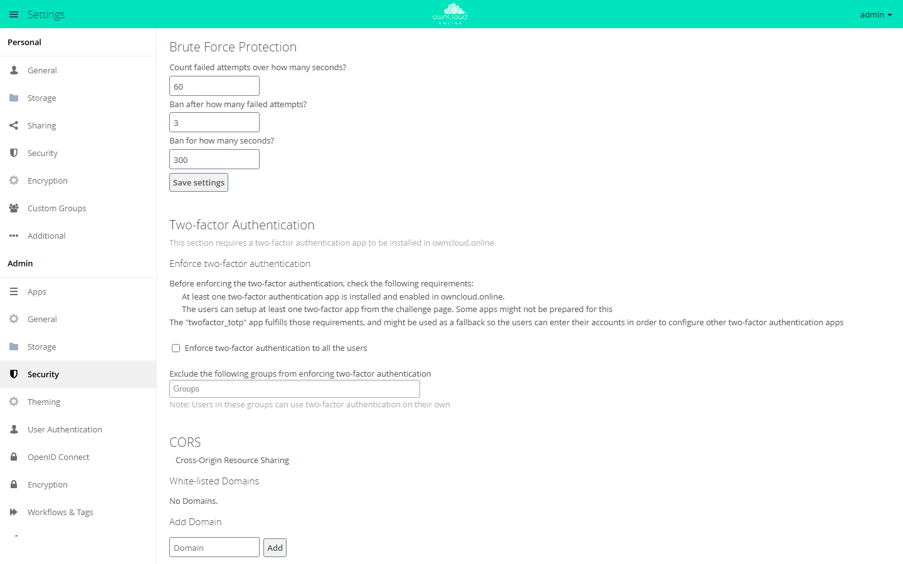
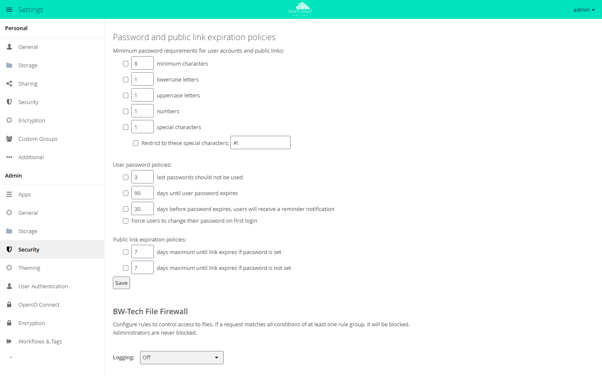

# Security and setup warnings

The setup warnings under **Settings → Admin → General** ("Security & setup
warnings") point to missing production configuration. On a production system,
do not ignore any of them.

## HTTPS

Production systems must run over HTTPS.

```bash
certbot --apache -d cloud.example.com
```

Then set:

```bash
sudo -u www-data php8.4 occ config:system:set overwrite.cli.url --value https://cloud.example.com
```

If the instance runs behind a reverse proxy, also follow
[Reverse proxy and TLS](reverse-proxy.en.md).

## System cron

```bash
crontab -u www-data -e
```

Entry:

```cron
*/15 * * * * /usr/bin/php8.4 /var/www/owncloud.online/occ system:cron
```

Switch owncloud.online to cron:

```bash
sudo -u www-data php8.4 occ background:cron
```

In the web interface, this is the "Cron" option under **Settings → Admin →
General**. Its description mentions `cron.php`. `occ system:cron` runs the same
jobs but does not print a notice on every run, which cron would send as an
email. Details are in [Background jobs (cron)](background-jobs.en.md).

<figure markdown="span">


<figcaption>Background jobs work best with the system's cron service calling cron.php every 15 minutes.</figcaption>
</figure>

## Memory cache (APCu)

```bash
apt install -y php8.4-apcu
systemctl reload php8.4-fpm
```

`config/config.php`:

```php
'memcache.local' => '\\OC\\Memcache\\APCu',
```

Without `memcache.local`, the cache factory falls back to `NullCache`
(`lib/private/Memcache/Factory.php`). The caches for translations and app
information then have no effect either: every language file and every
`info.xml` is parsed again on every request. For `occ` and `cron.php` to use
the cache as well, APCu must be enabled in the **CLI** `php.ini`:

```ini
apc.enable_cli=1
```

## File locking with Redis

On production systems, Redis handles transactional file locking:

```bash
apt install -y redis-server php8.4-redis
systemctl enable --now redis-server
systemctl reload php8.4-fpm
```

`config/config.php`:

```php
'memcache.locking' => '\\OC\\Memcache\\Redis',
'redis' => [
    'host' => '127.0.0.1',
    'port' => 6379,
    'timeout' => 1.5,
],
```

`timeout` limits the connection attempt to 1.5 seconds. Without it, every
request waits for the operating system's TCP timeout when Redis is
unreachable, see [Troubleshooting](troubleshooting.en.md).

## Database

SQLite is only suitable for local tests. Production systems use MariaDB or
MySQL, see [Database](database.en.md).

## Integrity check {#integritaetspruefung}

owncloud.online ships on the `bwtech` channel (`version.php`). For this
channel, the core does not enforce the code integrity check
(`$notSignedChannels` in `lib/private/IntegrityCheck/Checker.php`), and the
release package contains no signature files. Both check commands therefore
**always** report success without checking a single file:

```bash
sudo -u www-data php8.4 occ integrity:check-core
sudo -u www-data php8.4 occ integrity:check-app market
```

They are useless as a check after an update. Verify the release package
before you unpack it instead:

- `SHA256SUMS.txt` in the release contains the SHA-256 checksums of the
  archives. The check with `sha256sum --ignore-missing -c SHA256SUMS.txt` must
  print `OK`, see [Linux server installation, step 5](../installation/linux-server.en.md#herunterladen).
- The release archives come with a signed build provenance attestation. It
  proves that the archive was built from the public repository. You can check
  it with the GitHub command line tool `gh`:

    ```bash
    gh attestation verify owncloud-online-11.0.25.tar.gz \
      --repo BWTECH-github/owncloud.online
    ```

The Market app checks apps from the Marketplace against the SHA-256 checksum
from the catalog when it downloads them, if the catalog provides one.

Your own changes to core files, for example for branding, are not reported by
the check. Keep a written record of such changes: an update replaces the
program directory and with it the changed files.

## Hiding version information

`status.php` returns the exact version and edition without a login, with
`Access-Control-Allow-Origin: *`. Together with the detailed CHANGELOG, this
makes instances without current security fixes easy to find. Recommended for
production instances:

```php
'version.hide' => true,
```

After that, `status.php` returns the fields `version`, `versionstring`,
`edition`, `productname`, and `product` empty. The trade-off: monitoring that
reads the version from `status.php` no longer sees it.

## Update check

By default, the update checker queries the update server of the upstream
project (the default value of `updater.server.url`) with the channel `bwtech`.
That service knows neither the channel nor the owncloud.online versions.
Administrators therefore **never** get an update notice, but with every check
the instance sends its version, installation and update time, channel,
edition, and build to a third-party server. Set your own endpoint
(`'updater.server.url' => '…'`) or turn the check off:

```php
'updatechecker' => false,
```

New versions are published at
<https://github.com/BWTECH-github/owncloud.online/releases>.

## PHP security updates

Since 11.0.24, the security and setup warnings report a PHP version that lacks
the fixes for CVE-2026-109618 and CVE-2026-109619. These vulnerabilities in the
PHP interpreter let attackers run code on the server without logging in. For
PHP 8.4, they are fixed in 8.4.27 and later. The warning starts with "This
server runs PHP …".

For a PHP build without a suffix in the version number, the message is an
error. For distribution packages (a version number with a suffix, for example
from Debian or Ubuntu), it is only a warning, because distributions often ship
such fixes under the old version number. Once the fix is installed that way,
this entry hides the message:

```php
'php_security_check' => false,
```

## HSTS (Strict-Transport-Security)

The shipped `.htaccess` sets HSTS **only** if Apache terminates TLS itself
(`env=HTTPS`, set by `mod_ssl`):

```apache
Header always set Strict-Transport-Security "max-age=15552000; includeSubDomains" env=HTTPS
```

**nginx and reverse proxies:** nginx ignores `.htaccess`, and behind a proxy
that terminates TLS, the backend only sees HTTP. There, the proxy or nginx must
set the header, and only in one place, or it is sent twice:

```nginx
add_header Strict-Transport-Security "max-age=15552000; includeSubDomains" always;
```

Before you set it, make sure that **all** subdomains will be reachable over
HTTPS permanently: browsers enforce HSTS for the duration of `max-age`. Add
`preload` only after testing.

## Reverse proxy: trusted_proxies

Behind a reverse proxy, the server sees the proxy as the sender of every
request. The real client address is then in `X-Forwarded-For`. The server
evaluates this header **only** for addresses listed in `trusted_proxies`:

```php
'trusted_proxies' => ['10.0.0.5'],
'overwriteprotocol' => 'https',
```

This matters for security because several protection mechanisms use the
client address as a key, above all brute-force protection for logins, public
link passwords, and the MCP endpoint. It counts failed attempts per
(IP, account).

| Setup | Result |
| --- | --- |
| `trusted_proxies` set correctly | The real client address is counted, protection works |
| `trusted_proxies` **not** set | All requests count against the proxy address, legitimate users slow each other down |
| The proxy appends to `X-Forwarded-For` instead of setting it | An attacker sends the header themselves and gets a new "address" with every request, and the throttle never applies |
| App server reachable **directly** from the network | Requests bypass the proxy. The server evaluates `X-Forwarded-Proto` and `X-Forwarded-Host` without checking `trusted_proxies`, so the protocol and host name of generated links can be influenced from outside |

Two steps therefore belong in every setup:

1. Set `trusted_proxies` to the **actual** proxy addresses (no network ranges
   "just in case", no `0.0.0.0/0`).
2. **Never** expose the PHP-FPM or app server directly. It must only be
   reachable through the reverse proxy (firewall or binding to `127.0.0.1`).

The log shows which address actually arrives: after a failed login, it is in
the `remoteAddr` field, see [Server log and error messages](logging.en.md). If
the log shows the proxy address instead of the client address,
`trusted_proxies` is wrong. All details are in
[Reverse proxy and TLS](reverse-proxy.en.md).

## Brute-force protection

The core slows down repeated failed attempts at login (web interface as well
as WebDAV and OCS with HTTP basic auth), for public link passwords, and at the
MCP endpoint. It counts the failed attempts of the last 12 hours in three
dimensions and applies the strictest:

| Counted per | Without delay | After that |
| --- | --- | --- |
| Address and identifier (account name or share token) | 3 failed attempts | 5 seconds, doubling with every further failed attempt, at most 120 seconds |
| Address, across all identifiers | 20 failed attempts | same as above |
| Subnet (`/24` for IPv4, `/64` for IPv6) | 20 failed attempts | at most 10 seconds |

There is no permanent lockout; every delay expires on its own. Meanwhile, the
login page shows "Login paused for a moment" and the remaining time.

To set the values yourself, install the
[Brute-Force Protection](../plugins/apps/brute_force_protection.en.md) app
(`brute_force_protection`) from the Marketplace. Since 11.0.14, the core then
leaves the rules for logins and link passwords to the app. The settings are
under **Settings → Admin → Security** in the "Brute Force Protection" section:

| Field | Meaning | Default |
| --- | --- | --- |
| "Count failed attempts over how many seconds?" | Time window in seconds in which failed attempts count | 60 |
| "Ban after how many failed attempts?" | Number of failed attempts before the ban | 3 |
| "Ban for how many seconds?" | Duration of the ban in seconds | 300 |

<figure markdown="span">



<figcaption>Brute-force protection blocks logins after several failed attempts. Shown here: 3 failed attempts within 60 seconds lead to a 300-second ban.</figcaption>
</figure>

## Password policy

The [Password Policy](../plugins/apps/password_policy.en.md) app
(`password_policy`) from the Marketplace sets minimum requirements for
passwords:

```bash
sudo -u www-data php8.4 occ market:install password_policy
```

The settings are under **Settings → Admin → Security** in the "Password and
public link expiration policies" section. Each rule takes effect only when the
checkbox in front of it is selected:

- Minimum length, lowercase and uppercase letters, numbers, and special
  characters, optionally restricted to specific special characters. This
  applies to accounts and to public link passwords.
- For user accounts: blocking recently used passwords, expiration after a
  number of days, a reminder before expiration, and a forced password change at
  first login.
- For public links: the maximum number of days until expiration, separately for
  links with and without a password.

<figure markdown="span">



<figcaption>The password policy sets minimum length, character types, and expiration, including passwords for public links.</figcaption>
</figure>

## PHP upload progress

PHP can record the progress of a form upload in the session
(`session.upload_progress.enabled`, on by default). owncloud.online does not
use this; the progress display in the browser does its own calculation. As
long as the feature is on, PHP writes data from the sender into the session
store for every upload with the form field `PHP_SESSION_UPLOAD_PROGRESS`, and
it does so without a login and before owncloud.online even sees the request.
This is a known building block for file inclusion attacks and also fills up
the session store.

Since 11.0.24, the shipped `.user.ini` (PHP-FPM, CGI) and `.htaccess` (Apache
with `mod_php`) turn the feature off. Both apply only to the owncloud.online
directory, and PHP-FPM rereads `.user.ini` only after up to five minutes
(`user_ini.cache_ttl`). In `php.ini` or the FPM pool, the setting applies
server-wide and takes effect as soon as you run `systemctl reload php8.4-fpm`:

```ini
; php.ini
session.upload_progress.enabled = Off

; or in the pool, e.g. /etc/php/8.4/fpm/pool.d/www.conf
php_admin_flag[session.upload_progress.enabled] = off
```

The value that counts is the one `phpinfo()` shows as "Local Value" in the
"session" section. The CLI (`php -i`, `occ`) has its own `php.ini` and tells
you nothing about it.
