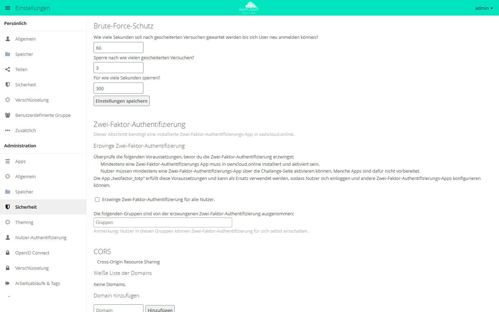
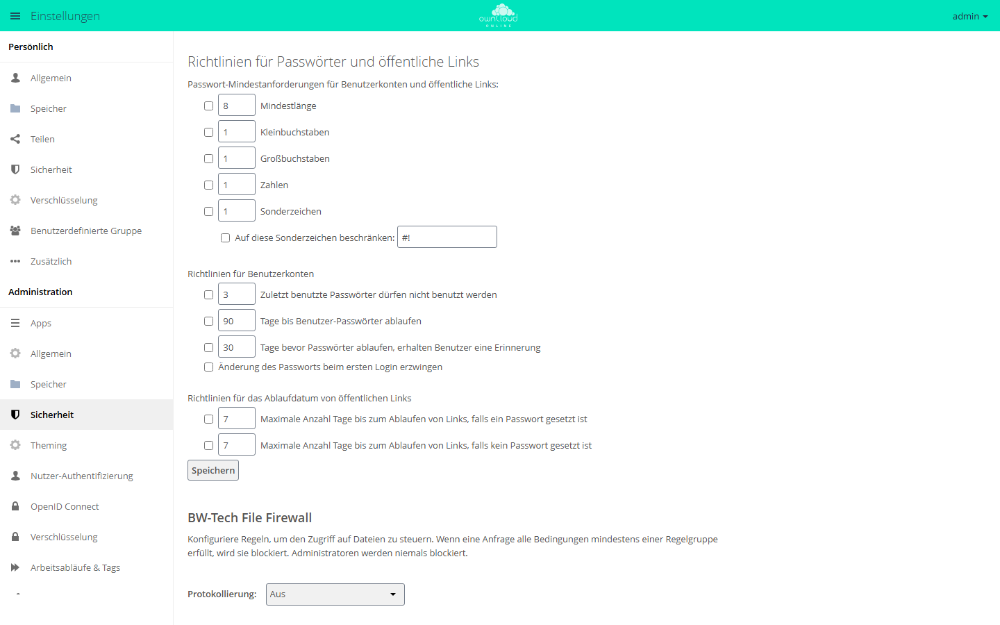

# Sicherheit und Setup-Warnungen

Die Setup-Warnungen unter **Einstellungen → Administration → Allgemein**
(„Sicherheits- & Einrichtungswarnungen“) zeigen fehlende
Produktionskonfiguration an. Auf einem Produktivsystem darf keine davon
ignoriert werden.

## HTTPS

Produktivsysteme müssen über HTTPS laufen.

```bash
certbot --apache -d cloud.example.com
```

Danach setzen:

```bash
sudo -u www-data php8.4 occ config:system:set overwrite.cli.url --value https://cloud.example.com
```

Steht die Instanz hinter einem Reverse-Proxy, gelten zusätzlich die Punkte unter
[Reverse-Proxy und TLS](reverse-proxy.md).

## System-Cron

```bash
crontab -u www-data -e
```

Eintrag:

```cron
*/15 * * * * /usr/bin/php8.4 /var/www/owncloud.online/occ system:cron
```

In owncloud.online auf Cron umstellen:

```bash
sudo -u www-data php8.4 occ background:cron
```

In der Weboberfläche entspricht das der Option „Cron“ unter **Einstellungen →
Administration → Allgemein**. Deren Beschreibung nennt `cron.php`.
`occ system:cron` führt dieselben Jobs aus, gibt aber nicht bei jedem Lauf einen
Hinweis aus, den Cron als Mail verschickt. Einzelheiten unter
[Hintergrund-Jobs (Cron)](background-jobs.md).

<figure markdown="span">


<figcaption>Hintergrund-Jobs laufen am besten über den Cron-Dienst des Systems, der cron.php alle 15 Minuten aufruft.</figcaption>
</figure>

## Zwischenspeicher (APCu)

```bash
apt install -y php8.4-apcu
systemctl reload php8.4-fpm
```

`config/config.php`:

```php
'memcache.local' => '\\OC\\Memcache\\APCu',
```

Ohne gesetztes `memcache.local` fällt die Cache-Factory auf `NullCache` zurück
(`lib/private/Memcache/Factory.php`). Dann wirken auch die Zwischenspeicher für
Übersetzungen und App-Informationen nicht: Jede Sprachdatei und jede
`info.xml` wird bei jeder Anfrage neu eingelesen. Damit auch `occ` und
`cron.php` mit Zwischenspeicher laufen, muss APCu in der `php.ini` der **CLI**
aktiv sein:

```ini
apc.enable_cli=1
```

## Dateisperren mit Redis

Auf Produktivsystemen übernimmt Redis die transaktionalen Dateisperren:

```bash
apt install -y redis-server php8.4-redis
systemctl enable --now redis-server
systemctl reload php8.4-fpm
```

`config/config.php`:

```php
'memcache.locking' => '\\OC\\Memcache\\Redis',
'redis' => [
    'host' => '127.0.0.1',
    'port' => 6379,
    'timeout' => 1.5,
],
```

`timeout` begrenzt den Verbindungsaufbau auf 1,5 Sekunden. Ohne diesen Wert
wartet jede Anfrage bei einem nicht erreichbaren Redis bis zum TCP-Timeout des
Betriebssystems, siehe [Troubleshooting](troubleshooting.md).

## Datenbank

SQLite eignet sich nur für lokale Tests. Produktivsysteme nutzen MariaDB oder
MySQL, siehe [Datenbank](database.md).

## Integritätsprüfung {#integritaetspruefung}

owncloud.online wird auf dem Kanal `bwtech` ausgeliefert (`version.php`). Für
diesen Kanal erzwingt der Kern die Code-Integritätsprüfung nicht
(`$notSignedChannels` in `lib/private/IntegrityCheck/Checker.php`), und das
Release-Paket enthält keine Signaturdateien. Beide Prüfbefehle melden deshalb
**immer** Erfolg, ohne eine Datei zu prüfen:

```bash
sudo -u www-data php8.4 occ integrity:check-core
sudo -u www-data php8.4 occ integrity:check-app market
```

Als Kontrolle nach einem Update taugen sie nicht. Prüfen Sie stattdessen das
Release-Paket, bevor Sie es auspacken:

- `SHA256SUMS.txt` aus dem Release enthält die SHA-256-Prüfsummen der Archive.
  Der Abgleich mit `sha256sum --ignore-missing -c SHA256SUMS.txt` muss `OK`
  ausgeben, siehe [Installation, Schritt 5](../installation/linux-server.md#herunterladen).
- Zu den Release-Archiven gibt es eine signierte Bau-Bescheinigung (Build
  Provenance). Sie belegt, dass das Archiv aus dem öffentlichen Repository
  gebaut wurde. Prüfen lässt sie sich mit der GitHub-Kommandozeile `gh`:

    ```bash
    gh attestation verify owncloud-online-11.0.25.tar.gz \
      --repo BWTECH-github/owncloud.online
    ```

Apps aus dem Marktplatz prüft die Market-App beim Herunterladen gegen die
SHA-256-Prüfsumme aus dem Katalog, sofern der Katalog eine angibt.

Eigene Änderungen an Dateien des Kerns, etwa für ein Branding, meldet die
Prüfung nicht. Halten Sie solche Änderungen schriftlich fest: Ein Update
ersetzt das Programmverzeichnis und damit auch die geänderten Dateien.

## Versionsinformationen verbergen

`status.php` liefert ohne Anmeldung die exakte Version und Edition aus, mit
`Access-Control-Allow-Origin: *`. Zusammen mit dem ausführlichen CHANGELOG
lassen sich so Instanzen ohne aktuelle Sicherheitskorrekturen leicht finden.
Für Produktivinstanzen empfohlen:

```php
'version.hide' => true,
```

Danach liefert `status.php` die Felder `version`, `versionstring`, `edition`,
`productname` und `product` leer aus. Der Preis: Eine Überwachung, die die
Version aus `status.php` liest, sieht sie dann nicht mehr.

## Update-Prüfung

Ab Werk fragt der Update-Checker den Update-Server des Ursprungsprojekts ab
(Vorgabe von `updater.server.url`), und zwar mit dem Kanal `bwtech`. Dieser
Dienst kennt weder den Kanal noch die Versionen von owncloud.online. Betreiber
erhalten so **nie** einen Update-Hinweis. Die Instanz sendet aber bei jeder
Prüfung Version, Installations- und Update-Zeitpunkt, Kanal, Edition und Build
an einen fremden Server. Hinterlegen Sie deshalb einen eigenen Endpunkt
(`'updater.server.url' => '…'`) oder schalten Sie die Prüfung ab:

```php
'updatechecker' => false,
```

Neue Versionen erscheinen unter
<https://github.com/BWTECH-github/owncloud.online/releases>.

## PHP-Sicherheitsupdates

Seit 11.0.24 melden die Sicherheits- und Einrichtungswarnungen eine
PHP-Version ohne die Korrekturen für CVE-2026-109618 und CVE-2026-109619. Über
diese Lücken im PHP-Interpreter können Angreifer ohne Anmeldung Code auf dem
Server ausführen. Für PHP 8.4 sind sie ab 8.4.27 behoben. Die Meldung beginnt
mit „Dieser Server läuft mit PHP …“.

Bei einem PHP ohne Zusatz in der Versionsnummer ist die Meldung ein Fehler. Bei
Paketen einer Distribution (Versionsnummer mit Zusatz, etwa von Debian oder
Ubuntu) ist sie nur eine Warnung, weil Distributionen solche Korrekturen oft
unter der alten Versionsnummer ausliefern. Ist die Korrektur auf diesem Weg
eingespielt, blendet dieser Eintrag die Meldung aus:

```php
'php_security_check' => false,
```

## HSTS (Strict-Transport-Security)

Die ausgelieferte `.htaccess` setzt HSTS **nur**, wenn Apache selbst TLS
terminiert (`env=HTTPS`, von `mod_ssl` gesetzt):

```apache
Header always set Strict-Transport-Security "max-age=15552000; includeSubDomains" env=HTTPS
```

**nginx und Reverse-Proxy:** nginx ignoriert die `.htaccess`, und hinter einem
TLS-terminierenden Proxy sieht das Backend nur HTTP. Dort muss der Proxy bzw.
nginx den Header setzen, und zwar nur an einer Stelle, sonst steht er doppelt
in der Antwort:

```nginx
add_header Strict-Transport-Security "max-age=15552000; includeSubDomains" always;
```

Stellen Sie vorher sicher, dass **alle** Subdomains dauerhaft über HTTPS
erreichbar sind: Browser halten sich für die Dauer von `max-age` an HSTS. `preload` erst nach
einem Test ergänzen.

## Reverse-Proxy: trusted_proxies

Hinter einem Reverse-Proxy sieht der Server als Absender jeder Anfrage den
Proxy. Die echte Client-Adresse steht dann in `X-Forwarded-For`. Diese
Kopfzeile wertet der Server **nur** für Adressen aus, die in `trusted_proxies`
eingetragen sind:

```php
'trusted_proxies' => ['10.0.0.5'],
'overwriteprotocol' => 'https',
```

Das ist sicherheitsrelevant, weil mehrere Schutzmechanismen die Client-Adresse
als Schlüssel benutzen, allen voran die Bremse gegen Passwort-Raten bei der
Anmeldung, bei Passwörtern öffentlicher Links und am MCP-Endpunkt. Sie zählt
Fehlversuche pro (IP, Konto).

| Konstellation | Folge |
| --- | --- |
| `trusted_proxies` korrekt gesetzt | Gezählt wird die echte Client-Adresse, der Schutz wirkt |
| `trusted_proxies` **nicht** gesetzt | Alle Anfragen zählen auf die Proxy-Adresse, legitime Benutzer bremsen sich gegenseitig aus |
| Der Proxy hängt `X-Forwarded-For` nur an, statt es zu setzen | Ein Angreifer schickt die Kopfzeile selbst mit und bekommt pro Anfrage eine neue „Adresse“, die Bremse greift nicht |
| App-Server **direkt** aus dem Netz erreichbar | Anfragen umgehen den Proxy. `X-Forwarded-Proto` und `X-Forwarded-Host` wertet der Server ohne Abgleich mit `trusted_proxies` aus, Protokoll und Hostname erzeugter Links lassen sich dann von außen beeinflussen |

Deshalb gehören zwei Punkte in die Inbetriebnahme:

1. `trusted_proxies` auf die **tatsächlichen** Proxy-Adressen setzen (keine
   Netzbereiche „auf Verdacht“, kein `0.0.0.0/0`).
2. Den PHP-FPM- oder App-Server **nie** direkt erreichbar machen. Er darf nur
   über den Reverse-Proxy erreichbar sein (Firewall oder Bindung an
   `127.0.0.1`).

Welche Adresse tatsächlich ankommt, zeigt das Protokoll: Nach einer
fehlgeschlagenen Anmeldung steht sie im Feld `remoteAddr`, siehe
[Serverprotokoll und Fehlermeldungen](logging.md). Erscheint dort die
Proxy-Adresse statt der Client-Adresse, ist `trusted_proxies` falsch. Alle
Einzelheiten stehen unter [Reverse-Proxy und TLS](reverse-proxy.md).

## Bremse gegen Passwort-Raten

Der Kern bremst wiederholte Fehlversuche bei der Anmeldung (Weboberfläche sowie
WebDAV und OCS mit HTTP-Basic), bei Passwörtern öffentlicher Links und am
MCP-Endpunkt. Er zählt die Fehlversuche der letzten 12 Stunden in drei
Dimensionen und wendet die strengste an:

| Gezählt pro | Ohne Wartezeit | Danach |
| --- | --- | --- |
| Adresse und Kennung (Kontoname oder Freigabe-Token) | 3 Fehlversuche | 5 Sekunden, bei jedem weiteren Fehlversuch doppelt so lang, höchstens 120 Sekunden |
| Adresse, über alle Kennungen | 20 Fehlversuche | wie oben |
| Subnetz (`/24` bei IPv4, `/64` bei IPv6) | 20 Fehlversuche | höchstens 10 Sekunden |

Eine dauerhafte Sperre gibt es nicht, jede Wartezeit läuft von selbst ab. Die
Anmeldeseite zeigt währenddessen „Anmeldung kurz angehalten“ und die
verbleibende Zeit.

Wer die Werte selbst einstellen will, installiert aus dem Marktplatz die App
[Brute-Force-Schutz](../plugins/apps/brute_force_protection.md)
(`brute_force_protection`). Seit 11.0.14 überlässt ihr der Kern dann die Regeln
für Anmeldung und Link-Passwörter. Die Einstellungen stehen unter
**Einstellungen → Administration → Sicherheit** im Abschnitt
„Brute-Force-Schutz“:

| Feld | Bedeutung | Vorgabe |
| --- | --- | --- |
| „Wie viele Sekunden soll nach gescheiterten Versuchen gewartet werden …“ | Zeitfenster in Sekunden, in dem Fehlversuche zählen | 60 |
| „Sperre nach wie vielen gescheiterten Versuchen?“ | Zahl der Fehlversuche bis zur Sperre | 3 |
| „Für wie viele Sekunden sperren?“ | Dauer der Sperre in Sekunden | 300 |

Die Beschriftung des ersten Felds ist missverständlich: Der Wert ist das
Zeitfenster, nicht die Wartezeit.

<figure markdown="span">



<figcaption>Die Bremse gegen Passwort-Raten sperrt Anmeldungen nach mehreren Fehlversuchen. Im Bild: 3 Fehlversuche in 60 Sekunden führen zu 300 Sekunden Sperre.</figcaption>
</figure>

## Passwort-Richtlinie

Mindestanforderungen an Passwörter setzt die App
[Passwortrichtlinie](../plugins/apps/password_policy.md) (`password_policy`) aus
dem Marktplatz:

```bash
sudo -u www-data php8.4 occ market:install password_policy
```

Die Einstellungen stehen unter **Einstellungen → Administration → Sicherheit**
im Abschnitt „Richtlinien für Passwörter und öffentliche Links“. Jede Regel
wirkt erst, wenn das Kästchen davor angehakt ist:

- Mindestlänge, Klein- und Großbuchstaben, Zahlen und Sonderzeichen, auf Wunsch
  beschränkt auf bestimmte Sonderzeichen. Das gilt für Konten und für
  Passwörter öffentlicher Links.
- Für Benutzerkonten: Sperre zuletzt benutzter Passwörter, Ablauf nach einer
  Zahl von Tagen, Erinnerung vor dem Ablauf und Passwortwechsel bei der ersten
  Anmeldung.
- Für öffentliche Links: höchste Zahl von Tagen bis zum Ablauf, getrennt für
  Links mit und ohne Passwort.

<figure markdown="span">



<figcaption>Die Passwort-Richtlinie legt Mindestlänge, Zeichenarten und Ablauf fest, auch für Passwörter öffentlicher Links.</figcaption>
</figure>

## PHP-Upload-Fortschritt

PHP kann den Fortschritt eines Formular-Uploads in der Sitzung mitschreiben
(`session.upload_progress.enabled`, ab Werk an). owncloud.online nutzt das
nicht, die Fortschrittsanzeige im Browser rechnet selbst. Solange die Funktion
an ist, schreibt PHP bei jedem Upload mit dem Formularfeld
`PHP_SESSION_UPLOAD_PROGRESS` Daten des Absenders in den Sitzungsspeicher, und
zwar ohne Anmeldung und bevor owncloud.online die Anfrage überhaupt sieht. Das
ist ein bekannter Baustein für Angriffe über eingebundene Dateien und füllt
nebenbei den Sitzungsspeicher.

Die mitgelieferte `.user.ini` (PHP-FPM, CGI) und die `.htaccess` (Apache mit
`mod_php`) schalten die Funktion seit 11.0.24 ab. Beide gelten nur für das
Verzeichnis von owncloud.online, und PHP-FPM liest die `.user.ini` erst nach bis
zu fünf Minuten neu (`user_ini.cache_ttl`). Serverweit wirkt die Einstellung in
der `php.ini` oder im FPM-Pool, und zwar gleich nach
`systemctl reload php8.4-fpm`:

```ini
; php.ini
session.upload_progress.enabled = Off

; oder im Pool, z. B. /etc/php/8.4/fpm/pool.d/www.conf
php_admin_flag[session.upload_progress.enabled] = off
```

Maßgeblich ist der Wert, den `phpinfo()` im Abschnitt „session“ als „Local
Value“ zeigt. Die CLI (`php -i`, `occ`) hat ihre eigene `php.ini` und sagt
darüber nichts.
