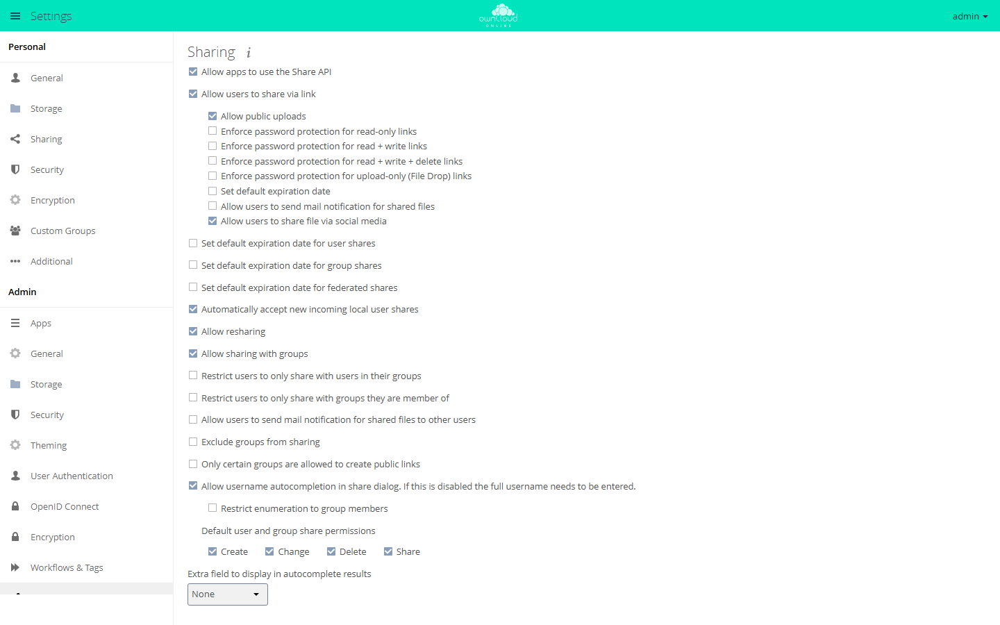
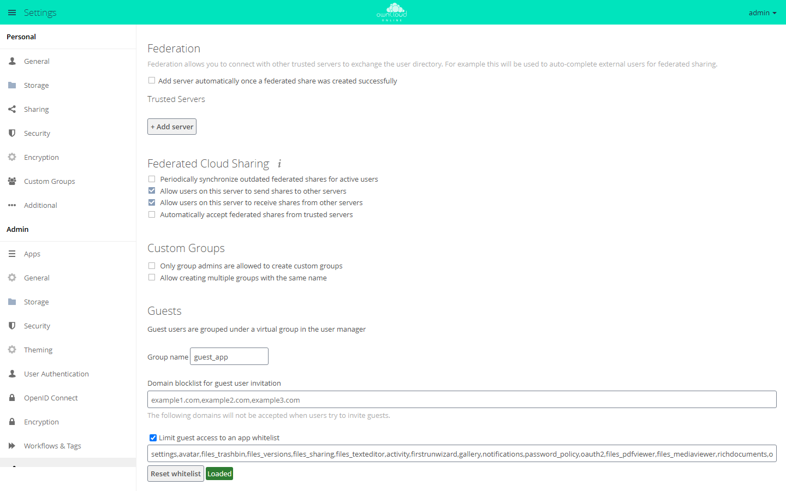

# Sharing policies

owncloud.online keeps its sharing rules under *Settings → Admin → Sharing*. The
switches there write app config values, so you can set almost every option
with `occ config:app:set` as well, for example during initial setup, in
scripts, or for reproducible configurations. The only exception on this page is
the list of trusted federation servers: it lives in its own database table,
not in the app config.

Run the `occ` commands on this page from the installation directory, for
example after `cd /var/www/owncloud.online`.

## Where the settings are

Menu path: **Settings → Admin → Sharing**.



The page is built from several panels. Which ones appear depends on the enabled
apps:

| Section | Source | Shown |
| --- | --- | --- |
| **Sharing** | core (`settings/templates/panels/admin/filesharing.php`) | always |
| **Group Sharing Blacklist** | `files_sharing` app | always (the app is enabled by default) |
| **Federated Cloud Sharing** | `federatedfilesharing` app | only if the app is enabled |
| **Federation** | `federation` app | only if the app is enabled |
| **Custom Groups** | `customgroups` app, see [Users and groups](users-groups.en.md#custom-groups) | only if the app is enabled |
| **Guests** | `guests` app | only if the app is enabled |

Almost all keys of the main section belong to the `core` app, not to
`files_sharing`. The keys for federated shares, for the recipient blacklist, and
for the groups allowed to create public links belong to `files_sharing`. Pay
attention to the app name when you set values with `occ`.

The yes/no switches in the main **Sharing** section store the strings `yes` and
`no`, not `1` and `0` (`settings/js/admin.js`). The panels of the `guests` and
`federation` apps work differently, see their sections below.

## Turning sharing on or off

The top switch, **Allow apps to use the Share API**, is the main switch. If it
is set to `no`, the web interface hides all other sharing options, and the
server refuses access to public links
(`apps/files_sharing/lib/Middleware/SharingCheckMiddleware.php`).

| Key | App | Default |
| --- | --- | --- |
| `shareapi_enabled` | `core` | `yes` |

```bash
sudo -u www-data php8.4 occ config:app:set core shareapi_enabled --value no
```

The dependent values are kept but are no longer evaluated. When you set the
main switch back to `yes`, the previously stored configuration applies again
right away.

## Public links

**Allow users to share via link** decides whether link shares can be created at
all. If the value is `no`, the server refuses to create them
(`lib/private/Share20/Manager.php`, `linkCreateChecks`) and blocks access to
existing links.

| Label | Key (app `core`) | Default |
| --- | --- | --- |
| Allow users to share via link | `shareapi_allow_links` | `yes` |
| Allow public uploads | `shareapi_allow_public_upload` | `yes` |
| Allow users to send mail notification for shared files | `shareapi_allow_public_notification` | `no` |
| Language used for public mail notifications for shared files | `shareapi_public_notification_lang` | `owner` |
| Allow users to share file via social media | `shareapi_allow_social_share` | `yes` |

With `shareapi_allow_public_upload` set to `no`, only read-only links are
possible: the server rejects any link share that includes the create, change,
or delete permission. The language key takes either a language code or the
special value `owner`. In that case the language of the share owner is used
(label *Owner language*).

```bash
sudo -u www-data php8.4 occ config:app:set core shareapi_allow_links --value yes
sudo -u www-data php8.4 occ config:app:set core shareapi_allow_public_upload --value no
```

## Enforcing passwords for links

Passwords are not enforced across the board but per link role. The server
compares the permissions of the share with fixed combinations
(`lib/private/Share20/Manager.php`, `passwordMustBeEnforced`):

| Label | Key (app `core`) | Default | Applies to |
| --- | --- | --- | --- |
| Enforce password protection for read-only links | `shareapi_enforce_links_password_read_only` | `no` | read |
| Enforce password protection for read + write links | `shareapi_enforce_links_password_read_write` | `no` | folder: read + create |
| Enforce password protection for read + write + delete links | `shareapi_enforce_links_password_read_write_delete` | `no` | folder: read + change + create + delete, and file: read + change |
| Enforce password protection for upload-only (File Drop) links | `shareapi_enforce_links_password_write_only` | `no` | create only |

The check runs when a link share is created and when it is changed. To protect
all public links, set all four keys. Each one only covers its own role:

```bash
sudo -u www-data php8.4 occ config:app:set core shareapi_enforce_links_password_read_only --value yes
sudo -u www-data php8.4 occ config:app:set core shareapi_enforce_links_password_read_write --value yes
sudo -u www-data php8.4 occ config:app:set core shareapi_enforce_links_password_read_write_delete --value yes
sudo -u www-data php8.4 occ config:app:set core shareapi_enforce_links_password_write_only --value yes
```

The four switches only enforce that a password is set at all. How strong it has
to be is up to the password policy, see below.

## Expiration dates

There are four independent sets of expiration settings: for links, for user
shares, for group shares, and for federated shares. Each set has three keys:
turn on, number of days, enforce.

| Share type | Set default expiration date | Expire after … days | Enforce as maximum expiration date |
| --- | --- | --- | --- |
| Public links | `shareapi_default_expire_date` | `shareapi_expire_after_n_days` | `shareapi_enforce_expire_date` |
| User shares | `shareapi_default_expire_date_user_share` | `shareapi_expire_after_n_days_user_share` | `shareapi_enforce_expire_date_user_share` |
| Group shares | `shareapi_default_expire_date_group_share` | `shareapi_expire_after_n_days_group_share` | `shareapi_enforce_expire_date_group_share` |
| Federated shares | `shareapi_default_expire_date_remote_share` | `shareapi_expire_after_n_days_remote_share` | `shareapi_enforce_expire_date_remote_share` |

All keys belong to the `core` app. The switches default to `no`, the day values
to `7`.

The order matters: the enforce switch is only evaluated if the matching default
expiration is turned on. The code spells this out as an AND condition
(`shareApiLinkDefaultExpireDateEnforced` and the matching methods for user,
group, and federated shares in `lib/private/Share20/Manager.php`).

```bash
sudo -u www-data php8.4 occ config:app:set core shareapi_default_expire_date --value yes
sudo -u www-data php8.4 occ config:app:set core shareapi_expire_after_n_days --value 14
sudo -u www-data php8.4 occ config:app:set core shareapi_enforce_expire_date --value yes
```

Expired shares do not disappear right away. A background job that runs once a
day removes them (`apps/files_sharing/lib/ExpireSharesJob.php`). Without a
working cron they stay, see [Background jobs (cron)](background-jobs.en.md).

## Resharing

**Allow resharing** controls whether recipients of a share may pass it on.

| Key | App | Default |
| --- | --- | --- |
| `shareapi_allow_resharing` | `core` | `yes` |

```bash
sudo -u www-data php8.4 occ config:app:set core shareapi_allow_resharing --value no
```

Independently of this, link shares can never carry the share permission: the
server explicitly rejects a link share with that permission.

## Sharing with groups and limiting recipients

| Label | Key | App | Default |
| --- | --- | --- | --- |
| Allow sharing with groups | `shareapi_allow_group_sharing` | `core` | `yes` |
| Restrict users to only share with users in their groups | `shareapi_only_share_with_group_members` | `core` | `no` |
| Restrict users to only share with groups they are member of | `shareapi_only_share_with_membership_groups` | `core` | `no` |
| Exclude groups from sharing | `shareapi_exclude_groups` | `core` | `no` |
| Groups excluded from sharing | `shareapi_exclude_groups_list` | `core` | empty |
| Exclude groups from receiving shares | `blacklisted_receiver_groups` | `files_sharing` | `[]` |
| Only certain groups are allowed to create public links | `public_share_sharers_groups_allowlist_enabled` | `files_sharing` | `no` |
| Groups allowed to create public links | `public_share_sharers_groups_allowlist` | `files_sharing` | `[]` |

The three lists work differently:

- `shareapi_exclude_groups_list` takes away the members' right to **create**
  shares. They can still receive shares.
- `blacklisted_receiver_groups` removes groups from the list of
  **recipients**. Members can still create shares themselves and receive
  personal shares.
- `public_share_sharers_groups_allowlist` limits who may create public links at
  all. If the list is empty but the switch is on, nobody is excluded
  (`apps/files_sharing/lib/SharingAllowlist.php`).

All three group lists are stored as JSON arrays:

```bash
sudo -u www-data php8.4 occ config:app:set core shareapi_exclude_groups --value yes
sudo -u www-data php8.4 occ config:app:set core shareapi_exclude_groups_list --value '["external","interns"]'
sudo -u www-data php8.4 occ config:app:set files_sharing blacklisted_receiver_groups --value '["archive"]'
```

For `shareapi_exclude_groups_list`, the server also accepts an old
comma-separated format. It converts it to JSON on first read and writes the
result back (`lib/private/Share20/Manager.php`, `sharingDisabledForUser`). Do
not rely on this.

## Recipient autocompletion

| Label | Key (app `core`) | Default |
| --- | --- | --- |
| Allow username autocompletion in share dialog. If this is disabled the full username needs to be entered. | `shareapi_allow_share_dialog_user_enumeration` | `yes` |
| Restrict enumeration to group members | `shareapi_share_dialog_user_enumeration_group_members` | `no` |
| Extra field to display in autocomplete results | `user_additional_info_field` | empty |

If enumeration is set to `no`, the search no longer returns a list of matches.
Only an exact username, display name, or email address returns a result
(`apps/files_sharing/lib/Controller/ShareesController.php`). This is the most
effective measure against harvesting the user list through the share dialog.

`user_additional_info_field` takes exactly three values: empty (label *None*),
`id` (*User ID*), and `email` (*Email address*). The extra field helps when
several users have the same display name.

```bash
sudo -u www-data php8.4 occ config:app:set core shareapi_allow_share_dialog_user_enumeration --value no
sudo -u www-data php8.4 occ config:app:set core user_additional_info_field --value email
```

Users can also remove themselves from autocompletion under *Settings → Personal
→ Sharing* ("Allow finding you via autocomplete in share dialog. …"). This is a
user setting of the `files_sharing` app, not an app config value, and it is
only visible while global enumeration is on
(`apps/files_sharing/lib/Panels/Personal/PersonalPanel.php`):

```bash
sudo -u www-data php8.4 occ user:setting maxine files_sharing allow_share_dialog_user_enumeration --value no
```

## Default permissions and automatic acceptance

| Label | Key (app `core`) | Default |
| --- | --- | --- |
| Default user and group share permissions | `shareapi_default_permissions` | `31` |
| Automatically accept new incoming local user shares | `shareapi_auto_accept_share` | `yes` |
| Allow users to send mail notification for shared files to other users | `shareapi_allow_mail_notification` | `no` |

`shareapi_default_permissions` is a bitmask of the constants in
`lib/public/Constants.php`:

| Permission | Label | Value |
| --- | --- | --- |
| Read | (always set) | 1 |
| Change | Change | 2 |
| Create | Create | 4 |
| Delete | Delete | 8 |
| Share | Share | 16 |

The web interface always adds the read permission, whatever you select. The
value is only used if no permissions are passed when a user or group share is
created. Link shares do not use it
(`apps/files_sharing/lib/Controller/Share20OcsController.php`).

```bash
# read + change + create + delete, but no resharing (1+2+4+8)
sudo -u www-data php8.4 occ config:app:set core shareapi_default_permissions --value 15
```

Automatic acceptance can be turned off globally and also overridden per user.
The user setting is only evaluated while the global setting is on:

```bash
sudo -u www-data php8.4 occ config:app:set core shareapi_auto_accept_share --value no
sudo -u www-data php8.4 occ user:setting maxine files_sharing auto_accept_share --value no
```

`shareapi_allow_mail_notification` covers notifications to internal recipients
and is independent of `shareapi_allow_public_notification`, which applies to
public links. Both need working email delivery, see
[Sending email](email.en.md).

## Federated sharing



The **Federated Cloud Sharing** section comes from the `federatedfilesharing`
app, but most of its keys belong to the `files_sharing` app.

| Label | Key | App | Default |
| --- | --- | --- | --- |
| Allow users on this server to send shares to other servers | `outgoing_server2server_share_enabled` | `files_sharing` | `yes` |
| Allow users on this server to receive shares from other servers | `incoming_server2server_share_enabled` | `files_sharing` | `yes` |
| Periodically synchronize outdated federated shares for active users | `cronjob_scan_external_enabled` | `files_sharing` | `no` |
| Automatically accept federated shares from trusted servers | `auto_accept_trusted` | `federatedfilesharing` | `no` |

```bash
sudo -u www-data php8.4 occ config:app:set files_sharing outgoing_server2server_share_enabled --value no
sudo -u www-data php8.4 occ config:app:set files_sharing incoming_server2server_share_enabled --value no
```

The `federation` app maintains the list of trusted servers itself, in the
**Trusted Servers** section. It has its own key, which stores `0` and `1`
instead (`apps/federation/lib/TrustedServers.php`):

| Label | Key | App | Default |
| --- | --- | --- | --- |
| Add server automatically once a federated share was created successfully | `autoAddServers` | `federation` | `0` |

A separate command removes orphaned storages left behind by deleted federated
shares:

```bash
sudo -u www-data php8.4 occ sharing:cleanup-remote-storages
```

## Password policy

The `password_policy` app hooks into the core's password check. When a link
password is set, the core fires the `OCP\Share::validatePassword` event
(`lib/private/Share20/Manager.php`, `verifyPassword`). The app checks the
password and rejects it with a message if needed.

The two mechanisms have separate jobs:

- The `shareapi_enforce_links_password_*` switches decide **whether** a
  password is required.
- The policy decides **what** the password has to look like.

Without the `password_policy` app there is no strength check. The core does not
have one.


The *Password and public link expiration policies* panel is not under
*Sharing* but under **Settings → Admin → Security**. As the heading *Minimum
password requirements for user accounts and public links* says, the minimum
requirements apply to account passwords and link passwords alike. All keys
belong to the `password_policy` app and follow the pattern `<name>_checked` and
`<name>_value`. When a box is checked, the web interface stores `on`; an
unchecked box is stored as an empty value. When you set values with `occ`, use
only `on`: the expiration rules compare strictly against `on`
(`lib/HooksHandler.php`), while the password check treats any non-empty value
as on (`lib/Engine.php`, `yes`). To turn a rule off, delete the key.

| Label | Key pair | Default value |
| --- | --- | --- |
| minimum characters | `spv_min_chars_checked` / `spv_min_chars_value` | 8 |
| lowercase letters | `spv_lowercase_checked` / `spv_lowercase_value` | 1 |
| uppercase letters | `spv_uppercase_checked` / `spv_uppercase_value` | 1 |
| numbers | `spv_numbers_checked` / `spv_numbers_value` | 1 |
| special characters | `spv_special_chars_checked` / `spv_special_chars_value` | 1 |
| Restrict to these special characters: | `spv_def_special_chars_checked` / `spv_def_special_chars_value` | `#!` |

The app also adds its own expiration rules for public links that depend on the
password:

| Label | Key pair | Default value |
| --- | --- | --- |
| days maximum until link expires if password is set | `spv_expiration_password_checked` / `spv_expiration_password_value` | 7 |
| days maximum until link expires if password is not set | `spv_expiration_nopassword_checked` / `spv_expiration_nopassword_value` | 7 |

If one of these rules is on, the app requires an expiration date for link
shares and rejects any date beyond the configured number of days
(`lib/HooksHandler.php`, `updateLinkExpiry`). This is a second, independent
mechanism next to `shareapi_enforce_expire_date`. The stricter of the two rules
wins.

```bash
sudo -u www-data php8.4 occ config:app:set password_policy spv_min_chars_checked --value on
sudo -u www-data php8.4 occ config:app:set password_policy spv_min_chars_value --value 12
```

## Guests


If the `guests` app is enabled, the *Sharing* section also shows the **Guests**
panel. Guests are separate accounts that are marked with the `isGuest` user
setting and collected in a virtual group. Users invite them by email address in
the share dialog.

| Label | Key (app `guests`) | Default |
| --- | --- | --- |
| Group name | `group` | `guest_app` |
| Domain blocklist for guest user invitation | `blockdomains` | empty |
| Limit guest access to an app whitelist | `usewhitelist` | `true` |
| Input field below the whitelist checkbox (no visible label; screen readers announce "App whitelist for guest access") | `whitelist` | list in `lib/AppWhitelist.php` |

The whitelist switch stores the strings `true` and `false`, not `yes` and `no`.

The domain blocklist is a comma-separated list. It is checked when a guest is
created. The comparison uses the full domain after the `@` and ignores upper
and lower case (`lib/Controller/UsersController.php`, `isDomainBlocked`).

```bash
sudo -u www-data php8.4 occ config:app:set guests blockdomains --value 'example.com,example.net'
```

Keep two interactions with the sharing rules in mind:

- The whitelist decides which apps a guest sees at all. It only applies to
  accounts that are explicitly marked as guests (`lib/AppInfo/Application.php`).
  If `files_trashbin` or `files_versions` is missing from the list, guests have
  neither *Deleted files* nor versions.
- The restriction **Restrict users to only share with users in their groups**
  is deliberately skipped for guests: the server allows sharing with a guest
  even if there is no common group (`lib/private/Share20/Manager.php`,
  `userCreateChecks`).

## Checking values

```bash
# read a single value
sudo -u www-data php8.4 occ config:app:get core shareapi_enabled

# all sharing keys of the core at a glance
sudo -u www-data php8.4 occ config:list core

# reset a value to the built-in default
sudo -u www-data php8.4 occ config:app:delete core shareapi_enforce_expire_date
```

Prefer `config:app:delete` over setting what looks like the default value.
After deleting, the default from the code applies again, even if it changes in
a later version.

## Troubleshooting

| Symptom | Cause | Fix |
| --- | --- | --- |
| The enforced expiration date has no effect | `shareapi_enforce_expire_date` is only evaluated if `shareapi_default_expire_date` is `yes` | Set both keys, not just the enforce switch |
| Some links still get through without a password | Passwords are enforced per role, and only one of the four `shareapi_enforce_links_password_*` keys is set | Set all four keys to `yes` |
| Expired shares are still visible | The cleanup job runs once a day and needs a working cron | Check cron, see [Background jobs (cron)](background-jobs.en.md) |
| An excluded group can still share | `shareapi_exclude_groups_list` is not stored as a JSON array, or `shareapi_exclude_groups` is `no` | Set the list as `'["group"]'` and turn the switch on |
| A group can still create shares even though it is on the recipient blacklist | `blacklisted_receiver_groups` only blocks receiving, not sharing | Also use `shareapi_exclude_groups_list` |
| Public links are allowed, but nobody can create one | `public_share_sharers_groups_allowlist_enabled` is `yes`, and the user's group is missing from `public_share_sharers_groups_allowlist` | Add the group to `public_share_sharers_groups_allowlist` or turn the switch off |
| The desktop or mobile client reports a group restriction that the server does not enforce | The capabilities report the default `yes` for `shareapi_only_share_with_group_members` and `shareapi_only_share_with_membership_groups`, while enforcement in the core assumes `no` | Set both keys explicitly instead of relying on the default |
| A link password is rejected even though it is long enough | The `password_policy` app also checks character classes | Read the message in the dialog and adjust the policy under *Admin → Security* |
| A link cannot be saved because an expiration date is missing | An expiration rule of the `password_policy` app is on and requires a date | Set an expiration date, or turn off `spv_expiration_password_checked` or `spv_expiration_nopassword_checked` |
| A guest cannot be invited | The domain is listed in `guests`/`blockdomains` | Remove the entry or use a different address |
| A guest has no *Deleted files* and no versions | `files_trashbin` or `files_versions` is missing from the guest whitelist | Add them to the whitelist or set `guests`/`usewhitelist` to `false` |
| The *Federated Cloud Sharing* panel is missing | The `federatedfilesharing` app is not enabled | Enable the app or set the keys directly with `occ` |

## See also

- [Security and setup warnings](security-hardening.en.md)
- [Background jobs (cron)](background-jobs.en.md)
- [Files and sharing](../user/files-sharing.en.md)
- Apps: [Password Policy](../plugins/apps/password_policy.en.md),
  [Guests](../plugins/apps/guests.en.md),
  [Custom Groups](../plugins/apps/customgroups.en.md)
