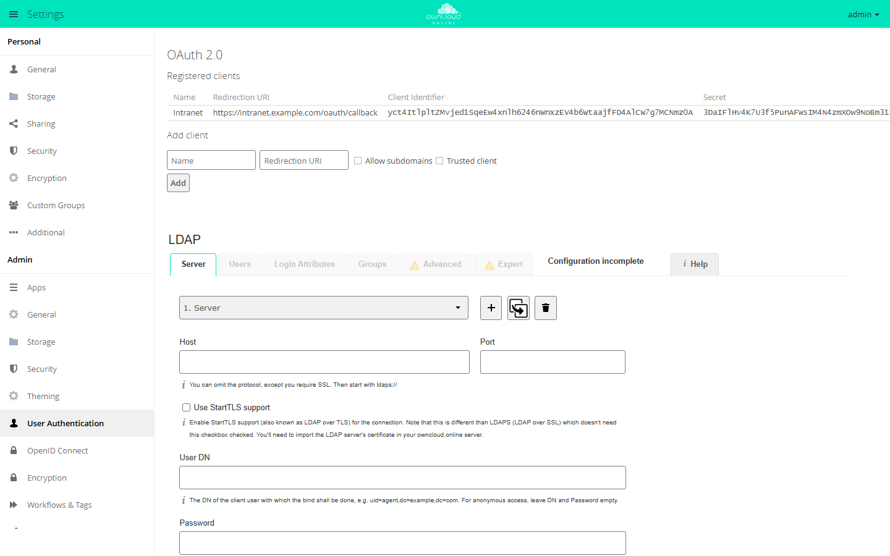
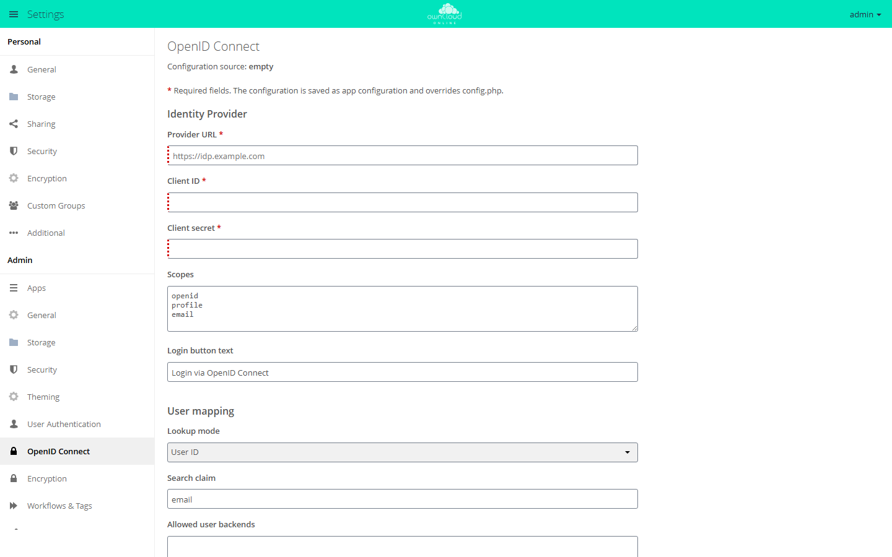
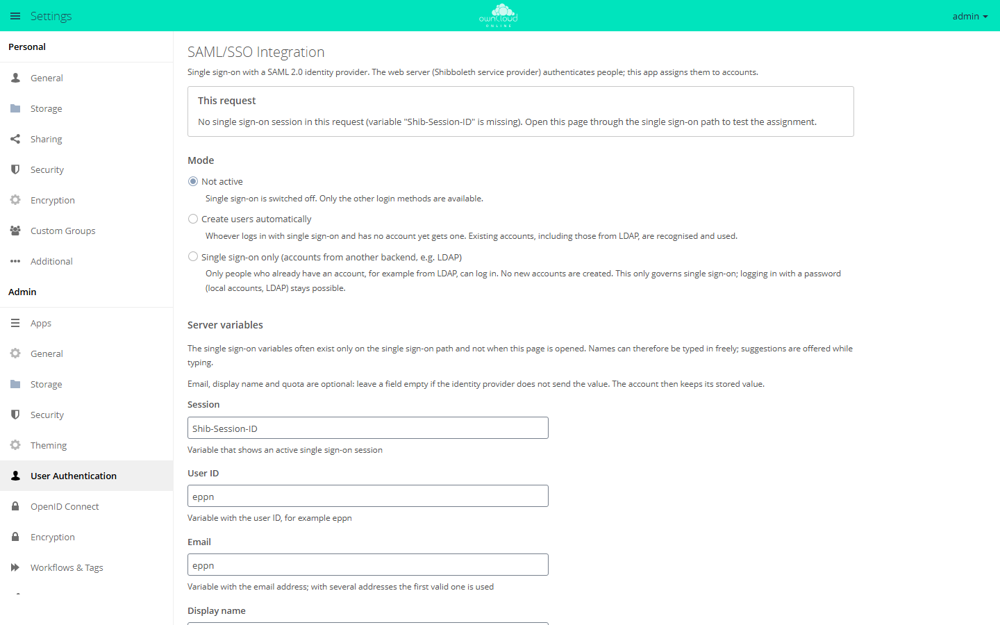

# Login with OAuth2 and OpenID Connect

Two separate apps cover logins without a password, one for clients and one for
external identity providers. Both are available in the Marketplace without an
API key. `oauth2` (version 0.10.1) turns the instance itself into an authorization
server, so that the desktop, Android, and iOS clients and third-party
applications can connect without the user's password. `openidconnect`
(version 2.4.8) works the other way around and logs users in through an
external provider. Both apps can be active at the same time. For single sign-on
with SAML 2.0 there is also the `user_shibboleth` app, see
[Login with SAML](#login-with-saml). The plugin pages
[OAuth2](../plugins/apps/oauth2.en.md) and
[OpenID Connect](../plugins/apps/openidconnect.en.md) give a short overview of
the apps; this page covers setup and behavior in detail.

## What each app does

| | OAuth2 (`oauth2`) | OpenID Connect (`openidconnect`) |
| --- | --- | --- |
| Role | owncloud.online issues tokens | owncloud.online checks tokens from an external provider |
| Where the accounts live | locally in owncloud.online | at the identity provider |
| Configuration | clients in the database, through `occ` or the admin settings | `config.php` or app configuration |
| Settings page | Settings → Admin → *User Authentication* | Settings → Admin → *OpenID Connect* |

Both apps register an authentication module for `Bearer` tokens. If `oauth2`
does not know a token and `openidconnect` is enabled, `oauth2` passes the token
on instead of rejecting the request. This lets you combine local OAuth2 clients
with login through the provider.

Neither module knows the user's password. Encryption with per-user keys
therefore does not work with these sessions; only the master key does, see
[Encryption](encryption.en.md).

## Setting up OAuth2

### Enabling the app

```bash
sudo -u www-data php8.4 occ market:install oauth2
```

`market:install` downloads the app from the Marketplace and enables it. If the
app is already in the app directory, `occ app:enable oauth2` is enough.

The app creates its database tables through its migrations. The same
migrations also add three clients with built-in IDs: *Desktop Client*,
*Android*, and *iOS*. They exist right after you enable the app, so you do not
have to create them; `occ oauth2:list-clients` shows them.

### Registering a client

```bash
sudo -u www-data php8.4 occ oauth2:add-client \
  "Third-party app" \
  "<client-id>" \
  "<client-secret>" \
  "https://app.example.com/oauth/callback"
```

The name must be new; the three built-in names are already taken.

| Argument | Required | Meaning |
| --- | --- | --- |
| `name` | yes | Display name on the consent page, must be unique |
| `client-id` | yes | Client ID, at least 32 characters |
| `client-secret` | yes | Client secret, at least 32 characters |
| `redirect-url` | yes | Redirect URL, must be a valid URL |
| `allow-sub-domains` | no | `true` or `false`, default `false` |
| `trusted` | no | `true` skips the consent page, default `false` |
| `force-trust` | no | `true` allows `trusted` for `localhost`, `127.0.0.1`, and `[::1]` as well |

More commands:

```bash
# show all clients, including the secret
sudo -u www-data php8.4 occ oauth2:list-clients

# change a single value
sudo -u www-data php8.4 occ oauth2:modify-client "Desktop Client" redirect-url "http://localhost:*"

# remove a client
sudo -u www-data php8.4 occ oauth2:remove-client "<client-id>"
```

`oauth2:modify-client` accepts the keys `name`, `client-id`, `client-secret`,
`redirect-url`, `allow-sub-domains`, and `trusted`.

In the admin settings under *User Authentication*, the same clients are listed
under *OAuth 2.0* → *Registered clients*. The *Add client* form only has
*Name*, *Redirection URI*, *Allow subdomains*, and *Trusted client*; the client
ID and secret are generated at random. A client with a specific ID can
therefore only be created with `occ oauth2:add-client`, or set to the values you
need afterwards with `occ oauth2:modify-client`.

<figure markdown="span">
  
  <figcaption>Under "OAuth 2.0" you register clients with a name and redirection URI. owncloud.online generates the client ID and secret.</figcaption>
</figure>

### Redirect URLs of the clients

The redirect URL of each built-in client is hard-coded in the client, and the
migration registers it on the server. The *Desktop Client* is registered with
`http://localhost:*`; the client picks the port freely when it logs in.
*Android* and *iOS* are registered with a fixed address under a URI scheme of
their own. `occ oauth2:list-clients` shows the redirect URL, ID, and secret of
all three clients.

The secrets of the built-in clients are in the source code of the clients. They
are not a protection mechanism, only the second half of the agreed ID; the real
protection is the redirect URL plus PKCE.

During authorization and when the code is redeemed, the app checks that
protocol, host, port, path, and query of the redirect URL match exactly. For
redirects to the local machine, the exceptions from RFC 8252 apply:

- If `http://127.0.0.1` or `http://[::1]` is registered, with or without `:*`,
  the client may redirect to `127.0.0.1` or `[::1]` on any port. Path and query
  must match.
- The same applies to `http://localhost:*`; in addition, the client may
  redirect to `localhost` on any port.

Other hosts below the registered domain are only allowed if
`allow-sub-domains` is set. When the code is redeemed, the redirect URL must
also be exactly the same as during authorization.

### Consent page

Without `trusted`, the user sees a page in the browser with the client name and
the *Authorize* button; below it, *Switch users to continue* leads to a new
login. With `trusted`, this page is skipped and the client gets the
authorization code directly. `localhost`, `127.0.0.1`, and `[::1]` can only be
marked as trusted with `force-trust`; the form shows "Cannot set localhost as
trusted." instead. This is meant for test setups, not for production
instances.

### Endpoints and lifetimes

| Purpose | URL |
| --- | --- |
| Authorization | `/index.php/apps/oauth2/authorize` |
| Token | `/index.php/apps/oauth2/api/v1/token` |
| UserInfo | `/index.php/apps/oauth2/api/v1/userinfo` |

An authorization code is valid for 600 seconds, an access token for 3600
seconds; after that the client gets a new one with the refresh token. Two app
values set the lifetimes:

| Key (app `oauth2`) | Default | Allowed | Effect |
| --- | --- | --- | --- |
| `access_token_lifetime` | `3600` | 10 to 86400 | Lifetime of new access tokens from the token endpoint, in seconds. Tokens from the implicit flow (`response_type=token`) are always valid for 3600 seconds. |
| `refresh_token_grace_period` | `180` | 0 to 3600 | For this many seconds, a refresh token that was already redeemed returns the same new tokens again, in case the response got lost on the way. `0` turns this off. |

```bash
sudo -u www-data php8.4 occ config:app:set oauth2 access_token_lifetime --value 3600
```

The app silently clamps values outside the allowed range to the nearest limit
and replaces non-numeric values with the default.

A daily background job removes expired codes and tokens, but only one week
after they expire; redeemed refresh tokens go after one day. If cron does not
run, the rows stay in the database, but they are rejected anyway. See
[Background jobs (cron)](background-jobs.en.md).

## Setting up OpenID Connect

### Prerequisites

```bash
sudo -u www-data php8.4 occ market:install openidconnect
```

As soon as a configuration exists, the app requires a distributed cache for
every web request and otherwise stops with
`A real distributed mem cache setup is required`. `memcache.distributed` falls
back to `memcache.local`; if neither is set, the instance can no longer be used
once OpenID Connect is configured. So set up Redis or APCu **first**, see
[Security and setup warnings](security-hardening.en.md).

### Configuration in config.php

```php
'openid-connect' => [
    'provider-url'     => 'https://idp.example.com',
    'client-id'        => 'owncloud-online',
    'client-secret'    => '…',
    'scopes'           => ['openid', 'profile', 'email'],
    'mode'             => 'userid',
    'search-attribute' => 'preferred_username',
    'loginButtonName'  => 'Log in with your company account',
    'autoRedirectOnLoginPage' => false,
],
```

`mode` decides how the user is looked up: `userid` (default) compares the claim
named in `search-attribute` with the user ID, `email` looks the user up by email
address. If `search-attribute` is not set, the `email` claim is used.
`allowed-user-backends` limits the login to certain user backends. If it is not
set, all backends are allowed.

The app can create new accounts by itself:

```php
'auto-provision' => [
    'enabled'            => true,
    'groups'             => ['oidc-users'],
    'email-claim'        => 'email',
    'display-name-claim' => 'name',
    'picture-claim'      => 'picture',
    'update'             => ['enabled' => true],
],
```

In the same `auto-provision` block, `provisioning-claim` and
`provisioning-attribute` work together as a filter: the account is only created
if the named claim is a list and contains the required attribute. With
`mode => 'email'`, new accounts get a generated ID of the form
`oidc-user-<random>`, because the email address is then the lookup key, not the
ID.

### Configuration in the admin settings

Under Settings → Admin → *OpenID Connect* you maintain the same values in a
form. The field labels on this page are not translated, so they appear in
English in every language (*Provider URL*, *Client ID*, *Client secret*,
*Lookup mode*, *Search claim*, and so on).

<figure markdown="span">
  
  <figcaption>To log in through an identity provider, enter the provider URL, client ID, and client secret. Required fields are marked with *.</figcaption>
</figure>

Values saved in the form are stored as app configuration of the `openidconnect`
app under the key `openid-connect`, and they take **precedence** over
`config.php`. As long as they exist, any change to `config.php` has no effect.
At the top, under *Configuration source*, the page shows which source is in use.
The *Use system config* button deletes the app configuration again. On the
command line:

```bash
# show the saved app configuration
sudo -u www-data php8.4 occ config:app:get openidconnect openid-connect

# discard the app configuration; config.php applies again
sudo -u www-data php8.4 occ config:app:delete openidconnect openid-connect

# check the block in config.php
sudo -u www-data php8.4 occ config:list system
```

`config:app:get` prints the app configuration including the client secret in
plain text. `config:list system`, on the other hand, hides the secret of the
block in `config.php`.

### What to register at the provider

| Purpose | URL |
| --- | --- |
| Redirect URI | `https://cloud.example.com/index.php/apps/openidconnect/redirect` |
| Logout initiated by the provider | `https://cloud.example.com/index.php/apps/openidconnect/logout` |
| Discovery pass-through | `https://cloud.example.com/index.php/apps/openidconnect/config` |

You can override the redirect URI with `redirect-url`, for example if a proxy in
front of the instance uses a different address. The logout URL expects the
parameters `iss` and `sid`. `iss` must have the same domain as the configured
`provider-url`: protocol, host, and port are compared, the path is not. If one
of the two parameters is missing or `iss` does not match, nothing happens, and
a running browser session stays as it is. If everything matches, the app
removes the session ID from the distributed cache. If the request carries the
session cookie of a logged-in browser, that session is only logged out if the
session ID stored at login matches `sid`.

The login page shows a button under *Alternative Logins* with the text from
`loginButtonName`. If the value is not set in `config.php`, the button says
"OpenID Connect"; the form in the admin settings suggests "Login via OpenID
Connect". With `autoRedirectOnLoginPage => true`, the app sends every visit to
the login page straight to the provider. The local login form is then no longer
reachable.

## Rewriting .well-known addresses

When the desktop client sets up an account, it first requests
`/.well-known/openid-configuration` and takes the authorization and token
endpoints from the response. A standard installation does not serve this
address, though: the shipped `.htaccess` only maps `host-meta` (also
`host-meta.json`), `carddav`, and `caldav`, and answers everything else that
starts with a dot with 404. `acme-challenge` and `pki-validation` are the
exceptions.

The result is not a visible error but a silent fallback: if the request fails,
the desktop client switches to the OAuth2 routes
`/index.php/apps/oauth2/authorize` and `/index.php/apps/oauth2/api/v1/token`.
The client then keeps logging in locally even though OpenID Connect is set up.

For the request to work, the web server has to rewrite it:

| Requested address | Target |
| --- | --- |
| `/.well-known/openid-configuration` | `/index.php/apps/openidconnect/config` |

Apache, in the virtual host configuration:

```apache
RewriteEngine on
RewriteRule ^/\.well-known/openid-configuration$ /index.php/apps/openidconnect/config [PT,L]
```

nginx:

```nginx
location = /.well-known/openid-configuration {
    return 301 /index.php/apps/openidconnect/config;
}
```

Two things to note:

- The rule belongs in the virtual host configuration, not in `.htaccess`.
  `.htaccess` is part of the release package and is replaced with the packaged
  version on every update. nginx does not read it anyway.
- It must come before the rule that rejects paths starting with a dot.

The target route passes the provider's discovery document through. As long as no
OpenID Connect configuration exists, it answers with an empty JSON list (`[]`);
if the provider cannot be reached, it answers with HTTP 503 and
`temporarily_unavailable`. In both cases the client falls back to the OAuth2
routes again.

## Login with SAML

For single sign-on with a SAML 2.0 identity provider there is the
`user_shibboleth` app (*SAML/SSO Integration*, version 4.0.0). The login itself
is handled by the Shibboleth service provider (`mod_shib`, service `shibd`) in
Apache in front of owncloud.online. The app reads the values that the service
provider passes to PHP and assigns the person to an account.

!!! info "API key required"
    `user_shibboleth` is visible in the Marketplace only with an API key. You
    can request the key from BW-Tech GmbH. Enter it in the **Market** app under
    **Settings** → **Add API Key**, see
    [Apps that require an API key](apps-market.en.md#apps-that-require-an-api-key).

You need Apache 2.4 with the Shibboleth service provider 3 (package
`libapache2-mod-shib`) and an identity provider that sends a unique ID, such as
`eppn` or `subject-id`.

The settings are under **Settings → Admin → User Authentication**, section
*SAML/SSO Integration*. Under *Mode* you choose:

| Mode | Value for `occ shibboleth:mode` | Effect |
| --- | --- | --- |
| Not active | `notactive` | Single sign-on is off (default). Only the other login methods are available. |
| Create users automatically | `autoprovision` | Anyone who logs in with single sign-on and has no account yet gets one. Existing accounts, including those from LDAP, are recognized and used. |
| Single sign-on only (accounts from another backend, e.g. LDAP) | `ssoonly` | Only people who already have an account can log in. No new accounts are created. |

Under *Server variables* you define which variables of the service provider
supply the session, user ID, email, display name, and quota. The *This request*
box shows what the app reads from the current request.

<figure markdown="span">
  
  <figcaption>For single sign-on through SAML, choose the mode and enter the web server's variables.</figcaption>
</figure>

The same on the command line:

```bash
sudo -u www-data php8.4 occ shibboleth:mapping --uid eppn --email mail --display-name displayName --quota quota
sudo -u www-data php8.4 occ shibboleth:mode autoprovision
sudo -u www-data php8.4 occ shibboleth:check
```

`shibboleth:check` checks the mode, the mapping, the single sign-on entry point,
`overwrite.cli.url`, the WebDAV address, and the accounts of the SSO backend. If
it finds problems, it exits with code 1. Also keep in mind:

- Local accounts with admin rights (group `admin`) are never logged in through
  single sign-on. They log in with their password at
  `/index.php/login?direct=1`.
- Desktop and mobile clients do not log in through the identity provider. They
  use an app password or OAuth2 (WebDAV at `remote.php/nonshib-webdav` or
  `remote.php/dav`).
- `occ user:sync` does not work for this backend, because the app cannot list
  accounts.
- Here too there is no password. Encryption works only with the master key.
  Windows network drives with *Log-in credentials, save in session* are
  unavailable; mechanisms with stored credentials work.

Web server examples and all settings of the app are described in
[SAML/SSO Integration](../plugins/apps/user_shibboleth.en.md).

## Revoking sessions

**Users:** Settings → Personal → *Security* → *OAuth 2.0* → *Authorized
Applications*. The delete icon in a row (*Revoke authorization*) removes the
authorization codes, access tokens, and refresh tokens of this client for this
account. Other users of the same client are not affected.

**Administrators:** If you delete a client under *User Authentication*, all
codes and tokens of this client are removed as well, for all users.

`occ oauth2:remove-client` behaves differently: it only deletes the client
entry. Access tokens that were already issued stay valid until they expire
(default one hour, `access_token_lifetime`), while a refresh fails with
`invalid_client` afterwards. If you want to close access immediately, delete the
client in the admin settings.

When a user is deleted, their codes and tokens are removed automatically.

**OpenID Connect:** Logging out of the web interface revokes the access token at
the provider and ends the session there; `post_logout_redirect_uri` determines
where the browser goes next. In the other direction, the provider can end a
session through the logout URL with `iss` and `sid`: the session ID is then
removed from the distributed cache, and the user is logged out on the next
request. If the instance runs on several nodes, all nodes must share this
cache; otherwise the logout only takes effect on one of them.

## Troubleshooting

| Symptom | Cause | Fix |
| --- | --- | --- |
| `invalid_client` at the token endpoint | Client ID or secret does not match, or the reverse proxy does not pass the `Authorization` header through | Compare the values with `occ oauth2:list-clients`; pass the header through in the proxy |
| `invalid_grant` with `auth grant redirect uri invalid` or `auth grant redirect uri mismatch` | The redirect URL sent by the client does not match the registration, or it differs from the one used during authorization | Correct the registered URL with `occ oauth2:modify-client <name> redirect-url <url>` |
| "Request not valid" page instead of the consent page | Unknown `client_id` or a redirect URL that does not match | Register the client or align the redirect URL |
| Desktop client logs in locally although OpenID Connect is set up | `/.well-known/openid-configuration` returns 404, so the client falls back to the OAuth2 routes | Set up the rewrite in the web server |
| Every page stops with "A real distributed mem cache setup is required" | OpenID Connect is configured, but there is no distributed cache | Set `memcache.local` or `memcache.distributed` |
| "Configuration issue in openidconnect app" at login | There is neither a valid app configuration nor an `openid-connect` block in `config.php` | Check `occ config:app:get openidconnect openid-connect` and `occ config:list system` |
| Changes to `config.php` have no effect | An app configuration overrides them | `occ config:app:delete openidconnect openid-connect`, or *Use system config* in the form |
| "Configured attribute … is not known." | The claim from `search-attribute` is missing from the provider's user data | Release the claim at the provider (scope), or adjust `search-attribute` |
| "… is not unique." at login | `mode` is `email` and several accounts share the address | Switch `mode` to `userid`, or clean up the accounts |
| "User … is not known." | The account does not exist locally and automatic creation is off | Check `search-attribute`, or turn on `auto-provision` |
| "Required provisioning attribute is not found." | `provisioning-claim` is missing from the token or does not contain the required attribute | Have the provider send the claim, or adjust the filter |
| "User is from wrong user backend" | `allowed-user-backends` excludes the account's backend | Add the backend or remove the restriction |
| Clients with tokens from the provider get HTTP 401, the log says "Token audience does not match the expected audience" | The access token does not name the configured `client-id` in `aud` (or, as a fallback, in `azp`, `appid`, or `client_id`) | Fix it at the provider, or set the key `audience` in the `openid-connect` block to the value the provider writes to `aud` |
| Encryption fails after a token login | The authentication modules do not know a password | Use the master key only, see [Encryption](encryption.en.md) |
| Expired tokens stay in the database | The daily cleanup job does not run | Check cron, see [Background jobs (cron)](background-jobs.en.md) |

Detailed messages from both apps are in the log, see
[Server log and error messages](logging.en.md).
