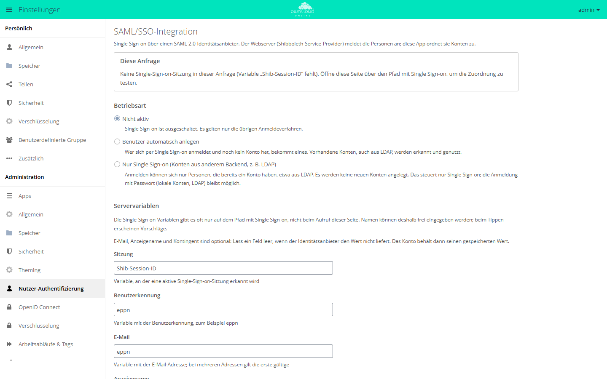

# Anmeldung über OAuth2 und OpenID Connect

Für die Anmeldung ohne Passwort gibt es zwei getrennte Apps mit
unterschiedlichen Aufgaben, eine für Clients und eine für fremde
Identitätsanbieter. Beide stehen ohne API-Schlüssel im Marktplatz.
`oauth2` (Version 0.10.1) macht die Instanz selbst zum Autorisierungsserver,
damit Desktop-, Android- und iOS-Client sowie fremde Anwendungen ohne
Benutzerpasswort angebunden werden können. `openidconnect` (Version 2.4.8)
dreht die Richtung um und meldet Benutzer über einen fremden Anbieter an.
Beide Apps können gleichzeitig aktiv sein. Für Single Sign-on über SAML 2.0
gibt es zusätzlich die App `user_shibboleth`, siehe
[Anmeldung über SAML](#anmeldung-uber-saml). Einen kurzen Überblick über die
Apps geben die Plugin-Seiten [OAuth2](../plugins/apps/oauth2.md) und
[OpenID Connect](../plugins/apps/openidconnect.md); diese Seite beschreibt
Einrichtung und Verhalten im Detail.

## Was welche App macht

| | OAuth2 (`oauth2`) | OpenID Connect (`openidconnect`) |
| --- | --- | --- |
| Rolle | owncloud.online gibt Token aus | owncloud.online prüft Token eines fremden Anbieters |
| Konten liegen | lokal in owncloud.online | beim Identitätsanbieter |
| Konfiguration | Clients in der Datenbank, per `occ` oder Verwaltungsbereich | `config.php` oder App-Konfiguration |
| Einstellungsseite | Einstellungen → Administration → *Nutzer-Authentifizierung* | Einstellungen → Administration → *OpenID Connect* |

Beide Apps registrieren ein Authentifizierungsmodul für `Bearer`-Token. Kennt
`oauth2` ein vorgelegtes Token nicht und ist `openidconnect` aktiviert, gibt
`oauth2` das Token weiter, statt die Anfrage abzuweisen. Ein Mischbetrieb aus
lokalen OAuth2-Clients und Anmeldung über den Anbieter ist damit möglich.

Beide Module kennen das Benutzerpasswort nicht. Verschlüsselung mit
Benutzerschlüsseln funktioniert mit solchen Sitzungen deshalb nicht, nur der
Hauptschlüssel, siehe [Verschlüsselung](encryption.md).

## OAuth2 einrichten

### App aktivieren

```bash
sudo -u www-data php8.4 occ market:install oauth2
```

`market:install` lädt die App aus dem Marktplatz und schaltet sie ein. Liegt
sie schon im App-Verzeichnis, genügt `occ app:enable oauth2`.

Die Datenbanktabellen legt die App über ihre Migrationen an. Dieselben
Migrationen tragen außerdem drei Clients mit fest eingebauten Kennungen ein:
*Desktop Client*, *Android* und *iOS*. Sie sind unmittelbar nach dem Aktivieren
vorhanden und müssen nicht von Hand angelegt werden; `occ oauth2:list-clients`
zeigt sie an.

### Client anlegen

```bash
sudo -u www-data php8.4 occ oauth2:add-client \
  "Fremdanwendung" \
  "<client-id>" \
  "<client-secret>" \
  "https://app.example.com/oauth/callback"
```

Der Name muss neu sein; die drei mitgelieferten Namen sind bereits vergeben.

| Argument | Pflicht | Bedeutung |
| --- | --- | --- |
| `name` | ja | Anzeigename auf der Zustimmungsseite, muss eindeutig sein |
| `client-id` | ja | Kennung des Clients, mindestens 32 Zeichen |
| `client-secret` | ja | Geheimnis des Clients, mindestens 32 Zeichen |
| `redirect-url` | ja | Rückleit-URL, muss eine gültige URL sein |
| `allow-sub-domains` | nein | `true` oder `false`, Standard `false` |
| `trusted` | nein | `true` überspringt die Zustimmungsseite, Standard `false` |
| `force-trust` | nein | `true` erlaubt `trusted` auch für `localhost`, `127.0.0.1` und `[::1]` |

Weitere Befehle:

```bash
# alle Clients samt Geheimnis anzeigen
sudo -u www-data php8.4 occ oauth2:list-clients

# einzelnen Wert ändern
sudo -u www-data php8.4 occ oauth2:modify-client "Desktop Client" redirect-url "http://localhost:*"

# Client entfernen
sudo -u www-data php8.4 occ oauth2:remove-client "<client-id>"
```

`oauth2:modify-client` akzeptiert als Schlüssel `name`, `client-id`,
`client-secret`, `redirect-url`, `allow-sub-domains` und `trusted`.

Im Verwaltungsbereich unter *Nutzer-Authentifizierung* steht derselbe
Client-Bestand unter *OAuth 2.0* → *Angelegte Clients*. Das Formular
*Client hinzufügen* kennt nur *Name*, *URI weiterleiten*, *Subdomains erlauben*
und *Vertrauenswürdiger Client*; Kennung und Geheimnis werden dabei zufällig
erzeugt. Ein Client mit einer vorgegebenen Kennung lässt sich deshalb nur über
`occ oauth2:add-client` anlegen oder nachträglich mit
`occ oauth2:modify-client` auf die gewünschten Werte setzen.

<figure markdown="span">
  
  <figcaption>Unter „OAuth 2.0“ legen Sie Clients mit Name und Weiterleitungs-URI an. Client ID und Secret erzeugt owncloud.online.</figcaption>
</figure>

### Rückleit-URLs der Clients

Die drei mitgelieferten Clients haben ihre Rückleit-URL fest eingebaut, die
Migration registriert sie serverseitig mit. Der *Desktop Client* ist mit
`http://localhost:*` registriert; der Client wählt den Port beim Anmelden frei.
*Android* und *iOS* sind mit einer festen Adresse unter einem eigenen
URI-Schema der jeweiligen App registriert. `occ oauth2:list-clients` zeigt
Rückleit-URL, Kennung und Geheimnis aller drei Clients.

Die Geheimnisse der mitgelieferten Clients stehen im Quellcode der Clients. Sie
sind kein Schutzmechanismus, sondern nur der zweite Teil der vereinbarten
Kennung; der eigentliche Schutz liegt in der Rückleit-URL und in PKCE.

Beim Autorisieren und beim Einlösen des Codes prüft die App Protokoll, Host,
Port, Pfad und Query der Rückleit-URL auf exakte Gleichheit. Für Rückleitungen
auf den eigenen Rechner gelten Ausnahmen nach RFC 8252:

- Ist `http://127.0.0.1` oder `http://[::1]` registriert, mit oder ohne `:*`,
  darf der Client auf `127.0.0.1` oder `[::1]` mit beliebigem Port
  zurückleiten. Pfad und Query müssen passen.
- Bei `http://localhost:*` gilt dasselbe, dazu darf der Client auch auf
  `localhost` mit beliebigem Port zurückleiten.

Andere Hosts unterhalb der registrierten Domain sind nur erlaubt, wenn
`allow-sub-domains` gesetzt ist. Beim Einlösen des Codes muss die Rückleit-URL
außerdem genau dieselbe sein wie beim Autorisieren.

### Zustimmungsseite

Ohne `trusted` sieht der Benutzer im Browser eine Seite mit dem Clientnamen und
der Schaltfläche *Autorisieren*; darunter führt *Benutzer wechseln, um fortzufahren* zu
einer Neuanmeldung. Mit `trusted` entfällt diese Seite, und der Client bekommt
den Autorisierungscode direkt. `localhost`, `127.0.0.1` und `[::1]` lassen sich
nur mit `force-trust` als vertrauenswürdig eintragen; im Formular erscheint
stattdessen „Localhost kann nicht als Vertrauenswürdig eingestuft werden“. Das
ist für Testaufbauten gedacht, nicht für Produktivinstanzen.

### Endpunkte und Laufzeiten

| Zweck | Adresse |
| --- | --- |
| Autorisierung | `/index.php/apps/oauth2/authorize` |
| Token | `/index.php/apps/oauth2/api/v1/token` |
| UserInfo | `/index.php/apps/oauth2/api/v1/userinfo` |

Ein Autorisierungscode ist 600 Sekunden gültig, ein Zugriffstoken 3600
Sekunden; danach holt der Client mit dem Refresh-Token ein neues. Zwei
App-Werte stellen die Laufzeiten ein:

| Schlüssel (App `oauth2`) | Vorgabe | Erlaubt | Wirkung |
| --- | --- | --- | --- |
| `access_token_lifetime` | `3600` | 10 bis 86400 | Gültigkeit neuer Zugriffstoken vom Token-Endpunkt in Sekunden. Token aus dem impliziten Ablauf (`response_type=token`) gelten immer 3600 Sekunden. |
| `refresh_token_grace_period` | `180` | 0 bis 3600 | So viele Sekunden liefert ein bereits eingelöstes Refresh-Token noch einmal dieselben neuen Token, falls die Antwort unterwegs verloren ging. `0` schaltet das ab. |

```bash
sudo -u www-data php8.4 occ config:app:set oauth2 access_token_lifetime --value 3600
```

Werte außerhalb des erlaubten Bereichs setzt die App stillschweigend auf die
nächste Grenze, nicht numerische Werte ersetzt sie durch die Vorgabe.

Abgelaufene Codes und Token räumt ein täglicher Hintergrund-Job weg, und zwar
erst eine Woche nach Ablauf; eingelöste Refresh-Token nach einem Tag. Läuft kein
Cron, bleiben die Zeilen in der Datenbank stehen, abgelehnt werden sie
trotzdem. Siehe [Hintergrund-Jobs (Cron)](background-jobs.md).

## OpenID Connect einrichten

### Voraussetzungen

```bash
sudo -u www-data php8.4 occ market:install openidconnect
```

Sobald eine Konfiguration hinterlegt ist, verlangt die App bei jeder
Web-Anfrage einen verteilten Cache und bricht sonst mit
`A real distributed mem cache setup is required` ab. `memcache.distributed`
fällt auf `memcache.local` zurück; ist keines von beiden gesetzt, ist die
Instanz nach dem Konfigurieren nicht mehr bedienbar. Richten Sie Redis oder
APCu also **vorher** ein, siehe
[Sicherheit und Setup-Warnungen](security-hardening.md).

### Konfiguration in config.php

```php
'openid-connect' => [
    'provider-url'     => 'https://idp.example.com',
    'client-id'        => 'owncloud-online',
    'client-secret'    => '…',
    'scopes'           => ['openid', 'profile', 'email'],
    'mode'             => 'userid',
    'search-attribute' => 'preferred_username',
    'loginButtonName'  => 'Anmeldung über den Firmenzugang',
    'autoRedirectOnLoginPage' => false,
],
```

`mode` entscheidet, wie der Benutzer gesucht wird: `userid` (Vorgabe)
vergleicht den in `search-attribute` genannten Claim mit der Benutzerkennung,
`email` sucht über die E-Mail-Adresse. Ohne Angabe ist `search-attribute` der
Claim `email`. `allowed-user-backends` schränkt die Anmeldung auf bestimmte
Benutzer-Backends ein. Fehlt die Angabe, sind alle erlaubt.

Neue Konten kann die App selbst anlegen:

```php
'auto-provision' => [
    'enabled'            => true,
    'groups'             => ['oidc-users'],
    'email-claim'        => 'email',
    'display-name-claim' => 'name',
    'picture-claim'      => 'picture',
    'update'             => ['enabled' => true],
],
```

Im selben `auto-provision`-Block wirken `provisioning-claim` und
`provisioning-attribute` zusammen als Filter: Das Konto entsteht nur, wenn der
genannte Claim eine Liste ist und das geforderte Attribut enthält. Mit
`mode => 'email'` bekommen neu angelegte Konten eine erzeugte Kennung der Form
`oidc-user-<zufall>`, weil die E-Mail-Adresse dann der Suchschlüssel ist und
nicht die Kennung.

### Konfiguration im Verwaltungsbereich

Unter Einstellungen → Administration → *OpenID Connect* pflegen Sie dieselben
Werte in einem Formular. Die Feldbeschriftungen dieser Seite sind nicht übersetzt und
erscheinen auch bei deutsch eingestellter Oberfläche auf Englisch
(*Provider URL*, *Client ID*, *Client secret*, *Lookup mode*, *Search claim*
und so weiter).

<figure markdown="span">
  
  <figcaption>Für die Anmeldung über einen Identity Provider tragen Sie Provider URL, Client ID und Client secret ein. Pflichtfelder sind mit * markiert.</figcaption>
</figure>

Gespeicherte Formularwerte landen als App-Konfiguration unter der App
`openidconnect` im Schlüssel `openid-connect` und haben **Vorrang** vor
`config.php`. Solange sie existieren, bleibt jede Änderung an `config.php`
wirkungslos. Die Seite zeigt oben unter *Configuration source* an, welche Quelle
gerade greift. Die Schaltfläche *Use system config* löscht die
App-Konfiguration wieder. Auf der Kommandozeile:

```bash
# gespeicherte App-Konfiguration ansehen
sudo -u www-data php8.4 occ config:app:get openidconnect openid-connect

# App-Konfiguration verwerfen, danach gilt wieder config.php
sudo -u www-data php8.4 occ config:app:delete openidconnect openid-connect

# den Block aus config.php prüfen
sudo -u www-data php8.4 occ config:list system
```

`config:app:get` gibt die App-Konfiguration samt Client-Geheimnis im Klartext
aus. `config:list system` blendet das Geheimnis aus dem Block in `config.php`
dagegen aus.

### Was beim Anbieter eingetragen wird

| Zweck | Adresse |
| --- | --- |
| Rückleit-URL (Redirect URI) | `https://cloud.example.com/index.php/apps/openidconnect/redirect` |
| Abmeldung durch den Anbieter | `https://cloud.example.com/index.php/apps/openidconnect/logout` |
| Discovery-Weiterreichung | `https://cloud.example.com/index.php/apps/openidconnect/config` |

Die Rückleit-URL lässt sich mit `redirect-url` überschreiben, etwa wenn ein
Proxy davor eine andere Adresse ausliefert. Die Abmeldeadresse erwartet die
Parameter `iss` und `sid`. `iss` muss dieselbe Domäne wie die konfigurierte
`provider-url` tragen: Protokoll, Host und Port werden verglichen, der Pfad
nicht. Fehlt einer der beiden Parameter oder passt `iss` nicht, passiert nichts;
auch eine laufende Browser-Sitzung bleibt bestehen. Passt alles, entfernt die
App die Sitzungskennung aus dem verteilten Cache. Bringt der Aufruf das
Sitzungs-Cookie eines angemeldeten Browsers mit, wird diese Sitzung nur
abgemeldet, wenn die beim Anmelden gespeicherte Sitzungskennung zu `sid` passt.

Auf der Anmeldeseite erscheint unter *Alternative Logins* eine Schaltfläche mit
dem Text aus `loginButtonName`. Fehlt der Wert in `config.php`, steht dort
„OpenID Connect“; das Formular im Verwaltungsbereich schlägt „Login via OpenID
Connect“ vor. Mit `autoRedirectOnLoginPage => true` leitet die App jeden Aufruf
der Anmeldeseite sofort zum Anbieter weiter. Die lokale Anmeldemaske ist dann
nicht mehr erreichbar.

## .well-known-Adressen umschreiben

Der Desktop-Client fragt beim Einrichten eines Kontos zuerst
`/.well-known/openid-configuration` ab und nimmt Autorisierungs- und
Token-Endpunkt aus der Antwort. Genau diese Adresse liefert eine
Standardinstallation aber nicht aus: Die mitgelieferte `.htaccess` bildet nur
`host-meta` (auch `host-meta.json`), `carddav` und `caldav` ab und beantwortet
alles Übrige, das mit einem Punkt beginnt, mit 404. Ausgenommen sind
`acme-challenge` und `pki-validation`.

Die Folge ist kein sichtbarer Fehler, sondern ein stiller Rückfall: Der
Desktop-Client wechselt bei fehlgeschlagener Abfrage auf die OAuth2-Routen
`/index.php/apps/oauth2/authorize` und `/index.php/apps/oauth2/api/v1/token`.
Der Client meldet sich dann weiterhin lokal an, obwohl OpenID Connect
eingerichtet ist.

Damit die Abfrage funktioniert, muss der Webserver umschreiben:

| Angefragte Adresse | Ziel |
| --- | --- |
| `/.well-known/openid-configuration` | `/index.php/apps/openidconnect/config` |

Apache, in der vhost-Konfiguration:

```apache
RewriteEngine on
RewriteRule ^/\.well-known/openid-configuration$ /index.php/apps/openidconnect/config [PT,L]
```

nginx:

```nginx
location = /.well-known/openid-configuration {
    return 301 /index.php/apps/openidconnect/config;
}
```

Zwei Punkte dazu:

- Die Regel gehört in die vhost-Konfiguration, nicht in die `.htaccess`. Die
  `.htaccess` ist Teil des Auslieferungspakets und wird bei einer
  Aktualisierung durch die Paketfassung ersetzt. nginx liest sie ohnehin nicht.
- Sie muss vor der Regel stehen, die Pfade mit führendem Punkt abweist.

Die Ziel-Route reicht das Discovery-Dokument des Anbieters durch. Solange keine
OpenID-Connect-Konfiguration hinterlegt ist, antwortet sie mit einer leeren
JSON-Liste (`[]`); ist der Anbieter nicht erreichbar, mit HTTP 503 und
`temporarily_unavailable`. In beiden Fällen greift wieder der Rückfall auf die
OAuth2-Routen.

## Anmeldung über SAML

Für Single Sign-on über einen SAML-2.0-Identitätsanbieter gibt es die App
`user_shibboleth` (*SAML/SSO-Integration*, Version 4.0.0). Die Anmeldung
selbst übernimmt der Shibboleth-Service-Provider (`mod_shib`, Dienst `shibd`)
im Apache vor owncloud.online. Die App liest die Angaben, die der
Service-Provider an PHP übergibt, und ordnet die Person einem Konto zu.

!!! info "Nur mit API-Schlüssel"
    `user_shibboleth` ist im Marktplatz nur mit API-Schlüssel sichtbar. Den
    Schlüssel erhalten Sie auf Anfrage von der BW-Tech GmbH. Eingetragen wird
    er in der App **Markt** unter **Einstellungen** → **API Schlüssel
    hinzufügen**, siehe
    [Apps mit API-Schlüssel](apps-market.md#apps-mit-api-schlussel).

Voraussetzungen sind Apache 2.4 mit dem Shibboleth-Service-Provider 3 (Paket
`libapache2-mod-shib`) und ein Identitätsanbieter, der eine eindeutige Kennung
liefert, etwa `eppn` oder `subject-id`.

Die Einstellungen stehen unter **Einstellungen → Administration →
Nutzer-Authentifizierung**, Abschnitt *SAML/SSO-Integration*. Unter
*Betriebsart* wählen Sie:

| Betriebsart | Wert für `occ shibboleth:mode` | Wirkung |
| --- | --- | --- |
| Nicht aktiv | `notactive` | Single Sign-on ist aus (Vorgabe). Es gelten nur die übrigen Anmeldeverfahren. |
| Benutzer automatisch anlegen | `autoprovision` | Wer sich per Single Sign-on anmeldet und noch kein Konto hat, bekommt eines. Vorhandene Konten, auch aus LDAP, werden erkannt und genutzt. |
| Nur Single Sign-on (Konten aus anderem Backend, z. B. LDAP) | `ssoonly` | Anmelden können sich nur Personen, die bereits ein Konto haben. Es werden keine neuen Konten angelegt. |

Unter *Servervariablen* legen Sie fest, aus welchen Variablen des
Service-Providers Sitzung, Benutzerkennung, E-Mail, Anzeigename und Kontingent
kommen. Der Kasten *Diese Anfrage* zeigt, was die App aus der aktuellen Anfrage
liest.

<figure markdown="span">
  
  <figcaption>Für Single Sign-on über SAML wählen Sie die Betriebsart und tragen die Servervariablen des Webservers ein.</figcaption>
</figure>

Dasselbe auf der Kommandozeile:

```bash
sudo -u www-data php8.4 occ shibboleth:mapping --uid eppn --email mail --display-name displayName --quota quota
sudo -u www-data php8.4 occ shibboleth:mode autoprovision
sudo -u www-data php8.4 occ shibboleth:check
```

`shibboleth:check` prüft Betriebsart, Zuordnung, SSO-Einstieg,
`overwrite.cli.url`, die WebDAV-Adresse und die Konten des SSO-Backends. Findet
der Befehl Probleme, endet er mit Rückgabewert 1. Was Sie außerdem wissen
sollten:

- Lokale Konten mit Administratorrechten (Gruppe `admin`) meldet Single Sign-on
  nie an. Sie melden sich mit Passwort über `/index.php/login?direct=1` an.
- Desktop- und Mobil-Clients melden sich nicht über den Identitätsanbieter an,
  sondern mit App-Passwort oder über OAuth2 (WebDAV unter
  `remote.php/nonshib-webdav` oder `remote.php/dav`).
- `occ user:sync` ist für dieses Backend nicht möglich, die App kann keine
  Konten auflisten.
- Auch hier gibt es kein Passwort. Verschlüsselung geht nur mit dem
  Hauptschlüssel. Windows-Netzlaufwerke mit *Anmeldedaten in Sitzung speichern*
  sind nicht verfügbar; Mechanismen mit gespeicherten Zugangsdaten
  funktionieren.

Webserver-Beispiele und alle Einstellungen der App beschreibt
[SAML/SSO-Integration](../plugins/apps/user_shibboleth.md).

## Sitzungen zurückziehen

**Benutzer:** Einstellungen → Persönlich → *Sicherheit* → *OAuth 2.0* →
*Autorisierte Anwendungen*. Das Löschsymbol in der Zeile (*Revoke
authorization*) entfernt Autorisierungscodes, Zugriffs- und Refresh-Token
dieses Clients für dieses Konto. Andere Benutzer desselben Clients sind nicht
betroffen.

**Administration:** Wird ein Client unter *Nutzer-Authentifizierung* gelöscht,
verschwinden zusätzlich alle Codes und Token dieses Clients für sämtliche
Benutzer.

`occ oauth2:remove-client` verhält sich anders: Der Befehl löscht nur den
Client-Eintrag. Bereits ausgegebene Zugriffstoken bleiben deshalb bis zum Ende
ihrer Laufzeit gültig (Vorgabe eine Stunde, `access_token_lifetime`), während
ein Refresh danach mit `invalid_client` scheitert. Wollen Sie den Zugang sofort
schließen, löschen Sie den Client im Verwaltungsbereich.

Beim Löschen eines Benutzers werden dessen Codes und Token automatisch mit
entfernt.

**OpenID Connect:** Die Abmeldung in der Weboberfläche widerruft beim Anbieter
das Zugriffstoken und beendet dort die Sitzung; `post_logout_redirect_uri`
bestimmt, wohin der Browser danach geht. Umgekehrt kann der Anbieter eine
Sitzung über die Abmeldeadresse mit `iss` und `sid` beenden: Die
Sitzungskennung wird dann aus dem verteilten Cache entfernt, und bei der
nächsten Anfrage wird der Benutzer abgemeldet. Läuft die Instanz auf mehreren Knoten,
muss dieser Cache von allen Knoten gemeinsam genutzt werden, sonst wirkt die
Abmeldung nur auf einem.

## Fehlersuche

| Symptom | Ursache | Abhilfe |
| --- | --- | --- |
| `invalid_client` am Token-Endpunkt | Kennung oder Geheimnis stimmen nicht, oder der Reverse Proxy reicht den `Authorization`-Header nicht durch | Werte mit `occ oauth2:list-clients` vergleichen; Header im Proxy durchreichen |
| `invalid_grant` mit `auth grant redirect uri invalid` oder `auth grant redirect uri mismatch` | Die vom Client geschickte Rückleit-URL passt nicht zur Registrierung, oder sie weicht beim Einlösen von der beim Autorisieren ab | Registrierte URL mit `occ oauth2:modify-client <name> redirect-url <url>` korrigieren |
| Seite „Anfrage nicht gültig“ statt Zustimmungsseite | Unbekannte `client_id` oder unpassende Rückleit-URL | Client anlegen beziehungsweise Rückleit-URL angleichen |
| Desktop-Client meldet sich lokal an, obwohl OpenID Connect eingerichtet ist | `/.well-known/openid-configuration` liefert 404, der Client fällt auf die OAuth2-Routen zurück | Umschreibung im Webserver einrichten |
| Jede Seite bricht mit „A real distributed mem cache setup is required“ ab | OpenID Connect ist konfiguriert, aber kein verteilter Cache vorhanden | `memcache.local` bzw. `memcache.distributed` setzen |
| „Configuration issue in openidconnect app“ beim Anmelden | Weder eine gültige App-Konfiguration noch ein Block `openid-connect` in `config.php` vorhanden | `occ config:app:get openidconnect openid-connect` und `occ config:list system` prüfen |
| Änderungen an `config.php` bleiben wirkungslos | Eine App-Konfiguration überdeckt sie | `occ config:app:delete openidconnect openid-connect` oder im Formular *Use system config* |
| „Configured attribute … is not known.“ | Der Claim aus `search-attribute` fehlt in den Benutzerdaten des Anbieters | Claim beim Anbieter ausliefern lassen (Scope) oder `search-attribute` anpassen |
| „… is not unique.“ bei der Anmeldung | `mode` steht auf `email` und mehrere Konten teilen sich die Adresse | Auf `mode` `userid` wechseln oder die Konten bereinigen |
| „User … is not known.“ | Konto fehlt lokal und das automatische Anlegen ist aus | `search-attribute` prüfen oder `auto-provision` einschalten |
| „Required provisioning attribute is not found.“ | `provisioning-claim` fehlt im Token oder enthält das geforderte Attribut nicht | Claim beim Anbieter ausliefern oder den Filter anpassen |
| „User is from wrong user backend“ | `allowed-user-backends` schließt das Backend des Kontos aus | Backend ergänzen oder die Einschränkung entfernen |
| Clients mit Token des Anbieters bekommen HTTP 401, im Protokoll „Token audience does not match the expected audience“ | Das Zugriffstoken nennt in `aud` (ersatzweise `azp`, `appid` oder `client_id`) nicht die konfigurierte `client-id` | Beim Anbieter korrigieren, oder im Block `openid-connect` den Schlüssel `audience` auf den Wert setzen, den der Anbieter in `aud` schreibt |
| Verschlüsselung schlägt bei Token-Anmeldung fehl | Die Authentifizierungsmodule kennen kein Passwort | Nur den Hauptschlüssel verwenden, siehe [Verschlüsselung](encryption.md) |
| Abgelaufene Token bleiben in der Datenbank | Der tägliche Aufräum-Job läuft nicht | Cron prüfen, siehe [Hintergrund-Jobs (Cron)](background-jobs.md) |

Ausführliche Meldungen beider Apps stehen im Protokoll, siehe
[Serverprotokoll und Fehlermeldungen](logging.md).
