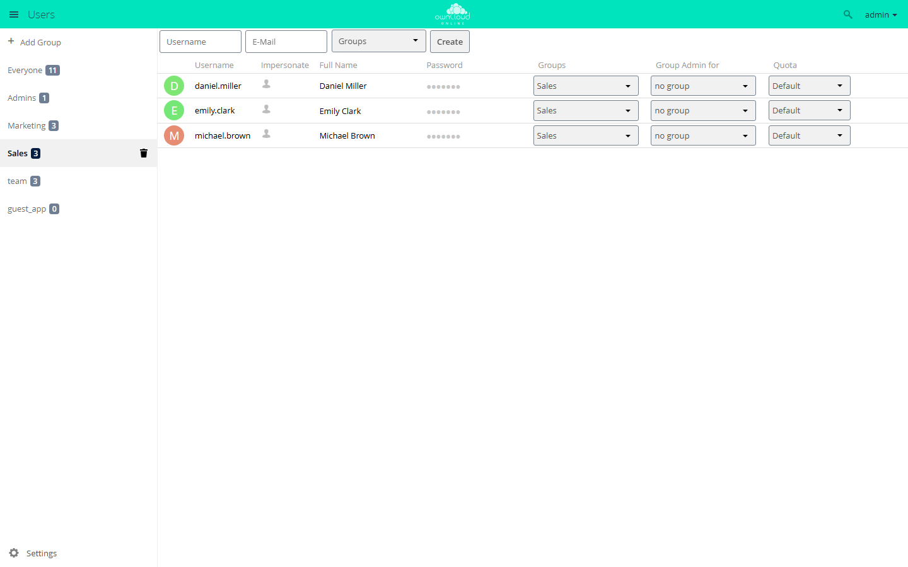

# Users and groups

owncloud.online manages accounts and groups in the web interface, through the
*Users* entry in the user menu at the top right, and on the command line with
`occ`. Both write to the same tables. There is no separate data store.

Run the `occ` commands on this page from the installation directory, for
example after `cd /var/www/owncloud.online`.

## The user management page



The *Users* menu entry (`/settings/users`) is shown to admins and to group
admins (`lib/private/legacy/app.php`). The left column holds the group list
with *Add Group*, *Everyone*, *Admins*, and the existing groups. Click a group
to filter the account list. On the right are the form for new accounts and the
account list.

*Everyone* is not a group but a filter over all accounts
(`data-gid="_everyone"` in `settings/templates/users/part.grouplist.php`).

The checkboxes under *Settings* at the bottom of the left column control which
columns the account list shows. Each one writes an app config value of the
`core` app:

| Checkbox | Key (app `core`) | Default |
| --- | --- | --- |
| Show enabled/disabled option | `umgmt_show_is_enabled` | `false` |
| Show storage location | `umgmt_show_storage_location` | `false` |
| Show creation time | `umgmt_show_creation_time` | `false` |
| Show last log in | `umgmt_show_last_login` | `false` |
| Show user backend | `umgmt_show_backend` | `false` |
| Show email address | `umgmt_show_email` | `false` |
| Set password for new users | `umgmt_set_password` | `false` |
| Show password field | `umgmt_show_password` | `true` |
| Show quota field | `umgmt_show_quota` | `true` |

The values apply to the whole instance, not per admin. You can also set them
directly:

```bash
sudo -u www-data php8.4 occ config:app:set core umgmt_show_last_login --value true
```

## Username and display name

Every account has two names, and they are often mixed up.

| | Username (uid) | Display name |
| --- | --- | --- |
| Purpose | Identity of the account: login, name of the home directory, owner of files and shares | Label in the web interface, share dialog, emails |
| Column in the list | *Username* | *Full Name* |
| Can be changed | no | yes |
| Unique | yes | no |

The username is checked when the account is created
(`lib/private/User/Manager.php`). It may contain `a-z`, `A-Z`, `0-9`, and
`+_.@-'`, and it must be 3 to 64 characters long. Leading or trailing spaces
are rejected, and so are umlauts and other special characters. A space inside the name passes the check even though the error
message does not mention it. Avoid it anyway.

The names that sit next to the accounts in the data directory are reserved and
cannot be used as usernames (`lib/public/User/Constants.php`): `avatars`,
`meta`, `files_external`, `files_encryption`, `.htaccess`, `.ocdata`,
`htaccesstest.txt`, `owncloud.db`, `owncloud.log`, `index.html`.

You cannot change a username later, neither in the web interface nor with an
`occ` command. To rename an account, create a new one and move the data with
`files:transfer-ownership` (see below).

Display names are not unique: two accounts may have the same full name. If
`allow_user_to_change_display_name` is set to `false` in `config/config.php`,
only admins and group admins can change display names. Users can no longer
change their own (`lib/private/User/User.php`, `canChangeDisplayName`).

## Creating accounts

In the web interface, fill in *Username* and, depending on the settings,
*Password* or *E-Mail*, and optionally pick groups. The password field and the
email field exclude each other: if *Set password for new users* is checked, the
email field is hidden, and the other way round (`settings/js/users/users.js`).

If the password stays empty and an email address is given, the server
generates a random password and sends an invitation with a link to set the
password (`settings/Controller/UsersController.php`, `create`). Without working
email delivery, this message never arrives and the account cannot be used. See
[Sending email](email.en.md).

On the command line:

```bash
# interactive, prompts for the password
sudo -u www-data php8.4 occ user:add jdoe

# non-interactive, password from the OC_PASS environment variable
sudo -u www-data env OC_PASS='ExamplePassword' php8.4 occ user:add jdoe \
  --password-from-env \
  --display-name "Jane Doe" \
  --email jane.doe@example.com \
  --group project-a --group sales
```

`OC_PASS` has to come after `sudo`, as shown above with `env`. If you set the
variable before `sudo`, sudo drops it with its default settings (`env_reset`),
and `occ` reports "--password-from-env given, but OC_PASS is empty!".

`user:add` creates the groups named in `--group` if they do not exist yet.
Without `--password-from-env` and without an interactive session, the command
stops because it cannot ask for a password.

On first login, the home directory is filled from the skeleton directory
(`skeletondirectory`, see [Configuration](config-reference.en.md)).

## Changing accounts

Change the display name and email address in the list with the pencil icons
next to *Full Name* and *Email*, or on the command line:

```bash
sudo -u www-data php8.4 occ user:modify jdoe displayname "Jane Doe"
sudo -u www-data php8.4 occ user:modify jdoe email jane.doe@example.com
```

`user:modify` accepts exactly these two keys (`displayname`, `email`). An
invalid email address is rejected.

Resetting a password:

```bash
# set a new password directly
sudo -u www-data env OC_PASS='NewPassword' php8.4 occ user:resetpassword jdoe \
  --password-from-env

# create a reset link and print it instead
sudo -u www-data php8.4 occ user:resetpassword jdoe --output-link

# send a reset link to the stored address (and print it)
sudo -u www-data php8.4 occ user:resetpassword jdoe --send-email
```

If the `encryption` app is enabled, interactive mode shows an explicit warning:
resetting the password then causes data loss unless a recovery key applies.
See [Encryption](encryption.en.md).

Reading and writing individual account settings:

```bash
# all settings of an account
sudo -u www-data php8.4 occ user:setting jdoe

# only those of one app
sudo -u www-data php8.4 occ user:setting jdoe core

# read, set, delete a single value
sudo -u www-data php8.4 occ user:setting jdoe core lang
sudo -u www-data php8.4 occ user:setting jdoe core lang --value de
sudo -u www-data php8.4 occ user:setting jdoe core lang --delete
```

`--update-only` writes only if the key already exists. `--error-if-not-exists`
makes `--delete` fail if there was nothing to delete. `--default-value` returns
a fallback value instead of an error when reading.

## Disabling accounts

A disabled account can no longer log in, neither in the web interface nor
through the login methods for WebDAV and clients
(`lib/private/User/Session.php`). Files, shares, and group memberships stay as
they are. This is the right step when someone leaves, when an account is
suspected of misuse, and for anything that should stay reversible.

```bash
sudo -u www-data php8.4 occ user:disable jdoe
sudo -u www-data php8.4 occ user:enable jdoe
```

In the web interface, use the *Enabled* column. Turn it on first with *Show
enabled/disabled option*. You cannot disable or delete your own account there.

Finding candidates:

```bash
# accounts that have not logged in for 180 days
sudo -u www-data php8.4 occ user:inactive 180

# last login of a single account
sudo -u www-data php8.4 occ user:lastseen jdoe
```

## Deleting accounts

Deleting is final. In the web interface, the *Delete user* dialog asks first
("All user data, files and shares will be deleted.",
`settings/js/users/users.js`). `occ user:delete` deletes without asking.
`lib/private/User/User.php` (`delete`) and the hooks attached to it remove:

| What | Effect |
| --- | --- |
| Group memberships | The account is removed from all groups |
| Group admin rights | Entries in `group_admin` are dropped (`lib/private/SubAdmin.php`) |
| Account settings | All values of the account in `preferences` |
| External storage | Personal mounts are deleted. The account is removed from global mounts; if it was the only one with access, the mount is deleted entirely (`lib/private/Files/External/Service/GlobalStoragesService.php`) |
| Home directory | Removed completely, including deleted files and file versions |
| Comments | Comments and read markers of the account |
| Record in the user backend and in the `accounts` table | Last, so that an interrupted run can be repeated |

For shares, `OC\Share20\Hooks::post_deleteUser` applies
(`lib/private/Share20/Hooks.php`). These are deleted:

- user shares owned by the account **or** shared with the account,
- group shares owned by the account, and the account's own entries derived
  from group shares,
- public links the account owns or created,
- shares with remote instances
  (`apps/federatedfilesharing/lib/FederatedShareProvider.php`) and the mounts
  received from them (`apps/files_sharing/lib/Hooks.php`, `deleteUser`).

Recipients immediately lose access to everything the deleted account had
shared. To keep the data, transfer it **before** deleting the account:

```bash
sudo -u www-data php8.4 occ files:transfer-ownership jdoe jsmith
sudo -u www-data php8.4 occ user:delete jdoe
```

`files:transfer-ownership` moves files and folders and takes the shares along.
`--path` limits the transfer to a subfolder.

If a failed run leaves orphaned data behind, `--force` cleans up even when the
account itself can no longer be found:

```bash
sudo -u www-data php8.4 occ user:delete jdoe --force
```

## Groups

Groups are used for assigning permissions and for sharing. Manage them in the
left column of the user management page or on the command line:

```bash
sudo -u www-data php8.4 occ group:add project-a
sudo -u www-data php8.4 occ group:add-member project-a -m jdoe -m jsmith
sudo -u www-data php8.4 occ group:list-members project-a
sudo -u www-data php8.4 occ group:remove-member project-a -m jsmith
sudo -u www-data php8.4 occ group:delete project-a
```

Two special cases:

- The `admin` group is protected and cannot be deleted
  (`lib/private/Group/Group.php`). Its members are admins of the instance.
- Groups cannot be renamed. The group name is also its ID. There is neither an
  `occ` command nor a button for it.

When you delete a group, the server removes all shares with that group,
including the members' own entries derived from these shares
(`lib/private/Share20/DefaultShareProvider.php`, `groupDeleted`). If you only
remove one member from the group, the group share stays. Only that account
loses access.

## Group admins

A group admin manages the accounts in their groups without being an admin of
the instance. You can only assign this role in the web interface, in the
*Group Admin for* column. Only admins of the instance see that column.

The limits come from `lib/private/SubAdmin.php` and
`settings/Controller/UsersController.php`:

| Allowed | Not allowed |
| --- | --- |
| Create, change, disable, and delete accounts in their own groups | Edit accounts outside their own groups |
| Set storage quotas for these accounts | Edit admins |
| Change the display names of these accounts, even if `allow_user_to_change_display_name` is `false` | Appoint group admins; the endpoint `settings/ajax/togglesubadmins.php` requires admin rights |

If a group admin creates an account without choosing a group, the account is
added to the group admin's own groups automatically.

You can turn the whole feature off. With

```php
'allow_subadmins' => false,
```

in `config/config.php`, nobody counts as a group admin anymore. Only admins of
the instance keep access to the user management page.

To check which groups an account belongs to:

```bash
sudo -u www-data php8.4 occ user:list-groups jdoe
```

## Storage quota

The quota belongs to the **account**, not to the group. owncloud.online has no
per-group quota. If you want different quotas per department, set the value
per account or work with the default.

The quota is resolved in this order (`lib/private/legacy/util.php`,
`getUserQuota`):

1. the value set on the account, unless it is `default`,
2. otherwise `default_quota` of the `files` app,
3. if the resulting value is `none`, there is no limit.

Two app config values control the selection lists:

| Key | App | Default | Meaning |
| --- | --- | --- | --- |
| `default_quota` | `files` | `none` | Default for all accounts set to *Default* |
| `quota_preset` | `files` | `1 GB, 5 GB, 10 GB` | Values offered in the drop-down list |

```bash
sudo -u www-data php8.4 occ config:app:set files default_quota --value "10 GB"
sudo -u www-data php8.4 occ config:app:set files quota_preset --value "1 GB, 5 GB, 10 GB, 100 GB"
```

Set the quota of a single account in the *Quota* column. Besides *Default* and
*Unlimited*, it offers the preset values and *Other ...* for free input such as
`512 MB` or `12 GB`. Check the stored values with:

```bash
sudo -u www-data php8.4 occ user:list --attributes uid --attributes quota
```

## Custom groups


The `customgroups` app adds groups that users create themselves. They are
meant for sharing, not for granting permissions. Users create them under *Settings →
Personal → Custom Groups*. In the share dialog they look like regular groups.

A custom group has two roles. A *Group owner* can add and remove members,
rename and delete the group, and assign roles. A *Member* can share with the
group, see the member list, and leave the group. Admins see and change all
custom groups.

Two checkboxes are in the *Custom Groups* section under *Settings → Admin →
Sharing*:

| Checkbox | Key (app `customgroups`) | Default |
| --- | --- | --- |
| Only group admins are allowed to create custom groups | `only_subadmin_can_create` | `false` |
| Allow creating multiple groups with the same name | `allow_duplicate_names` | `false` |

```bash
sudo -u www-data php8.4 occ config:app:set customgroups only_subadmin_can_create --value true
```

If `shareapi_only_share_with_group_members` of the `core` app is enabled, a
member can only add accounts with which they share at least one group (the
app's `lib/Service/MembershipHelper.php`).

Important for troubleshooting: the app's group backend only reports itself as
responsible for the "sharing" scope (`isVisibleForScope`). Custom groups
therefore do **not** show up in `occ group:list` or in `occ user:list-groups`,
even though they are real groups with the ID prefix `customgroup_`.

Install the app from the Market, see [Managing apps](apps-market.en.md). For
more about the app, see [Custom Groups](../plugins/apps/customgroups.en.md).

## occ command overview

| Command | Arguments and options |
| --- | --- |
| `user:add` | `uid`; `--password-from-env`, `--display-name`, `--email`, `-g/--group` (repeatable) |
| `user:delete` | `uid`; `-f/--force` |
| `user:disable` / `user:enable` | `uid` |
| `user:modify` | `uid key value`, keys: `displayname`, `email` |
| `user:resetpassword` | `user`; `--password-from-env`, `--send-email`, `--output-link` |
| `user:setting` | `uid [app] [key]`; `--value`, `--update-only`, `--delete`, `--error-if-not-exists`, `--default-value`, `--ignore-missing-user` |
| `user:list` | `[search-pattern]`; `-a/--attributes` (repeatable), `-s/--show-all-attributes`, `--output` |
| `user:list-groups` | `uid`; `--output` |
| `user:lastseen` | `uid` |
| `user:inactive` | `days`; `--output` |
| `user:report` | none |
| `user:sync` | `[backend-class]`; `-l/--list`, `-u/--uid`, `-s/--seenOnly`, `-c/--showCount`, `-m/--missing-account-action` (`disable`, `remove`), `-r/--re-enable` |
| `user:home:list-dirs` | `--output` |
| `user:home:list-users` | `[path]`; `--all`, `--output` |
| `user:move-home` | `user_id new_location` |
| `group:add` | `group` |
| `group:delete` | `group` |
| `group:add-member` | `group`; `-m/--member` (repeatable) |
| `group:remove-member` | `group`; `-m/--member` (repeatable) |
| `group:list` | `[search-pattern]`; `--output` |
| `group:list-members` | `group`; `--output` |

`--output` accepts `plain` (default), `json`, and `json_pretty`. Possible
attributes for `user:list` are `uid`, `displayName`, `email`, `quota`,
`enabled`, `lastLogin`, `creationTime`, `home`, `backend`, `cloudId`, and
`searchTerms`. Without `--attributes`, the command prints `displayName`.

An overview of all accounts:

```bash
sudo -u www-data php8.4 occ user:report
sudo -u www-data php8.4 occ user:list --show-all-attributes --output json_pretty
```

`user:sync` syncs the accounts of a backend with the `accounts` table. `--list`
shows the backend classes you can use. Be careful:
`--missing-account-action remove` deletes accounts, including their data, as
soon as they are missing in the backend. If in doubt, choose `disable` and
check the list first.

## Troubleshooting

| Symptom | Cause | Fix |
| --- | --- | --- |
| `occ user:add` stops with "Interactive input or --password-from-env is needed for entering a password!" | Called without a terminal, for example from a script | Pass `--password-from-env` and set `OC_PASS` after `sudo` |
| `occ` reports "--password-from-env given, but OC_PASS is empty!" | `OC_PASS` was set before `sudo`, and sudo does not pass it on | `sudo -u www-data env OC_PASS='…' php8.4 occ …` |
| A username with an umlaut or another special character is rejected | Character check in `lib/private/User/Manager.php` | Use only `a-z`, `A-Z`, `0-9`, `+_.@-'`, 3 to 64 characters |
| A new account gets no invitation email | With *Set password for new users* checked, the email field is hidden, or email delivery is not set up | Uncheck the box; check email delivery, see [Sending email](email.en.md) |
| Account deleted, files and shares are gone | `user:delete` removes the home directory, deleted files, versions, and all shares | Run `files:transfer-ownership` first; restoring is only possible from a backup |
| A custom group is missing from `occ group:list` and `occ user:list-groups` | The backend is only visible for the "sharing" scope | Check under *Settings → Personal → Custom Groups* |
| A group needs a new name | The group name is the ID; groups cannot be renamed | Create a new group, move members and shares, delete the old group |
| `occ group:delete admin` fails | The `admin` group is protected | Remove members one by one |
| The *Group Admin for* column is missing | The column is only shown to admins of the instance (`settings/users.php`, `part.userlist.php`) | Log in as an admin |
| A user cannot change their display name | `allow_user_to_change_display_name` is `false` | Remove the value or have an admin make the change |
| `occ user:setting <uid> files quota --value "5 GB"` has no effect | What counts is the value on the account in the `accounts` table; the setting is only read when the account is synced | Set the quota in the *Quota* column and check it with `occ user:list -a uid -a quota` |
| Password reset, files can no longer be read | The `encryption` app was enabled | Use the recovery key, see [Encryption](encryption.en.md) |
| A disabled account still uses storage | Disabling deletes nothing, it only blocks login | Transfer the data and delete the account |
