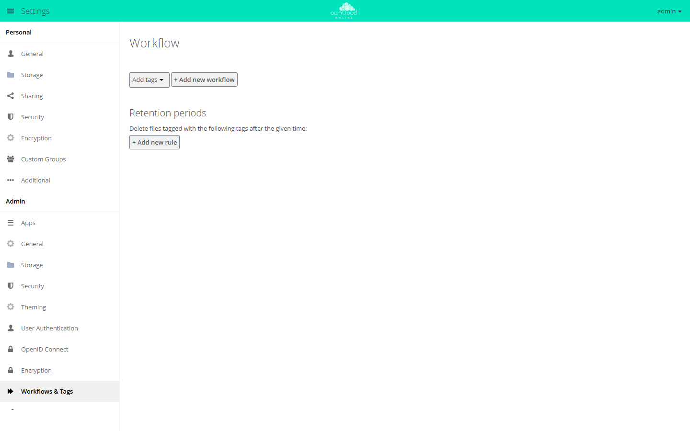

# Rules and retention

owncloud.online has two kinds of rules that work independently of each other.
The **file firewall** (app `file_firewall`) checks every incoming request and
rejects it before anything happens. The **Workflow app** (`workflow`) does not
interfere with access; it assigns tags automatically on upload and later deletes
files on a schedule when they carry a tag with a retention period. The
`oco_expire` app deletes files by age alone, without any tags.

!!! info "API key required"
    `file_firewall`, `workflow`, and `oco_expire` appear in the Marketplace
    only with an API key. You can request the key from BW-Tech GmbH. How to
    enter it in the Market app is described in
    [Apps and Marketplace](apps-market.en.md#apps-that-require-an-api-key).

## The two layers compared

| | File firewall (`file_firewall`) | Workflow (`workflow`) |
| --- | --- | --- |
| Effect | rejects the request (HTTP 403) | assigns tags, deletes tagged files |
| When | synchronously, during the request | auto-tagging on creation, deletion in a background job |
| Logic | conditions in a group combined with AND, groups combined with OR | conditions of a workflow combined with AND |
| Management | admin settings, `occ`, OCS API | admin settings |
| Test mode | yes, per rule group | no |
| Hit counter | yes, per rule group | no |

Install both apps (after entering the API key) and check the state:

```bash
sudo -u www-data php8.4 occ market:install file_firewall workflow
sudo -u www-data php8.4 occ app:list
```

If the apps are already present, `occ app:enable file_firewall` and
`occ app:enable workflow` turn them on.

The settings are under **Settings → Admin → Security** (section *BW-Tech File
Firewall*) and **Settings → Admin → Workflows & Tags** (section *Workflow*).

## File firewall: reject access

### Structure of a rule

A rule is a **rule group** with a name, the switches *Enabled* and *Test mode
(log only)*, and one or more conditions. Within a group, **all** conditions must
match (shown as *AND* between the lines in the user interface). If a group
matches, the request is blocked and evaluation ends; further groups are not
checked.

In the user interface, *Add Group* creates a new rule group and *Add Condition*
adds another line. Changes only take effect after *Save Rules*. Until then, deleting
a group or a condition also only removes it from the editor.

<figure markdown="span">
  
  <figcaption>A request is blocked if it meets all conditions of a rule group. "Save Rules" applies the changes.</figcaption>
</figure>

The firewall answers blocked WebDAV requests with HTTP 403 and the message
`Blocked by BW-Tech File Firewall: <rule group name>`. The web interface shows
this message when an upload is blocked. So choose names that users may see.

Four things are never blocked:

* Requests from administrators.
* Everything that runs on the command line (`occ`, `cron.php`). The firewall
  does not evaluate any rules there.
* Requests without a logged-in user, unless they are for a public link. Public
  links are evaluated.
* Requests for which the evaluation itself throws an error. In that case the
  firewall lets the request through (*fail open*).

Disabled groups are skipped entirely.

### Available conditions and operators

| Condition (ID) | Label | Operators | Value |
| --- | --- | --- | --- |
| `user_group` | User Group | `is`, `is_not` | group ID |
| `user_agent` | User Agent | `matches`, `not_matches` | pattern with `*` |
| `device` | User Device | `is`, `is_not` | see device types |
| `ip_range_ipv4` | IP Range (IPv4) | `is`, `is_not` | CIDR or single address |
| `ip_range_ipv6` | IP Range (IPv6) | `is`, `is_not` | CIDR or single address |
| `time` | Request Time | `is`, `is_not` | start/end, optional time zone |
| `request_url` | Request URL | `contains`, `not_contains` | string |
| `request_type` | Request Type | `is`, `is_not` | see request types |
| `upload_size` | File Size Upload | `less`, `greater_equal` | bytes or `10KB`, `10MB`, `2GB`, `1TB` |
| `file_mimetype` | File Mimetype Upload | `is`, `is_not`, `begins_with`, `not_begins_with`, `ends_with`, `not_ends_with` | MIME type |
| `system_tag` | System File Tag | `is`, `is_not` | tag name; the file and its parent folders are checked |
| `regex` | Regular Expression | `is`, `is_not` | pattern plus target field |

In a `user_agent` pattern, `*` may only appear at the start and/or the end:
`*BadBot*` looks for the string anywhere, `mirall/*` requires it at the start,
`*Firefox` at the end, and a pattern without `*` requires an exact match. The
comparison is case-insensitive.

For `regex` you also choose a target field: `user_group`, `user_agent`,
`ip_range_ipv4`, `ip_range_ipv6`, `request_url`, or `file_mimetype`. If the
pattern starts with `/`, `#`, `~`, or `@` and is a complete expression with
delimiters (such as `/secret/i`), the app uses it unchanged. Otherwise the app
wraps it itself, preferably as `#…#i`, as `~…~i` if the pattern contains a `#`,
and as `@…@i` otherwise, and compares case-insensitively. A path such as
`/dav/files/alice/` is therefore treated as a plain pattern.

Device types are `android`, `ios`, `desktop`, and `other`. If your own client
identifiers are configured under the system key `firewall.branded_clients`, the
collective values `all_branded` and `all_non_branded` are added, plus
`android_branded`, `ios_branded`, or `desktop_branded` per platform, but only
for platforms that actually have an identifier configured there.

### Request types

| Value | Label | Detected by |
| --- | --- | --- |
| `upload` | File Upload (PUT/MKCOL/MOVE/COPY) | WebDAV with PUT, MKCOL, MOVE, COPY, PATCH, and POST to `/remote.php/dav/bulk` |
| `file_upload` | File Upload incl. Public Links and Bulk Upload (file content only) | uploading file content: PUT via WebDAV or a public link, MOVE when a chunked upload is assembled, bulk upload, POST or PUT with an uploaded file. Downloads, previews, PROPFIND, renaming, copying, and folders do not count |
| `download` | File Download (GET) | GET via WebDAV (including previews, versions, trash bin); downloads from the web interface (ZIP for folders and multiple selections, single file); previews, text editor, gallery; any other read of file content by a logged-in account outside WebDAV |
| `webdav` | WebDAV Browse (PROPFIND) | other WebDAV methods, such as PROPFIND and OPTIONS |
| `webdav_any` | WebDAV, any method (remote.php) | any file access via `remote.php` (`webdav`, `files`, `dav/files`, `dav/uploads`, `dav/bulk`), whatever the method |
| `public` | Public Link Share | `public.php`, `/s/…`, `/remote.php/dav/public-files/`, previews and gallery of public links |
| `api` | API Request | OCS calls (`ocs/v1.php`, `ocs/v2.php`) and the API addresses of apps (`index.php/apps/<app>/api/…`) |
| `other` | Other | everything else, including DELETE via WebDAV |

The `public` type takes precedence: an upload through a public link counts as
`public`, not as `upload`. `file_upload` and `webdav_any` apply regardless of
that. Requests are classified by the entry script (`index.php`, `remote.php`,
`public.php`, OCS) and the start of the path after it, not by strings anywhere
in the address.

An `api` rule does not block OCS calls themselves. It only affects file
operations that reach the storage layer during such a call; creating a share via
OCS, for example, is not blocked.

### Where requests are checked

The firewall hooks into the request flow in four places:

1. A Sabre DAV plugin runs after authentication for every WebDAV method and
   answers matches with a clean HTTP 403.
2. Downloads from the web interface (ZIP for folders and multiple selections,
   single file) are also rejected with HTTP 403.
3. A storage wrapper catches access that does not go through WebDAV. It applies
   to **write** operations (`mkdir`, `rmdir`, `fopen` in write mode,
   `file_put_contents`, `unlink`, `rename`, `copy`, `touch`) and to permission
   checks. Since version 2.10.3 it also blocks reads of file content (files,
   versions, trash bin, cached previews) in GET requests; these then count as
   `download`, or as `public` on public links. Blocked reads end with the error
   of the reading app, such as HTTP 404 for a preview or 400 in the text editor,
   not with the firewall message. The wrapper stays out of WebDAV requests,
   because it would run too early there and turn an intended block into a 503
   error.
4. For public links, event listeners are added: `share.linkaccess` for the
   `files_sharing` pages and the `dav.public.*.before` events for WebDAV via
   `public.php`.

### Rules on the command line

```bash
# Show all rule groups with log level and hit counters
sudo -u www-data php8.4 occ firewall:list

# Machine-readable
sudo -u www-data php8.4 occ firewall:list --output=json
sudo -u www-data php8.4 occ firewall:list --output=json_pretty
```

Create a group. Conditions are passed as `type:operator:value`; several
conditions are combined with AND:

```bash
sudo -u www-data php8.4 occ firewall:add-rule "Block external networks" \
  -c "ip_range_ipv4:is_not:10.0.0.0/8" \
  -c "request_type:is:upload"
```

The group can be created disabled or in test mode right away:

```bash
sudo -u www-data php8.4 occ firewall:add-rule "Watch only" \
  -c "user_agent:matches:*BadBot*" --test-mode

sudo -u www-data php8.4 occ firewall:add-rule "Not live yet" \
  -c "user_group:is:contractors" --disabled
```

Time windows can be given in the short form `HH:MM-HH:MM`, optionally with
`@timezone`, or as a JSON value with `start` and `end`, optionally with
`timezone`. The short form works since version 2.10.3; older versions stored it
as a string without any effect.

```bash
sudo -u www-data php8.4 occ firewall:add-rule "Outside office hours" \
  -c "time:is:18:00-06:00@Europe/Berlin"

# the same as JSON
sudo -u www-data php8.4 occ firewall:add-rule "Outside office hours" \
  -c 'time:is:{"start":"18:00","end":"06:00","timezone":"Europe/Berlin"}'
```

For `regex`, a `|` separates the pattern from the target field:

```bash
sudo -u www-data php8.4 occ firewall:add-rule "Bot identifiers" \
  -c "regex:is:/bot/i|user_agent"
```

Delete, back up, and import:

```bash
# The index is 0-based: the first group has index 0
sudo -u www-data php8.4 occ firewall:delete-rule 0

# Backup (without a file argument it goes to stdout)
sudo -u www-data php8.4 occ firewall:export /var/backups/firewall.json

# Append or replace completely
sudo -u www-data php8.4 occ firewall:import /var/backups/firewall.json
sudo -u www-data php8.4 occ firewall:import /var/backups/firewall.json --replace
sudo -u www-data php8.4 occ firewall:import - --replace < /var/backups/firewall.json
```

Besides the rules, the export contains the log level; the import sets it too.
If the file has no log level, the current one stays.

### Test mode

Each rule group has its own *Test mode (log only)* switch. When a group in test
mode matches, three things happen:

* The request is **not** blocked.
* The match is counted as a test hit.
* The match is logged, **regardless of the configured log level**, because that
  is the purpose of test mode. The message reads `BW-Tech File Firewall TEST
  MODE would have blocked request: …` and names the user, IP, method, URL, rule
  name, and the evaluated conditions.

Evaluation then continues, so several test groups can match in one pass. In
test mode you can therefore check a new rule against real requests before you
make it live.

### Hit counters

For each rule group, the firewall keeps the number of real hits, the number of
test hits, and the time of the last hit. The timestamp is written in **UTC** and
shown that way (format `Y-m-d H:i:s UTC`), regardless of the time zone used by
the server or the rule.

A group counts at most once per request, even if several checkpoints trigger
the evaluation. The counters are shown in the admin settings and in
`occ firewall:list`; the *Reset statistics* button resets them.

The counters are tied to the internal ID of the rule group. On save, counter
values for groups that no longer exist are discarded.

### Logging

The log level applies to the whole app and has three values:

| Value | Label | Effect |
| --- | --- | --- |
| `0` | Off | no messages of its own (except test hits) |
| `1` | Blocked Requests Only | every block as a warning |
| `2` | All Requests | in addition, every allowed request as info |

Change it in the user interface (*Logging*) or directly:

```bash
sudo -u www-data php8.4 occ config:app:set file_firewall log_level --value=1
sudo -u www-data php8.4 occ config:app:get file_firewall log_level
```

Level `2` writes one line per request and is only meant for troubleshooting.
Where the messages end up is described in
[Server log and error messages](logging.en.md).

### Time zones

The *Request Time* condition has its own time zone selection. If it stays on
*Server time*, the rule uses the time zone of the PHP process, which
owncloud.online sets to UTC. For office hours, choose an IANA identifier such as
`Europe/Berlin`; the window is then evaluated in that zone, and daylight saving
time is handled automatically. An unknown identifier is dropped on save, and the
evaluation falls back to server time.

If the end is before the start, or both are equal, the window spans midnight:
`22:00`–`06:00` matches in the evening **and** in the morning.

## Workflow: assign tags automatically

A workflow consists of a name, any number of conditions, and an action. All
conditions must match. The available action is *Add tags*: the listed tags are
assigned to the file as soon as it is created. Later changes to an existing file
do not trigger a workflow. The tags must exist when the workflow is saved;
otherwise the app rejects it ("The following Autotagging tags do not exist:
…").

If more than one workflow matches, all of them run. There is no "first match
wins" as in the firewall.

Workflows and retention periods are under **Settings → Admin → Workflows &
Tags**. *+ Add new workflow* creates a workflow.

<figure markdown="span">
  
  <figcaption>Workflows assign tags automatically. Retention periods delete files with certain tags after the set time.</figcaption>
</figure>

### Available conditions and operators

| ID | Label | Operators |
| --- | --- | --- |
| `cidr` | Client IP Subnet (IPv4) | `equals`, `not_equals` |
| `cidr6` | Client IP Subnet (IPv6) | `equals`, `not_equals` |
| `subnet` | Server IP Subnet (IPv4) | `equals`, `not_equals` |
| `subnet6` | Server IP Subnet (IPv6) | `equals`, `not_equals` |
| `devicetype` | Device type | `equals`, `not_equals` |
| `filesize` | File size | `less`, `less_or_equal`, `greater`, `greater_or_equal` |
| `filetype` | File mimetype | `equals`, `not_equals`, `begins_with`, `not_begins_with`, `contains`, `not_contains`, `ends_with`, `not_ends_with` |
| `requesturl` | Request URL | same as `filetype` |
| `useragent` | User agent | same as `filetype` |
| `request` | Request type | `equals`, `not_equals` |
| `systemtag` | System file tag | `equals`, `not_equals` |
| `time` | Request time | `equals`, `not_equals` |
| `usergroup` | User group | `equals`, `not_equals` |

The selection list in the admin settings is built from exactly this list. The app
also has a `regex` condition with the target fields `cidr`, `subnet`,
`requesturl`, `useragent`, and `usergroup`. There is no entry for it in the user
interface, so it can only be used programmatically.

The request type offers only *Public Share Link*, *WebDAV*, and *Other*. Device
types are `android`, `ios`, `desktop`, and `other`, plus the branded values if
the system key `workflow.branded_clients` is set.

The `systemtag` condition checks the file **and its parent folders**. Since
version 1.1.3, a condition whose tag no longer exists matches neither with "is"
nor with "is not", and the log shows a warning. Older versions treated a
deleted tag as a match and then tagged every new file.

### Time zone of the workflow condition

Unlike the file firewall, there is **no** time zone selection here. The *Request
time* condition always uses **UTC**; the user interface converts the input to
the browser's local time. Here, too, a window whose end is before its start
spans midnight.

### Limits of auto-tagging

* The only built-in action is setting tags. Other types can only be added with
  a custom extension through the app's event interface.
* Shares (shared storages) are deliberately not included. An upload into a
  share does not trigger a workflow for the recipient.
* There is neither a test mode nor a hit counter. A workflow takes effect
  immediately after saving.
* For the *File size* condition, the check fails if the size of the running
  transfer cannot be determined. The workflow then does not match.

## Retention

### How a retention period is created

Under **Settings → Admin → Workflows & Tags**, the *Retention periods* section
shows the text "Delete files tagged with the following tags after the given
time:". *+ Add new rule* creates a retention period. It consists of exactly
three values: a tag, a number, and a unit (*Days*, *Weeks*, *Months*, *Years*).
New retention periods are limited to 100 years.

Each tag can have exactly one retention period; a second entry for the same tag
is rejected. When a tag is deleted, the app automatically removes the
corresponding retention period and background job as well.

### How the retention period is enforced

Retention runs only in background jobs. Without a working cron, nothing
happens, see [Background jobs (cron)](background-jobs.en.md).

1. A management job of the app checks every hour (with the default `tagbased`
   engine, see below) whether a worker job exists for each retention period,
   and adds missing ones.
2. Each tag with a retention period has its own worker job, which runs every
   24 hours.
3. The worker job computes the cutoff date (now minus the retention period) and
   fetches the tagged objects in batches of ten. From a tagged folder it walks
   down the tree: if the folder itself is not due yet, its children are
   checked.
4. By default, the file's **modification time** is what counts.
5. The job deletes due files and folders on behalf of their owner. If the trash
   bin is active, they end up there and can be restored until the trash bin
   expires them. The job never deletes mount points such as shares and external
   storages, and it does not descend into received shares.

Optionally, the upload time can be used instead of the modification time:

```bash
sudo -u www-data php8.4 occ config:system:set \
  workflow.tag-based-retention.use-upload-time --value=true --type=boolean
```

This switch only works for files that have an upload time stored at all. If it
is missing, the file is not deleted, and the log shows the warning
`No upload time stored for file id …`. Since version 1.1.4 the app records the
upload time of new files itself if this switch is set:

```bash
sudo -u www-data php8.4 occ config:app:set workflow record_upload_time --value yes
```

Without it, new files only get an upload time if another app writes it;
`oco_expire` (see below) uses the same value.

### The two engines

A system key controls which engine runs retention:

```bash
sudo -u www-data php8.4 occ config:system:get workflow.retention_engine
sudo -u www-data php8.4 occ config:system:set workflow.retention_engine \
  --value=tagbased
```

| Value | Approach | Schedule of the management job |
| --- | --- | --- |
| `tagbased` (default) | one worker job per tag with a retention period, starting from the tagged objects | hourly |
| `userbased` | one worker job per user that walks the user's file tree | daily |

With an unknown value, nothing is processed; the app writes a critical message
to the log that names the allowed values.

Only with the `userbased` engine does the user interface also show the option "Delete
empty folders that have not been modified for … days". It is stored in the app
configuration:

```bash
sudo -u www-data php8.4 occ config:app:get workflow folder_retention
sudo -u www-data php8.4 occ config:app:get workflow folder_retention_period
```

`folder_retention` is the switch (`0`/`1`), `folder_retention_period` the number
of days; without an entry, `7` applies.

### What retention cannot do today

* **Delete only.** There is no archive stage, no move to other storage, and no
  intermediate state. A due file is deleted; only the trash bin keeps it for a
  while.
* **No advance warning.** The app sends no emails; affected users only learn
  about the deletion from the activity stream, where it is recorded as an
  automated action.
* **No dry run.** There is no preview of the files the next run would hit, and
  no test mode as in the file firewall. Try new retention periods first on a
  dedicated tag with only a few files.
* **One retention period per tag.** Retention periods cannot be combined or
  graded by user, group, or folder; the only lever is where the tag is set.
* **No immediate effect.** A newly added retention period applies at the next
  run of the worker job at the earliest, so within 24 hours with the
  `tagbased` engine.
* **No control via `occ`.** Retention periods are managed only in the admin
  settings; the app has no `occ` commands of its own.

## Delete old files by age

The `oco_expire` app (called "Auto Expire" in the Market app) works without
tags. Once a day it moves every file in the accounts' own folders to the trash
bin if the file was uploaded **and** last changed more than the configured
number of days ago. Recently edited and freshly uploaded files therefore stay,
even if a sync client sets an old modification time.

The settings are under **Settings → Admin → Workflows & Tags**, section
**Delete old files automatically**:

| Setting | Value |
| --- | --- |
| *Move old files to the trash bin automatically* | on or off, default off |
| *Files older than* … *days (uploaded and last changed before that)* | 1 to 36500, default 90 |
| *Excluded groups* | members of these groups keep all their files |

<figure markdown="span">
  
  <figcaption>When enabled, owncloud.online moves files older than the configured number of days to the trash bin once a day. Dry run: occ oco_expire:run --dry-run.</figcaption>
</figure>

Folders, external storages, and received shares are not touched. If an excluded
group cannot be found, for example because it was deleted or the directory
server does not answer, the run deletes nothing. If the trash bin is disabled,
the app deletes files permanently; the settings page then shows a warning.

Before you switch it on, and before you reduce the number of days, a dry run
shows what the next run would move to the trash bin:

```bash
sudo -u www-data php8.4 occ oco_expire:run --dry-run
sudo -u www-data php8.4 occ oco_expire:run --dry-run --user alice
```

Without `--dry-run`, `occ oco_expire:run` runs immediately, provided the option
is switched on.

## Check the state

```bash
# Rules, log level, and hit counters of the firewall
sudo -u www-data php8.4 occ firewall:list

# Are the retention jobs running? The "Job" column shows the class names
sudo -u www-data php8.4 occ background:queue:status

# Run a specific job right away for checking
sudo -u www-data php8.4 occ background:queue:execute <job-id> --force
```

`background:queue:execute` is a maintenance command and asks for confirmation
before it runs (`--accept-warning` skips the question); the regular schedule is
not affected.

## Troubleshooting

| Symptom | Cause | Fix |
| --- | --- | --- |
| A rule does not match during testing although it is correct | Logged in as an administrator; administrators are never blocked | Test with a normal account |
| A rule does not apply to `occ` or cron calls | Evaluation stops right away on the command line | Test via HTTP; the firewall does not protect command-line calls |
| A time window set on the command line has no effect | Version before 2.10.3: `time:is:18:00-06:00` was stored as a string, but the condition expects `start`/`end` | Update the app or pass the value as JSON: `time:is:{"start":"18:00","end":"06:00"}` |
| A regular expression set on the command line is cut off | `firewall:add-rule` splits off the target field at the first vertical bar, which breaks an alternation | Enter the pattern in the admin settings or import it with `firewall:import` |
| `firewall:delete-rule` deletes the wrong group | `firewall:list` numbers from 1, the delete argument is 0-based | Check `--output=json_pretty` first and count the position from 0 |
| Hit counters are reset after saving | Groups saved via the API without a valid ID get a new ID; the old counter values are discarded | Send the existing `id` when saving via the API |
| Changes in the user interface have no effect | *Save Rules* was not clicked | Apply the changes with *Save Rules* |
| The *System File Tag* condition does not match in the browser | The file is only resolved from `/remote.php/webdav` and `/remote.php/dav/files/<user>` | Use a different condition for web access |
| A block in the browser shows up as a generic error instead of 403 | Outside WebDAV, the storage wrapper applies and only makes the operation fail | Expected behavior; at log level `1` the cause is in the server log |
| An `api` rule does not prevent creating shares | The firewall does not check OCS calls themselves, only file operations on the storage layer | Expected behavior; control sharing through the sharing policies |
| Test hits appear in the log although logging is set to *Off* | Test hits are always logged on purpose | Turn off test mode if the messages are in the way |
| A time window does not match local time | Without a time zone selection, the firewall uses server time (UTC); the Workflow app always uses UTC | Set the IANA time zone in the firewall; for workflows, account for the UTC offset |
| Auto-tagging does not happen for uploads into a share | Shared storages are not included by the workflow | No workaround available |
| Auto-tagging does not happen for a changed file | Workflows only evaluate the creation of new files | Expected behavior |
| Retention deletes nothing | Cron is not running, or the worker job is not due again yet | Check `background:queue:status`, see [Background jobs (cron)](background-jobs.en.md) |
| Retention deletes nothing, the log shows `No upload time stored for file id` | `workflow.tag-based-retention.use-upload-time` is active, but no upload time is stored for the file | Turn on `record_upload_time`; for older files, remove the switch so that the modification time applies again |
| The log reports `Unrecognized retention engine` | `workflow.retention_engine` contains a value other than `tagbased` or `userbased` | Correct the value |
| The option for empty folders is missing in the user interface | It only appears with the `userbased` engine | Switch `workflow.retention_engine` or do without the option |
| `oco_expire` deletes nothing although it is switched on | An excluded group cannot be found, or cron is not running | Read the message about the last run in the settings, check the groups, run `occ oco_expire:run --dry-run` |
