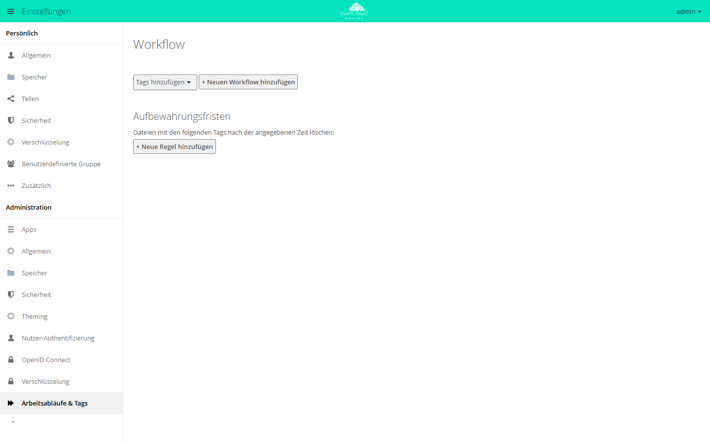
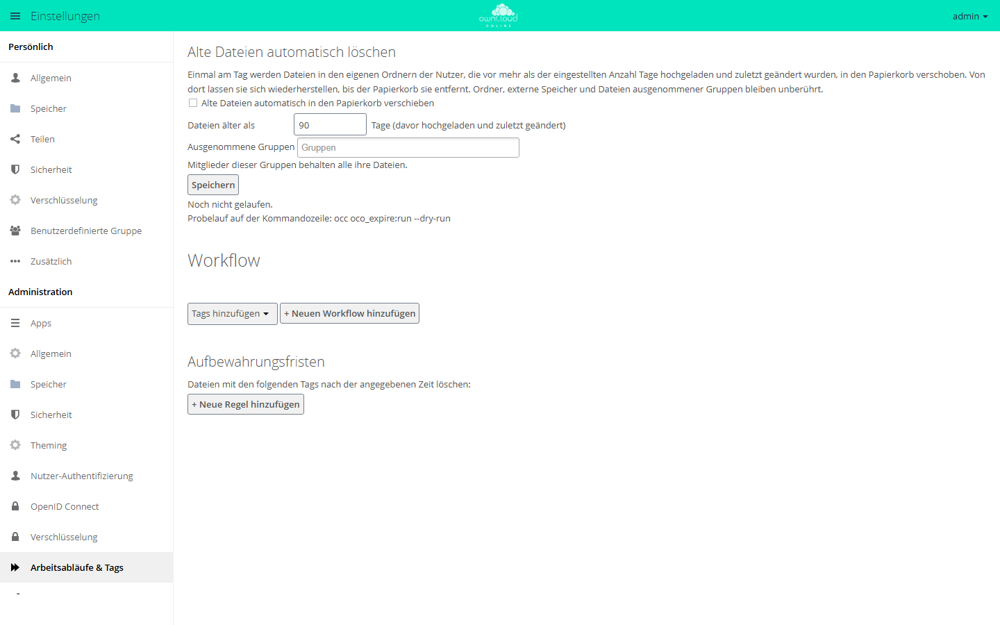

# Regeln und Aufbewahrung

owncloud.online kennt zwei Arten von Regeln, die getrennt voneinander
arbeiten: Die **Dateifirewall** (App `file_firewall`) prüft jede eingehende
Anfrage und weist sie ab, bevor etwas passiert. Die **Workflow-App**
(`workflow`) greift dagegen nicht in den Zugriff ein, sondern vergibt beim
Hochladen automatisch Tags und löscht später zeitgesteuert Dateien, die ein
Tag mit Aufbewahrungsfrist tragen. Dateien nur nach ihrem Alter löscht die App
`oco_expire`, ganz ohne Tags.

!!! info "Nur mit API-Schlüssel"
    `file_firewall`, `workflow` und `oco_expire` erscheinen im Marketplace nur
    mit einem API-Schlüssel. Den Schlüssel erhalten Sie auf Anfrage von der
    BW-Tech GmbH. Wie Sie ihn in der Market-App eintragen, steht unter
    [Apps und Marketplace](apps-market.md#apps-mit-api-schlussel).

## Die beiden Ebenen im Vergleich

| | Dateifirewall (`file_firewall`) | Workflow (`workflow`) |
| --- | --- | --- |
| Wirkung | weist die Anfrage ab (HTTP 403) | vergibt Tags, löscht getaggte Dateien |
| Zeitpunkt | synchron, während der Anfrage | Auto-Tagging beim Anlegen, Löschen im Hintergrund-Job |
| Verknüpfung | Bedingungen einer Gruppe mit UND, Gruppen untereinander mit ODER | Bedingungen eines Workflows mit UND |
| Verwaltung | Verwaltungsoberfläche, `occ`, OCS-API | Verwaltungsoberfläche |
| Testmodus | ja, pro Regelgruppe | nein |
| Trefferzähler | ja, pro Regelgruppe | nein |

Beide Apps installieren (nach dem Eintragen des API-Schlüssels) und den Zustand
prüfen:

```bash
sudo -u www-data php8.4 occ market:install file_firewall workflow
sudo -u www-data php8.4 occ app:list
```

Liegen die Apps schon in der Instanz, schaltet `occ app:enable file_firewall`
beziehungsweise `occ app:enable workflow` sie ein.

Die Bedienoberflächen liegen unter **Einstellungen → Administration →
Sicherheit** (Abschnitt *BW-Tech File Firewall*) und **Einstellungen →
Administration → Arbeitsabläufe & Tags** (Abschnitt *Workflow*).

## Dateifirewall: Zugriffe abweisen

### Aufbau einer Regel

Eine Regel ist eine **Regelgruppe** mit einem Namen, den Schaltern *Aktiv*
und *Testmodus (nur protokollieren)* sowie einer oder mehreren Bedingungen.
Innerhalb einer Gruppe müssen **alle** Bedingungen zutreffen (in der Oberfläche
als *UND* zwischen den Zeilen dargestellt). Trifft eine Gruppe zu, wird die
Anfrage blockiert und die Auswertung endet; weitere Gruppen werden nicht
mehr geprüft.

In der Oberfläche legt *Gruppe hinzufügen* eine neue Regelgruppe an,
*Bedingung hinzufügen* eine weitere Zeile. Änderungen wirken erst nach *Regeln
speichern*. Auch das Löschen einer Gruppe oder Bedingung entfernt sie bis dahin
nur aus dem Editor.

<figure markdown="span">
  
  <figcaption>Eine Anfrage wird gesperrt, wenn sie alle Bedingungen einer Regelgruppe erfüllt. „Regeln speichern“ übernimmt die Änderungen.</figcaption>
</figure>

Gesperrte WebDAV-Anfragen beantwortet die Firewall mit HTTP 403 und der Meldung
`Blocked by BW-Tech File Firewall: <Name der Regelgruppe>`. Die Weboberfläche
zeigt diese Meldung bei einem gesperrten Upload an. Wählen Sie deshalb Namen,
die Benutzer sehen dürfen.

Vier Dinge werden grundsätzlich nie blockiert:

* Anfragen von Administratoren.
* Alles, was auf der Kommandozeile läuft (`occ`, `cron.php`). Dort wertet
  die Firewall keine Regeln aus.
* Anfragen ohne angemeldeten Benutzer, sofern es sich nicht um einen
  öffentlichen Link handelt. Öffentliche Links werden ausgewertet.
* Anfragen, bei denen die Auswertung selbst einen Fehler wirft. Die
  Firewall lässt in diesem Fall durch (*fail open*).

Deaktivierte Gruppen werden vollständig übersprungen.

### Verfügbare Bedingungen und Operatoren

| Bedingung (Kennung) | Beschriftung | Operatoren | Wert |
| --- | --- | --- | --- |
| `user_group` | Benutzergruppe | `is`, `is_not` | Gruppen-ID |
| `user_agent` | User-Agent | `matches`, `not_matches` | Muster mit `*` |
| `device` | Benutzergerät | `is`, `is_not` | siehe Gerätetypen |
| `ip_range_ipv4` | IP-Bereich (IPv4) | `is`, `is_not` | CIDR oder einzelne Adresse |
| `ip_range_ipv6` | IP-Bereich (IPv6) | `is`, `is_not` | CIDR oder einzelne Adresse |
| `time` | Anfragezeit | `is`, `is_not` | Start/Ende, optional Zeitzone |
| `request_url` | Anfrage-URL | `contains`, `not_contains` | Zeichenkette |
| `request_type` | Anfragetyp | `is`, `is_not` | siehe Anfragetypen |
| `upload_size` | Dateigröße (Upload) | `less`, `greater_equal` | Bytes oder `10KB`, `10MB`, `2GB`, `1TB` |
| `file_mimetype` | Datei-MIME-Typ (Upload) | `is`, `is_not`, `begins_with`, `not_begins_with`, `ends_with`, `not_ends_with` | MIME-Typ |
| `system_tag` | Systemtag der Datei | `is`, `is_not` | Tag-Name; geprüft werden die Datei und ihre übergeordneten Ordner |
| `regex` | Regulärer Ausdruck | `is`, `is_not` | Muster plus Zielfeld |

In der Auswahlliste erscheinen die Namen der Bedingungen derzeit
auch in einer deutschen Oberfläche englisch, zum Beispiel *User Group* statt
*Benutzergruppe*. Die englischen Namen stehen in der englischen Fassung dieser
Seite.

Beim `user_agent`-Muster steht `*` nur am Anfang und/oder am Ende:
`*BadBot*` sucht die Zeichenkette irgendwo, `mirall/*` verlangt den
Anfang, `*Firefox` das Ende, ein Muster ohne `*` verlangt exakte Gleichheit.
Der Vergleich erfolgt ohne Rücksicht auf Groß- und Kleinschreibung.

Für `regex` wird zusätzlich ein Zielfeld gewählt: `user_group`,
`user_agent`, `ip_range_ipv4`, `ip_range_ipv6`, `request_url` oder
`file_mimetype`. Beginnt das Muster mit `/`, `#`, `~` oder `@` und ist es ein
vollständiger Ausdruck mit Begrenzern (etwa `/secret/i`), übernimmt die App es
unverändert. Andernfalls fasst sie es selbst ein, bevorzugt als `#…#i`, bei
einem `#` im Muster als `~…~i`, sonst als `@…@i`, und vergleicht ohne Rücksicht
auf Groß- und Kleinschreibung. Ein Pfad wie `/dav/files/alice/` gilt damit als
einfaches Muster.

Gerätetypen sind `android`, `ios`, `desktop` und `other`. Sind unter dem
Systemschlüssel `firewall.branded_clients` eigene Client-Kennungen
hinterlegt, kommen die Sammelwerte `all_branded` und `all_non_branded` hinzu
sowie je Plattform `android_branded`, `ios_branded` bzw. `desktop_branded`,
aber nur für die Plattformen, für die dort tatsächlich eine Kennung
eingetragen ist.

### Anfragetypen

| Wert | Beschriftung | Erkannt an |
| --- | --- | --- |
| `upload` | Datei-Upload (PUT/MKCOL/MOVE/COPY) | WebDAV mit PUT, MKCOL, MOVE, COPY, PATCH sowie POST auf `/remote.php/dav/bulk` |
| `file_upload` | „File Upload incl. Public Links and Bulk Upload (file content only)“ (nicht übersetzt) | Hochladen von Dateiinhalt: PUT über WebDAV oder einen öffentlichen Link, MOVE beim Zusammensetzen eines Chunk-Uploads, Bulk-Upload, POST oder PUT mit hochgeladener Datei. Download, Vorschau, PROPFIND, Umbenennen, Kopieren und Ordner zählen nicht |
| `download` | Datei-Download (GET) | GET über WebDAV (auch Vorschau, Versionen, Papierkorb); Downloads der Weboberfläche (ZIP für Ordner und Mehrfachauswahl, Einzeldatei); Vorschaubilder, Texteditor, Galerie; jeder andere Lesezugriff eines angemeldeten Kontos auf Dateiinhalt außerhalb von WebDAV |
| `webdav` | WebDAV-Durchsuchen (PROPFIND) | übrige WebDAV-Methoden, etwa PROPFIND und OPTIONS |
| `webdav_any` | „WebDAV, any method (remote.php)“ (nicht übersetzt) | jeder Dateizugriff über `remote.php` (`webdav`, `files`, `dav/files`, `dav/uploads`, `dav/bulk`), gleich mit welcher Methode |
| `public` | Öffentliche Linkfreigabe | `public.php`, `/s/…`, `/remote.php/dav/public-files/`, Vorschau und Galerie öffentlicher Links |
| `api` | API-Anfrage | OCS-Aufrufe (`ocs/v1.php`, `ocs/v2.php`) und API-Adressen der Apps (`index.php/apps/<app>/api/…`) |
| `other` | Andere (förmlich: Sonstige) | alles Übrige, unter anderem DELETE über WebDAV |

Die Zuordnung `public` hat Vorrang: Ein Upload über einen öffentlichen Link
gilt als `public`, nicht als `upload`. `file_upload` und `webdav_any` gelten
unabhängig davon. Eingeordnet wird nach dem Einstiegsskript (`index.php`,
`remote.php`, `public.php`, OCS) und dem Anfang des Pfads dahinter, nicht nach
Zeichenketten irgendwo in der Adresse.

Eine `api`-Regel sperrt keine OCS-Aufrufe selbst. Sie wirkt nur auf
Dateioperationen, die während eines solchen Aufrufs die Speicherebene
erreichen; das Anlegen einer Freigabe über OCS etwa blockiert sie nicht.

### Wo geprüft wird

Die Firewall hängt an vier Stellen im Ablauf:

1. Ein Sabre-DAV-Plugin läuft nach der Anmeldung bei jeder WebDAV-Methode und
   beantwortet Treffer mit einem sauberen HTTP 403.
2. Downloads der Weboberfläche (ZIP für Ordner und Mehrfachauswahl,
   Einzeldatei) weist die Firewall ebenfalls mit HTTP 403 ab.
3. Ein Storage-Wrapper fängt Zugriffe ab, die nicht über WebDAV laufen. Er
   greift bei **schreibenden** Operationen (`mkdir`, `rmdir`, `fopen` im
   Schreibmodus, `file_put_contents`, `unlink`, `rename`, `copy`, `touch`) und
   bei den Rechteabfragen. Seit Version 2.10.3 sperrt er außerdem Lesezugriffe
   auf Dateiinhalt (Dateien, Versionen, Papierkorb, zwischengespeicherte
   Vorschaubilder) in GET-Anfragen; sie zählen dann als `download`, auf
   öffentlichen Links als `public`. Gesperrte Lesezugriffe enden mit dem Fehler
   der lesenden App, etwa HTTP 404 bei einer Vorschau oder 400 im Texteditor,
   nicht mit der Meldung der Firewall. Bei WebDAV-Anfragen hält sich der Wrapper
   heraus, weil er dort zu früh liefe und aus einer beabsichtigten Sperre einen
   Fehler 503 machen würde.
4. Für öffentliche Links kommen Ereignis-Listener hinzu: `share.linkaccess`
   für die Seiten von `files_sharing` und die `dav.public.*.before`-Ereignisse
   für WebDAV über `public.php`.

### Regeln auf der Kommandozeile

```bash
# Alle Regelgruppen mit Protokollstufe und Trefferzählern anzeigen
sudo -u www-data php8.4 occ firewall:list

# Maschinenlesbar
sudo -u www-data php8.4 occ firewall:list --output=json
sudo -u www-data php8.4 occ firewall:list --output=json_pretty
```

Eine Gruppe anlegen. Bedingungen werden als `typ:operator:wert` übergeben,
mehrfach angegeben ergeben sie eine UND-Verknüpfung:

```bash
sudo -u www-data php8.4 occ firewall:add-rule "Fremde Netze sperren" \
  -c "ip_range_ipv4:is_not:10.0.0.0/8" \
  -c "request_type:is:upload"
```

Eine Gruppe lässt sich auch gleich abgeschaltet oder im Testmodus anlegen:

```bash
sudo -u www-data php8.4 occ firewall:add-rule "Nur beobachten" \
  -c "user_agent:matches:*BadBot*" --test-mode

sudo -u www-data php8.4 occ firewall:add-rule "Noch nicht scharf" \
  -c "user_group:is:externe" --disabled
```

Zeitfenster lassen sich als Kurzform `HH:MM-HH:MM` angeben, optional mit
`@Zeitzone`, oder als JSON-Wert mit `start` und `end`, optional mit
`timezone`. Die Kurzform wirkt seit Version 2.10.3; ältere Versionen speicherten
sie als Zeichenkette ohne Wirkung.

```bash
sudo -u www-data php8.4 occ firewall:add-rule "Außerhalb der Bürozeit" \
  -c "time:is:18:00-06:00@Europe/Berlin"

# gleichwertig als JSON
sudo -u www-data php8.4 occ firewall:add-rule "Außerhalb der Bürozeit" \
  -c 'time:is:{"start":"18:00","end":"06:00","timezone":"Europe/Berlin"}'
```

Bei `regex` trennt ein `|` das Muster vom Zielfeld:

```bash
sudo -u www-data php8.4 occ firewall:add-rule "Bot-Kennungen" \
  -c "regex:is:/bot/i|user_agent"
```

Löschen, sichern und einspielen:

```bash
# Index ist 0-basiert: die erste Gruppe hat den Index 0
sudo -u www-data php8.4 occ firewall:delete-rule 0

# Sicherung (ohne Dateiargument nach stdout)
sudo -u www-data php8.4 occ firewall:export /var/backups/firewall.json

# Anhängen bzw. vollständig ersetzen
sudo -u www-data php8.4 occ firewall:import /var/backups/firewall.json
sudo -u www-data php8.4 occ firewall:import /var/backups/firewall.json --replace
sudo -u www-data php8.4 occ firewall:import - --replace < /var/backups/firewall.json
```

Der Export enthält neben den Regeln auch die Protokollstufe; beim Import
wird sie mitgesetzt. Fehlt sie in der Datei, bleibt die aktuelle Stufe.

### Testmodus

Jede Regelgruppe hat einen eigenen Schalter *Testmodus (nur
protokollieren)*. Trifft eine Gruppe im Testmodus zu, passiert dreierlei:

* Die Anfrage wird **nicht** blockiert.
* Der Treffer wird als Testtreffer gezählt.
* Der Treffer wird protokolliert, und zwar **unabhängig von der
  eingestellten Protokollstufe**, denn genau dafür ist der Testmodus da.
  Die Meldung lautet `BW-Tech File Firewall TEST MODE would have blocked
  request: …` und nennt Benutzer, IP, Methode, URL, Regelname und die
  ausgewerteten Bedingungen.

Anschließend läuft die Auswertung weiter, sodass in einem Durchgang mehrere
Testgruppen anschlagen können. Im Testmodus prüfen Sie eine neue Regel also
an echten Anfragen, bevor Sie sie scharf schalten.

### Trefferzählung

Zu jeder Regelgruppe werden die Zahl der echten Treffer, die Zahl der
Testtreffer und der Zeitpunkt des letzten Treffers geführt. Der Zeitstempel
wird in **UTC** geschrieben und auch so angezeigt (Format
`Y-m-d H:i:s UTC`), unabhängig davon, welche Zeitzone der Server oder die
Regel verwendet.

Pro Anfrage zählt eine Gruppe höchstens einmal, auch wenn mehrere Prüfstellen
die Auswertung anstoßen. Die Zähler stehen in der Verwaltungsoberfläche und in
`occ firewall:list`; zurückgesetzt werden sie über die Schaltfläche *Statistik
zurücksetzen*.

Die Zähler hängen an der internen ID der Regelgruppe. Beim Speichern werden
Zählerstände verworfen, zu denen es keine Gruppe mehr gibt.

### Protokollierung

Die Protokollstufe gilt für die ganze App und kennt drei Werte:

| Wert | Beschriftung | Wirkung |
| --- | --- | --- |
| `0` | Aus | keine eigenen Meldungen (Testtreffer ausgenommen) |
| `1` | Nur blockierte Anfragen | jede Sperre als Warnung |
| `2` | Alle Anfragen | zusätzlich jede durchgelassene Anfrage als Info |

Umstellen in der Oberfläche (*Protokollierung*) oder direkt:

```bash
sudo -u www-data php8.4 occ config:app:set file_firewall log_level --value=1
sudo -u www-data php8.4 occ config:app:get file_firewall log_level
```

Stufe `2` schreibt eine Zeile pro Anfrage und ist nur zur Fehlersuche
gedacht. Wo die Meldungen landen, steht unter
[Serverprotokoll und Fehlermeldungen](logging.md).

### Zeitzonen

Die Bedingung *Anfragezeit* hat eine eigene Zeitzonenauswahl. Bleibt sie auf
*Serverzeit*, rechnet die Regel in der Zeitzone des PHP-Prozesses, und die
setzt owncloud.online auf UTC. Für Bürozeiten deshalb eine IANA-Kennung wie
`Europe/Berlin` wählen; das Fenster wird dann in dieser Zone ausgewertet, und
Sommer- und Winterzeit ergeben sich automatisch. Eine unbekannte Kennung wird
beim Speichern verworfen, und die Auswertung fällt auf die Serverzeit zurück.

Liegt das Ende vor dem Beginn oder ist beides gleich, gilt das Fenster über
Mitternacht hinweg: `22:00`–`06:00` trifft abends **und** morgens zu.

## Workflow: Tags automatisch vergeben

Ein Workflow besteht aus einem Namen, beliebig vielen Bedingungen und einer
Aktion. Alle Bedingungen müssen zutreffen. Als Aktion steht *Tags hinzufügen*
zur Verfügung: Die genannten Tags werden der Datei zugewiesen, sobald sie
angelegt wird. Spätere Änderungen an einer bestehenden Datei lösen keinen
Workflow aus. Die Tags müssen beim Speichern des Workflows existieren, sonst
lehnt die App ihn ab („Die folgenden Autotagging-Tags existieren nicht: …“).

Trifft mehr als ein Workflow zu, werden alle ausgeführt. Ein „erster Treffer
gewinnt“ wie bei der Firewall gibt es hier nicht.

Workflows und Aufbewahrungsfristen stehen unter **Einstellungen →
Administration → Arbeitsabläufe & Tags**. *+ Neuen Workflow hinzufügen* legt
einen Workflow an.

<figure markdown="span">
  
  <figcaption>Workflows vergeben Tags automatisch. Aufbewahrungsfristen löschen Dateien mit bestimmten Tags nach der eingestellten Zeit.</figcaption>
</figure>

### Verfügbare Bedingungen und Operatoren

| Kennung | Beschriftung | Operatoren |
| --- | --- | --- |
| `cidr` | Client-IP-Subnetz (IPv4) | `equals`, `not_equals` |
| `cidr6` | Client-IP-Subnetz (IPv6) | `equals`, `not_equals` |
| `subnet` | Server-IP-Subnetz (IPv4) | `equals`, `not_equals` |
| `subnet6` | Server-IP-Subnetz (IPv6) | `equals`, `not_equals` |
| `devicetype` | Gerätetyp | `equals`, `not_equals` |
| `filesize` | Dateigröße | `less`, `less_or_equal`, `greater`, `greater_or_equal` |
| `filetype` | Datei-MIME-Typ | `equals`, `not_equals`, `begins_with`, `not_begins_with`, `contains`, `not_contains`, `ends_with`, `not_ends_with` |
| `requesturl` | Anfrage-URL | wie `filetype` |
| `useragent` | User-Agent | wie `filetype` |
| `request` | Anfragetyp | `equals`, `not_equals` |
| `systemtag` | Systemtag der Datei | `equals`, `not_equals` |
| `time` | Anfragezeit | `equals`, `not_equals` |
| `usergroup` | Benutzergruppe | `equals`, `not_equals` |

Die Auswahlliste der Verwaltungsoberfläche entsteht aus genau dieser
Aufstellung.
Die App kennt darüber hinaus eine `regex`-Bedingung mit den Zielfeldern
`cidr`, `subnet`, `requesturl`, `useragent` und `usergroup`. Für sie gibt es
jedoch keinen Eintrag in der Oberfläche, sie ist also nur programmatisch
erreichbar.

Als Anfragetyp stehen hier nur *Public Share Link*, *WebDAV* und *Other* zur
Auswahl; diese Beschriftungen sind nicht übersetzt. Gerätetypen sind `android`,
`ios`, `desktop` und `other`, ergänzt um die Branded-Werte, sofern der
Systemschlüssel `workflow.branded_clients` gefüllt ist.

Die Bedingung `systemtag` prüft die Datei **und ihre übergeordneten Ordner**.
Existiert das genannte Tag nicht mehr, ist die Bedingung seit Version 1.1.3
weder mit „ist“ noch mit „ist nicht“ erfüllt, und das Protokoll meldet eine
Warnung. Ältere Versionen werteten ein gelöschtes Tag als erfüllt und taggten
dann jede neue Datei.

### Zeitzone der Workflow-Bedingung

Anders als bei der Dateifirewall gibt es hier **keine** Zeitzonenauswahl. Die
Bedingung *Anfragezeit* rechnet fest in **UTC**; die Oberfläche rechnet die
Eingabe in die lokale Zeit des Browsers um. Auch hier gilt ein Fenster, dessen
Ende vor dem Beginn liegt, als Fenster über Mitternacht.

### Grenzen des Auto-Taggings

* Die einzige mitgelieferte Aktion ist das Setzen von Tags. Weitere Typen
  lassen sich nur über die Ereignisschnittstelle der App durch eine eigene
  Erweiterung ergänzen.
* Freigaben (geteilte Speicher) werden bewusst nicht eingebunden. Ein Upload
  in eine Freigabe löst beim Empfänger keinen Workflow aus.
* Es gibt weder Testmodus noch Trefferzähler. Ein Workflow wirkt sofort nach
  dem Speichern.
* Bei der Bedingung *Dateigröße* fällt die Prüfung durch, wenn die Größe des
  laufenden Transfers nicht bestimmbar ist. Der Workflow trifft dann nicht
  zu.

## Aufbewahrung

### Wie eine Aufbewahrungsfrist entsteht

Unter **Einstellungen → Administration → Arbeitsabläufe & Tags** gibt es den
Abschnitt *Aufbewahrungsfristen* mit dem Text „Dateien mit den folgenden Tags
nach der angegebenen Zeit löschen:“. *+ Neue Regel hinzufügen* legt eine Frist
an. Sie besteht aus genau drei Angaben: einem Tag, einer Zahl und einer Einheit
(*Tage*, *Wochen*, *Monate*, *Jahre*). Neue Fristen sind auf 100 Jahre
begrenzt.

Jedes Tag kann genau eine Frist haben; ein zweiter Eintrag zum selben Tag wird
abgelehnt. Wird ein Tag gelöscht, entfernt die App die zugehörige Frist und
den zugehörigen Hintergrund-Job automatisch mit.

### Wie die Frist durchgesetzt wird

Die Aufbewahrung läuft ausschließlich in Hintergrund-Jobs. Ohne
funktionierenden Cron passiert nichts, siehe
[Hintergrund-Jobs (Cron)](background-jobs.md).

1. Ein Verwaltungs-Job der App prüft stündlich (beim Standardverfahren
   `tagbased`, siehe unten), ob zu jeder Frist ein Arbeits-Job eingetragen
   ist, und trägt fehlende nach.
2. Jedes Tag mit Frist hat einen eigenen Arbeits-Job, der alle 24 Stunden
   läuft.
3. Der Arbeits-Job berechnet den Stichtag (jetzt minus Frist) und holt die
   getaggten Objekte in Stapeln zu je zehn Einträgen. Ein getaggter Ordner
   wird von dort aus nach unten durchlaufen: Ist der Ordner selbst noch nicht
   fällig, werden seine Kinder geprüft.
4. Maßgeblich ist standardmäßig die **Änderungszeit** der Datei.
5. Fällige Dateien und Ordner löscht der Job im Namen ihres Besitzers. Ist der
   Papierkorb aktiv, landen sie dort und lassen sich bis zu seinem Ablauf
   wiederherstellen. Einhängepunkte wie Freigaben und externe Speicher löscht
   der Job nie, und in empfangene Freigaben steigt er nicht hinab.

Optional kann statt der Änderungszeit die Upload-Zeit herangezogen werden:

```bash
sudo -u www-data php8.4 occ config:system:set \
  workflow.tag-based-retention.use-upload-time --value=true --type=boolean
```

Dieser Schalter wirkt nur für Dateien, für die überhaupt eine Upload-Zeit
gespeichert ist. Fehlt sie, wird die Datei nicht gelöscht, und im Protokoll
steht eine Warnung `No upload time stored for file id …`. Die Upload-Zeit neuer
Dateien schreibt die App seit Version 1.1.4 selbst, wenn dieser Schalter gesetzt
ist:

```bash
sudo -u www-data php8.4 occ config:app:set workflow record_upload_time --value yes
```

Ohne ihn bekommen neue Dateien nur dann eine Upload-Zeit, wenn eine andere App
sie schreibt; `oco_expire` (siehe unten) verwendet dieselbe Angabe.

### Die beiden Verfahren

Welches Verfahren die Aufbewahrung ausführt, steuert ein Systemschlüssel:

```bash
sudo -u www-data php8.4 occ config:system:get workflow.retention_engine
sudo -u www-data php8.4 occ config:system:set workflow.retention_engine \
  --value=tagbased
```

| Wert | Vorgehen | Takt des Verwaltungs-Jobs |
| --- | --- | --- |
| `tagbased` (Standard) | ein Arbeits-Job für jedes Tag mit Frist, ausgehend von den getaggten Objekten | stündlich |
| `userbased` | ein Arbeits-Job je Benutzer, der dessen Dateibaum durchläuft | täglich |

Ein unbekannter Wert führt zu keiner Verarbeitung; die App schreibt in diesem
Fall eine kritische Meldung ins Protokoll und nennt die zulässigen Werte.

Nur beim Verfahren `userbased` zeigt die Oberfläche zusätzlich die Option
„Leere Ordner löschen, die seit … Tagen nicht geändert wurden“. Sie liegt in
der App-Konfiguration:

```bash
sudo -u www-data php8.4 occ config:app:get workflow folder_retention
sudo -u www-data php8.4 occ config:app:get workflow folder_retention_period
```

`folder_retention` ist der Schalter (`0`/`1`), `folder_retention_period` die
Anzahl Tage; ohne Eintrag gilt `7`.

### Was die Aufbewahrung heute nicht kann

* **Nur löschen.** Es gibt keine Archivstufe, kein Verschieben auf einen
  anderen Speicher und keinen Zwischenzustand. Eine fällige Datei wird
  gelöscht; nur der Papierkorb hält sie noch eine Weile vor.
* **Keine Vorwarnung.** Die App verschickt keine Mails; Betroffene erfahren
  vom Löschen nur über den Aktivitätsstrom, in dem der Vorgang als
  automatische Aktion vermerkt wird.
* **Kein Probelauf.** Es gibt keine Vorschau, welche Dateien der nächste Lauf
  treffen würde, und keinen Testmodus wie bei der Dateifirewall. Neue Fristen
  sollten deshalb zuerst an einem eigens angelegten Tag mit wenigen Dateien
  erprobt werden.
* **Eine Frist für jedes Tag.** Fristen lassen sich nicht kombinieren oder
  nach Benutzer, Gruppe oder Ordner staffeln; die einzige Stellschraube ist,
  an welchen Dateien und Ordnern das Tag hängt.
* **Kein sofortiges Wirken.** Eine gerade eingetragene Frist greift
  frühestens beim nächsten Lauf des Arbeits-Jobs, beim Verfahren `tagbased`
  also innerhalb von 24 Stunden.
* **Keine Steuerung über `occ`.** Fristen werden ausschließlich in der
  Verwaltungsoberfläche gepflegt; die App bringt keine eigenen `occ`-Befehle
  mit.

## Alte Dateien nach Alter löschen

Ohne Tags arbeitet die App `oco_expire` (im Markt: „Auto Expire“). Einmal am
Tag verschiebt sie jede Datei in den eigenen Ordnern der Konten in den
Papierkorb, die vor mehr als der eingestellten Zahl von Tagen hochgeladen
**und** zuletzt geändert wurde. Gerade bearbeitete und frisch hochgeladene
Dateien bleiben also stehen, auch wenn ein Sync-Client eine alte Änderungszeit
mitbringt.

Die Einstellungen stehen unter **Einstellungen → Administration →
Arbeitsabläufe & Tags**, Abschnitt **Alte Dateien automatisch löschen**:

| Einstellung | Wert |
| --- | --- |
| *Alte Dateien automatisch in den Papierkorb verschieben* | ein oder aus, Vorgabe aus |
| *Dateien älter als* … *Tage (davor hochgeladen und zuletzt geändert)* | 1 bis 36500, Vorgabe 90 |
| *Ausgenommene Gruppen* | Mitglieder dieser Gruppen behalten alle ihre Dateien |

<figure markdown="span">
  
  <figcaption>Ist die Option eingeschaltet, verschiebt owncloud.online einmal am Tag Dateien, die älter als die eingestellten Tage sind, in den Papierkorb. Probelauf: occ oco_expire:run --dry-run.</figcaption>
</figure>

Ordner, externe Speicher und empfangene Freigaben bleiben unberührt. Ist eine
ausgenommene Gruppe nicht auffindbar, etwa weil sie gelöscht wurde oder der
Verzeichnisdienst nicht antwortet, löscht der Lauf nichts. Ist der Papierkorb
ausgeschaltet, löscht die App endgültig; die Einstellungsseite warnt dann.

Vor dem Einschalten und vor dem Verringern der Tage zeigt ein Probelauf, was
der nächste Lauf in den Papierkorb verschieben würde:

```bash
sudo -u www-data php8.4 occ oco_expire:run --dry-run
sudo -u www-data php8.4 occ oco_expire:run --dry-run --user alice
```

Ohne `--dry-run` führt `occ oco_expire:run` den Lauf sofort aus, sofern die
Option eingeschaltet ist.

## Zustand prüfen

```bash
# Regeln, Protokollstufe und Trefferzähler der Firewall
sudo -u www-data php8.4 occ firewall:list

# Laufen die Aufbewahrungs-Jobs? Spalte "Job" zeigt die Klassennamen
sudo -u www-data php8.4 occ background:queue:status

# Einen bestimmten Job zur Kontrolle sofort ausführen
sudo -u www-data php8.4 occ background:queue:execute <Job-ID> --force
```

`background:queue:execute` ist ein Wartungsbefehl und fragt vor der
Ausführung nach (`--accept-warning` überspringt die Frage); die regelmäßige
Einplanung bleibt davon unberührt.

## Fehlersuche

| Symptom | Ursache | Abhilfe |
| --- | --- | --- |
| Regel greift beim Testen nicht, obwohl sie stimmt | Als Administrator angemeldet; Administratoren werden nie blockiert | Mit einem normalen Konto prüfen |
| Regel greift bei `occ`- oder Cron-Aufrufen nicht | Auf der Kommandozeile wertet die Firewall keine Regeln aus | Über HTTP prüfen; die Firewall schützt keine Kommandozeilenaufrufe |
| Zeitfenster über die Kommandozeile bleibt wirkungslos | Version vor 2.10.3: `time:is:18:00-06:00` wurde als Zeichenkette gespeichert, die Bedingung erwartet aber `start`/`end` | App aktualisieren oder den Wert als JSON übergeben: `time:is:{"start":"18:00","end":"06:00"}` |
| Regulärer Ausdruck über die Kommandozeile ist abgeschnitten | `firewall:add-rule` trennt am ersten senkrechten Strich das Zielfeld ab, eine Alternation wird dadurch zerschnitten | Muster in der Verwaltungsoberfläche eintragen oder über `firewall:import` einspielen |
| `firewall:delete-rule` löscht die falsche Gruppe | `firewall:list` nummeriert ab 1, das Löschargument ist 0-basiert | Vorher `--output=json_pretty` prüfen und die Position ab 0 zählen |
| Trefferzähler nach dem Speichern zurückgesetzt | Über die API gespeicherte Gruppen ohne gültige ID bekommen eine neue ID; die alten Zählerstände werden verworfen | Beim Speichern über die API die vorhandene `id` mitschicken |
| Änderungen in der Oberfläche wirken nicht | *Regeln speichern* wurde nicht gedrückt | Änderungen mit *Regeln speichern* übernehmen |
| Bedingung *Systemtag der Datei* greift im Browser nicht | Der Dateibezug wird nur aus `/remote.php/webdav` und `/remote.php/dav/files/<Benutzer>` aufgelöst | Für Web-Zugriffe eine andere Bedingung wählen |
| Sperre im Browser erscheint als allgemeiner Fehler statt als 403 | Außerhalb von WebDAV greift der Storage-Wrapper, der die Operation nur scheitern lässt | Erwartetes Verhalten; die Ursache steht bei Protokollstufe `1` im Serverprotokoll |
| `api`-Regel verhindert das Anlegen von Freigaben nicht | OCS-Aufrufe selbst prüft die Firewall nicht, nur Dateioperationen auf der Speicherebene | Erwartetes Verhalten; Freigaben über die Freigabe-Richtlinien steuern |
| Testtreffer stehen im Protokoll, obwohl die Protokollierung auf *Aus* steht | Testtreffer werden bewusst immer protokolliert | Testmodus abschalten, wenn die Meldungen stören |
| Zeitfenster passt nicht zur Ortszeit | Ohne Zeitzonenauswahl rechnet die Firewall in der Serverzeit (UTC), die Workflow-App immer in UTC | In der Firewall die IANA-Zeitzone setzen; bei Workflows die UTC-Verschiebung einrechnen |
| Auto-Tagging bleibt bei Uploads in eine Freigabe aus | Geteilte Speicher werden vom Workflow nicht eingebunden | Kein Umgehungsweg vorhanden |
| Auto-Tagging bleibt bei einer geänderten Datei aus | Workflows werten nur das Anlegen neuer Dateien aus | Erwartetes Verhalten |
| Aufbewahrung löscht nichts | Cron läuft nicht, oder der Arbeits-Job wurde noch nicht wieder fällig | `background:queue:status` prüfen, siehe [Hintergrund-Jobs (Cron)](background-jobs.md) |
| Aufbewahrung löscht nichts, Protokoll meldet `No upload time stored for file id` | `workflow.tag-based-retention.use-upload-time` ist aktiv, für die Datei ist aber keine Upload-Zeit gespeichert | `record_upload_time` einschalten; für ältere Dateien den Schalter entfernen, damit wieder die Änderungszeit gilt |
| Protokoll meldet `Unrecognized retention engine` | `workflow.retention_engine` enthält einen anderen Wert als `tagbased` oder `userbased` | Wert korrigieren |
| Option für leere Ordner fehlt in der Oberfläche | Sie erscheint nur beim Verfahren `userbased` | `workflow.retention_engine` umstellen oder auf die Option verzichten |
| `oco_expire` löscht nichts, obwohl eingeschaltet | Eine ausgenommene Gruppe ist nicht auffindbar, oder Cron läuft nicht | Meldung zum letzten Lauf in den Einstellungen lesen, Gruppen prüfen, `occ oco_expire:run --dry-run` |
