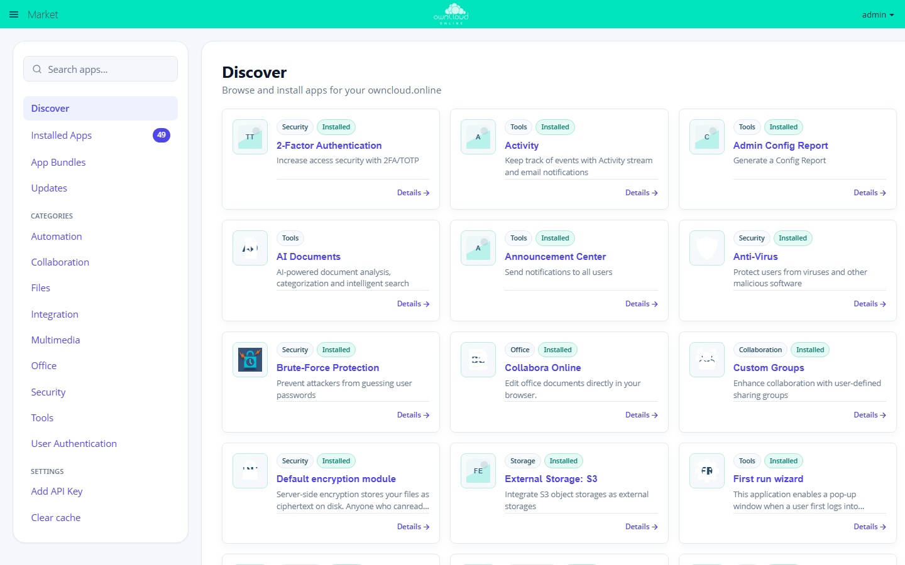

# Development

owncloud.online is file storage, sharing, and collaboration on your own server,
built for PHP 8.4 and maintained by BW-Tech GmbH.

The source code is at <https://github.com/BWTECH-github/owncloud.online>, the
release packages at
<https://github.com/BWTECH-github/owncloud.online/releases>. The current
version is 11.0.25 (`version.php`).

## Repository layout

| Directory | Contents |
| --- | --- |
| `core/` | Application bootstrap, templates, JavaScript, and CSS of the core. The core's `occ` commands are in `core/Command` |
| `lib/private/` | Implementation, namespace `OC\`. Not a stable API: apps should not rely on it |
| `lib/public/` | The stable API for apps, namespace `OCP\`. Every new method needs an `@since` tag; `build/OCPSinceChecker.php` checks this |
| `lib/private/OCO/` | owncloud.online additions, namespace `OCO\` (registered in `composer.json`) |
| `settings/` | Personal settings and admin pages |
| `apps/` | Bundled apps: `comments`, `dav`, `federatedfilesharing`, `federation`, `files`, `files_external`, `files_sharing`, `files_trashbin`, `files_versions`, `oco_mcp`, `provisioning_api`, `systemtags`, `updatenotification`. An app's own `occ` commands live in `apps/<id>/lib/Command` |
| `apps-external/market/` | The Market app, which installs apps from the Marketplace. A copy from [BWTECH-github/market](https://github.com/BWTECH-github/market) that is not edited here (see below) |
| `ocs/`, `ocs-provider/`, `ocm-provider/` | The OCS API and the endpoints for federated sharing |
| `config/` | `config.sample.php` with every key and its explanation. Your own `config.php` is created during installation and is not versioned |
| `core/l10n/`, `settings/l10n/` | Translations as `.json` and `.js`, maintained directly in the repository. `l10n/` only holds the helper scripts |
| `core/vendor/` | JavaScript libraries of the web interface. Checked in on purpose, so an installation from the Git tree has a working interface without Node tools |
| `lib/composer/` | Composer's target directory (`vendor-dir` in `composer.json`), not versioned |
| `vendor-bin/` | A separate Composer installation per tool: `owncloud-codestyle`, `php_codesniffer`, `phan`, `phpstan`, `behat` |
| `tests/` | PHPUnit in `tests/lib`, `tests/Core`, `tests/Settings`; Karma configuration `tests/karma.config.js`; Behat in `tests/acceptance`; browser tests in `tests/js` |
| `build/` | Build and test scripts, including `build/autotest.sh` and `build/minify-assets.sh`; `build/package.json` holds the Node dependencies |
| `changelog/` | Changelog entries; new entries go into `changelog/unreleased/` |
| `docs/` | This documentation (MkDocs, configuration in `mkdocs.yml`) |
| `.github/workflows/` | The CI |

## Requirements

| Tool | Version | Used for |
| --- | --- | --- |
| PHP | 8.4 | `composer.json` requires `>=8.4` and pins `platform.php` to 8.4 |
| Composer | v2 | Dependencies and autoloader |
| Node.js | 14.17 or later, the CI uses 20 | Minifiers and JavaScript tests |
| Yarn | 1.0 or later | Installs the Node dependencies from `build/package.json` |
| Git | Any | Checking out and submitting |

You need the PHP extensions from the `require` block of `composer.json`:
`apcu`, `ctype`, `curl`, `exif`, `fileinfo`, `gd`, `iconv`, `imagick`, `intl`,
`json`, `libxml`, `mbstring`, `memcached`, `pdo`, `posix`, `simplexml`, `zip`.
Add the driver for the database you use; `pdo_sqlite` is enough to get started.

The JavaScript tests also need Firefox: `tests/karma.config.js` starts
`FirefoxHeadless`.

## Getting the dependencies

```bash
git clone https://github.com/BWTECH-github/owncloud.online.git
cd owncloud.online
make install-composer-deps
```

`make install-composer-deps` runs `composer install` including the development
dependencies and puts everything into `lib/composer/`. That is also where
PHPUnit ends up (`lib/composer/phpunit/phpunit/phpunit`), which the test
targets use.

The check tools come from separate installations in `vendor-bin/`:

```bash
make vendor-bin-deps
```

This installs php-cs-fixer, PHP_CodeSniffer, Phan, PHPStan, and Behat. The code
style job (`.github/workflows/lint-and-codestyle.yml`) runs exactly these two
commands.

For JavaScript tests and the minifiers:

```bash
make install-nodejs-deps
```

This runs `yarn install` in the `build/` directory.

`make` without a target fetches the Composer and Node dependencies in one step.
`make help` lists the common targets; `vendor-bin-deps`, `minify-assets`,
`check-minified`, and `test-js-browser` are not listed there. `make clean`
removes dependencies, test results, and the build directory.

!!! warning "`make clean` deletes `core/vendor`"
    `core/vendor` contains security fixes applied to bundled third-party
    libraries, most importantly the jQuery backport for
    CVE-2020-11022/11023. A subsequent `yarn install` does not bring them
    back; they have to be applied again. For the current state, see the
    "Frontend libraries" section of
    [CVE status](../administration/upstream-cve-status.en.md#frontend-libraries).

## A development instance

You can install the checkout directly with `occ`:

```bash
php8.4 occ maintenance:install \
  --database sqlite \
  --admin-user admin \
  --admin-pass 'PleaseChooseYourOwnPassword' \
  --data-dir "$(pwd)/data"
```

SQLite is enough for daily work. For MySQL, MariaDB, or PostgreSQL, add
`--database-host`, `--database-name`, `--database-user`, and
`--database-pass`; the CI sets it up the same way
(`.github/workflows/php-unit.yml`).

!!! note "Why there is no `sudo -u www-data` here"
    In the other chapters, `occ` calls usually start with `sudo -u www-data`
    because a web server runs the instance there. A development checkout
    belongs to your own account: a call as `www-data` would create files with
    a different owner in your working tree. If you run the instance through
    Apache or nginx, use the `sudo -u www-data` form again.

Enable the bundled apps one by one. The CI uses the same selection:

```bash
php8.4 occ app:enable files_sharing
php8.4 occ app:enable files_trashbin
php8.4 occ app:enable files_versions
php8.4 occ app:enable provisioning_api
php8.4 occ app:enable federation
php8.4 occ app:enable federatedfilesharing
```

PHP's built-in server is enough to try things in the browser:

```bash
php8.4 -S localhost:8080 -t .
```

This is a development server only. The CI's upgrade job checks an instance
the same way (`.github/workflows/upgrade-test.yml`): `status.php` and
`/index.php/login` must answer with 200, and the PHP server's output must not
contain a fatal PHP error (`PHP Fatal`, `Uncaught`).

Two keys in `config/config.php` help during development:

```php
'debug' => true,
'loglevel' => 0,
```

`debug` shows exceptions with their stack trace in the web interface.
`config.sample.php` warns against setting this on a production system: a stack
trace can contain passwords in plain text. `loglevel` 0 also writes debug
messages to the log, see
[Server log and error messages](../administration/logging.en.md).

Check the state:

```bash
php8.4 occ status
php8.4 occ app:list
```

## Adding apps from the Marketplace



Everything that is not in the repository comes from the Marketplace
(marketplace.owncloud.online): in the web interface through the app menu →
**Market**, or on the command line.

```bash
php8.4 occ market:install <app_id>
```

If you have a package as a `.tar.gz` file, such as a plugin you built
yourself, install it without going through the Marketplace:

```bash
php8.4 occ market:install --local /path/to/app.tar.gz
```

On a server installation, the same call is:

```bash
sudo -u www-data php8.4 occ market:install <app_id>
```

The Marketplace shows some apps only with an API key. You get the key from
BW-Tech GmbH. [Apps and Marketplace](../administration/apps-market.en.md)
explains app management and where to enter the key.

## Tests

| Command | What it runs | In the CI |
| --- | --- | --- |
| `make test-php-unit` | PHPUnit over `tests/`, driven by `build/autotest.sh`; database through `TEST_DATABASE` (default `sqlite`) | yes |
| `make test-php-style` | php-cs-fixer as a dry run, PHP_CodeSniffer for `tests/acceptance` and `tests/TestHelpers`, plus `build/OCPSinceChecker.php` | yes |
| `make test-php-phpstan` | PHPStan over `apps core settings lib/private lib/public ocs ocs-provider` | yes |
| `make test-php-phan` | Phan with `.phan/config.php` | yes |
| `make minify-assets` | Regenerates the `.min` sibling files | yes, as a comparison |
| `make test-js` | Karma and Jasmine according to `tests/karma.config.js` | yes, job *JS Unit* |
| `make test-js-browser` | Checks in a real Chromium that the fixes for select2 (CVE-2016-10744) and jQuery UI (CVE-2021-41182 to -41184) work; needs Playwright (`PLAYWRIGHT_MODULE` or `node_modules/playwright`) and runs `make check-minified` first | no |
| `make test-acceptance-api`, `-cli`, `-webui` | Behat through `tests/acceptance/run.sh` | no |

A single test file, in the form given by `make help`:

```bash
make test-php-unit TEST_DATABASE=mysql TEST_PHP_SUITE=path/to/testfile.php
```

The CI runs the unit tests against SQLite, MySQL 8.0, MariaDB 10.6 and 10.11,
and PostgreSQL 16. The runs other than SQLite are limited to the `DB` group;
the SQLite run covers everything else.

!!! warning "`make test-php-unit` touches your configuration"
    `build/autotest.sh` moves an existing `config/config.php` to
    `config/config-autotest-backup.php` and restores it on exit. If the run
    is killed, your configuration stays under that name and you have to rename
    it back by hand.

The Behat targets need a running instance with the `testing` app, which this
repository does not include. No CI job runs them. Without `TEST_SERVER_URL`,
`tests/acceptance/run.sh` starts its own PHP development server.

Besides the test targets, the CI runs two more checks that are easy to miss
(`.github/workflows/lint-and-codestyle.yml`):

* `composer audit --locked` for the repository itself and for
  `apps/oco_mcp` and `apps-external/market`. A new or upgraded dependency with
  a known security advisory fails the CI.
* The standalone security tests of the `oco_mcp` app
  (`apps/oco_mcp/tests/basic_auth_test.php` and `security_test.php`). They run
  without an instance, and you can run them locally the same way.

## Changes to the Market app

`apps-external/market/` is not edited in this repository. The Market app has
its own repository,
[BWTECH-github/market](https://github.com/BWTECH-github/market); this
repository holds a copy because the app belongs in the release package.
`build/market.ref` records which state that is. A change to the Market app
therefore works like this:

1. Change, test, commit, and push in the Market repository.
2. Run `build/sync-market.sh <commit>` here. It copies exactly that state to
   `apps-external/market/` and rewrites `build/market.ref`.
3. Commit both here.

The script copies all versioned files of the Market repository except
`.github/`, `.gitignore`, and `tests/`. On every push to `main` and in every
pull request, the `market-copy` job in
`.github/workflows/lint-and-codestyle.yml` compares the copy with the recorded
state (`build/sync-market.sh --check`) and turns red if someone edited the copy
directly.

The script does not take `build/market.ref` on trust: `repo=` must be
`https://github.com/BWTECH-github/market.git`, `commit=` a full commit ID
(40 hex characters), and a `<ref>` argument a commit, tag, or branch without a
leading `-`. Otherwise it exits with code 2 without fetching or changing
anything. `--check` also requires that the commit is reachable from `main` or a
tag in the Market repository. If the state exists only in a pull request or on
another branch, the script also exits with 2. So merge the change in the Market
repository first, then copy it.

`MARKET_REPO=<URL or path>` fetches the state from another source when
copying, such as a local clone. Combined with `--check`, the script exits with
2; the check always runs against GitHub. `bash tests/build/sync_market_test.sh`
tests these rules without network access and runs in the same job before the
comparison. In addition, when files under `apps-external/market/` change,
`.github/workflows/market-bundle.yml` rebuilds `js/market.bundle.js` from
`src/` and fails the job if the checked-in bundle differs.

## Code style

The reference is php-cs-fixer with the rule set from
`vendor-bin/owncloud-codestyle`, configured in `.php-cs-fixer.dist.php`. It
checks the core and the bundled apps except `oco_mcp`; `apps-external`,
`build`, `data`, and `lib/composer` are excluded.

```bash
make test-php-style      # checks, changes nothing
make test-php-style-fix  # fixes what can be fixed automatically
```

Both targets pass `--allow-risky yes`. If you run php-cs-fixer by hand without
this option, your result differs from the CI's.

Two rules the formatter does not enforce:

* New methods in `lib/public/` need an `@since` tag.
  `build/OCPSinceChecker.php` runs in `make test-php-style` and also at the
  start of every `build/autotest.sh` run.
* Code and identifiers in English; for PHP 8.4, the points in
  [PHP 8.4 compatibility](php84-compat.en.md) apply.

## Minified sibling files

`TemplateLayout::preferMinified()` serves `foo.min.js` as soon as it sits next
to `foo.js`, limited to paths below the server directory (`OC::$SERVERROOT`).
If you change a `.js` or `.css` file and leave the `.min` file next to it as it
is, nothing changes in what the server delivers.

So the rule is: **after every change to JavaScript or CSS**, run

```bash
make minify-assets
```

and commit the result. The target calls `build/minify-assets.sh` and generates
the sibling files for `core/js`, `settings/js`, `apps/*/js`, and the matching
CSS directories; `tests/` and `vendor/` are skipped.

The CI has a dedicated gate for this, the *Minified assets up to date* job: it
runs `make minify-assets` and fails as soon as

```bash
git status --porcelain -- '*.min.js' '*.min.css'
```

prints anything afterwards. The release build runs the same comparison.
Locally, `make check-minified` does both in one step and stops when something
differs; the newly generated files stay in your working tree.

Use the same minifiers as the CI, otherwise you get different bytes:

```bash
npm install -g terser@5.49.1 clean-css-cli@5.6.3
```

`make install-nodejs-deps` installs both in the same versions
(`build/package.json`). The script prefers the installation in
`build/node_modules` and only then falls back to global installations. If it
finds no minifier at all, it copies the original file to the `.min` name. The
checkout keeps working, but the result differs from the CI and the gate turns
red.

## Documentation

The pages in `docs/` are the source of the published documentation at
<https://docs.owncloud.online>. The navigation is in the `nav` block of
`mkdocs.yml`; a new page without an entry there does not appear in the
navigation. Plugin pages in `docs/plugins/apps/` are the exception: they appear
in the Plugins section without an entry.

| What | Where and how |
| --- | --- |
| German page | `docs/<section>/<page>.md`, the default language |
| English version | `<page>.en.md` next to the German page. Links in it point to the `.en.md` counterparts |
| English navigation titles | `mkdocs.yml`, block `extra.i18n.nav_en` (German title → English title). MkDocs ignores `extra` |
| Fixed anchors | Sections that are linked to get an anchor that is the same in both languages: `## Datei hochladen {#datei-hochladen}` in the German version, `## Upload a file {#datei-hochladen}` in the English version |
| Screenshots | `docs/assets/screenshots/de/<name>.png` and `docs/assets/screenshots/en/<name>.png`, same name, interface in the respective language |
| Plugin pages | `docs/plugins/apps/<app-id>.md` and `.en.md`. Apps that the Marketplace shows only with an API key start with `!!! info "Nur mit API-Schlüssel"` or `!!! info "API key required"` |

Build and check:

```bash
python3 -m pip install -r requirements-docs.txt
python3 -m mkdocs build --strict
```

`.github/workflows/docs.yml` runs exactly this. With `--strict`, a single
warning fails the build, for example a link to a page that does not exist.

Changes that only touch `docs/`, `mkdocs.yml`, `requirements-docs.txt`,
`changelog/`, or Markdown files do not trigger the other CI runs: `ci.yml` and
`lint-and-codestyle.yml` exclude them under `paths-ignore`.

## Submitting a contribution

The full text is in `.github/CONTRIBUTING.md`. The essentials:

1. Branch off `main`, one topic per pull request.
2. Add tests where behavior changes.
3. For changes to `.js` or `.css`: run `make minify-assets` and commit the
   result.
4. Add a changelog entry to `changelog/unreleased/`, structured like
   `changelog/TEMPLATE`. The first line starts with one of the types
   `Bugfix`, `Change`, `Enhancement`, or `Security`.
5. Write commit messages in the Conventional Commits format. A dedicated CI
   job checks this. Valid types: `feat`, `fix`, `docs`, `style`, `refactor`,
   `test`, `build`, `perf`, `ci`, `chore`, `revert`; the check rejects any
   other type.
6. Open the pull request and explain **why** the change is needed. The
   template `.github/PULL_REQUEST_TEMPLATE.md` asks for your environment and
   the cases you actually tried; "should work" is not a test.

To report a bug you do not fix yourself, use the repository's
[issues](https://github.com/BWTECH-github/owncloud.online/issues).
**Security vulnerabilities do not belong in an issue**; follow the confidential
process described in `.github/SECURITY.md`.

A pull request has to pass: commit format, PHP code style, PHPStan, Phan,
Composer audit, the `oco_mcp` security tests, the gate for the minified files,
the Market copy check, the JavaScript tests, the unit tests on all four
database systems, and the upgrade test, which upgrades an existing installation
of each of the last two releases to the new state. If the pull request changes
anything under `apps-external/market/`, `market-bundle.yml` also checks the
Market app's JavaScript bundle.

## What a release contains

A tag of the form `v<version>` triggers
`.github/workflows/release-owncloud-online.yml`. Before packaging, the run
checks the same gate as the CI: if the `.min` sibling files are not up to date,
it stops. It then produces these files, available at
<https://github.com/BWTECH-github/owncloud.online/releases>:

| File | Contents |
| --- | --- |
| `owncloud-online-<version>.tar.gz` | The distribution, about 57 MiB |
| `owncloud-online-<version>.zip` | The same distribution as a ZIP file, about 64 MiB |
| `SHA256SUMS.txt` | Checksums of the archives and the JSON files |
| `sbom-owncloud-online-<version>.cdx.json` | Software bill of materials in CycloneDX format |
| `release-manifest.json` | Version, commit, and the PHP version used for the build |
| `removed-release-files.txt` | List of the development files removed during the build |

## Troubleshooting

| Symptom | Cause | Fix |
| --- | --- | --- |
| `make` stops with "Could not open input file: install" | The Makefile looks for Composer with `command -v composer`. If it is not in your `PATH`, the variable stays empty and the call becomes `php install` | Install Composer v2 and add it to your `PATH` |
| "yarn is not available on your system, please install yarn" | The rule for the Node dependencies checks first whether Yarn is installed | Install Yarn (`npm install -g yarn`), or use only `make install-composer-deps` as long as you do not need JavaScript tests |
| `make test-php-unit` cannot find PHPUnit | PHPUnit comes from the development dependencies in `lib/composer/phpunit/phpunit/phpunit` | Run `make install-composer-deps` |
| `config/config.php` is missing after an aborted test run | `build/autotest.sh` moved it to `config/config-autotest-backup.php` and could not move it back | Rename the file back by hand |
| After switching branches, every page returns 500 and `occ` reports missing classes | `lib/composer/` is not versioned; the old class map points to deleted classes | Run `composer dump-autoload`. `make install-composer-deps` only runs Composer when `composer.json` or `composer.lock` has changed |
| Changes to JavaScript or CSS have no effect in the browser | The server prefers the `.min` sibling file, which still has the old content | `make minify-assets` |
| CI job *Minified assets up to date* is red | `.min` files are outdated or new and not checked in | `make minify-assets`, commit the result |
| `.min` files differ from those of the CI | A different minifier version, or none at all; then the script copies the original | Use terser 5.49.1 and clean-css-cli 5.6.3 |
| CI job *Commits* is red | The commit message does not follow Conventional Commits or uses an unknown type | Fix the message and use only the types listed above |
| CI job *Market-App gegen ihr Repository prüfen* (Market copy check) is red | The copy in `apps-external/market/` was edited directly, or `build/market.ref` names a state that is not reachable from `main` or a tag in the Market repository | Make the change in the Market repository and merge it, then run `build/sync-market.sh <commit>` |
| `make test-js` does not start a browser | `tests/karma.config.js` starts `FirefoxHeadless` | Install Firefox |
| Behat targets stop immediately | `vendor-bin/behat/vendor` is missing, or the `testing` app is not present on the instance | `make vendor-bin-deps`; the `testing` app is not part of this repository |
| `mkdocs build --strict` fails without a visible error in the changed file | `--strict` treats every warning as an error, including a link to a page that does not exist | Search the output for `WARNING` and fix the link |

More pages for developers: [PHP 8.4 compatibility](php84-compat.en.md) and
[Building a release](release-workflow.en.md).
