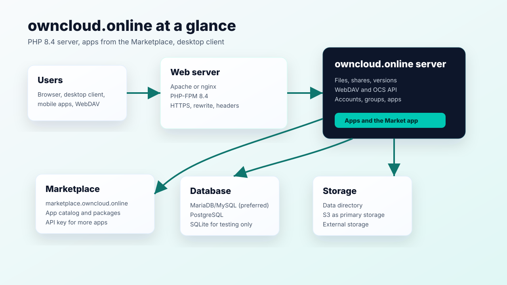

# owncloud.online documentation

*Diese Dokumentation gibt es auch auf [Deutsch](index.md).*

owncloud.online is file storage, sharing, and collaboration on your own server.
It runs on PHP 8.4. This documentation covers installation, operation, and
updates. It also describes the plugins, how to get them from the Marketplace,
and the desktop client.


## About this documentation

| Item | Details |
| --- | --- |
| Server | owncloud.online `11.0.25` |
| PHP | 8.4 |
| Desktop client | `7.11.1` |
| Repository | <https://github.com/BWTECH-github/owncloud.online> |
| Last updated | October 28, 2026 |

## Sections

| Section | Contents |
| --- | --- |
| [Installation](installation/index.en.md) | [Linux server](installation/linux-server.en.md), [web hosting with Plesk](installation/webhosting.en.md), [Windows with WSL for testing](installation/local-wsl.en.md) |
| [Administration](administration/index.en.md) | Security, cron, caching, apps, backups, updates, and troubleshooting |
| [Users](user/index.en.md) | Files, sharing, the web interface, and the desktop client |
| [Plugins](plugins/index.md) | Tested apps with a page for each, installation from the Marketplace, and updates |
| [Developers](developer/index.en.md) | Release process, PHP 8.4 rules, and tests |

If you are setting up owncloud.online for the first time, start with
[Installation](installation/index.en.md). It also explains who each of the
three options is for.

## Architecture



Browsers, the desktop client, and WebDAV clients talk to the web server over
HTTPS. The owncloud.online server keeps accounts, shares, and file information
in the database and the files themselves in storage. The *Market* app installs
additional apps from the Marketplace.

## Scope

This documentation applies to owncloud.online on PHP 8.4 and to the plugins
from BW-Tech GmbH. It stands on its own: everything described here applies to
this server and was tested on it.

- Server source code: <https://github.com/BWTECH-github/owncloud.online>
- Desktop client: <https://github.com/BWTECH-github/client/releases>
- Marketplace: <https://marketplace.owncloud.online>

## The first admin account

During installation, you create the admin account yourself, either in the
browser under *Create an admin account* or on the command line with
`occ maintenance:install --admin-user … --admin-pass …`:

```text
Username: admin
Password: <choose your own password>
```

The name `admin` is only an example; `occ maintenance:install` uses it when you
don't specify another one. Even for a test instance, choose a random
password and don't reuse it anywhere else. Test instances tend to become
reachable from the local network sooner than planned, and a password copied
from a guide is on every wordlist.
