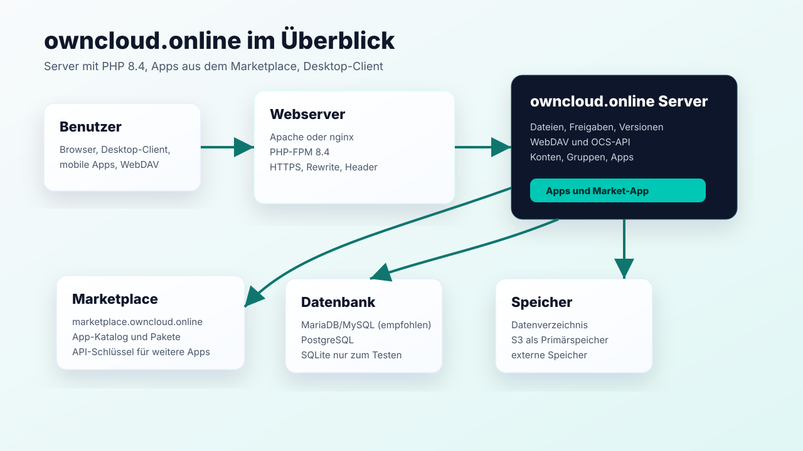

# owncloud.online Dokumentation

*This documentation is also available in [English](index.en.md).*

owncloud.online ist Dateiablage, Freigabe und Zusammenarbeit auf dem eigenen
Server und läuft mit PHP 8.4. Diese Dokumentation beschreibt Installation,
Betrieb und Updates, die Plugins und ihren Bezug über den Marketplace sowie den
Desktop-Client.


## Stand dieser Dokumentation

| Bereich | Stand |
| --- | --- |
| Server | owncloud.online `11.0.25` |
| PHP | 8.4 |
| Desktop-Client | `7.11.1` |
| Repository | <https://github.com/BWTECH-github/owncloud.online> |
| Aktualisiert | 28. Oktober 2026 |

## Dokumentationsbereiche

| Bereich | Inhalt |
| --- | --- |
| [Installation](installation/index.md) | [Linux-Server](installation/linux-server.md), [Webhosting mit Plesk](installation/webhosting.md), [Windows mit WSL zum Testen](installation/local-wsl.md) |
| [Administration](administration/index.md) | Sicherheit, Cron, Zwischenspeicher, Apps, Sicherungen, Updates und Fehlersuche |
| [Benutzer](user/index.md) | Dateien, Freigaben, Weboberfläche und Desktop-Client |
| [Plugins](plugins/index.md) | Geprüfte Apps mit je einer eigenen Seite, Installation über den Marketplace und Updates |
| [Entwickler](developer/index.md) | Release-Ablauf, PHP-8.4-Regeln und Tests |

Wer owncloud.online zum ersten Mal aufsetzt, beginnt mit
[Installation](installation/index.md). Dort steht auch, für wen welche der drei
Varianten gedacht ist.

## Aufbau



Browser, Desktop-Client und WebDAV-Programme sprechen über HTTPS mit dem
Webserver. Der owncloud.online-Server legt Konten, Freigaben und Dateiinformationen
in der Datenbank ab und die Dateien selbst im Speicher. Weitere Apps installiert
die App *Market* aus dem Marketplace.

## Geltungsbereich

Diese Dokumentation gilt für owncloud.online mit PHP 8.4 und für die Plugins der
BW-Tech GmbH. Sie ist eigenständig: Was hier steht, gilt für diesen Server und
wurde an ihm geprüft.

- Quellcode des Servers: <https://github.com/BWTECH-github/owncloud.online>
- Desktop-Client: <https://github.com/BWTECH-github/client/releases>
- Marketplace: <https://marketplace.owncloud.online>

## Das erste Administratorkonto

Bei der Installation legen Sie das Administratorkonto selbst an, im Browser
unter *Administrator-Konto anlegen* oder auf der Kommandozeile mit
`occ maintenance:install --admin-user … --admin-pass …`:

```text
Benutzername: admin
Passwort:     <eigenes Passwort wählen>
```

Der Name `admin` ist nur ein Beispiel; `occ maintenance:install` nimmt ihn,
wenn Sie keinen anderen angeben. Wählen Sie auch für eine reine
Testinstanz ein zufälliges Passwort und verwenden Sie es nirgends erneut.
Testinstanzen sind erfahrungsgemäß schneller aus dem lokalen Netz erreichbar als
geplant, und ein Passwort aus einer Anleitung steht in jeder Passwortliste.
