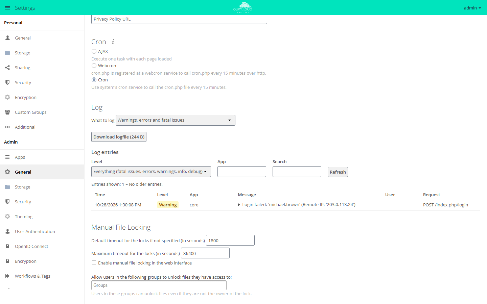

# Installing on web hosting with Plesk

owncloud.online can also be installed in a hosting plan with the Plesk control
panel. You need neither root access nor a command line: you upload a ZIP file,
create a database, and finish the setup in your browser. Other control panels
such as cPanel work the same way, only the menu items have different names.

When you are done, your hosting plan's home directory contains two new folders
next to `httpdocs`:

| Folder | Contents |
| --- | --- |
| `owncloud` | the program. The domain points to this folder. |
| `oco-data` | the data directory with all uploaded files. It lies outside the website and cannot be reached from the internet. |

In the examples, the domain is `cloud.example.com`. Use your own.

## Check the requirements {#voraussetzungen}

Check these points before you start. Otherwise, the installation will fail at
one of them later.

| Requirement | Why | Where to check |
| --- | --- | --- |
| PHP 8.4 | Older versions do not start, PHP 8.5 is not supported | *PHP Settings* of the domain |
| Linux server | owncloud.online refuses hosting on Windows | ask your hosting provider |
| MySQL or MariaDB | database for accounts, shares, and the file list | *Databases* |
| PHP may use 512 MB of memory | previews and updates need it | *PHP Settings*, value `memory_limit` |
| Folder outside the website | for the data directory | File Manager: home directory with `httpdocs` in it |
| *Scheduled Tasks* | for the background jobs | menu item in the control panel |
| Let's Encrypt | for HTTPS | *SSL/TLS Certificates* |
| outgoing HTTPS connections | for apps from the Marketplace, optional | ask your hosting provider |

On start, owncloud.online also checks these PHP extensions: zip, dom,
XMLWriter, XMLReader, intl, libxml, mbstring, ctype, JSON, GD, zlib, iconv,
SimpleXML, hash, cURL, and PDO with the MySQL driver. Plesk usually provides
them.

## Limits of web hosting {#grenzen}

Web hosting usually lacks a command line with the `occ` command, and Redis.
This means:

| Limit | Consequence |
| --- | --- |
| more than 50 accounts | The update in the browser refuses to run and asks for the `occ upgrade` command. |
| `user_ldap` or `user_shibboleth` app installed | the same block, regardless of the number of accounts |
| no Redis | File locking runs through the database. The settings page permanently shows a warning about it. |
| maintenance tasks | Rescanning files, transferring files between accounts, and repair steps only work with `occ`. |

For more than 50 accounts or an LDAP connection, plan a
[Linux server](linux-server.en.md) or a plan with SSH access from the start,
see [With SSH access](#ssh).

## 1. Prepare the domain and HTTPS {#domain}

1. In Plesk, under *Websites & Domains*, add the domain or subdomain
   `cloud.example.com` if it does not exist yet.
2. Under *SSL/TLS Certificates*, issue a free certificate from Let's Encrypt
   for the domain.
3. In the domain's *Hosting Settings*, turn on *Permanent SEO-safe 301
   redirect from HTTP to HTTPS*.

Open `https://cloud.example.com`. The browser shows the page without a
certificate warning.

## 2. Configure PHP {#php}

Open the domain's *PHP Settings*:

| Setting | Value |
| --- | --- |
| PHP version | 8.4, as an FPM application served by Apache. With the variant served by nginx, the bundled `.htaccess` file does not apply. |
| `memory_limit` | `512M` or more |
| `max_execution_time` | `3600` |
| `open_basedir` | must include the whole home directory. The Plesk default `{WEBSPACEROOT}{/}{:}{TMP}{/}` does. |

Save the settings.

??? note "Background: values from .user.ini"
    The release includes a `.user.ini` file that PHP reads on every request
    when it runs as an FPM application. It sets `upload_max_filesize` and
    `post_max_size` to `513M`, `memory_limit` to `512M`, `default_charset` to
    `UTF-8`, and `output_buffering` to `0`. These values take precedence over
    the PHP settings in Plesk, unless the hosting provider explicitly locks
    them.

    The 513 MB limit applies to a single request. The web interface and the
    desktop client upload large files in chunks and are not affected.

## 3. Download and verify {#herunterladen}

From <https://github.com/BWTECH-github/owncloud.online/releases>, download to
your own computer:

- `owncloud-online-11.0.25.zip`, about 65 MB, or the newer version offered
  there,
- `SHA256SUMS.txt` with the checksums.

Check that the ZIP file arrived unchanged. On Windows, open PowerShell in your
download folder and enter:

```powershell
(Get-FileHash .\owncloud-online-11.0.25.zip -Algorithm SHA256).Hash -eq ((Select-String 'owncloud-online-11.0.25.zip' .\SHA256SUMS.txt).Line -split '\s+')[0]
```

The answer is `True`. On Linux, the command is
`sha256sum --ignore-missing -c SHA256SUMS.txt`, and the answer is
`owncloud-online-11.0.25.zip: OK`. On macOS,
`shasum -a 256 owncloud-online-11.0.25.zip` shows the checksum. Compare it with
the line for the ZIP file in `SHA256SUMS.txt`.

If the answer is `False` or the checksum differs, the file is damaged or has
been modified. Download it again and do not upload it.

## 4. Upload and unpack {#hochladen}

1. Open the File Manager in Plesk. It shows the home directory with the
   `httpdocs` folder.
2. Upload the ZIP file to this home directory, not to `httpdocs`. Upload the
   ZIP file, not the unpacked files. The program consists of more than 11,000
   files, and uploading them one by one takes hours.
3. Extract the ZIP file from its menu in the File Manager. This creates the
   `owncloud` folder.
4. Next to it, create an empty folder named `oco-data`.
5. Delete the ZIP file.

Open the `owncloud` folder. It contains the `apps`, `config`, and `core`
folders and the `.htaccess` and `.user.ini` files, among others.

## 5. Create the database {#datenbank}

Under *Databases*, use *Add Database* to create a new, empty database, for
example `owncloud_online`, along with a database user with its own random
password. Write down four values:

| Value | Note |
| --- | --- |
| Database name | sometimes with a fixed prefix, for example `p123_owncloud_online` |
| Database user | |
| Password | |
| Database server | usually `localhost`. If Plesk shows a different name or a port such as `localhost:3306`, write it down exactly like that. |

The database must be empty. Tables from another application cause errors
during setup.

## 6. Point the domain to the program folder {#programmordner}

In the *Hosting Settings* of `cloud.example.com`, set the *Document root* to
the `owncloud` folder. Save.

Open `https://cloud.example.com`. The owncloud.online setup wizard appears.

!!! warning "Finish the setup right away"
    Until you complete the next step, anyone who opens the address can take
    over the installation. Continue without a break.

## 7. Setup in the browser {#einrichtung}

Fill in the form:

| Field | Entry |
| --- | --- |
| *Create an admin account*: *Username* and *Password* | your future administrator account. A long password of its own that you use nowhere else. |
| *Storage & database* | Click to expand. |
| *Data folder* | The suggestion is a `data` folder inside the program folder, for example `/var/www/vhosts/example.com/owncloud/data`. Replace `owncloud/data` with `oco-data`, in this example `/var/www/vhosts/example.com/oco-data`. |
| *Configure the database* | If several databases are offered, choose *MySQL/MariaDB*. |
| *Database user*, *Database password*, *Database name*, *Database host* | the four values from step 5 |

Click *Finish setup*. Depending on the hosting provider, the setup takes up to
two minutes. Do not interrupt it. Afterwards, the file view or the login page
appears.

??? note "Background: what the wizard enters"
    The wizard writes `config/config.php`. For that, the `config` folder must
    be writable, which it is in Plesk.

    | Key | Value |
    | --- | --- |
    | `datadirectory` | the path to `oco-data` |
    | `dbtype`, `dbname`, `dbuser`, `dbpassword`, `dbhost` | your database values |
    | `trusted_domains` | the address you opened the wizard with |
    | `overwrite.cli.url` | the same address with `https://` |
    | `passwordsalt`, `secret` | randomly generated |
    | `apps_paths` | `apps/` (fixed) and `apps-external/` (for apps from the Marketplace) |

    An almost empty `data` folder stays behind in the program folder. The
    wizard creates it to test the protection by the `.htaccess` file.

## 8. Set up background jobs {#cron}

Every 15 minutes, owncloud.online does work in the background: it cleans up
deleted files and old versions, removes expired shares, and sends
notifications and emails. Create a new task for it under *Scheduled Tasks*:

| Field | Entry |
| --- | --- |
| Task type | *Run a PHP script* |
| Script path | `owncloud/cron.php`, selected with the folder icon |
| PHP version | 8.4 |
| Run | every 15 minutes, in cron format `*/15 * * * *` |

Then, in owncloud.online, select the *Cron* option in the *Cron* section under
*Settings → Admin → General*.



The *Cron* option matches a scheduled task that runs `cron.php` with PHP.
Within 15 minutes, the section shows "Last cron job execution: …" with a green
dot.

??? note "If your hosting provider can only fetch URLs"
    Some plans only offer tasks of the type *Fetch a URL*. In that case, enter
    this address, every 5 minutes if possible:

    ```text
    https://cloud.example.com/index.php/cron
    ```

    Select the *Webcron* option in owncloud.online. With the *Cron* option, the
    address only answers `Background jobs are using system cron!` and does
    nothing. Each call processes exactly one job, which is why the short
    interval matters.

    The settings page names the `cron.php` file. Over the web, it only
    redirects to the address above.

??? warning "If it doesn't work"
    | What you see | Cause | Fix |
    | --- | --- | --- |
    | "Cron was not executed yet!" stays | task missing, running with a different PHP version, or the option does not match the task | check the task and PHP version; *Run a PHP script* goes with *Cron*, *Fetch a URL* with *Webcron* |
    | The task runs, but nothing happens | the hosting provider blocks the PHP function `system()`, which `cron.php` uses to start the actual run | switch to *Fetch a URL* and *Webcron* |
    | The list of jobs does not get shorter | *Webcron* processes only one job per call | shorten the interval or use *Run a PHP script* |

## 9. Log in and check {#pruefen}

Open `https://cloud.example.com/status.php`. The answer contains
`"installed":true` and `"maintenance":false`.

Log in and open *Settings → Admin → General*. The page checks the setup when
it opens and shows problems in the *Security & setup warnings* section. If it
shows

> Your data directory and your files are probably accessible from the
> Internet. The .htaccess file is not working.

the data directory is inside the program folder, and the `.htaccess` file
does not protect it. This warning must not stay. On a fresh installation
without data, start over: delete `owncloud/config/config.php`, create the
database again in Plesk, and repeat step 7 with `oco-data`. For what
the other messages mean, see
[Security and setup warnings](../administration/security-hardening.en.md).

Then set up email, see [Sending email](../administration/email.en.md). Enter
the SMTP access of your mailbox there. Without it, no password reset emails
and no invitations arrive.

## Caching {#zwischenspeicher}

Without a cache, owncloud.online reads all language and app files again on
every request. If your hosting provider offers the APCu PHP extension, turn it
on as a cache. To do so, open `owncloud/config/config.php` in the File Manager
and add this line before the last line `);`:

```php
  'memcache.local' => '\OC\Memcache\APCu',
```

If the error page `Memcache \OC\Memcache\APCu not available for local cache`
appears afterwards, APCu is missing. Remove the line again.

!!! warning "Edit config.php carefully"
    A typo in `config/config.php` makes the instance unreachable. Download the
    file before every change so that you can put it back.

## With SSH access {#ssh}

If your plan allows SSH access with a full shell, `occ` is available as well.
Log in and run it with the PHP from Plesk:

```bash
/opt/plesk/php/8.4/bin/php owncloud/occ status
```

This removes the [limits of web hosting](#grenzen) that depend on `occ`.
Write the commands from
the other pages of this documentation without `sudo -u www-data` and with
`/opt/plesk/php/8.4/bin/php owncloud/occ` instead of `php8.4 occ`.

??? note "What is different without a command line"
    | Task | With `occ` | Replacement on web hosting |
    | --- | --- | --- |
    | Check the state | `occ status` | `status.php` in the browser |
    | Update | `occ upgrade` | update in the browser, up to 50 accounts |
    | Turn maintenance mode on or off | `occ maintenance:mode --on` | `'maintenance' => true,` in `config/config.php` |
    | Change settings | `occ config:system:set …` | entry in `config/config.php`, see [Configuration (config.php)](../administration/config-reference.en.md) |
    | Enable and disable apps | `occ app:enable <app>` | *Settings → Admin → Apps* |
    | Install apps | `occ market:install <app>` | "Market" app in the web interface |
    | Rescan files | `occ files:scan --all` | no replacement |
    | Transfer an account's files | `occ files:transfer-ownership …` | no replacement |
    | Repair steps | `occ maintenance:repair` | no replacement |

## Installing more apps {#apps}

The release contains the server with the basic functions and the "Market"
app. You install other apps such as Activity, Gallery, Text Editor, or Guests
from the Marketplace. For administrator accounts, the app menu at the top left
shows a *Market* entry for this. Two requirements:

- The server may reach `https://marketplace.owncloud.online`. If the hosting
  provider blocks outgoing connections, the list stays empty.
- The `owncloud/apps-external` folder is writable, which it is in Plesk.

Without the Marketplace, you can do it by hand: download the app package,
unpack it on your own computer, upload the folder to `owncloud/apps-external`,
and enable the app under *Settings → Admin → Apps*. Details under
[Managing apps](../administration/apps-market.en.md).

## Updating {#aktualisieren}

For an update, you swap the program folder for the one from the new release.
The data directory and the database stay where they are.

1. **Back up.** Export the database under *Databases* and download
   `owncloud/config/config.php` and the `oco-data` folder.
2. **Turn on maintenance mode.** In `owncloud/config/config.php`, change the
   line `'maintenance' => false,` to `'maintenance' => true,`. If the line is
   missing, add it before the last line `);`.
3. **Upload the new release.** Download the ZIP file of the new version,
   verify it as in step 3, and rename the old `owncloud` folder to
   `owncloud-old` in Plesk. Upload the ZIP file to the home directory through
   the File Manager or over FTP, and extract it in the File Manager. This
   creates a new `owncloud` folder.
4. **Carry over your own files.** Copy `owncloud-old/config/config.php` to
   `owncloud/config/`. Copy all folders except `market` from
   `owncloud-old/apps-external` to `owncloud/apps-external`.
5. **Turn off maintenance mode.** In the copied `config.php`, change the line
   back to `'maintenance' => false,`.
6. **Start the update.** Open `https://cloud.example.com`. The page reports
   that owncloud.online will be updated to the new version. Click
   *Start update*.

If everything works, delete `owncloud-old`. If the update fails, rename the
folders back and restore the database backup. More on backups under
[Backups and updates](../administration/backups-updates.en.md).

## Troubleshooting {#fehlersuche}

Most errors are logged with their cause in `oco-data/owncloud.log`. The request
ID on the error page leads to the matching entry, see
[Server log and error messages](../administration/logging.en.md).

| What you see | Cause | Fix |
| --- | --- | --- |
| `This version of owncloud.online requires at least PHP 8.4.0` | PHP version too old or set for a different domain | choose PHP 8.4 in the *PHP Settings* of this domain |
| "PHP module … not installed." | an extension is missing | have the hosting provider enable the extension |
| `Cannot write into "config" directory` | `config` belongs to a different user than PHP | check the permissions in the File Manager |
| "Can't create or write into the data directory …" | wrong path or outside `open_basedir` | copy the path from the File Manager, check `open_basedir` |
| "Your Data directory must be an absolute path" | the path does not start with `/` | enter the full path |
| "Your Data directory is invalid" | the `.ocdata` file in the data directory is missing, for example after a move | create an empty `.ocdata` file in `oco-data` |
| "You are accessing the server through an untrusted domain." | opened through an address that is not in `trusted_domains`, for example a preview address of the hosting provider | add the address under `trusted_domains` in `config/config.php` |
| Blank page or error 500 without a message | PHP error | read the log, see above |
| The "Market" app shows no apps | no outgoing connection to the Marketplace | ask your hosting provider whether outgoing HTTPS is allowed |
| The update in the browser asks for `occ upgrade` | more than 50 accounts or `user_ldap` installed | use SSH access or move to a [Linux server](linux-server.en.md) |
| `.htaccess` or `.user.ini` missing after an update | files starting with a dot were not copied | extract the ZIP file on the server instead of uploading individual files |
