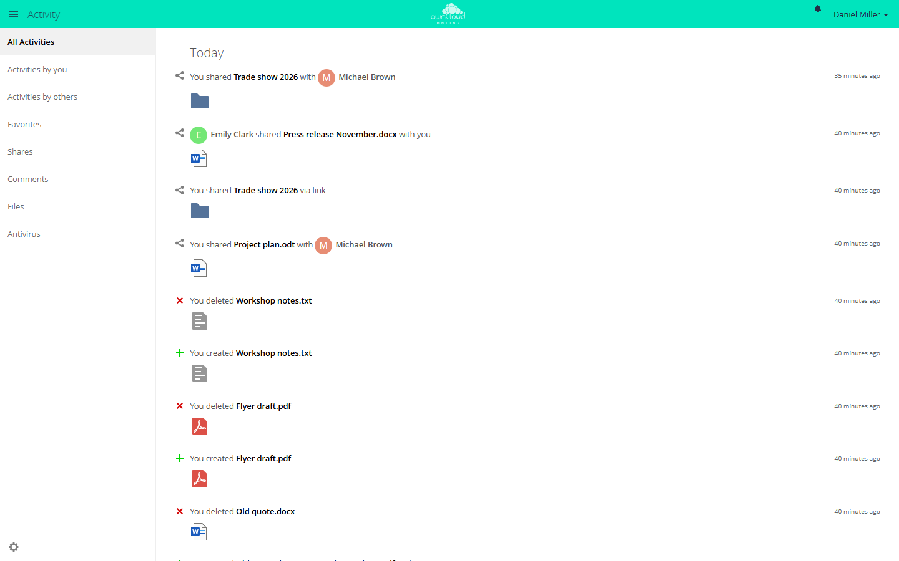

# Activity

The app records what happens to files and folders: new, changed, deleted, and
restored files, shares, comments, tags, and downloads through public links. Each
account sees the events for its own files and for files shared with it.
Accounts can also get a summary by email.

!!! note "Availability"
    Public in the Marketplace, no API key needed. App ID `activity`,
    version 2.8.5. Name in the Market: "Activity".

## Requirements

| Area | Requirement |
| --- | --- |
| owncloud.online | 11.x |
| PHP | 8.4 or later |
| Background jobs | Cron, preferably system cron (see [Background jobs](../../administration/background-jobs.en.md)). Without cron, no emails go out and old entries are never removed. |
| Email | only for the summaries: working [email delivery](../../administration/email.en.md) and an email address in the account |

## Installation

In the web interface: open **Market** from the app menu in the top left corner,
search for "Activity", and install the app.

On the command line:

```bash
sudo -u www-data php8.4 occ market:install activity
```

The command downloads the package from the Marketplace, installs the app, and
enables it. If the app is already installed and only disabled:

```bash
sudo -u www-data php8.4 occ app:enable activity
```

## Setup

The app has no page of its own in the admin settings. Administrators set two
values on the command line:

| Value | Where | Default | Effect |
| --- | --- | --- | --- |
| `activity_expire_days` | `config.php` | `365` | A background job deletes older entries once a day. |
| `enable_move_and_rename_activities` | app value of `activity` | `no` | With `yes`, the app also records renaming and moving. Two more rows then appear in the personal settings. |

```bash
# delete entries after 90 days
sudo -u www-data php8.4 occ config:system:set activity_expire_days --type integer --value 90

# record renaming and moving
sudo -u www-data php8.4 occ config:app:set activity enable_move_and_rename_activities --value yes
```

Before you shorten `activity_expire_days`, check whether contractual or legal
retention periods apply.

### Background jobs

| Job | Interval | Task |
| --- | --- | --- |
| `OCA\Activity\BackgroundJob\EmailNotification` | every 15 minutes | sends due summaries. With system cron it works through the whole queue, with AJAX or Webcron it handles at most 25 accounts per run. |
| `OCA\Activity\BackgroundJob\ExpireActivities` | once a day | deletes entries older than `activity_expire_days` days |

The emails go out through the instance's email delivery. The sender's local
part is `no-reply` unless `mail_from_address` sets a different one.

### Command line

```bash
# send all pending activity emails now
sudo -u www-data php8.4 occ activity:send-emails

# after moving a database: point links of old entries to this instance
sudo -u www-data php8.4 occ activity:rewrite-legacy-links \
  --old-base-url https://old.example.com/cloud
```

`activity:send-emails` ignores the interval the accounts have chosen. Daily and
weekly summaries go out right away as well.

`activity:rewrite-legacy-links` changes only links to the old host or below the
old webroot. Everything after `?` and `#` stays as it is. The command takes the
new address from `--new-base-url`, or from `overwrite.cli.url` without that
option. A second run changes nothing. Such links appear in the RSS feed, in the
API for the clients, and in the stream for entries without a file link.

## Usage

Open the stream from the app menu under **Activity**. Entries are grouped by
day, with the filters on the left.



*The Activity app lists changes to your files and shares. Filter on the left by "Activities by you", "Shares", or "Files", for example.*

| Filter | Shows |
| --- | --- |
| **All Activities** | all entries |
| **Activities by you** | your own actions |
| **Activities by others** | actions of other accounts on your files and on shared files |
| **Favorites** | entries for files you marked as favorites |
| **Shares** | shares with accounts, groups, and through links |
| **Comments** | comments on files |
| **Files** | creating, changing, deleting, and restoring |

Other apps add more filters, for example **Antivirus**.

In the file list, the sidebar of a file or folder has an **Activities** tab with
the entries for exactly that item.

### Personal settings

Under **Settings → Personal → General**, each account decides in the
**Activity** section what appears in the stream and what triggers an email:

- The table has one row per type of event and the columns **Mail** and
  **Stream**. Clicking a column header toggles the whole column; clicking a
  description toggles the whole row.
- The row "Limit notifications about creation and changes to your favorite files
  (Stream only)" keeps a busy stream readable.
- **List your own file actions in the stream** and **Notify about your own
  actions via email** include your own actions or leave them out.
- **Send emails:** **As soon as possible**, **Hourly**, **Daily**, or
  **Weekly**. "As soon as possible" also waits for the next run of the email
  job, which is due every 15 minutes.

If the account has no email address, the section shows "You need to set up your
email address before you can receive notification emails."

### RSS feed

In the Activity app, the gear icon in the bottom left corner opens the setting
**Enable RSS feed**. A field then shows the address of the feed.

The address contains a secret token. Anyone who knows it can read the feed
without logging in, so do not pass it on. Turning the feed off makes the address
invalid; turning it on again creates a new one. For disabled and deleted
accounts, the feed no longer returns entries.

## Limits and notes

- The app records nothing retroactively. Events from before the app was enabled
  are missing from the stream.
- If the account has no email address, the email job discards the account's
  pending emails. They are not sent later, even after an address is added.
- The app cannot be limited to groups.
  `occ app:enable activity --groups …` stops with "activity can't be enabled for
  groups."
- The app only records renaming and moving when
  `enable_move_and_rename_activities` is set to `yes`.
- The `oc_activity` table grows with every action. `activity_expire_days` limits
  how long entries are kept.
- When you move a database: `activity_expire_days` is stored in `config.php`,
  not in the database. The cleanup job moves with the database and runs on the
  first cron run. If the value is missing from the new `config.php`, the job
  deletes everything older than 365 days. Copy the value over before cron runs
  for the first time (see
  [Moving to another server](../../administration/migration.en.md)).

## Troubleshooting

| Symptom | Cause | Fix |
| --- | --- | --- |
| No emails | Cron does not run, email delivery is not set up, or the account has no email address | check cron and [email delivery](../../administration/email.en.md), add an email address to the account, then run `occ activity:send-emails` |
| The stream stays empty | The events happened before the app was enabled, or the **Stream** column is cleared in the personal settings | entries are collected from now on; select the checkboxes in the **Stream** column |
| Renaming and moving are missing | `enable_move_and_rename_activities` is `no` | set the value to `yes` |
| The `oc_activity` table keeps growing | The cleanup job does not run | check cron |
| The RSS reader shows "Your feed URL is invalid" | Feed turned off, recreated, or account disabled | get the new address in the Activity app |
