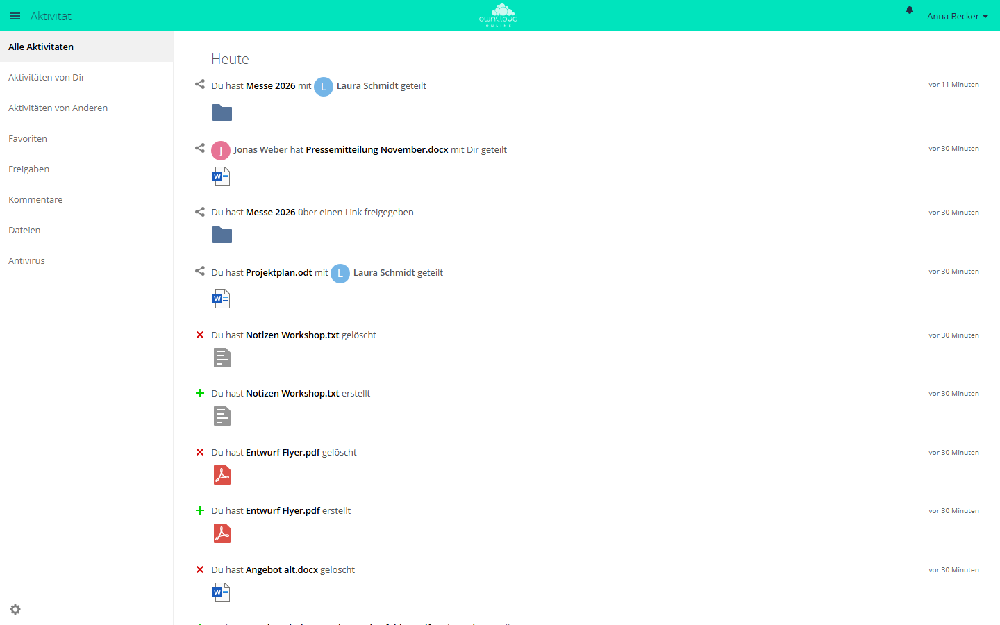

# Aktivität

Die App zeichnet auf, was mit Dateien und Ordnern geschieht: Anlegen, Ändern,
Löschen und Wiederherstellen, Freigaben, Kommentare, Tags und Downloads über
öffentliche Links. Jedes Konto sieht die Ereignisse zu seinen eigenen und den
mit ihm geteilten Dateien. Auf Wunsch kommt eine Zusammenfassung per E-Mail.

!!! note "Verfügbarkeit"
    Öffentlich im Marketplace, ohne API-Schlüssel. App-ID `activity`,
    Version 2.8.5. Name im Markt: „Activity“.

## Voraussetzungen

| Bereich | Anforderung |
| --- | --- |
| owncloud.online | 11.x |
| PHP | 8.4 oder neuer |
| Hintergrund-Jobs | Cron, am besten als System-Cron (siehe [Hintergrund-Jobs](../../administration/background-jobs.md)). Ohne Cron gehen keine Mails hinaus und alte Einträge bleiben liegen. |
| E-Mail | nur für die Zusammenfassungen: eingerichteter [E-Mail-Versand](../../administration/email.md) und eine E-Mail-Adresse im Konto |

## Installation

In der Weboberfläche: im App-Menü links oben **Markt** öffnen, nach
„Activity“ suchen und die App installieren.

Auf der Kommandozeile:

```bash
sudo -u www-data php8.4 occ market:install activity
```

Der Befehl lädt das Paket aus dem Marketplace, installiert die App und schaltet
sie ein. Ist die App schon vorhanden und nur abgeschaltet:

```bash
sudo -u www-data php8.4 occ app:enable activity
```

## Einrichtung

Eine eigene Seite in der Administration hat die App nicht. Zwei Werte legen
Administratoren auf der Kommandozeile fest:

| Wert | Ort | Standard | Wirkung |
| --- | --- | --- | --- |
| `activity_expire_days` | `config.php` | `365` | Einträge, die älter sind, löscht ein Hintergrund-Job einmal am Tag. |
| `enable_move_and_rename_activities` | App-Wert von `activity` | `no` | Mit `yes` erfasst die App auch Umbenennen und Verschieben. In den persönlichen Einstellungen erscheinen dafür zwei weitere Zeilen. |

```bash
# Einträge nach 90 Tagen löschen
sudo -u www-data php8.4 occ config:system:set activity_expire_days --type integer --value 90

# Umbenennen und Verschieben erfassen
sudo -u www-data php8.4 occ config:app:set activity enable_move_and_rename_activities --value yes
```

Prüfen Sie vor dem Kürzen von `activity_expire_days`, ob vertragliche oder
gesetzliche Aufbewahrungsfristen gelten.

### Hintergrund-Jobs

| Job | Takt | Aufgabe |
| --- | --- | --- |
| `OCA\Activity\BackgroundJob\EmailNotification` | alle 15 Minuten | verschickt fällige Zusammenfassungen. Mit System-Cron arbeitet er die ganze Warteschlange ab, mit AJAX oder Webcron höchstens 25 Konten je Lauf. |
| `OCA\Activity\BackgroundJob\ExpireActivities` | einmal am Tag | löscht Einträge, die älter als `activity_expire_days` Tage sind |

Die Mails gehen über den Mailversand der Instanz. Der Absender hat den
Lokalteil `no-reply`, sofern `mail_from_address` nichts anderes vorgibt.

### Kommandozeile

```bash
# alle wartenden Aktivitäts-Mails sofort verschicken
sudo -u www-data php8.4 occ activity:send-emails

# nach dem Umzug einer Datenbank: Verweise alter Einträge auf diese Instanz umschreiben
sudo -u www-data php8.4 occ activity:rewrite-legacy-links \
  --old-base-url https://alt.example.com/cloud
```

`activity:send-emails` richtet sich nicht nach dem Takt, den die Konten gewählt
haben. Auch tägliche und wöchentliche Zusammenfassungen gehen sofort hinaus.

`activity:rewrite-legacy-links` ändert nur Verweise auf den alten Host oder
unter dem alten Webroot. Der Teil hinter `?` und `#` bleibt erhalten. Die neue
Adresse nimmt der Befehl aus `--new-base-url`, ohne diese Option aus
`overwrite.cli.url`. Ein zweiter Lauf ändert nichts mehr. Solche Verweise
stehen im RSS-Feed, in der Schnittstelle für die Clients und im Stream bei
Einträgen ohne Dateiverweis.

## Nutzung

Den Stream öffnen Sie im App-Menü unter **Aktivität**. Die Einträge sind nach
Tagen gruppiert, links stehen die Filter.



*Die App Aktivität listet Änderungen an Ihren Dateien und Freigaben. Links filtern Sie etwa nach „Aktivitäten von Dir“, „Freigaben“ oder „Dateien“.*

| Filter | Zeigt |
| --- | --- |
| **Alle Aktivitäten** | alle Einträge |
| **Aktivitäten von Dir** | Ihre eigenen Aktionen |
| **Aktivitäten von Anderen** | Aktionen anderer Konten an Ihren und an geteilten Dateien |
| **Favoriten** | Einträge zu Dateien, die Sie als Favorit markiert haben |
| **Freigaben** | Freigaben an Konten, Gruppen und über Links |
| **Kommentare** | Kommentare an Dateien |
| **Dateien** | Anlegen, Ändern, Löschen und Wiederherstellen |

Andere Apps bringen weitere Filter mit, zum Beispiel **Antivirus**.

In der Dateiliste zeigt die Seitenleiste einer Datei oder eines Ordners den
Reiter **Aktivitäten** mit den Einträgen zu genau diesem Element.

### Persönliche Einstellungen

Unter **Einstellungen → Persönlich → Allgemein** legt jedes Konto im Abschnitt
**Aktivität** fest, was im Stream erscheint und wofür eine Mail kommt:

- Die Tabelle hat je Ereignisart eine Zeile und die Spalten **Mail** und
  **Stream**. Ein Klick auf den Spaltenkopf schaltet die ganze Spalte um, ein
  Klick auf die Beschreibung die ganze Zeile.
- Die Zeile „Benachrichtigungen über Neues und Änderungen auf Deine
  favorisierten Dateien beschränken (nur im Stream)“ hält den Stream bei vielen
  Änderungen übersichtlich.
- **Deine eigenen Datei-Aktivitäten im Stream auflisten** und **Über Deine
  eigenen Aktivitäten via E-Mail benachrichtigen** schalten die eigenen Aktionen
  zu oder ab.
- **Sende E-Mails:** **Schnellstmöglich**, **Stündlich**, **Täglich** oder
  **Wöchentlich**. Auch „Schnellstmöglich“ wartet auf den nächsten Lauf des
  Mail-Jobs, der alle 15 Minuten ansteht.

Fehlt im Konto eine E-Mail-Adresse, steht dort der Hinweis „Bevor Du
E-Mail-Benachrichtigungen empfangen kannst, musst Du Deine E-Mail-Adresse
einrichten.“

### RSS-Feed

In der App Aktivität öffnet das Zahnrad links unten die Einstellung
**RSS-Feed aktivieren**. Danach zeigt ein Feld die Adresse des Feeds.

Die Adresse enthält ein geheimes Token. Wer sie kennt, liest den Feed ohne
Anmeldung. Geben Sie sie deshalb nicht weiter. Abschalten macht die Adresse
ungültig, erneutes Einschalten erzeugt eine neue. Für gesperrte und gelöschte
Konten liefert der Feed keine Einträge mehr.

## Grenzen und Hinweise

- Rückwirkend erfasst die App nichts. Ereignisse vor dem Einschalten fehlen im
  Stream.
- Fehlt im Konto die E-Mail-Adresse, verwirft der Mail-Job die fälligen Mails
  dieses Kontos. Sie kommen auch nach dem Eintragen einer Adresse nicht nach.
- Die App lässt sich nicht auf Gruppen beschränken.
  `occ app:enable activity --groups …` bricht mit „activity can't be enabled for
  groups.“ ab.
- Umbenennen und Verschieben erfasst die App erst, wenn
  `enable_move_and_rename_activities` auf `yes` steht.
- Die Tabelle `oc_activity` wächst mit jeder Aktion. `activity_expire_days`
  begrenzt die Aufbewahrung.
- Beim Umzug einer Datenbank: `activity_expire_days` steht in der `config.php`,
  nicht in der Datenbank. Der Aufräum-Job zieht mit der Datenbank um und läuft
  beim ersten Cron-Lauf. Fehlt der Wert in der neuen `config.php`, löscht er alles,
  was älter als 365 Tage ist. Übertragen Sie den Wert deshalb, bevor der Cron
  zum ersten Mal läuft (siehe
  [Umzug auf einen anderen Server](../../administration/migration.md)).

## Fehlersuche

| Symptom | Ursache | Abhilfe |
| --- | --- | --- |
| Keine Mails | Cron läuft nicht, Mailversand fehlt oder das Konto hat keine E-Mail-Adresse | Cron und [E-Mail-Versand](../../administration/email.md) prüfen, E-Mail-Adresse im Konto eintragen, danach `occ activity:send-emails` |
| Stream bleibt leer | Die Ereignisse liegen vor dem Einschalten der App, oder die Spalte **Stream** ist in den persönlichen Einstellungen abgewählt | ab jetzt wird gesammelt; Haken in der Spalte **Stream** setzen |
| Umbenennen und Verschieben fehlen | `enable_move_and_rename_activities` steht auf `no` | Wert auf `yes` setzen |
| Tabelle `oc_activity` wächst ohne Ende | Der Aufräum-Job läuft nicht | Cron prüfen |
| Der RSS-Reader meldet „Deine Feed-URL ist ungültig“ | Feed abgeschaltet, neu erzeugt oder Konto gesperrt | neue Adresse in der App Aktivität holen |
