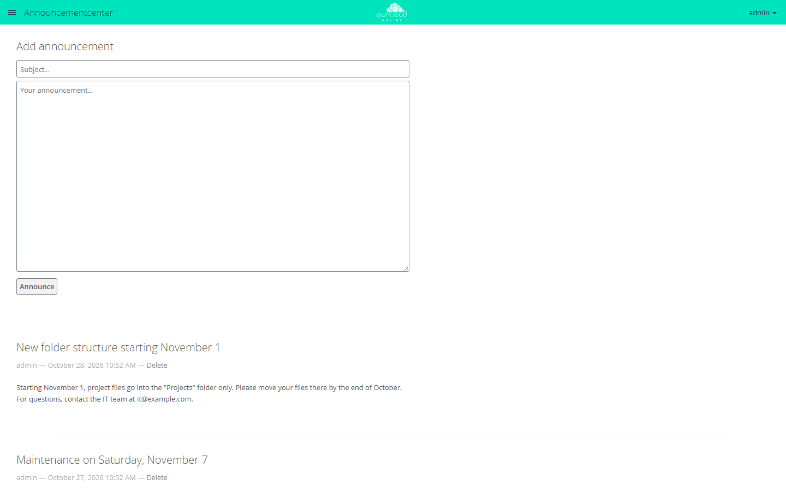
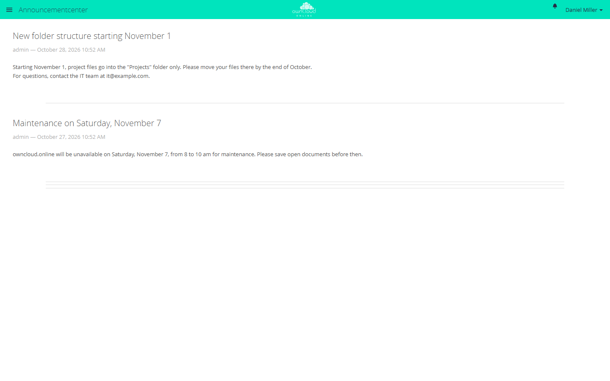

# Announcement Center

With this app, admins send messages to all accounts, for example about a
maintenance window or a changed procedure. Announcements appear on the app's own
page and also arrive as a notification under the bell, in the activity stream,
and by email. Guest accounts do not receive announcements.

!!! note "Availability"
    Public in the Marketplace, no API key needed. App ID `announcementcenter`,
    version 1.3.6. Name in the Market: "Announcement Center".

## Requirements

| Area | Requirement |
| --- | --- |
| owncloud.online | 11.x |
| PHP | 8.4 or later |
| Apps | [Notifications](notifications.en.md) for the bell, [Activity](activity.en.md) for the activity stream and email. Without both, announcements only appear on the app's page. |
| Cron | A background job creates the notifications and activities, see [Background jobs](../../administration/background-jobs.en.md). |

## Installation

In the web interface: open **Market** from the app menu in the top left corner,
search for "Announcement Center", and click **Install**.

On the command line:

```bash
sudo -u www-data php8.4 occ market:install announcementcenter
```

If the app is already installed and only disabled:

```bash
sudo -u www-data php8.4 occ app:enable announcementcenter
```

The app has no settings page. The app menu shows the entry
**Announcementcenter**; it has this name in every language.

## Write an announcement

1. Open **Announcementcenter** from the app menu.
2. Under **Add announcement**, type the subject into the **Subject…** field and
   the text into the **Your announcement…** field.
3. Click **Announce**.



*Admins write announcements with a subject and text. Announce publishes them for everyone.*

The announcement appears at the top of the list right away. On the next run of
the background jobs, all accounts except guests get an entry in the activity
stream and, except for the author, a notification under the bell. By email, the
announcement arrives with the Activity app's digest: as soon as possible,
hourly, daily, or weekly, depending on each account's setting, and only for
accounts with an email address.

| Field | Rule |
| --- | --- |
| Subject | required, up to 512 bytes, one line |
| Text | optional, up to 8000 bytes, line breaks are kept |

Umlauts, accented letters, and other non-ASCII characters take two or more
bytes in UTF-8. If a field is too long, the app reports "The subject is too
long" or "The announcement is too long".

Subject and text are plain text. HTML shows up as text, and addresses do not
turn into links.

## Delete an announcement

Next to the author and date of each announcement, admins see **Delete**. After
a confirmation, the announcement disappears from the list and the notifications
under the bell are removed. Entries in the activity stream remain and read
"Announcement does not exist anymore". Emails already sent cannot be recalled.

## What users see

Users open the announcements from the app menu or by clicking the notification.
They see the list, newest first, but no form and no delete button.



*Announcements appear in one list for all users, newest first.*

## Limits and notes

- Only admins can write and delete announcements, group admins cannot.
- An announcement always goes to all accounts except guests. There are no
  target groups.
- Announcements cannot be edited. To correct one, delete it and write it again;
  the accounts then get notified a second time.
- Until background jobs run, the bell, activity stream, and email stay empty;
  the announcement only appears on the app's page.
- The background job walks through all accounts one by one and creates a
  notification and an activity entry for each. On large instances, this takes
  a while.
