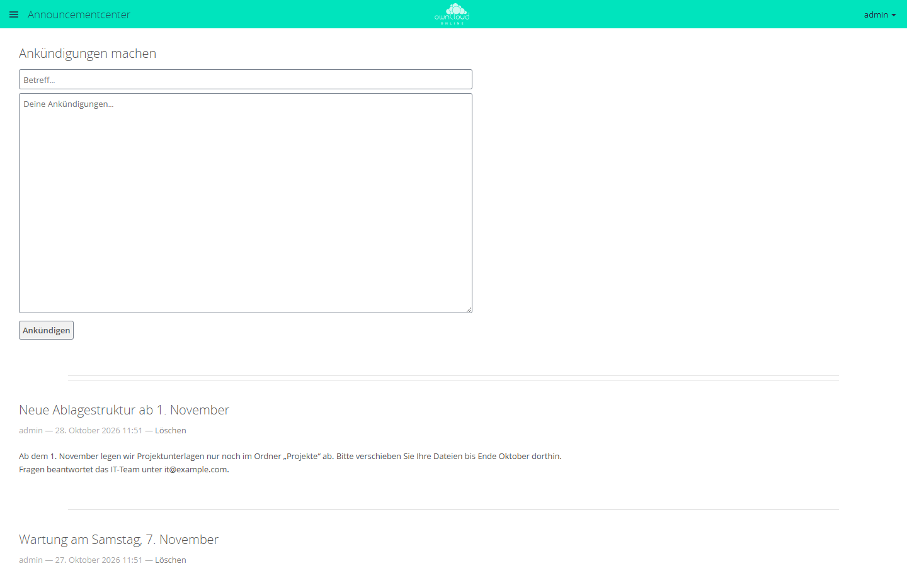
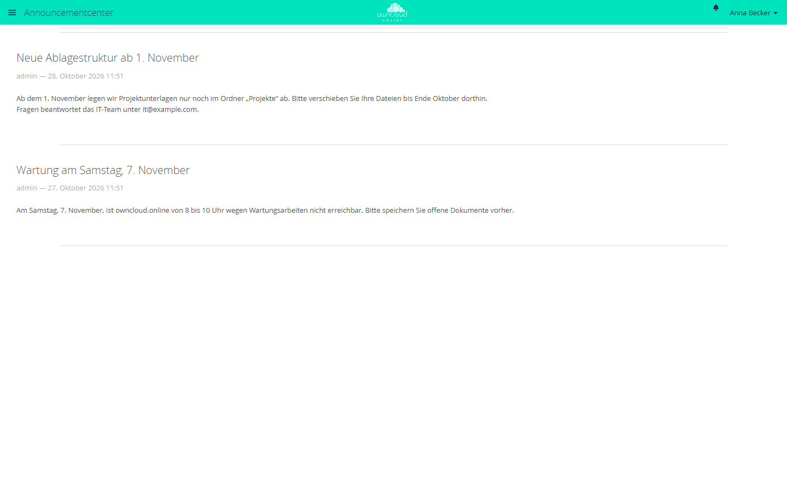

# Ankündigungen

Mit der App schreiben Administratoren Mitteilungen an alle Konten, etwa zu
einem Wartungsfenster oder zu geänderten Abläufen. Die Ankündigungen stehen auf
einer eigenen Seite der App und kommen zusätzlich als Benachrichtigung an der
Glocke, im Aktivitätenstrom und per E-Mail an. Gastkonten bekommen keine
Ankündigungen.

!!! note "Verfügbarkeit"
    Öffentlich im Marketplace, ohne API-Schlüssel. App-ID `announcementcenter`,
    Version 1.3.6. Name im Markt: „Announcement Center“.

## Voraussetzungen

| Bereich | Anforderung |
| --- | --- |
| owncloud.online | 11.x |
| PHP | 8.4 oder neuer |
| Apps | [Benachrichtigungen](notifications.md) für die Glocke, [Aktivität](activity.md) für Aktivitätenstrom und E-Mail. Ohne beide stehen Ankündigungen nur auf der Seite der App. |
| Cron | Benachrichtigungen und Aktivitäten erzeugt ein Hintergrund-Job, siehe [Hintergrund-Jobs](../../administration/background-jobs.md). |

## Installation

In der Weboberfläche: im App-Menü links oben **Markt** öffnen, nach
„Announcement Center“ suchen und **Installieren** klicken.

Auf der Kommandozeile:

```bash
sudo -u www-data php8.4 occ market:install announcementcenter
```

Ist die App schon vorhanden und nur abgeschaltet:

```bash
sudo -u www-data php8.4 occ app:enable announcementcenter
```

Eine Einstellungsseite hat die App nicht. Im App-Menü erscheint der Eintrag
**Announcementcenter**; er heißt in allen Sprachen so.

## Ankündigung schreiben

1. Im App-Menü **Announcementcenter** öffnen.
2. Unter **Ankündigungen machen** den Betreff in das Feld **Betreff…** und den
   Text in das Feld **Deine Ankündigungen…** schreiben.
3. **Ankündigen** klicken.



*Administratoren schreiben Ankündigungen mit Betreff und Text. Ankündigen veröffentlicht sie für alle.*

Die Ankündigung steht sofort oben in der Liste. Beim nächsten Lauf der
Hintergrund-Jobs bekommen alle Konten außer Gästen einen Eintrag im
Aktivitätenstrom und, außer dem Verfasser, eine Benachrichtigung an der Glocke.
Per E-Mail kommt die Ankündigung mit der Sammelmail der App Aktivität, also je
nach Einstellung des Kontos schnellstmöglich, stündlich, täglich oder
wöchentlich, und nur an Konten mit hinterlegter E-Mail-Adresse.

| Feld | Regel |
| --- | --- |
| Betreff | Pflichtfeld, höchstens 512 Byte, eine Zeile |
| Text | freiwillig, höchstens 8000 Byte, Zeilenumbrüche bleiben erhalten |

Umlaute und andere Sonderzeichen belegen in UTF-8 zwei oder mehr Byte. Ist ein
Feld zu lang, meldet die App „Der Betreff ist zu lang“ beziehungsweise „Die
Ankündigung ist zu lang“.

Betreff und Text sind reiner Text. HTML wird als Text angezeigt, Adressen
werden nicht zu Links.

## Ankündigung löschen

Neben Verfasser und Datum jeder Ankündigung steht für Administratoren
**Löschen**. Nach der Rückfrage verschwindet die Ankündigung aus der Liste, und
die Benachrichtigungen an der Glocke werden entfernt. Einträge im
Aktivitätenstrom bleiben mit dem Hinweis „Die Ankündigung existiert nicht mehr“
stehen. Verschickte E-Mails lassen sich nicht zurückholen.

## Was Anwender sehen

Anwender öffnen die Ankündigungen über das App-Menü oder per Klick auf die
Benachrichtigung. Sie sehen die Liste, die neueste oben, aber kein Formular und
keinen Knopf zum Löschen.



*Ankündigungen stehen für alle Benutzer in einer Liste, die neueste oben.*

## Grenzen und Hinweise

- Schreiben und löschen dürfen nur Administratoren, keine
  Gruppenadministratoren.
- Eine Ankündigung geht immer an alle Konten außer Gästen. Zielgruppen gibt es
  nicht.
- Ändern lässt sich eine Ankündigung nicht. Für eine Korrektur löschen Sie sie
  und schreiben sie neu; die Konten werden dann ein zweites Mal benachrichtigt.
- Solange keine Hintergrund-Jobs laufen, bleiben Glocke, Aktivitätenstrom und
  E-Mail leer; die Ankündigung steht nur auf der Seite der App.
- Der Hintergrund-Job geht alle Konten nacheinander durch und legt für jedes
  eine Benachrichtigung und einen Aktivitätseintrag an. Auf großen Instanzen
  dauert das eine Weile.
