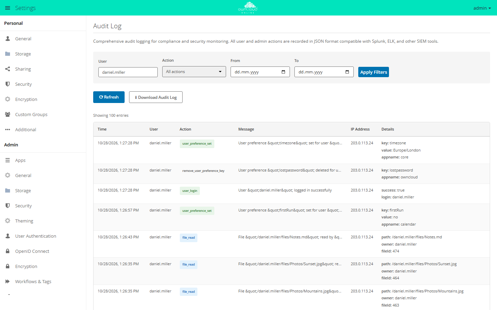

# Audit Log

!!! info "API key required"
    The Marketplace lists this app only for instances that have a valid API
    key entered in the Market. BW-Tech GmbH issues the key on request. To
    enter it: in the **Market**, click **Add API Key** under *Settings*, paste
    the key, and click **Save**. The steps in detail are under
    "Installation". App ID `audit_log`, version 1.3.2.

The `audit_log` app records who did what and when: logins, file access,
shares, changes to accounts and groups, tags, comments, enabling and disabling
apps, and every `occ` command. It is meant for instances that have to prove who
accessed or changed what. Each entry is one line of JSON that SIEM systems such
as Splunk, ELK, or Graylog can ingest directly.

## Requirements

| Area | Requirement |
| --- | --- |
| owncloud.online | 11.0.x |
| PHP | 8.4; the package does not allow newer PHP versions |
| Cron | for the daily rotation, see [Background jobs (cron)](../../administration/background-jobs.en.md) |
| Log folder | writable for the web server user |

## Installation

1. Request the API key from BW-Tech GmbH.
2. Open **Market** from the app menu in the top left. In the left column under
   *Settings*, click **Add API Key**.
3. Paste the key into the "Your personal API Key" field and click **Save**.
   The Market checks the key with the Marketplace and reloads the catalog. If
   the key was accepted, the entry in the left column now reads
   **Edit API Key**. If it still reads **Add API Key**, the key was rejected
   and not saved.
4. Go to the "Audit Log" app and click **Install**.

On the command line, once the key is entered:

```bash
sudo -u www-data php8.4 occ market:install audit_log
```

`market:install` downloads, installs, and enables the app. If the app is
already present but disabled, run
`sudo -u www-data php8.4 occ app:enable audit_log`. How to enter the key on the
command line, and what to watch out for, is described for the
[BW-Tech File Firewall](file_firewall.en.md#installation).

## Configuration

### Separate log file

Always set up a separate file. Without one, the app writes through the server
log at the info level, and with the default level 2 (warning) the server drops
these entries.

```bash
sudo install -d -o www-data -g www-data -m 0750 /var/log/owncloud.online
sudo -u www-data php8.4 occ config:system:set log.conditions 0 apps 0 --value admin_audit
sudo -u www-data php8.4 occ config:system:set log.conditions 0 logfile --value /var/log/owncloud.online/audit.log
sudo -u www-data php8.4 occ config:system:get log.conditions
```

If `log.conditions` already has entries, use the next free number instead of
`0`. The same entry directly in `config/config.php`:

```php
'log.conditions' => [
    [
        'apps' => ['admin_audit'],
        'logfile' => '/var/log/owncloud.online/audit.log',
    ],
],
```

The entries carry the ID `admin_audit`. With a separate file, the app writes
there directly, and the server's log level does not matter. If the file does
not exist, the app creates it with permissions `0640`.

### Options

| Value | Where | Default | Effect |
| --- | --- | --- | --- |
| `log.conditions` with `apps` and `logfile` | `config/config.php` | empty | separate log file |
| `logfile` | app value of `audit_log` | empty | separate log file if `log.conditions` does not name one |
| `log_rotate_size` | app value of `audit_log` | `52428800` (50 MB) | from this size on, the background job rotates the separate file |
| `log_rotate_max_files` | app value of `audit_log` | `5` | number of old files kept (`.1` to `.5`); the oldest is deleted |
| `ignore_cli_events` | app value of `audit_log` | `no` | `yes`: no entries from `occ` and cron |
| `admin_audit.groups` | `config/config.php` | empty | list of groups; the `auditGroups` field then names only these |
| `logtimezone`, `logdateformat` | `config/config.php` | `UTC`, `c` | time zone and format of the `time` field |

Set app values like this:

```bash
sudo -u www-data php8.4 occ config:app:set audit_log log_rotate_max_files --value 30
```

### Web interface

The app has its own section: **Settings → Admin → Audit Log**.

<figure markdown="span">
  
  <figcaption>The audit log records user and admin actions. Filters for user, action, and date range narrow the list.</figcaption>
</figure>

| Element | Function |
| --- | --- |
| "User", "Action", "From", "To", **Apply Filters** | filter by acting account (exact name), action, and date range |
| Table | the latest 100 matching entries with "Time", "User", "Action", "Message", "IP Address", and "Details" |
| **Refresh** | reload the list |
| **Download Audit Log** | all audit entries of the current file as JSON lines (`audit_log_<date>_<time>.log`); rotated files are not included |

### Command line

| Command | Purpose |
| --- | --- |
| `audit:list` | filter entries: `-c <count>` (default 50), `-u <account>`, `-a <action>`, `--from <date>`, `--to <date>`, `-f json` |
| `audit:tail` | print new entries as they arrive: `-n <lines>` (default 10), `-s <seconds>`, `--once` |
| `audit:stats` | file, size, number of entries, breakdown by action and account; `-f json` |
| `audit:rotate` | rotate the separate file once it has reached `log_rotate_size`; `--force` rotates right away |

```bash
sudo -u www-data php8.4 occ audit:list -u anna -a file_read --from 2026-10-01 --to 2026-10-28
sudo -u www-data php8.4 occ audit:tail
```

A date without a time covers the whole day, in the time zone from
`logtimezone`.

## What is recorded

| Area | Actions (`action`) |
| --- | --- |
| Login | `user_login` (successful and failed, see the `success` field), `user_logout` |
| Files | `file_create`, `file_read`, `file_update`, `file_delete`, `file_rename`, `file_copy`, `file_trash_delete`, `file_trash_restore`, `file_version_restore`, `file_version_delete` |
| Shares | `file_shared`, `file_unshared`, `share_permission_update`, `share_password_updated`, `share_expiration_date_updated`, `share_name_updated`, `share_accepted`, `share_declined`, `public_link_removed` |
| Public links | `public_link_accessed` (link page and download, including failed attempts, see the `success` field), `public_link_accessed_webdav` (access over WebDAV) |
| Accounts and groups | `user_created`, `user_deleted`, `user_password_reset`, `user_state_changed`, `group_created`, `group_deleted`, `group_member_added`, `group_member_removed` |
| Personal settings | `user_preference_set`, `remove_user_preference_key`, `remove_preferences_of_user`, `delete_all_user_preference_of_app` |
| Tags | `tag_created`, `tag_updated`, `tag_deleted`, `tag_assigned`, `tag_unassigned` |
| Comments | `comment_created`, `comment_updated`, `comment_deleted` |
| Apps | `app_enabled`, `app_disabled` |
| Command line | `command_executed` with the complete command line |

One entry, wrapped here for readability:

```json
{
  "reqId": "4uAiwjMtXOfVyPyn5B7H",
  "level": 1,
  "time": "2026-10-28T13:17:43+00:00",
  "remoteAddr": "203.0.113.24",
  "user": "anna",
  "app": "admin_audit",
  "method": "POST",
  "url": "/index.php/login",
  "message": "User &quot;anna&quot; logged in successfully",
  "action": "user_login",
  "CLI": false,
  "userAgent": "Mozilla/5.0 (…)",
  "success": true,
  "login": "anna",
  "auditUsers": ["anna"],
  "auditGroups": ["sales"]
}
```

| Field | Content |
| --- | --- |
| `reqId` | ID of the request; entries from the same request share it |
| `time` | time according to `logtimezone` and `logdateformat` |
| `remoteAddr` | IP address of the client; `127.0.0.1` for `occ` and cron |
| `user` | acting account; `CLI` for `occ` and cron, `--` without a login |
| `action`, `message` | the action as an ID and as text |
| `auditUsers`, `auditGroups` | accounts involved and their groups |
| other fields | depending on the action, for example `path`, `owner`, and `fileId` for files |

## Rotation

A background job checks the separate file once a day. Once it has reached
`log_rotate_size`, the job renames it to `audit.log.1`, moves older files up
by one number, and deletes the oldest one beyond `log_rotate_max_files`. With
the defaults, five older files are kept next to the current one, each at least
50 MB in size.

If you use `logrotate` instead, set `log_rotate_size` so high that the app
never rotates. Running both at the same time leads to conflicts.

Without a separate file, the entries are in the server log. owncloud.online
rotates that log itself (`log_rotate_size` in `config/config.php`, default
100 MB), and the app leaves it alone.

## Usage

Users do not see the app.

## Limits and notes

- **Volume.** Every read of a file creates a `file_read` entry. On busy
  instances, expect large log files and plan rotation and retention
  accordingly.
- **Retention.** With the defaults, rotation deletes older entries. If you
  must keep entries longer, raise `log_rotate_max_files` or forward the file
  to a SIEM system.
- **Secrets on the command line.** `command_executed` contains the complete
  command line. Passwords or keys that you pass to an `occ` command as an
  argument end up in the log.
- **Gaps in version 1.3.2.** The following is not recorded:
    - changes to app and system settings in the web interface; changes made
      with `occ` appear only as `command_executed`,
    - switching to another account with [Impersonate](impersonate.en.md);
      whatever happens afterwards is recorded under the other account,
    - two-factor authentication,
    - creating, renaming, and leaving [custom groups](customgroups.en.md).
      Only the deletion of such a group is recorded completely; for members
      and roles, the affected account is missing.
- **Personal data.** The log contains accounts, IP addresses, and file paths.
  Restrict access to the file and agree on a retention period with your data
  protection officer.
- **Web interface and download** read only the current file, not rotated ones.
- **Reverse proxy.** For `remoteAddr` to contain the client's address and not
  the proxy's, `trusted_proxies` must be correct, see
  [Reverse proxy and TLS](../../administration/reverse-proxy.en.md).

How the general server log works is described in
[Server log and error messages](../../administration/logging.en.md).

## Troubleshooting

| Symptom | Cause | Fix |
| --- | --- | --- |
| No entries appear. | No separate file set up, log level 2 | Set up a separate file (see above) |
| Entries are in the server log, not in the separate file | `log.conditions` has the wrong structure: `apps` must contain `admin_audit`, `logfile` the path. | Check `occ config:system:get log.conditions` |
| The separate file stays empty or is missing, the PHP error log shows "[audit_log] Failed to write to …" | The web server user cannot write to the folder. | Create the folder and make `www-data` its owner, see above |
| `audit:rotate` reports "Nothing to rotate: no dedicated audit log file configured …" | No separate file; owncloud.online rotates the server log itself. | Set up a separate file, or do nothing |
| No entries from `occ` and cron | `ignore_cli_events` is `yes`. | `occ config:app:set audit_log ignore_cli_events --value no` |
