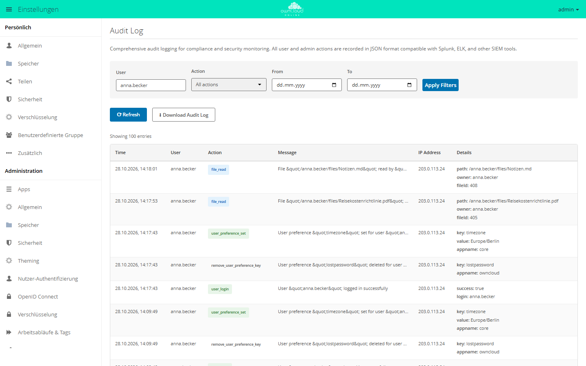

# Audit Log

!!! info "Nur mit API-Schlüssel"
    Der Marketplace zeigt diese App nur Instanzen, in deren Markt ein gültiger
    API-Schlüssel eingetragen ist. Den Schlüssel erhalten Sie auf Anfrage von der
    BW-Tech GmbH. Eintragen: im **Markt** unter *Einstellungen* auf **API
    Schlüssel hinzufügen** klicken, Schlüssel einfügen und **Speichern**
    klicken. Die Schritte im Einzelnen stehen unter „Installation“.
    App-ID `audit_log`, Version 1.3.2.

Die App `audit_log` schreibt mit, wer wann was getan hat: Anmeldungen,
Dateizugriffe, Freigaben, Änderungen an Konten und Gruppen, Tags, Kommentare,
das Ein- und Ausschalten von Apps und jeden `occ`-Befehl. Sie ist für Instanzen
gedacht, die Zugriffe und Änderungen nachweisen müssen. Jeder Eintrag ist eine
JSON-Zeile, die SIEM-Systeme wie Splunk, ELK oder Graylog direkt einlesen.

## Voraussetzungen

| Bereich | Anforderung |
| --- | --- |
| owncloud.online | 11.0.x |
| PHP | 8.4; neuere PHP-Versionen lässt das Paket nicht zu |
| Cron | für die tägliche Rotation, siehe [Hintergrund-Jobs (Cron)](../../administration/background-jobs.md) |
| Protokollverzeichnis | für den Webserver-Benutzer beschreibbar |

## Installation

1. Den API-Schlüssel bei der BW-Tech GmbH anfragen.
2. Im App-Menü links oben **Markt** öffnen. In der linken Spalte unter
   *Einstellungen* auf **API Schlüssel hinzufügen** klicken.
3. Den Schlüssel in das Feld „Dein persönlicher API-Key“ einfügen und
   **Speichern** klicken. Der Markt prüft den Schlüssel beim Marketplace und
   lädt den Katalog neu. Ist der Schlüssel angenommen, heißt der Eintrag in der
   linken Spalte jetzt **Bearbeite API Schlüssel**. Steht dort weiter
   **API Schlüssel hinzufügen**, wurde der Schlüssel abgelehnt und nicht
   gespeichert.
4. Die App „Audit Log“ aufrufen und **Installieren** klicken.

Auf der Kommandozeile, wenn der Schlüssel schon eingetragen ist:

```bash
sudo -u www-data php8.4 occ market:install audit_log
```

`market:install` lädt die App, installiert sie und schaltet sie ein. Ist die App
schon vorhanden und nur abgeschaltet, genügt
`sudo -u www-data php8.4 occ app:enable audit_log`. Wie Sie den Schlüssel auf
der Kommandozeile eintragen und was dabei zu beachten ist, steht bei der
[BW-Tech File Firewall](file_firewall.md#installation).

## Einrichtung

### Eigene Protokolldatei

Richten Sie immer eine eigene Datei ein. Ohne sie schreibt die App über das
Serverprotokoll auf Stufe Info, und bei der Standardstufe 2 (Warnung) verwirft
der Server diese Einträge.

```bash
sudo install -d -o www-data -g www-data -m 0750 /var/log/owncloud.online
sudo -u www-data php8.4 occ config:system:set log.conditions 0 apps 0 --value admin_audit
sudo -u www-data php8.4 occ config:system:set log.conditions 0 logfile --value /var/log/owncloud.online/audit.log
sudo -u www-data php8.4 occ config:system:get log.conditions
```

Gibt es in `log.conditions` schon Einträge, nehmen Sie statt `0` die nächste
freie Nummer. Derselbe Eintrag direkt in `config/config.php`:

```php
'log.conditions' => [
    [
        'apps' => ['admin_audit'],
        'logfile' => '/var/log/owncloud.online/audit.log',
    ],
],
```

Die Einträge tragen die Kennung `admin_audit`. Mit eigener Datei schreibt die
App direkt dorthin; die Protokollstufe des Servers spielt dann keine Rolle.
Fehlt die Datei, legt die App sie mit den Rechten `0640` an.

### Optionen

| Wert | Ort | Vorgabe | Wirkung |
| --- | --- | --- | --- |
| `log.conditions` mit `apps` und `logfile` | `config/config.php` | leer | eigene Protokolldatei |
| `logfile` | App-Wert `audit_log` | leer | eigene Protokolldatei, wenn `log.conditions` keine nennt |
| `log_rotate_size` | App-Wert `audit_log` | `52428800` (50 MB) | ab dieser Größe rotiert der Hintergrund-Job die eigene Datei |
| `log_rotate_max_files` | App-Wert `audit_log` | `5` | so viele alte Dateien (`.1` bis `.5`) bleiben, die älteste wird gelöscht |
| `ignore_cli_events` | App-Wert `audit_log` | `no` | `yes`: keine Einträge aus `occ` und Cron |
| `admin_audit.groups` | `config/config.php` | leer | Liste von Gruppen; das Feld `auditGroups` nennt dann nur diese |
| `logtimezone`, `logdateformat` | `config/config.php` | `UTC`, `c` | Zeitzone und Format des Felds `time` |

App-Werte setzen Sie so:

```bash
sudo -u www-data php8.4 occ config:app:set audit_log log_rotate_max_files --value 30
```

### Oberfläche

Die App hat einen eigenen Abschnitt: **Einstellungen → Administration → Audit
Log**. Die Oberfläche ist nur englisch.

<figure markdown="span">
  
  <figcaption>Das Audit Log zeichnet Aktionen von Benutzern und Administration auf. Filter für Benutzer, Aktion und Zeitraum grenzen die Liste ein.</figcaption>
</figure>

| Element | Funktion |
| --- | --- |
| „User“, „Action“, „From“, „To“, **Apply Filters** | Filter nach handelndem Konto (genauer Name), Aktion und Zeitraum |
| Tabelle | die neuesten 100 passenden Einträge mit „Time“, „User“, „Action“, „Message“, „IP Address“ und „Details“ |
| **Refresh** | Liste neu laden |
| **Download Audit Log** | alle Audit-Einträge der aktuellen Datei als JSON-Zeilen (`audit_log_<datum>_<uhrzeit>.log`); rotierte Dateien sind nicht enthalten |

### Kommandozeile

| Befehl | Zweck |
| --- | --- |
| `audit:list` | Einträge filtern: `-c <anzahl>` (Vorgabe 50), `-u <konto>`, `-a <aktion>`, `--from <datum>`, `--to <datum>`, `-f json` |
| `audit:tail` | neue Einträge laufend ausgeben: `-n <zeilen>` (Vorgabe 10), `-s <sekunden>`, `--once` |
| `audit:stats` | Datei, Größe, Zahl der Einträge, Verteilung nach Aktion und Konto; `-f json` |
| `audit:rotate` | eigene Datei rotieren, wenn sie `log_rotate_size` erreicht hat; `--force` rotiert sofort |

```bash
sudo -u www-data php8.4 occ audit:list -u anna -a file_read --from 2026-10-01 --to 2026-10-28
sudo -u www-data php8.4 occ audit:tail
```

Ein Datum ohne Uhrzeit gilt für den ganzen Tag, in der Zeitzone aus
`logtimezone`.

## Was protokolliert wird

| Bereich | Aktionen (`action`) |
| --- | --- |
| Anmeldung | `user_login` (erfolgreich und fehlgeschlagen, siehe Feld `success`), `user_logout` |
| Dateien | `file_create`, `file_read`, `file_update`, `file_delete`, `file_rename`, `file_copy`, `file_trash_delete`, `file_trash_restore`, `file_version_restore`, `file_version_delete` |
| Freigaben | `file_shared`, `file_unshared`, `share_permission_update`, `share_password_updated`, `share_expiration_date_updated`, `share_name_updated`, `share_accepted`, `share_declined`, `public_link_removed` |
| Öffentliche Links | `public_link_accessed` (Linkseite und Download, auch erfolglose Aufrufe, siehe Feld `success`), `public_link_accessed_webdav` (Zugriff über WebDAV) |
| Konten und Gruppen | `user_created`, `user_deleted`, `user_password_reset`, `user_state_changed`, `group_created`, `group_deleted`, `group_member_added`, `group_member_removed` |
| Persönliche Einstellungen | `user_preference_set`, `remove_user_preference_key`, `remove_preferences_of_user`, `delete_all_user_preference_of_app` |
| Tags | `tag_created`, `tag_updated`, `tag_deleted`, `tag_assigned`, `tag_unassigned` |
| Kommentare | `comment_created`, `comment_updated`, `comment_deleted` |
| Apps | `app_enabled`, `app_disabled` |
| Kommandozeile | `command_executed` mit der vollständigen Befehlszeile |

Ein Eintrag, hier zur besseren Lesbarkeit umbrochen:

```json
{
  "reqId": "4uAiwjMtXOfVyPyn5B7H",
  "level": 1,
  "time": "2026-10-28T13:17:43+00:00",
  "remoteAddr": "203.0.113.24",
  "user": "anna",
  "app": "admin_audit",
  "method": "POST",
  "url": "/index.php/login",
  "message": "User &quot;anna&quot; logged in successfully",
  "action": "user_login",
  "CLI": false,
  "userAgent": "Mozilla/5.0 (…)",
  "success": true,
  "login": "anna",
  "auditUsers": ["anna"],
  "auditGroups": ["vertrieb"]
}
```

| Feld | Inhalt |
| --- | --- |
| `reqId` | Kennung der Anfrage; Einträge aus derselben Anfrage teilen sie |
| `time` | Zeitpunkt nach `logtimezone` und `logdateformat` |
| `remoteAddr` | IP-Adresse des Clients; bei `occ` und Cron `127.0.0.1` |
| `user` | handelndes Konto; `CLI` bei `occ` und Cron, `--` ohne Anmeldung |
| `action`, `message` | Aktion als Kennung und als Text |
| `auditUsers`, `auditGroups` | beteiligte Konten und deren Gruppen |
| weitere Felder | je nach Aktion, etwa `path`, `owner` und `fileId` bei Dateien |

## Rotation

Ein Hintergrund-Job prüft einmal am Tag die eigene Datei. Hat sie
`log_rotate_size` erreicht, benennt er sie in `audit.log.1` um, verschiebt
ältere Dateien eine Nummer weiter und löscht die älteste, die über
`log_rotate_max_files` hinausgeht. Mit den Vorgaben bleiben neben der aktuellen
Datei fünf ältere, jede mindestens 50 MB groß.

Wer stattdessen `logrotate` verwendet, setzt `log_rotate_size` so hoch, dass die
App nie rotiert. Beide zusammen kommen sich in die Quere.

Ohne eigene Datei stehen die Einträge im Serverprotokoll. Dieses rotiert
owncloud.online selbst (`log_rotate_size` in `config/config.php`, Vorgabe
100 MB); die App lässt es dann in Ruhe.

## Nutzung

Anwender sehen von der App nichts.

## Grenzen und Hinweise

- **Datenmenge.** Jedes Lesen einer Datei erzeugt einen Eintrag `file_read`.
  Rechnen Sie auf aktiven Instanzen mit großen Protokolldateien und planen Sie
  Rotation und Aufbewahrung danach.
- **Aufbewahrung.** Mit den Vorgaben löscht die Rotation ältere Einträge. Wer
  Einträge länger aufbewahren muss, erhöht `log_rotate_max_files` oder leitet
  die Datei an ein SIEM-System weiter.
- **Geheimnisse auf der Kommandozeile.** `command_executed` enthält die
  vollständige Befehlszeile. Passwörter oder Schlüssel, die Sie einem
  `occ`-Befehl als Argument mitgeben, stehen damit im Protokoll.
- **Lücken in Version 1.3.2.** Nicht protokolliert werden:
    - Änderungen an App- und Systemeinstellungen über die Weboberfläche; per
      `occ` erscheinen sie nur als `command_executed`,
    - der Wechsel in ein fremdes Konto mit
      [Als Benutzer anmelden](impersonate.md); was danach geschieht, steht
      unter dem fremden Konto,
    - die Zwei-Faktor-Anmeldung,
    - das Anlegen, Umbenennen und Verlassen
      [benutzerdefinierter Gruppen](customgroups.md). Nur das Löschen einer
      solchen Gruppe steht vollständig im Protokoll; bei Mitgliedern und
      Rollen fehlt das betroffene Konto.
- **Personenbezogene Daten.** Das Protokoll enthält Konten, IP-Adressen und
  Dateipfade. Beschränken Sie den Zugriff auf die Datei und stimmen Sie die
  Aufbewahrungsfrist mit Ihrem Datenschutzbeauftragten ab.
- **Panel und Download** lesen nur die aktuelle Datei, keine rotierten.
- **Reverse-Proxy.** Damit `remoteAddr` die Adresse des Clients enthält und nicht
  die des Proxys, muss `trusted_proxies` stimmen, siehe
  [Reverse-Proxy und TLS](../../administration/reverse-proxy.md).

Wie das allgemeine Serverprotokoll funktioniert, steht unter
[Serverprotokoll und Fehlermeldungen](../../administration/logging.md).

## Fehlersuche

| Symptom | Ursache | Abhilfe |
| --- | --- | --- |
| Es erscheinen keine Einträge. | Keine eigene Datei eingerichtet, Protokollstufe 2 | Eigene Datei einrichten (siehe oben) |
| Einträge stehen im Serverprotokoll, nicht in der eigenen Datei | `log.conditions` ist falsch aufgebaut: `apps` muss `admin_audit` enthalten, `logfile` den Pfad. | `occ config:system:get log.conditions` prüfen |
| Die eigene Datei bleibt leer oder fehlt, im PHP-Fehlerprotokoll steht „[audit_log] Failed to write to …“ | Der Webserver-Benutzer darf im Verzeichnis nicht schreiben. | Verzeichnis anlegen und `www-data` als Eigentümer eintragen, siehe oben |
| `audit:rotate` meldet „Nothing to rotate: no dedicated audit log file configured …“ | Keine eigene Datei; das Serverprotokoll rotiert owncloud.online selbst. | Eigene Datei einrichten oder nichts tun |
| Keine Einträge aus `occ` und Cron | `ignore_cli_events` steht auf `yes`. | `occ config:app:set audit_log ignore_cli_events --value no` |
