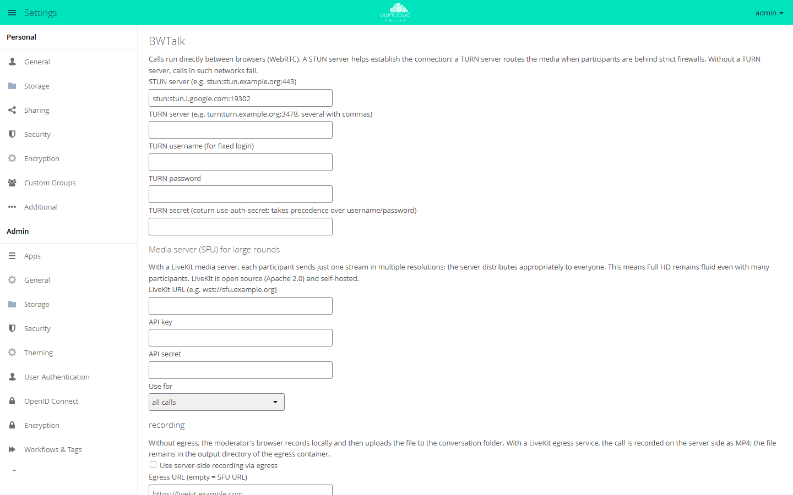
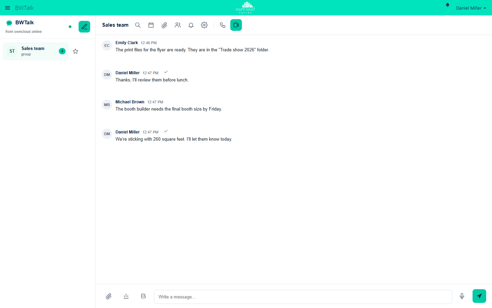

# BWTalk

!!! info "API key required"
    The Marketplace lists this app only for instances with a valid API key. You get the key from BW-Tech GmbH on request. To enter it, open *Market → Settings → Add API Key* from the app menu, paste the key into the "Your personal API Key" field, and click "Save". The app then appears in the catalog. For details, see [Market: Enter an API key](market.en.md#api-schluessel). App ID: `bwtalk`. This page describes version 1.3.0.

BWTalk adds chat as well as audio and video calls to owncloud.online: one-to-one and
group conversations, public rooms with a guest link, screen sharing, and files from the
instance right in the chat. Calls run directly between the browsers without any extra
service. For large calls and for participants behind strict firewalls, add a media server
and a TURN server.

## Requirements

| Component | Requirement |
| --- | --- |
| owncloud.online | 11.x |
| PHP | 8.4 (the app itself requires at least 8.2) |
| HTTPS | Browsers allow camera and microphone only on pages served over HTTPS |
| Background jobs | system cron, so that expired messages are deleted every hour |
| TURN server (optional) | for example coturn, for participants behind strict firewalls or symmetric NAT |
| Media server (optional) | LiveKit, recommended from about 6 participants. UDP 50000 to 60000 and TCP 7881 must be reachable |
| Web Push (optional) | the PHP extensions `openssl` and `curl` |

## Installation

1. Enter the API key, see the box above.
2. In the app menu, open *Market*, go to the app, and install it, or use the command line:

```bash
sudo -u www-data php8.4 occ market:install bwtalk
```

The app creates its tables when it is enabled. "BWTalk" then appears in the app menu, and
the settings are under *Settings → Admin → Additional* in the "BWTalk" section. Chat and
calls within the same network work without further setup.

## Configuration

<figure markdown>



<figcaption>For calls behind strict firewalls, enter a TURN server. A media server (SFU) handles large calls.</figcaption>
</figure>

### STUN and TURN

| Field | Key | Default |
| --- | --- | --- |
| "STUN server (e.g. stun:stun.example.org:443)" | `stun_server` | `stun:stun.l.google.com:19302` |
| "TURN server (e.g. turn:turn.example.org:3478, several with commas)" | `turn_server` | empty |
| "TURN secret (coturn use-auth-secret; takes precedence over username/password)" | `turn_secret` | empty |
| "TURN username (for fixed login)" and "TURN password" | `turn_username`, `turn_password` | empty |

The default is a public STUN server run by Google. If you run coturn, enter it as the
STUN server as well.

For coturn, set in `/etc/turnserver.conf`:

```ini
use-auth-secret
static-auth-secret=<long-random-secret>
```

Then enter the TURN address in BWTalk, for example `turn:turn.example.org:3478`, together
with the same secret. From it, BWTalk creates credentials that are valid for six hours and
are only handed to participants of a room. Fixed credentials with username and password
work as well.

### Media server (LiveKit)

Without a media server, the browsers connect to each other directly. This works for about
4 to 6 participants. With the LiveKit media server, each person sends only one stream in
three resolutions, and the server passes the right one to each receiver. LiveKit is open
source (Apache 2.0) and runs on your own server.

1. Install LiveKit. It is a single program and is also available as the Docker image
   `livekit/livekit-server`.
2. Create `/etc/livekit.yaml`:

    ```yaml
    port: 7880
    rtc:
      tcp_port: 7881
      port_range_start: 50000
      port_range_end: 60000
      use_external_ip: true
    keys:
      bwtalk: <long-random-secret>
    ```

3. Start it, for example as a systemd service or with
   `livekit-server --config /etc/livekit.yaml`.
4. Put a reverse proxy with TLS in front of it so that the server is reachable as
   `wss://sfu.example.org`. Open UDP 50000 to 60000 and TCP 7881.
5. In BWTalk, enter:

| Field | Value |
| --- | --- |
| "LiveKit URL (e.g. wss://sfu.example.org)" | `wss://sfu.example.org` |
| "API key" | `bwtalk`, the name under `keys:` |
| "API secret" | the secret from `livekit.yaml` |
| "Use for" | "all calls", "only groups and public spaces", or "do not use (only direct connections)" |

"API key" and "API secret" belong to LiveKit here, not to the Marketplace. BWTalk uses them
on the server to create the access tokens for the rooms; the secret never leaves the
server. If the media server cannot be reached, the call falls back to direct connections
and shows a notice.

### Recording

| Field | Key | Default |
| --- | --- | --- |
| "Use server-side recording via egress" | `egress_enabled` | off |
| "Egress URL (empty = SFU URL)" | `egress_url` | empty |
| "File path in the egress container" | `egress_path` | `/out/{room}-{time}.mp4` |
| "Largest browser record in MiB (0 = unlimited)" | `max_recording_mb` | 2048 |

Without egress, the moderator's browser records the call (WebM, 1280 × 720) and uploads
the file to the conversation folder. With the LiveKit Egress service, the recording is
made on the server as MP4 and stays in the output directory of the egress container.
While a recording runs, all participants see a red notice.

### More settings

| Option | Key | Default | Note |
| --- | --- | --- | --- |
| "Moderators are allowed to switch on E2EE per room (only with SFU)" | `e2ee_enabled` | on | End-to-end encryption per room, only with a media server |
| "Offer web push (calls and mentions even when the page is closed)" | `push_enabled` | on | The server generates the VAPID keys. The related field is "VAPID contact (mailto:)" |
| "Additional push services (…)" | `push_hosts` | empty | The push services of Google, Mozilla, Apple, and Microsoft are always allowed |
| "File links expire after days (0 = never)" | `share_expiry_days` | 0 | Links to files shared in the chat |
| "Dial-in number (display)" | `sip_number` | empty | Only shown in invitations, see the limits below |
| "Offer translation and summarization" | `ai_enabled` | off | Runs through an OpenAI-compatible gateway ("Gateway address", "Access key", "Model", "Time limit in seconds"). The text of the affected messages leaves the instance |
| "Offer subtitles in the call" | `captions_enabled` | off | Speech recognition runs in the browser. Chrome and Edge use a Google service for it; Firefox does not support it |

You can also set every value with `occ`:

```bash
sudo -u www-data php8.4 occ config:app:set bwtalk turn_server --value=turn:turn.example.org:3478
sudo -u www-data php8.4 occ config:app:set bwtalk share_expiry_days --value=30
```

### Message retention

Each conversation can have a retention period. The `ExpireMessages` background job deletes
older messages once an hour; pinned messages stay. To run it by hand:

```bash
sudo -u www-data php8.4 occ bwtalk:expire
```

## Usage

<figure markdown>



<figcaption>Group conversation in BWTalk. The icons at the top start a call or a video conference.</figcaption>
</figure>

* **Start a conversation:** "New conversation" lists all accounts of the instance. A click
  starts a one-to-one conversation. "Add person or group" turns it into a group
  conversation. If you add a group of the instance, new group members join automatically.
* **Call:** "Start audio call" or "Start video call". Before joining, you can check your
  camera and microphone. During the call, "Share screen", "Raise hand", reactions, and
  background effects are available. The browser computes the background effects; the
  image does not leave the device for this.
* **Invite guests:** "Publicly accessible (guest link)" makes a conversation public.
  Guests join through the link without an account, optionally with a password.
* **Moderate:** moderators turn on the waiting room, let people in, mute participants,
  remove them, and start recordings.
* **Chat:** replies, reactions, mentions with `@`, formatting such as `**bold**` and
  `*italic*`, threads, forwarding, pinned messages, polls, and voice messages.
  "Share file" posts a file from the instance into the conversation. Uploaded files and
  recordings are stored in the `BWTalk/<room>` folder of the person who shared them.
* **Schedule meetings:** appointments per conversation with an email invitation and an
  ICS file.
* **Mobile:** BWTalk can be installed on a phone as a web app and reports calls and
  messages with push notifications.

## Limits and notes

* Without a media server, a call works for about 4 to 6 participants.
* End-to-end encryption protects against the media server, not against the
  owncloud.online server, which creates and distributes the room key.
* Files in the chat are shared through public links with a random token. Whoever passes
  on the link passes on the file. The link disappears with the message or the
  conversation.
* Members of an added group see the existing history of the conversation. Groups with
  more than 200 members cannot be added to a conversation.
* Only accounts of the instance can upload files to the chat, up to 200 MiB per file.
  The PHP limits `upload_max_filesize` and `post_max_size` apply as well. Guests who
  joined through the guest link cannot upload files.
* Phone dial-in is prepared but does not work on its own. It needs a SIP provider with
  ongoing costs, requires a media server, and rules out end-to-end encryption.
* A public room accepts at most 200 guests. The app stores room passwords as a hash, and
  the server's brute-force protection slows down failed attempts.
* New messages arrive by long polling, without an extra service.
* Guest accounts of the [Guests](guests.en.md) app can use BWTalk only if `bwtalk` is on
  the app whitelist for guests.
