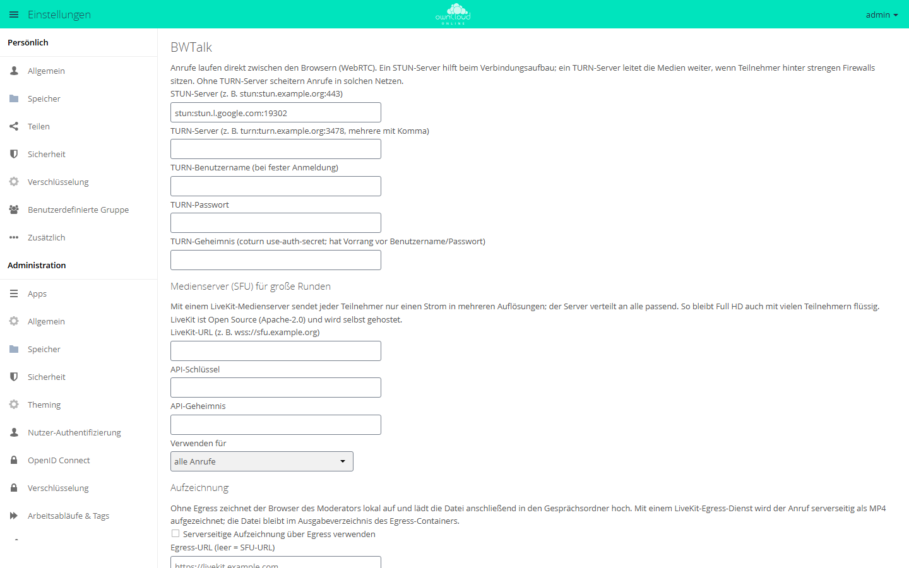
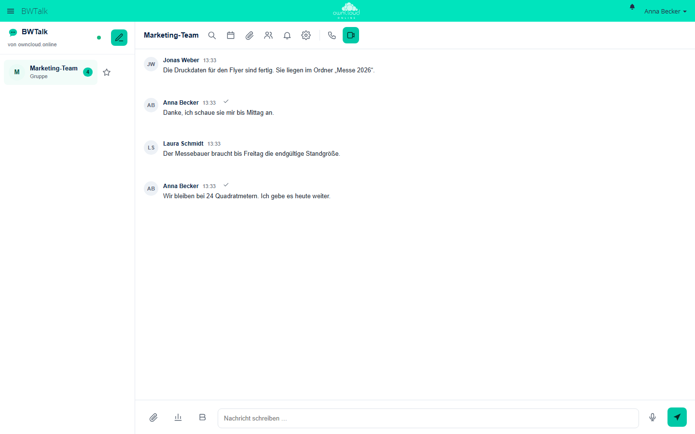

# BWTalk

!!! info "Nur mit API-Schlüssel"
    Der Marktplatz zeigt diese App nur Instanzen mit gültigem API-Schlüssel. Den Schlüssel erhalten Sie auf Anfrage von der BW-Tech GmbH. Tragen Sie ihn im App-Menü unter *Markt → Einstellungen → API Schlüssel hinzufügen* in das Feld „Dein persönlicher API-Key“ ein und klicken Sie auf „Speichern“. Danach erscheint die App im Katalog. Einzelheiten stehen unter [Markt: API-Schlüssel eintragen](market.md#api-schluessel). App-ID: `bwtalk`. Diese Seite beschreibt Version 1.3.0.

BWTalk bringt Chat sowie Audio- und Videoanrufe in owncloud.online: Einzel- und
Gruppengespräche, öffentliche Räume mit Gastlink, Bildschirmfreigabe und Dateien aus der
Instanz direkt im Chat. Anrufe laufen ohne weiteren Dienst direkt zwischen den Browsern.
Für große Runden und für Teilnehmende hinter strengen Firewalls binden Sie einen
Medienserver und einen TURN-Server an.

## Voraussetzungen

| Komponente | Anforderung |
| --- | --- |
| owncloud.online | 11.x |
| PHP | 8.4 (die App selbst verlangt mindestens 8.2) |
| HTTPS | Browser geben Kamera und Mikrofon nur auf Seiten frei, die über HTTPS laufen |
| Hintergrund-Jobs | System-Cron, damit abgelaufene Nachrichten stündlich gelöscht werden |
| TURN-Server (optional) | zum Beispiel coturn, für Teilnehmende hinter strengen Firewalls oder symmetrischem NAT |
| Medienserver (optional) | LiveKit, empfohlen ab etwa 6 Teilnehmenden. UDP 50000 bis 60000 und TCP 7881 müssen erreichbar sein |
| Web Push (optional) | PHP-Erweiterungen `openssl` und `curl` |

## Installation

1. API-Schlüssel eintragen, siehe Kasten oben.
2. Im App-Menü *Markt* die App aufrufen und installieren, oder auf der Kommandozeile:

```bash
sudo -u www-data php8.4 occ market:install bwtalk
```

Beim Einschalten legt die App ihre Tabellen selbst an. Danach steht „BWTalk“ im
App-Menü, die Einstellungen liegen unter *Einstellungen → Administration → Zusätzlich*
im Abschnitt „BWTalk“. Chat und Anrufe im selben Netz funktionieren ohne weitere
Einrichtung.

## Einrichtung

<figure markdown>



<figcaption>Für Anrufe hinter strengen Firewalls tragen Sie einen TURN-Server ein. Ein Medienserver (SFU) übernimmt große Runden.</figcaption>
</figure>

### STUN und TURN

| Feld | Schlüssel | Vorgabe |
| --- | --- | --- |
| „STUN-Server (z. B. stun:stun.example.org:443)“ | `stun_server` | `stun:stun.l.google.com:19302` |
| „TURN-Server (z. B. turn:turn.example.org:3478, mehrere mit Komma)“ | `turn_server` | leer |
| „TURN-Geheimnis (coturn use-auth-secret; hat Vorrang vor Benutzername/Passwort)“ | `turn_secret` | leer |
| „TURN-Benutzername (bei fester Anmeldung)“ und „TURN-Passwort“ | `turn_username`, `turn_password` | leer |

Voreingestellt ist ein öffentlicher STUN-Server von Google. Betreiben Sie coturn, tragen
Sie ihn auch als STUN-Server ein.

Für coturn setzen Sie in `/etc/turnserver.conf`:

```ini
use-auth-secret
static-auth-secret=<langes-zufälliges-geheimnis>
```

In BWTalk tragen Sie dann die TURN-Adresse, etwa `turn:turn.example.org:3478`, und
dasselbe Geheimnis ein. BWTalk erzeugt daraus Zugangsdaten, die sechs Stunden gelten und
nur an Teilnehmende eines Raums gehen. Feste Zugangsdaten mit Benutzername und Passwort
funktionieren ebenfalls.

### Medienserver (LiveKit)

Ohne Medienserver verbinden sich die Browser direkt miteinander. Das reicht für etwa 4
bis 6 Teilnehmende. Mit dem Medienserver LiveKit sendet jede Person nur einen Strom in drei
Auflösungen, und der Server verteilt an jeden Empfänger die passende. LiveKit ist Open
Source (Apache-2.0) und läuft auf Ihrem eigenen Server.

1. LiveKit installieren. Es ist ein einzelnes Programm und auch als Docker-Image
   `livekit/livekit-server` erhältlich.
2. `/etc/livekit.yaml` anlegen:

    ```yaml
    port: 7880
    rtc:
      tcp_port: 7881
      port_range_start: 50000
      port_range_end: 60000
      use_external_ip: true
    keys:
      bwtalk: <langes-zufälliges-geheimnis>
    ```

3. Starten, zum Beispiel als systemd-Dienst oder mit
   `livekit-server --config /etc/livekit.yaml`.
4. Einen Reverse-Proxy mit TLS davorsetzen, sodass der Server als
   `wss://sfu.example.org` erreichbar ist. UDP 50000 bis 60000 und TCP 7881 freigeben.
5. In BWTalk eintragen:

| Feld | Wert |
| --- | --- |
| „LiveKit-URL (z. B. wss://sfu.example.org)“ | `wss://sfu.example.org` |
| „API-Schlüssel“ | `bwtalk`, also der Name unter `keys:` |
| „API-Geheimnis“ | das Geheimnis aus `livekit.yaml` |
| „Verwenden für“ | „alle Anrufe“, „nur Gruppen und öffentliche Räume“ oder „nicht verwenden (nur Direktverbindungen)“ |

„API-Schlüssel“ und „API-Geheimnis“ gehören hier zu LiveKit, nicht zum Marktplatz. BWTalk
erzeugt daraus auf dem Server die Zugangstoken für die Räume, das Geheimnis verlässt den
Server nicht. Ist der Medienserver nicht erreichbar, fällt der Anruf auf
Direktverbindungen zurück und zeigt einen Hinweis.

### Aufzeichnung

| Feld | Schlüssel | Vorgabe |
| --- | --- | --- |
| „Serverseitige Aufzeichnung über Egress verwenden“ | `egress_enabled` | aus |
| „Egress-URL (leer = SFU-URL)“ | `egress_url` | leer |
| „Dateipfad im Egress-Container“ | `egress_path` | `/out/{room}-{time}.mp4` |
| „Größte Browser-Aufzeichnung in MiB (0 = unbegrenzt)“ | `max_recording_mb` | 2048 |

Ohne Egress zeichnet der Browser der moderierenden Person auf (WebM, 1280 × 720) und lädt
die Datei in den Gesprächsordner. Mit dem Dienst LiveKit Egress entsteht die Aufzeichnung
auf dem Server als MP4 und bleibt im Ausgabeverzeichnis des Egress-Containers. Während
der Aufzeichnung sehen alle Teilnehmenden einen roten Hinweis.

### Weitere Einstellungen

| Option | Schlüssel | Vorgabe | Hinweis |
| --- | --- | --- | --- |
| „Moderatoren dürfen E2EE je Raum einschalten (nur mit SFU)“ | `e2ee_enabled` | an | Ende-zu-Ende-Verschlüsselung je Raum, nur mit Medienserver |
| „Web Push anbieten (Anrufe und Erwähnungen auch bei geschlossener Seite)“ | `push_enabled` | an | Die VAPID-Schlüssel erzeugt der Server. Dazu gehört das Feld „VAPID-Kontakt (mailto:)“ |
| „Zusätzliche Push-Dienste (…)“ | `push_hosts` | leer | Die Push-Dienste von Google, Mozilla, Apple und Microsoft sind immer erlaubt |
| „Datei-Links laufen ab nach Tagen (0 = nie)“ | `share_expiry_days` | 0 | Links auf Dateien, die im Chat geteilt wurden |
| „Einwahlnummer (Anzeige)“ | `sip_number` | leer | Erscheint nur in Einladungen, siehe Grenzen |
| „Übersetzen und Zusammenfassen anbieten“ | `ai_enabled` | aus | Läuft über ein OpenAI-kompatibles Gateway („Gateway-Adresse“, „Zugangsschlüssel“, „Modell“, „Zeitgrenze in Sekunden“). Der Text der betroffenen Nachrichten verlässt dabei die Instanz |
| „Untertitel im Anruf anbieten“ | `captions_enabled` | aus | Die Spracherkennung läuft im Browser. Chrome und Edge nutzen dafür einen Dienst von Google, Firefox kann es nicht |

Alle Werte lassen sich auch mit `occ` setzen:

```bash
sudo -u www-data php8.4 occ config:app:set bwtalk turn_server --value=turn:turn.example.org:3478
sudo -u www-data php8.4 occ config:app:set bwtalk share_expiry_days --value=30
```

### Aufbewahrung von Nachrichten

Für jedes Gespräch lässt sich eine Aufbewahrungsfrist festlegen. Ältere Nachrichten
löscht der Hintergrund-Job `ExpireMessages` einmal pro Stunde, angeheftete Nachrichten
bleiben. Von Hand:

```bash
sudo -u www-data php8.4 occ bwtalk:expire
```

## Nutzung

<figure markdown>



<figcaption>Gruppengespräch in BWTalk. Über die Symbole oben starten Sie einen Anruf oder eine Videokonferenz.</figcaption>
</figure>

* **Gespräch beginnen:** „Neues Gespräch“ zeigt alle Konten der Instanz. Ein Klick startet
  ein Einzelgespräch. Mit „Person oder Gruppe hinzufügen“ wird daraus ein
  Gruppengespräch. Wird eine Gruppe der Instanz hinzugefügt, gehören neue
  Gruppenmitglieder automatisch dazu.
* **Anrufen:** „Audioanruf starten“ oder „Videoanruf starten“. Vor dem Beitritt prüfen Sie
  Kamera und Mikrofon. Im Anruf stehen „Bildschirm teilen“, „Hand heben“, Reaktionen und
  Hintergrundeffekte bereit. Die Hintergrundeffekte berechnet der Browser, das Bild
  verlässt dafür das Gerät nicht.
* **Gäste einladen:** Mit „Öffentlich zugänglich (Gastlink)“ wird ein Gespräch öffentlich.
  Gäste nehmen über den Link ohne Konto teil, auf Wunsch mit Passwort.
* **Moderieren:** Moderierende schalten den Warteraum ein, lassen Personen herein,
  schalten stumm, entfernen Teilnehmende und starten Aufzeichnungen.
* **Chatten:** Antworten, Reaktionen, Erwähnungen mit `@`, Formatierung wie `**fett**` und
  `*kursiv*`, Threads, Weiterleiten, angeheftete Nachrichten, Umfragen und
  Sprachnachrichten. „Datei teilen“ stellt eine Datei aus der Instanz ins Gespräch.
  Hochgeladene Dateien und Aufzeichnungen liegen im Ordner `BWTalk/<Raum>` der Person,
  die sie geteilt hat.
* **Besprechungen planen:** Termine je Gespräch mit Einladung per E-Mail und ICS-Datei.
* **Mobil:** BWTalk lässt sich auf dem Smartphone als Web-App installieren und meldet
  Anrufe und Nachrichten per Push.

## Grenzen und Hinweise

* Ohne Medienserver reicht ein Anruf für etwa 4 bis 6 Teilnehmende.
* Die Ende-zu-Ende-Verschlüsselung schützt gegenüber dem Medienserver, nicht gegenüber
  dem owncloud.online-Server. Dieser erzeugt und verteilt den Raumschlüssel.
* Dateien im Chat werden über öffentliche Links mit zufälligem Token geteilt. Wer den Link
  weitergibt, gibt die Datei weiter. Der Link verschwindet mit der Nachricht oder dem
  Gespräch.
* Mitglieder einer hinzugefügten Gruppe sehen den bisherigen Verlauf des Gesprächs.
  Gruppen mit mehr als 200 Mitgliedern lassen sich keinem Gespräch hinzufügen.
* Nur Konten der Instanz laden Dateien in den Chat hoch, höchstens 200 MiB je Datei. Die
  PHP-Grenzen `upload_max_filesize` und `post_max_size` gelten zusätzlich. Gäste, die
  über den Gastlink teilnehmen, laden keine Dateien hoch.
* Die Telefon-Einwahl ist nur vorbereitet. Sie braucht einen SIP-Anbieter, der laufende
  Kosten verursacht, setzt einen Medienserver voraus und schließt die
  Ende-zu-Ende-Verschlüsselung aus.
* Ein öffentlicher Raum nimmt höchstens 200 Gäste auf. Raumpasswörter speichert die App
  als Hash. Fehlversuche verlangsamt die Bremse gegen Passwort-Raten des Servers.
* Neue Nachrichten kommen per Long-Polling, ohne zusätzlichen Dienst.
* Gastkonten der App [Guests](guests.md) nutzen BWTalk nur, wenn `bwtalk` in der
  App-Whitelist für Gäste steht.
