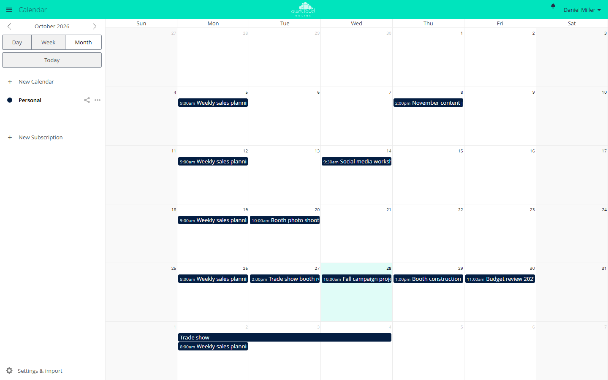

# Calendar

!!! info "API key required"
    The Marketplace lists this app only for instances with a valid API key. You get the key from BW-Tech GmbH on request. To enter it, open *Market → Settings → Add API Key* from the app menu, paste the key into the "Your personal API Key" field, and click "Save". The app then appears in the catalog. For details, see [Market: Enter an API key](market.en.md#api-schluessel). App ID: `calendar`. This page describes version 2.2.2.

Calendar is the web interface for the CalDAV server built into owncloud.online. Users see
and edit the appointments that phones, Thunderbird, or other CalDAV clients sync, and
whatever they create in the browser shows up on their devices. Calendars can be shared
with people and groups and published through a link.

## Requirements

| Component | Requirement |
| --- | --- |
| owncloud.online | 11.x |
| PHP | 8.4 with the `curl` extension (for subscriptions) |
| Core app `dav` | enabled (on by default); it provides the CalDAV server |
| Email | for "Email link to person", see [Sending email](../../administration/email.en.md) |
| Network | outgoing HTTP and HTTPS connections to subscribed calendars |
| Browser | a current version of Firefox, Chrome, Edge, or Safari |

## Installation

1. Enter the API key, see the box above.
2. In the app menu, open *Market*, go to the app, and install it, or use the command line:

```bash
sudo -u www-data php8.4 occ market:install calendar
```

"Calendar" then appears in the app menu. The app has no tables of its own.
Appointments, calendars, shares, and subscriptions are stored in the CalDAV storage of
the core.

### Data from an older instance

If the database comes from an instance with Calendar app 2.1.0 or older, the instance asks
for an upgrade after `occ app:enable calendar`. Until then, the login shows the update
page and CalDAV answers everyone with 503. So run the upgrade once afterwards:

```bash
sudo -u www-data php8.4 occ app:enable calendar
sudo -u www-data php8.4 occ upgrade
```

If you install the app with `occ market:install`, the command records the version itself
and no upgrade is needed. If the calendar was limited to certain groups in the old
instance, that restriction is lost during the move. Restore it with
`sudo -u www-data php8.4 occ app:enable calendar --groups=<group>`.

## Configuration

The app has no section of its own in the settings. Three values control it:

| Value | Location | Default | Effect |
| --- | --- | --- | --- |
| `allow_local_remote_servers` | `config/config.php` | `false` | Allow subscriptions from servers on your own network |
| `webcal_max_size_mb` | app value of `calendar` | 10 | Largest allowed subscription file in MiB (1 to 1024) |
| `sendmail_hourly_limit` | app value of `calendar` | 10 | Emails per person and hour for "Email link to person" (1 to 1000) |

```bash
sudo -u www-data php8.4 occ config:app:set calendar webcal_max_size_mb --value=20
sudo -u www-data php8.4 occ config:app:set calendar sendmail_hourly_limit --value=20
```

### Subscriptions

The server fetches subscribed calendars through a proxy built into the app. Allowed
schemes are `http`, `https`, `webcal`, and `webcals`; the app fetches `webcal` and
`webcals` over HTTPS. By default, the proxy refuses every target whose address, after DNS
resolution, is not public or belongs to this server. That way nobody can use a
subscription to reach services on the internal network.

To subscribe to calendars from a server on your own network on purpose, allow it in
`config/config.php`:

```php
'allow_local_remote_servers' => true,
```

This applies to all accounts of the instance. Set it only if all users are trusted or the
internal network offers no unprotected services. The other limits still apply: 10 seconds
to connect, 30 seconds per request, 45 seconds in total, and at most 5 redirects. The
response must start with `BEGIN:VCALENDAR`.

If `config/config.php` contains an outgoing proxy (`proxy`), that proxy resolves the
names. The app still checks the addresses but can no longer pin the connection to the
checked address, so the proxy itself must block targets on the internal network. The app
ignores proxy variables from the environment such as `HTTPS_PROXY`.

### Public links

Publishing, embedding, and "Email link to person" follow the rules for public links under
*Settings → Admin → Sharing*, see [Sharing policies](../../administration/sharing-policies.en.md):

* "Allow apps to use the Share API" and "Allow users to share via link" must be on.
* If the owner of a calendar is excluded from sharing ("Exclude groups from sharing"),
  they cannot publish, and their public pages are not reachable.
* If the server requires a password for read-only links
  (`shareapi_enforce_links_password_read_only`), new publishing is blocked, because
  calendar links cannot have a password. The calendar list shows the reason. Calendars
  that are already published stay reachable and can be unpublished.

The instance sends link emails from its general sender address
(`mail_from_address@mail_domain`). Replies go to the email address of the person who sent
the link, if they have one. For the hourly limit to count exactly, the core file locking
must be active (`filelocking.enabled`, with Redis as `memcache.locking` recommended).

### Embedding on other websites

The app removes the `X-Frame-Options` header only for the addresses
`/apps/calendar/embed/<token>` and `/apps/calendar/public/<token>`. If the web server sets
the header itself, embedding stays blocked. This affects Apache with `mod_headers`
through the server's `.htaccess` (`Header always set X-Frame-Options "SAMEORIGIN"`) and an
`add_header X-Frame-Options` in nginx or an upstream proxy. Exclude the two addresses
there.

### CalDAV clients

| Client | Address |
| --- | --- |
| CalDAV clients in general (Thunderbird, DAVx⁵, and others) | `https://<instance>/remote.php/dav` |
| iOS and macOS | `https://<instance>/remote.php/dav/principals/users/<user>/` |

The app shows both addresses under "Settings & import" as "Primary CalDAV address" and
"iOS/OS X CalDAV address".

## Usage

<figure markdown>



<figcaption>Calendar month view. On the left you switch between "Day", "Week", and "Month" and add calendars with "New Calendar".</figcaption>
</figure>

* **Create an appointment:** click into the view, type a title, and save. "More ..." opens
  all fields: location, description, reminders, recurrence, and attendees. You can move
  and resize appointments with the mouse.
* **Share a calendar:** the "Share Calendar" icon next to the calendar opens the sharing
  area. In the "Share with users or groups" field, pick the recipients. With "can edit",
  they may change appointments.
* **Publish:** in the same area, "Share link" turns on a public page. "Email link to
  person" sends the address to an email address. On the public page, "Embed" shows the
  code for other websites ("Iframe to integrate").
* **Subscribe:** "New Subscription" accepts a `webcal://` or `https://` address.
* **Import and export:** "Settings & import" → "Import calendar" reads `.ics` files.
  "Download" in the calendar's menu saves it as an `.ics` file.
* **Invite attendees:** your own email address must be set in your personal settings.

## Limits and notes

* The app stores reminders only in the appointment. The synced devices and CalDAV clients
  trigger them. Neither the web interface nor the server sends reminders, not even by
  email.
* For recurring events with more complex rules created by other programs, the editor
  shows "This event's repeating rule is not supported yet."
* If someone with write permission publishes a shared calendar over CalDAV, the app
  answers that link with 404. The core CalDAV endpoint `public-calendars` still serves
  it. The owner sees the calendar as published and can unpublish it.
* The app shows accounts from the system address book only according to the rules of the
  share dialog. Search terms shorter than `user.search_min_length` (default 2) return
  nothing, and a search returns at most 25 results.
* Users choose calendar names and display names freely. Both appear in the subject and
  body of the email that "Email link to person" sends from the instance's sender address
  to any address. If that is too much of a phishing risk for you, lower
  `sendmail_hourly_limit` or turn off public links.
