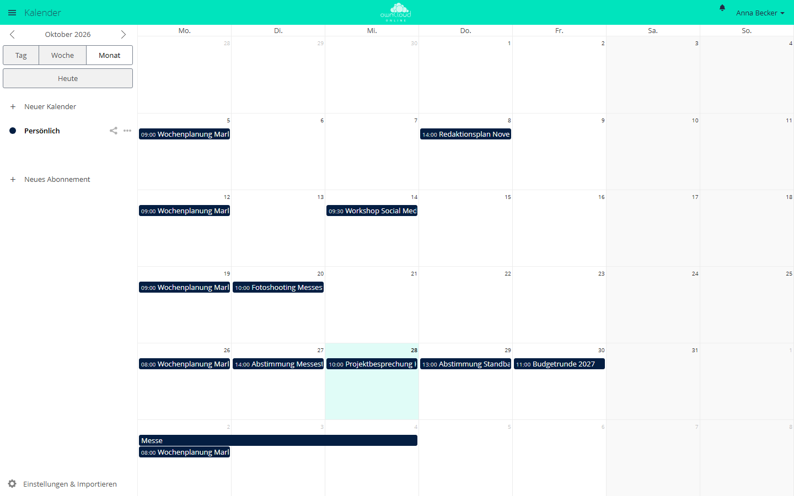

# Kalender

!!! info "Nur mit API-Schlüssel"
    Der Marktplatz zeigt diese App nur Instanzen mit gültigem API-Schlüssel. Den Schlüssel erhalten Sie auf Anfrage von der BW-Tech GmbH. Tragen Sie ihn im App-Menü unter *Markt → Einstellungen → API Schlüssel hinzufügen* in das Feld „Dein persönlicher API-Key“ ein und klicken Sie auf „Speichern“. Danach erscheint die App im Katalog. Einzelheiten stehen unter [Markt: API-Schlüssel eintragen](market.md#api-schluessel). App-ID: `calendar`. Diese Seite beschreibt Version 2.2.2.

Der Kalender ist die Weboberfläche für den CalDAV-Server, der in owncloud.online
eingebaut ist. Termine, die Smartphones, Thunderbird oder andere CalDAV-Programme
synchronisieren, sehen und bearbeiten Anwender im Browser. Was im Browser entsteht,
landet auf den Geräten. Kalender lassen sich mit Personen und Gruppen teilen und über
einen Link veröffentlichen.

## Voraussetzungen

| Komponente | Anforderung |
| --- | --- |
| owncloud.online | 11.x |
| PHP | 8.4 mit der Erweiterung `curl` (für Abonnements) |
| Kern-App `dav` | eingeschaltet (ab Werk aktiv), sie stellt den CalDAV-Server bereit |
| Mailversand | für „Link per E-Mail verschicken“, siehe [E-Mail-Versand](../../administration/email.md) |
| Netz | ausgehende HTTP- und HTTPS-Verbindungen zu abonnierten Kalendern |
| Browser | aktueller Firefox, Chrome, Edge oder Safari |

## Installation

1. API-Schlüssel eintragen, siehe Kasten oben.
2. Im App-Menü *Markt* die App aufrufen und installieren, oder auf der Kommandozeile:

```bash
sudo -u www-data php8.4 occ market:install calendar
```

Danach steht „Kalender“ im App-Menü. Die App bringt keine eigenen Tabellen mit. Termine,
Kalender, Freigaben und Abonnements liegen im CalDAV-Speicher des Kerns.

### Daten aus einer älteren Instanz

Stammt die Datenbank aus einer Instanz mit der Kalender-App 2.1.0 oder älter, verlangt
die Instanz nach `occ app:enable calendar` ein Upgrade. Bis dahin zeigt die Anmeldung die
Aktualisierungsseite, und CalDAV antwortet allen mit 503. Führen Sie deshalb danach
einmal das Upgrade aus:

```bash
sudo -u www-data php8.4 occ app:enable calendar
sudo -u www-data php8.4 occ upgrade
```

Installieren Sie die App mit `occ market:install`, vermerkt der Befehl die Version selbst.
Das Upgrade entfällt dann.
War der Kalender in der alten Instanz auf Gruppen beschränkt, geht diese Beschränkung
beim Umzug verloren. Sie stellen sie mit
`sudo -u www-data php8.4 occ app:enable calendar --groups=<gruppe>` wieder her.

## Einrichtung

Die App hat keinen eigenen Abschnitt in den Einstellungen. Drei Werte steuern sie:

| Wert | Ort | Vorgabe | Wirkung |
| --- | --- | --- | --- |
| `allow_local_remote_servers` | `config/config.php` | `false` | Abonnements von Servern im eigenen Netz erlauben |
| `webcal_max_size_mb` | App-Wert `calendar` | 10 | Größte erlaubte Abo-Datei in MiB (1 bis 1024) |
| `sendmail_hourly_limit` | App-Wert `calendar` | 10 | Mails je Person und Stunde für „Link per E-Mail verschicken“ (1 bis 1000) |

```bash
sudo -u www-data php8.4 occ config:app:set calendar webcal_max_size_mb --value=20
sudo -u www-data php8.4 occ config:app:set calendar sendmail_hourly_limit --value=20
```

### Abonnements

Abonnierte Kalender holt der Server über einen Proxy der App ab. Erlaubt sind die Schemata
`http`, `https`, `webcal` und `webcals`. `webcal` und `webcals` ruft die App über HTTPS
ab. Ab Werk lehnt der Proxy alle Ziele ab, deren Adresse nach der DNS-Auflösung nicht
öffentlich ist oder diesem Server gehört. So kann niemand über ein Abonnement Dienste im
internen Netz ansprechen.

Wer bewusst Kalender von einem Server im eigenen Netz abonnieren will, schaltet das in
`config/config.php` frei:

```php
'allow_local_remote_servers' => true,
```

Die Freigabe gilt für alle Konten der Instanz. Setzen Sie sie nur, wenn alle Personen
vertrauenswürdig sind oder das interne Netz keine ungeschützten Dienste anbietet. Die
übrigen Grenzen gelten weiter: 10 Sekunden für den Verbindungsaufbau, 30 Sekunden je
Abruf, 45 Sekunden insgesamt, höchstens 5 Weiterleitungen. Die Antwort muss mit
`BEGIN:VCALENDAR` beginnen.

Ist in `config/config.php` ein ausgehender Proxy (`proxy`) eingetragen, löst dieser die
Namen auf. Die App prüft die Adressen weiterhin, kann die Verbindung aber nicht mehr auf
die geprüfte Adresse festlegen. Der Proxy muss dann selbst Ziele im internen Netz
sperren. Proxy-Variablen aus der Umgebung wie `HTTPS_PROXY` nutzt die App nicht.

### Öffentliche Links

Veröffentlichen, Einbetten und „Link per E-Mail verschicken“ folgen den Regeln für
öffentliche Links unter *Einstellungen → Administration → Teilen*, siehe
[Freigaben steuern](../../administration/sharing-policies.md):

* „Apps die Benutzung der Share-API erlauben“ und „Benutzern erlauben, Inhalte über Links
  zu teilen“ müssen eingeschaltet sein.
* Ist der Besitzer eines Kalenders vom Teilen ausgeschlossen („Gruppen von Freigaben
  ausschließen“), kann er nicht veröffentlichen, und seine öffentlichen Seiten sind nicht
  erreichbar.
* Verlangt der Server ein Passwort für Nur-Lesen-Links
  (`shareapi_enforce_links_password_read_only`), ist neues Veröffentlichen gesperrt.
  Kalenderlinks können kein Passwort haben. Die Kalenderliste nennt den Grund. Schon
  veröffentlichte Kalender bleiben erreichbar und lassen sich zurückziehen.

Mails mit dem Link verschickt die Instanz mit ihrer allgemeinen Absenderadresse
(`mail_from_address@mail_domain`). Antworten gehen an die E-Mail-Adresse der Person, die
den Link verschickt, falls sie eine hinterlegt hat. Damit die Stundengrenze genau zählt,
muss das Datei-Locking des Kerns aktiv sein (`filelocking.enabled`, empfohlen mit Redis
als `memcache.locking`).

### Einbetten auf anderen Websites

Die App entfernt den Header `X-Frame-Options` nur für die Adressen
`/apps/calendar/embed/<token>` und `/apps/calendar/public/<token>`. Setzt der Webserver
den Header selbst, bleibt das Einbetten blockiert. Das betrifft Apache mit `mod_headers`
über die `.htaccess` des Servers (`Header always set X-Frame-Options "SAMEORIGIN"`) und
ein `add_header X-Frame-Options` in nginx oder einem vorgelagerten Proxy. Nehmen Sie dort
die beiden Adressen aus.

### CalDAV-Programme

| Programm | Adresse |
| --- | --- |
| allgemeine CalDAV-Programme (Thunderbird, DAVx⁵ und andere) | `https://<instanz>/remote.php/dav` |
| iOS und macOS | `https://<instanz>/remote.php/dav/principals/users/<benutzer>/` |

Beide Adressen zeigt die App unter „Einstellungen & Importieren“ als „Primäre
CalDAV-Adresse“ und „iOS/OS X CalDAV-Adresse“.

## Nutzung

<figure markdown>



<figcaption>Monatsansicht des Kalenders. Links wechseln Sie zwischen „Tag“, „Woche“ und „Monat“ und legen mit „Neuer Kalender“ weitere Kalender an.</figcaption>
</figure>

* **Termin anlegen:** In die Ansicht klicken, Titel eingeben, speichern. „Mehr ...“ öffnet
  alle Felder: Ort, Beschreibung, Erinnerungen, Wiederholung und Teilnehmer. Termine
  lassen sich mit der Maus verschieben und verlängern.
* **Kalender teilen:** Das Symbol „Kalender freigeben“ am Kalender öffnet den Bereich zum
  Teilen. Im Feld „Mit Benutzern oder Gruppen teilen“ wählen Sie die Empfänger. Mit „kann
  bearbeiten“ dürfen sie Termine ändern.
* **Veröffentlichen:** Im selben Bereich schaltet „Link teilen“ eine öffentliche Seite
  frei. „Link per E-Mail verschicken“ schickt die Adresse an eine E-Mail-Adresse. Auf der
  öffentlichen Seite steht unter „Einbetten“ der Code für andere Websites („Iframe zum
  Einbinden“).
* **Abonnieren:** „Neues Abonnement“ nimmt eine `webcal://`- oder `https://`-Adresse
  entgegen.
* **Importieren und Exportieren:** „Einstellungen & Importieren“ → „Kalender importieren“
  liest `.ics`-Dateien ein. „Herunterladen“ im Menü des Kalenders speichert ihn als
  `.ics`.
* **Teilnehmer einladen:** Dafür muss die eigene E-Mail-Adresse in den persönlichen
  Einstellungen hinterlegt sein.

## Grenzen und Hinweise

* Erinnerungen speichert die App nur im Termin. Auslösen tun sie die synchronisierten
  Geräte und CalDAV-Programme. Weboberfläche und Server verschicken keine Erinnerungen,
  auch keine E-Mails.
* Wiederholungen mit komplexeren Regeln, die andere Programme angelegt haben, zeigt der
  Editor mit dem Hinweis „Die Wiederholungsregel dieses Termins wird noch nicht
  unterstützt.“
* Veröffentlicht jemand mit Schreibrecht einen geteilten Kalender per CalDAV, antwortet
  die App unter diesem Link mit 404. Der CalDAV-Endpunkt `public-calendars` des Kerns
  liefert ihn trotzdem aus. Der Besitzer sieht den Kalender als veröffentlicht und kann
  die Veröffentlichung zurückziehen.
* Die App zeigt Konten aus dem Adressbuch des Systems nur nach den Regeln des
  Freigabedialogs an. Suchbegriffe unter der Mindestlänge `user.search_min_length`
  (Vorgabe 2) liefern nichts. Mehr als 25 Treffer zeigt eine Suche nicht.
* Kalendername und Anzeigename wählt jede Person selbst. Beide stehen in Betreff und
  Text der Mail, die „Link per E-Mail verschicken“ mit der Absenderadresse der Instanz
  an eine beliebige Adresse schickt. Ist Ihnen das als Weg für Phishing zu riskant,
  senken Sie `sendmail_hourly_limit` oder schalten öffentliche Links ab.
