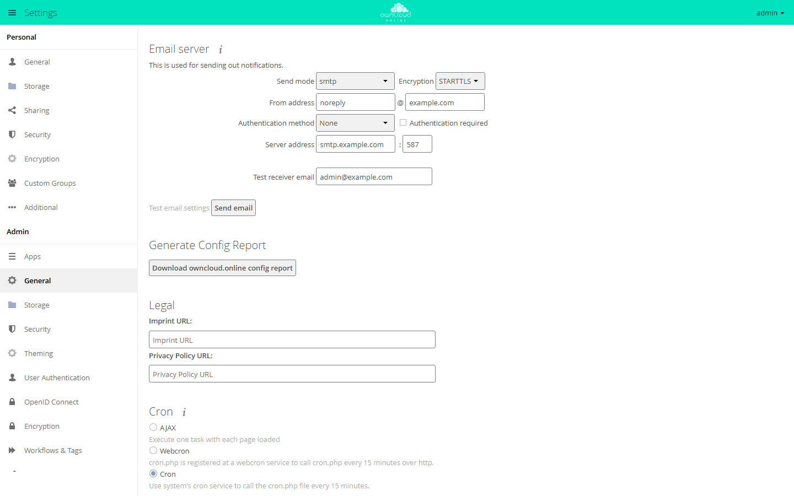

# Admin Config Report

The app collects the configuration of an instance in one JSON file: version,
apps, database, PHP, external storage, and the contents of `config.php`. It is
meant for support cases: instead of a long back-and-forth, support gets one
file. Before writing the file, the app replaces passwords and other secrets
with a placeholder.

!!! note "Availability"
    Public in the Marketplace, no API key needed. App ID `configreport`,
    version 0.4.5. Name in the Market: "Admin Config Report".

## Requirements

| Area | Requirement |
| --- | --- |
| owncloud.online | 11.x |
| PHP | 8.4 or later |

The app needs no other services or PHP extensions.

## Installation

In the web interface: open **Market** from the app menu in the top left corner,
search for "Admin Config Report", and click **Install**.

On the command line:

```bash
sudo -u www-data php8.4 occ market:install configreport
```

If the app is already installed and only disabled:

```bash
sudo -u www-data php8.4 occ app:enable configreport
```

## Create a report

In the web interface: **Settings → Admin → General**, section
**Generate Config Report**, button **Download owncloud.online config report**.
The browser downloads the file `config_report_<YYYYMMDD>.json`.



*The Generate Config Report section sits under Admin → General, between Email server and Legal.*

On the command line, the command writes the report to standard output:

```bash
sudo -u www-data php8.4 occ configreport:generate > config_report.json
```

This also works when the web interface is no longer reachable.

## Contents

| Section | Content |
| --- | --- |
| `basic` | date, server version, operating system, web server, host name, display name of the account that created the report, Linux distribution, Docker yes or no |
| `stats` | number of accounts per user backend (total, guests, logged in at least once, logged in during the last 30 days), number of groups per backend |
| `config` | contents of `config.php` |
| `integritychecker` | result of the integrity check |
| `core` | core settings from the database |
| `apps` | the installed apps with version and state, plus the settings of enabled apps |
| `mounts` | external storage set up by an admin, with type, authentication, options, and assigned accounts and groups |
| `tables` | database structure: tables, columns, and indexes, no contents |
| `migrations` | database migrations run per app |
| `phpinfo` | PHP version, loaded extensions, and `php.ini` values, without environment variables |

## What is replaced and what remains

The app replaces these values with `***REMOVED SENSITIVE VALUE***`:

- Values whose key points to a secret: `password`, `passwd`, `pwd`, `secret`,
  `token`, `salt`, `credential`, `api_key`, `private_key`, and keys named `key`
  or ending in `_key`, `-key`, or `.key`. This also applies to nested values and
  app settings, for example `dbpassword`, `passwordsalt`, `secret`, and the key
  of the Market app.
- Passwords and hidden credentials of external storage, for example OAuth
  tokens or the private key of an SFTP login.

Switches such as `token_auth_enforced` stay, as do all values that are not
secrets: paths, host names, database names, and account names. Read the report
before you send it to anyone.

The app sends nothing on its own. A report is created only on request and
leaves the server only when you pass it on.

## Limits and notes

- Only admins can create the report.
- A report from the web interface contains the host name and the display name
  of the logged-in account. On the command line, both are missing.
- Personal external storage of individual accounts is not part of `mounts`.
- In owncloud.online 11.0.25, the app is on the list of shipped apps
  (`core/shipped.json`). For this reason, `occ market:uninstall configreport`
  refuses to remove it ("Shipped apps cannot be uninstalled"). Disabling works
  as usual with `sudo -u www-data php8.4 occ app:disable configreport`.
