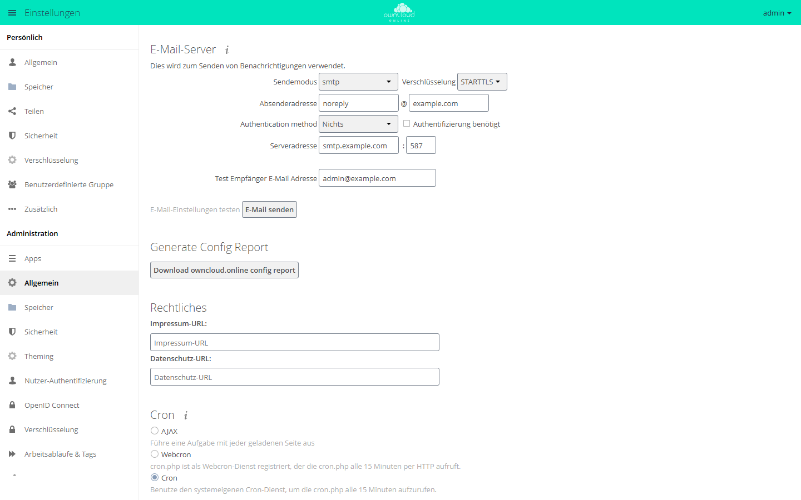

# Konfigurationsbericht

Die App fasst die Konfiguration einer Instanz in einer JSON-Datei zusammen:
Version, Apps, Datenbank, PHP, externe Speicher und den Inhalt der
`config.php`. Gedacht ist sie für Support-Fälle. Statt vieler Rückfragen geht
eine Datei an den Support. Passwörter und andere Geheimnisse ersetzt die App
vorher durch einen Platzhalter.

!!! note "Verfügbarkeit"
    Öffentlich im Marketplace, ohne API-Schlüssel. App-ID `configreport`,
    Version 0.4.5. Name im Markt: „Admin Config Report“.

## Voraussetzungen

| Bereich | Anforderung |
| --- | --- |
| owncloud.online | 11.x |
| PHP | 8.4 oder neuer |

Weitere Dienste oder PHP-Erweiterungen braucht die App nicht.

## Installation

In der Weboberfläche: im App-Menü links oben **Markt** öffnen, nach
„Admin Config Report“ suchen und **Installieren** klicken.

Auf der Kommandozeile:

```bash
sudo -u www-data php8.4 occ market:install configreport
```

Ist die App schon vorhanden und nur abgeschaltet:

```bash
sudo -u www-data php8.4 occ app:enable configreport
```

## Bericht erzeugen

In der Weboberfläche: **Einstellungen → Administration → Allgemein**, Abschnitt
**Generate Config Report**, Knopf **Download owncloud.online config report**.
Der Browser lädt die Datei `config_report_<JJJJMMTT>.json` herunter. Die
Oberfläche der App gibt es nur auf Englisch.



*Der Abschnitt Generate Config Report steht unter Administration → Allgemein zwischen E-Mail-Server und Rechtliches.*

Auf der Kommandozeile schreibt der Befehl den Bericht auf die Standardausgabe:

```bash
sudo -u www-data php8.4 occ configreport:generate > config_report.json
```

Dieser Weg funktioniert auch dann, wenn die Weboberfläche nicht mehr
erreichbar ist.

## Inhalt

| Abschnitt | Inhalt |
| --- | --- |
| `basic` | Datum, Serverversion, Betriebssystem, Webserver, Hostname, Anzeigename des Kontos, das den Bericht erzeugt hat, Linux-Distribution, Docker ja oder nein |
| `stats` | Zahl der Konten je Benutzer-Backend (gesamt, Gäste, schon einmal angemeldet, in den letzten 30 Tagen angemeldet), Zahl der Gruppen je Backend |
| `config` | Inhalt der `config.php` |
| `integritychecker` | Ergebnis der Integritätsprüfung |
| `core` | Einstellungen des Kerns aus der Datenbank |
| `apps` | die installierten Apps mit Version und Status, bei eingeschalteten Apps deren Einstellungen |
| `mounts` | vom Administrator eingerichtete externe Speicher mit Typ, Anmeldeart, Optionen und zugewiesenen Konten und Gruppen |
| `tables` | Aufbau der Datenbank: Tabellen, Spalten und Indizes, keine Inhalte |
| `migrations` | ausgeführte Datenbankmigrationen je App |
| `phpinfo` | PHP-Version, geladene Erweiterungen und `php.ini`-Werte, ohne Umgebungsvariablen |

## Was ersetzt wird und was bleibt

Ersetzt durch `***REMOVED SENSITIVE VALUE***` werden:

- Werte, deren Schlüssel auf ein Geheimnis hindeutet: `password`, `passwd`,
  `pwd`, `secret`, `token`, `salt`, `credential`, `api_key`, `private_key` und
  Schlüssel, die `key` heißen oder auf `_key`, `-key` oder `.key` enden. Das
  gilt auch für verschachtelte Werte und für App-Einstellungen, also etwa für
  `dbpassword`, `passwordsalt`, `secret` und den Schlüssel des Markts.
- Passwörter und versteckte Anmeldedaten externer Speicher, zum Beispiel
  OAuth-Token oder der private Schlüssel einer SFTP-Anmeldung.

Stehen bleiben Schalter wie `token_auth_enforced` und alle Werte, die kein
Geheimnis sind: Pfade, Hostnamen, Datenbank- und Kontonamen. Lesen Sie den
Bericht deshalb durch, bevor Sie ihn weitergeben.

Die App sendet nichts von sich aus. Der Bericht entsteht nur auf Anforderung
und verlässt den Server nur, wenn Sie ihn weitergeben.

## Grenzen und Hinweise

- Den Bericht erzeugen nur Administratoren.
- Ein Bericht über die Weboberfläche nennt Hostname und Anzeigename des
  angemeldeten Kontos. Auf der Kommandozeile fehlen diese beiden Angaben.
- Persönliche externe Speicher einzelner Konten fehlen im Abschnitt `mounts`.
- In owncloud.online 11.0.25 steht die App in der Liste der mitgelieferten
  Apps (`core/shipped.json`). `occ market:uninstall configreport` lehnt das
  Entfernen deshalb ab („Mitgelieferte Apps können nicht deinstalliert
  werden“). Abschalten geht wie gewohnt mit
  `sudo -u www-data php8.4 occ app:disable configreport`.
