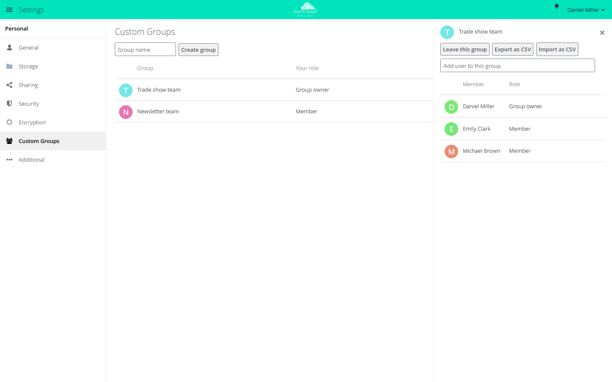

# Custom Groups

!!! note "Available on the Marketplace"
    The app is listed on the Marketplace without an API key. App ID: `customgroups`. This page describes version 0.10.5.

With this app, users create their own groups, for example for a project or a team, and
share files with all members at once. The groups are only for sharing, not for granting
permissions. Administrators do not have to maintain central groups for this.

## Requirements

| Component | Requirement |
| --- | --- |
| owncloud.online | 11.x |
| PHP | 8.4 |

The app needs no other services. Notifications about new memberships appear when the
`notifications` app is enabled.

## Installation

Open *Market* from the app menu, go to the "Custom Groups" app, and install it. On the
command line:

```bash
sudo -u www-data php8.4 occ market:install customgroups
```

The command downloads the package and enables the app. If the app is already present but
disabled, run `sudo -u www-data php8.4 occ app:enable customgroups`.

## Configuration

Two switches are under *Settings → Admin → Sharing* in the "Custom Groups" section:

| Checkbox | Key | Default | Effect |
| --- | --- | --- | --- |
| "Only group admins are allowed to create custom groups" | `only_subadmin_can_create` | off | Only administrators and group admins create groups |
| "Allow creating multiple groups with the same name" | `allow_duplicate_names` | off | Several groups may have the same name |

```bash
sudo -u www-data php8.4 occ config:app:set customgroups only_subadmin_can_create --value true
sudo -u www-data php8.4 occ config:app:set customgroups allow_duplicate_names --value true
```

If "Restrict users to only share with users in their groups" is enabled under
*Settings → Admin → Sharing*, people can only add accounts with whom they share at least
one group.

## Usage

Users manage their own groups under *Settings → Personal → Custom Groups*.

<figure markdown>



<figcaption>You create your own groups under "Custom Groups". The group is then available when you share.</figcaption>
</figure>

1. Type a name in "Group name" and click "Create group". The name is 2 to 64 characters
   long and does not start with a space.
2. Click the group. The member list opens on the right. In the "Add user to this group"
   field, search for accounts and add them.
3. When sharing, the group appears in the share dialog like any other group.

Whoever creates a group is its group owner. There are two roles:

| Role | May |
| --- | --- |
| "Member" | share with the group, see the member list, leave the group |
| "Group owner" | also add and remove members, rename and delete the group, change roles |

Every group needs at least one group owner. The last one cannot leave the group or give up
the role. Only its members see a group. Administrators see and change all groups.

### Members as CSV

In the member list, "Export as CSV" saves the members to a file, and "Import as CSV" adds
members from a file. Each line contains the user ID and the role, separated by a comma.
The role is `member` for members and `admin` for group owners:

```text
alice,admin
bob,member
```

Existing members are skipped during the import. Accounts that could not be added are
listed under "The following users were not imported".

## Limits and notes

* Custom groups apply to sharing only. That is why they do not appear in
  `occ group:list` and `occ user:list-groups`, even though they are real groups. Their IDs
  start with `customgroup_`.
* Guest accounts of the [Guests](guests.en.md) app can be added as well. The list shows
  them as "Member (Guest)".
* Members receive a notification when someone adds or removes them or changes their role.
