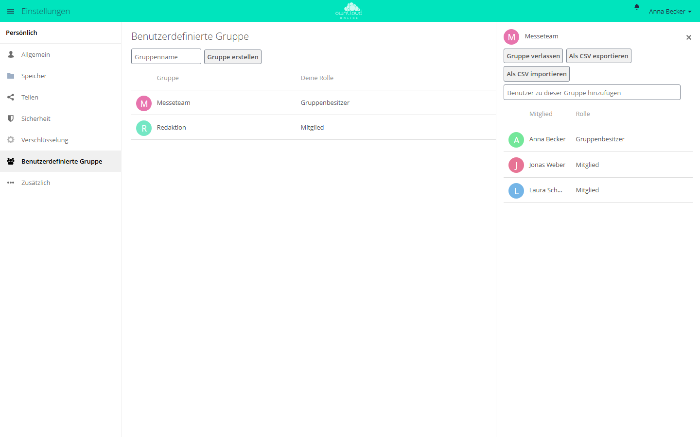

# Benutzerdefinierte Gruppen

!!! note "Öffentlich im Marktplatz"
    Die App steht ohne API-Schlüssel im Marktplatz. App-ID: `customgroups`. Diese Seite beschreibt Version 0.10.5.

Mit dieser App legen Anwender selbst Gruppen an, etwa für ein Projekt oder ein Team, und
teilen Dateien mit allen Mitgliedern auf einmal. Die Gruppen dienen nur dem Teilen, nicht
der Rechtevergabe. Administratoren müssen dafür keine zentralen Gruppen pflegen.

## Voraussetzungen

| Komponente | Anforderung |
| --- | --- |
| owncloud.online | 11.x |
| PHP | 8.4 |

Weitere Dienste braucht die App nicht. Hinweise auf neue Mitgliedschaften erscheinen,
wenn die App `notifications` eingeschaltet ist.

## Installation

Im App-Menü *Markt* öffnen, die App „Custom Groups“ aufrufen und installieren. Im Markt
trägt sie ihren englischen Namen. Auf der Kommandozeile:

```bash
sudo -u www-data php8.4 occ market:install customgroups
```

Der Befehl lädt das Paket und schaltet die App ein. Eine vorhandene, abgeschaltete App
schalten Sie mit `sudo -u www-data php8.4 occ app:enable customgroups` ein.

## Einrichtung

Zwei Schalter liegen unter *Einstellungen → Administration → Teilen* im Abschnitt
„Benutzerdefinierte Gruppe“:

| Kästchen | Schlüssel | Vorgabe | Wirkung |
| --- | --- | --- | --- |
| „Nur Gruppen-Administratoren sind berechtigt benutzerdefinierte Gruppen zu erstellen“ | `only_subadmin_can_create` | aus | Nur Administratoren und Gruppen-Administratoren legen Gruppen an |
| „Das Erstellen von mehreren Gruppen mit dem selben Namen erlauben“ | `allow_duplicate_names` | aus | Mehrere Gruppen dürfen denselben Namen tragen |

```bash
sudo -u www-data php8.4 occ config:app:set customgroups only_subadmin_can_create --value true
sudo -u www-data php8.4 occ config:app:set customgroups allow_duplicate_names --value true
```

Ist unter *Einstellungen → Administration → Teilen* „Benutzer auf das Teilen mit
Benutzern in ihren Gruppen beschränken“ eingeschaltet, nimmt jede Person nur Konten auf,
mit denen sie mindestens eine Gruppe teilt.

## Nutzung

Die eigenen Gruppen verwalten Anwender unter *Einstellungen → Persönlich →
Benutzerdefinierte Gruppe*.

<figure markdown>



<figcaption>Eigene Gruppen legen Sie unter „Benutzerdefinierte Gruppe“ an. Die Gruppe steht danach beim Teilen zur Auswahl.</figcaption>
</figure>

1. Einen Namen in „Gruppenname“ eingeben und „Gruppe erstellen“ wählen. Der Name ist 2
   bis 64 Zeichen lang und beginnt nicht mit einem Leerzeichen.
2. Die Gruppe anklicken. Rechts öffnet sich die Mitgliederliste. Im Feld „Benutzer zu
   dieser Gruppe hinzufügen“ Konten suchen und aufnehmen.
3. Beim Teilen erscheint die Gruppe im Freigabedialog wie jede andere Gruppe.

Wer eine Gruppe anlegt, ist ihr Gruppenbesitzer. Es gibt zwei Rollen:

| Rolle | Darf |
| --- | --- |
| „Mitglied“ | mit der Gruppe teilen, die Mitgliederliste sehen, die Gruppe verlassen |
| „Gruppenbesitzer“ | zusätzlich Mitglieder aufnehmen und entfernen, die Gruppe umbenennen und löschen, Rollen ändern |

Jede Gruppe braucht mindestens einen Gruppenbesitzer. Der letzte kann die Gruppe nicht
verlassen und seine Rolle nicht abgeben. Eine Gruppe sehen nur ihre Mitglieder.
Administratoren sehen und ändern alle Gruppen.

### Mitglieder als CSV

In der Mitgliederliste speichert „Als CSV exportieren“ die Mitglieder in eine Datei,
„Als CSV importieren“ nimmt Mitglieder aus einer Datei auf. Jede Zeile enthält
Benutzerkennung und Rolle, getrennt durch ein Komma. Die Rolle ist `member` für Mitglieder
und `admin` für Gruppenbesitzer:

```text
alice,admin
bob,member
```

Wer schon Mitglied ist, wird beim Import übersprungen. Konten, die sich nicht aufnehmen
ließen, nennt die App unter „Die folgenden Benutzer wurden nicht importiert“.

## Grenzen und Hinweise

* Benutzerdefinierte Gruppen gelten nur für das Teilen. Sie erscheinen deshalb nicht in
  `occ group:list` und `occ user:list-groups`, obwohl es echte Gruppen sind. Ihre
  Kennungen beginnen mit `customgroup_`.
* Auch Gastkonten der App [Guests](guests.md) lassen sich aufnehmen. Die Liste zeigt sie
  als „Benutzer (Gast)“.
* Mitglieder erhalten eine Benachrichtigung, wenn jemand sie aufnimmt, entfernt oder ihre
  Rolle ändert.
