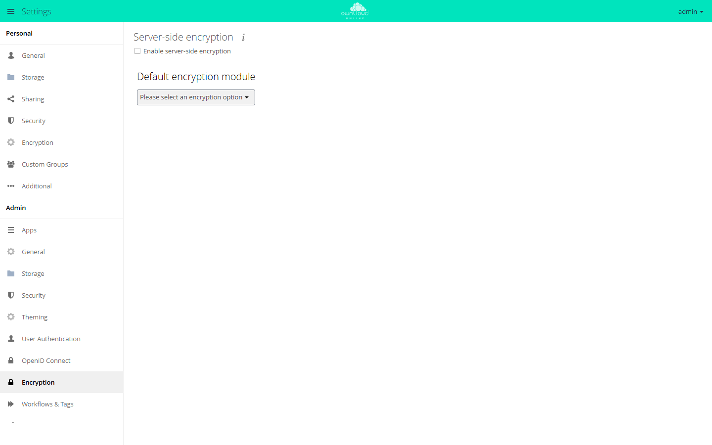

# Default encryption module

The `encryption` app encrypts the content of every file before owncloud.online
writes it to storage, and decrypts it on read. It is meant for instances whose
storage is not under your own control: a hosting provider, an S3 bucket used as
external storage, a stolen disk, or a backup then shows only AES-256
ciphertext. It does not help against an attacker on the running server,
because the key lives there.

!!! note "Availability"
    Listed in the Marketplace, no API key needed. App ID `encryption`,
    version 2.0.10. Name in the Market: "Default encryption module".

!!! warning "Read before you switch it on"
    You can only switch encryption off again if you delete all file versions
    and empty every trash bin (see "Switching encryption off"). Back up the
    data directory, the database, and `config/config.php` first. Without the
    key storage and the `secret` value, encrypted files are lost for good.

## Requirements

| Area | Requirement |
| --- | --- |
| owncloud.online | 11.x |
| PHP | 8.4 or later, `openssl` extension |
| `config/config.php` | `secret` is set and never changes |
| Storage | no S3 primary storage (see "Limits and notes") |

In master key mode, `secret` is the password that protects the private master
key. Always back up `config/config.php` together with the data directory.

## Installation

In the web interface: open **Market** from the app menu in the top left, go to
the "Default encryption module" app, and click **Install**.

On the command line:

```bash
sudo -u www-data php8.4 occ market:install encryption
```

`market:install` downloads, installs, and enables the app. If the app is
already present but disabled, run
`sudo -u www-data php8.4 occ app:enable encryption`.

The enabled app does not encrypt anything yet. To start, switch encryption on
as described in the next section.

## Configuration

### Switching encryption on

1. Open **Settings → Admin → Encryption**.
2. In the "Default encryption module" section, choose **Master Key** in the
   "Please select an encryption option" list and click **Permanently select
   this mode**. The page reloads.
3. Check "Enable server-side encryption". A list of warnings appears. Confirm
   with **Enable encryption**.
4. Log out and log in again. Until then the page shows "Encryption App is
   enabled but your keys are not initialized, please log-out and log-in
   again". Afterwards it shows "Encryption type: Master Key".

If you skip step 2, the app selects the master key itself on the first page
load after encryption is switched on.

<figure markdown="span">
  
  <figcaption>Turn on server-side encryption here. Read the notes on keys and backups first.</figcaption>
</figure>

The same on the command line:

```bash
sudo -u www-data php8.4 occ config:app:set encryption useMasterKey --value 1
sudo -u www-data php8.4 occ encryption:enable
sudo -u www-data php8.4 occ encryption:status
```

### Encrypting existing files

From the moment it is switched on, the app encrypts every file that is
written. Existing files are encrypted only by this command:

```bash
sudo -u www-data php8.4 occ encryption:encrypt-all
```

While it runs, the command puts the instance into single-user mode (only
admins can log in) and disables the trash bin. Depending on the amount of
data, this takes a long time, so start it in `screen` or `tmux`. `-y` skips the
confirmation prompt.

If the run is killed, for example because the connection drops, both settings
stay in place. To reset them:

```bash
sudo -u www-data php8.4 occ config:system:set singleuser --value false --type boolean
sudo -u www-data php8.4 occ app:enable files_trashbin
```

### Options

App values of the `encryption` app. Read and set them with
`occ config:app:get encryption <key>` and
`occ config:app:set encryption <key> --value <value>`. The app sets most other
values itself. Do not change those.

| Key | Default | Meaning |
| --- | --- | --- |
| `useMasterKey` | `1` after setup | master key mode |
| `encryptHomeStorage` | `1` | `0` encrypts only external storage, not the home storage |
| `hsm.url` | empty | address of an external HSM service; the service is not part of the app. Once it is set, the app switches `crypto.engine` to `hsm`. If you remove `hsm.url` later, remove `crypto.engine` as well (`occ config:app:delete encryption crypto.engine`). |
| `hsm.jwt.secret` | `secret` | shared secret with the HSM service; set your own value when you use an HSM |

Values in `config/config.php` that the app reads:

| Key | Default | Meaning |
| --- | --- | --- |
| `secret` | generated during installation | password of the private master key |
| `cipher` | `AES-256-CTR` | `AES-128-CTR`, `AES-256-CFB`, and `AES-128-CFB` are also allowed; for any other value the app logs a warning and uses `AES-256-CTR` |
| `openssl` → `private_key_bits` | `4096` | key length of new key pairs |

### Command line

Commands of the app:

| Command | Purpose |
| --- | --- |
| `encryption:recreate-master-key [-y]` | decrypts all files, creates a new master key, and encrypts everything again; afterwards all accounts must log in again |
| `encryption:fix-encrypted-version <account> [-p <path>] [-i <count>]` | repairs files that can no longer be read because of "Bad Signature"; repair shared files in the owner's account |
| `encryption:migrate [<account> …]` | moves the key storage of the predecessor app `files_encryption` to the current layout; without arguments for all accounts |
| `encryption:hsmdaemon`, `encryption:hsmdaemon:decrypt` | only with a configured HSM service (`hsm.url`) |

The core provides `encryption:enable`, `encryption:disable`,
`encryption:status`, `encryption:list-modules`,
`encryption:set-default-module`, `encryption:encrypt-all`,
`encryption:decrypt-all`, `encryption:show-key-storage-root`, and
`encryption:change-key-storage-root`.

## Usage

In master key mode, users do not have to do anything. Under **Settings →
Personal → Encryption**, the "owncloud.online basic encryption module" section
says: "Server-side encryption is active and your files are encrypted
transparently. No personal settings are required." Shares, public links,
versions, the trash bin, and the clients work as they do without encryption.

## Switching encryption off

```bash
sudo -u www-data php8.4 occ encryption:decrypt-all
sudo -u www-data php8.4 occ versions:cleanup
sudo -u www-data php8.4 occ trashbin:cleanup
sudo -u www-data php8.4 occ encryption:disable
sudo -u www-data php8.4 occ app:disable encryption
```

`encryption:decrypt-all` decrypts only the current files. Versions and the
trash bin stay encrypted, and `encryption:disable` refuses as long as any
encrypted file remains: "The system still has encrypted files. Please decrypt
them all before disabling encryption." Going back therefore costs all file
versions and the content of every trash bin. Like `encrypt-all`,
`decrypt-all` switches on single-user mode and disables the trash bin while it
runs; if the run is killed, reset both as described above.

Disable the app only at the very end. Without it, encrypted leftovers can no
longer be read.

## Limits and notes

- **Content only.** File names, the folder structure, shares, and everything
  in the database stay unencrypted. Encrypted files take up slightly more
  space.
- **Back up the key storage.** The keys are in
  `<data directory>/files_encryption/` and
  `<data directory>/<account>/files_encryption/`. If the key storage was moved
  with `encryption:change-key-storage-root`, they are there instead;
  `occ encryption:show-key-storage-root` shows the location. A backup without
  these folders and without `config/config.php` is worthless.
- **S3 primary storage.** With the `files_primary_s3` app, encryption cannot
  be switched on. `occ encryption:enable` then reports "Storage encryption is
  not compatible with S3 Object Storage." Use the bucket's server-side
  encryption (`serversideencryption`) instead.
- **Login without a password.** OAuth2, OpenID Connect, and SAML/SSO do not
  pass a login password. With them, only master key mode works.
- **Office.** ONLYOFFICE and Collabora Online open encrypted files only in
  master key mode.
- **Per-account keys.** Older installations that still use one key per
  account keep working. This mode is supported only for existing
  installations; the settings page offers only the master key. The recovery
  key exists only in this old mode.
- **Moving to another server.** The app keeps reading the encrypted files of a
  moved instance if `config/config.php` (`secret`, `instanceid`) and
  `files_encryption/` come along unchanged. If a storage gets a new storage ID
  during the move, files fail with "Bad Signature". Fix:
  `occ encryption:fix-encrypted-version <account> -p <path>`. Whatever is
  written after the move cannot be read by an older instance.

More on backups and operation: [Encryption](../../administration/encryption.en.md)
and [Backups and updates](../../administration/backups-updates.en.md).

## Troubleshooting

| Message | Cause | Fix |
| --- | --- | --- |
| "Encryption App is enabled but your keys are not initialized, please log-out and log-in again" | The keys of this session are not loaded. | Log out and log in again |
| Download fails, the log shows "Bad Signature" | The stored version number does not match the content, for example after a restore or a move. | `occ encryption:fix-encrypted-version <account> -p <path>` |
| Log: "Can not get secret …" | `secret` is missing in `config/config.php`. | Restore the value from the backup |
| `encryption:recreate-master-key` reports "Master key is not enabled." | `useMasterKey` is not `1`. | Select the master key (see "Configuration") |
| HTTP 403 or 503 with "Encryption not ready: Private Key missing …" with OAuth2 or OpenID Connect | The per-account key mode needs the login password. | Use master key mode |
| Log: "Unsupported cipher (…) defined in config.php …" | `config/config.php` sets a `cipher` that is not supported. | Enter one of the four allowed values |
| Files in the home storage stay unencrypted | `encryptHomeStorage` is `0`. | Set it to `1`, then run `occ encryption:encrypt-all` |
