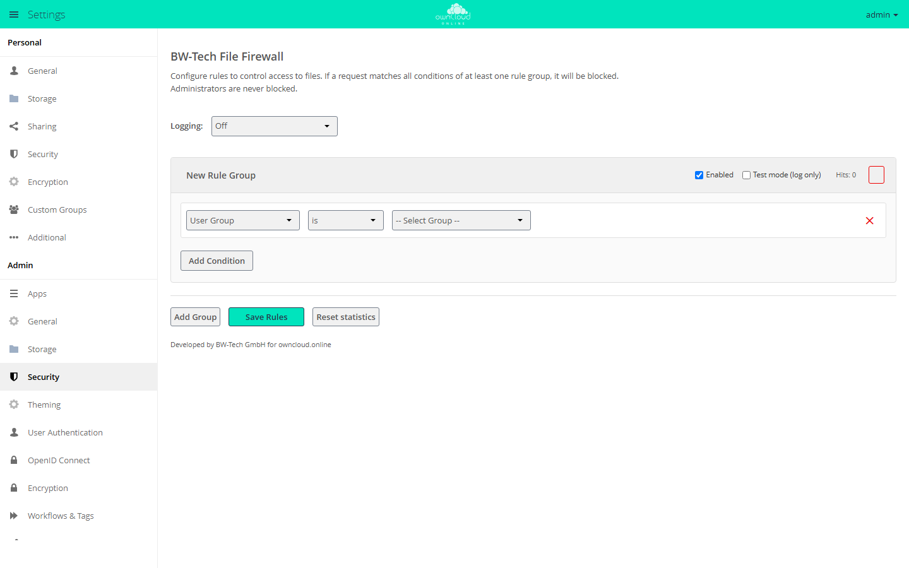

# BW-Tech File Firewall

!!! info "API key required"
    The Marketplace lists this app only for instances that have a valid API
    key entered in the Market. BW-Tech GmbH issues the key on request. To
    enter it: in the **Market**, click **Add API Key** under *Settings*, paste
    the key, and click **Save**. The steps in detail are under
    "Installation". App ID `file_firewall`, version 2.10.4.

The `file_firewall` app blocks file access according to rules you define: by
IP range, group, device, time of day, file size, file type, tag, or type of
request. A request is blocked if it meets all conditions of a rule group. The
app is meant for admins who have to restrict file access to, for example, the
company network, office hours, or certain devices.

## Requirements

| Area | Requirement |
| --- | --- |
| owncloud.online | 11.0.x |
| PHP | 8.4 |
| Reverse proxy | `trusted_proxies` set correctly, otherwise IP rules only see the proxy's address, see [Reverse proxy and TLS](../../administration/reverse-proxy.en.md) |

## Installation

1. Request the API key from BW-Tech GmbH.
2. Open **Market** from the app menu in the top left. In the left column under
   *Settings*, click **Add API Key**.
3. Paste the key into the "Your personal API Key" field and click **Save**.
   The Market checks the key with the Marketplace and reloads the catalog. If
   the key was accepted, the entry in the left column now reads
   **Edit API Key**. If it still reads **Add API Key**, the key was rejected
   and not saved.
4. Go to the "BW-Tech File Firewall" app and click **Install**.

On the command line:

```bash
sudo -u www-data php8.4 occ config:app:set market key --value '<KEY>'
sudo -u www-data php8.4 occ market:install file_firewall
```

`market:install` downloads, installs, and enables the app. If the app is
already present but disabled, run
`sudo -u www-data php8.4 occ app:enable file_firewall`.

Notes on the key:

- On the command line, the key ends up in your shell history. With the
  [Audit Log](audit_log.en.md) app enabled, the command including the key is
  also written to the audit log.
- Alternatively, put the key into `config/config.php`:
  `'marketplace.key' => '<KEY>',`. This entry takes precedence, and the key
  can then no longer be changed in the web interface.
- After `config:app:set`, the Market keeps working with the cached catalog
  without the key for up to 30 minutes. During that time, `market:install`
  reports the app as unknown ("Unknown app (file_firewall)"). Click
  **Clear cache** in the Market or wait the 30 minutes.

During installation and after every update, the app takes over the rules of
an earlier firewall installation, including its logging setting, if there
are any: from `firewall.rules` in `config/config.php` and from the app values
of the app ID `firewall`. If `file_firewall` already has rule groups of its
own, it takes over nothing and reports how many groups it skipped. Compare
them by hand with `occ firewall:list`.

## Configuration

The rules are under **Settings → Admin → Security**, in the "BW-Tech File
Firewall" section.

<figure markdown="span">
  
  <figcaption>A request is blocked if it meets all conditions of a rule group. "Save Rules" applies the changes.</figcaption>
</figure>

1. **Add Group** creates a "New Rule Group". Give it a name. Blocked users see
   this name in the error message.
2. Choose the condition type, operator, and value. **Add Condition** adds more
   conditions. A request is blocked only if all of them apply.
3. For a new rule, check "Test mode (log only)". Matching requests then only go
   to the log and to the "Test hits" counter.
4. Click **Save Rules**. Changes take effect only then, including deleted
   groups and conditions.

Each rule group has the "Enabled" switch, test mode, and the "Hits" counter.
"Test hits" appears once there are any; "Last hit" (time in UTC) shows when
you hover over the counter. **Reset statistics** asks for confirmation and
then sets all counters to zero right away, without **Save Rules**.

"Logging" controls what the app writes to the server log:

| Option | Effect |
| --- | --- |
| Off | nothing except matches in test mode (default) |
| Blocked Requests Only | every blocked request as a warning with account, IP address, URL, and rule group |
| All Requests | also every allowed request, at the info level; visible only if the log level is 1 or lower |

The app always logs matches in test mode, whatever this option says.

### Conditions

| Condition | Type | Operators | Value |
| --- | --- | --- | --- |
| User Group | `user_group` | is, is not | a group |
| User Agent | `user_agent` | matches, does not match | pattern with `*` at the start or end, for example `*curl*`; without `*`, the whole user agent must match |
| User Device | `device` | is, is not | "Android Client", "iOS Client", "Desktop Client", "Others (Browsers, etc.)" |
| IP Range (IPv4) | `ip_range_ipv4` | is, is not | CIDR, for example `192.168.0.0/16` |
| IP Range (IPv6) | `ip_range_ipv6` | is, is not | CIDR |
| Request Time | `time` | is, is not | start time, end time, time zone |
| Request URL | `request_url` | contains, does not contain | part of the URL |
| Request Type | `request_type` | is, is not | see the next table |
| File Size Upload | `upload_size` | less than, greater or equal | size in bytes |
| File Mimetype Upload | `file_mimetype` | is, is not, begins with, doesn't begin with, ends with, doesn't end with | MIME type, for example `application/x-msdownload` |
| System File Tag | `system_tag` | is, is not | a tag on the file or on a parent folder |
| Regular Expression | `regex` | is, is not | expression and target field (group, user agent, client IP, URL, or MIME type) |

About the request time: the default "Server time" is UTC in owncloud.online.
For office hours, pick a time zone such as `Europe/Berlin`. A time window may
cross midnight, for example 18:00 to 06:00.

Write regular expressions with delimiters (`/secret/i`) or without
(`secret\.txt$`, then matched case-insensitively).

| Request type | Value | Covers |
| --- | --- | --- |
| File Upload (PUT/MKCOL/MOVE/COPY) | `upload` | WebDAV requests that write |
| File Upload incl. Public Links and Bulk Upload (file content only) | `file_upload` | uploading file content, including through public links and bulk upload |
| File Download (GET) | `download` | every read of file content: downloads, also as ZIP, previews, versions, trash bin, text editor, gallery |
| WebDAV Browse (PROPFIND) | `webdav` | folder listings (PROPFIND) and other WebDAV requests without file content, such as OPTIONS; not DELETE |
| WebDAV, any method (remote.php) | `webdav_any` | every file access through `remote.php` |
| Public Link Share | `public` | access through public links, including previews and WebDAV |
| API Request | `api` | file access during an OCS or API call |
| Other | `other` | everything else, for example DELETE |

Assign your own branded clients to a device type in `config/config.php`. The
app compares the pattern with the user agent, ignoring case. A `*` at the start
means "ends with", a `*` at the end means "starts with", and a `*` at both ends
means "contains"; without `*`, the whole user agent must match. The client name
usually sits in the middle of the user agent, so `*name*` is normally the right
choice. You find the exact user agent in the web server's access log.

```php
'firewall.branded_clients' => [
    '*mycompany-android*' => 'android_branded',
    '*mycompany-ios*' => 'ios_branded',
    '*mycompany-desktop*' => 'desktop_branded',
],
```

The "User Device" condition then also offers "… (Branded)", "All branded
clients", and "All non-branded clients".

### Command line

```bash
# show the rules (logging, groups, conditions, counters)
sudo -u www-data php8.4 occ firewall:list
sudo -u www-data php8.4 occ firewall:list --output=json

# block access from outside the company network
sudo -u www-data php8.4 occ firewall:add-rule "Company network only" \
  -c "ip_range_ipv4:is_not:10.0.0.0/8"

# block uploads of the group external after hours, in test mode first
sudo -u www-data php8.4 occ firewall:add-rule "External after hours" \
  -c "user_group:is:external" \
  -c "request_type:is:upload" \
  -c "time:is:18:00-06:00@Europe/Berlin" \
  --test-mode

# delete the first rule group in the list (index 0)
sudo -u www-data php8.4 occ firewall:delete-rule 0

# back up the rules and import them again
sudo -u www-data php8.4 occ firewall:export /tmp/firewall-rules.json
sudo -u www-data php8.4 occ firewall:import /tmp/firewall-rules.json
sudo -u www-data php8.4 occ firewall:import --replace /tmp/firewall-rules.json
```

Write a condition as `type:operator:value`. On the command line the operators
are `is`, `is_not`, `matches`, `not_matches`, `contains`, `not_contains`,
`less`, `greater_equal`, `begins_with`, `not_begins_with`, `ends_with`, and
`not_ends_with`. `--disabled` creates a group that is switched off.

Write a time window as `HH:MM-HH:MM`, optionally followed by `@<timezone>`. The
app silently drops an unknown time zone, and UTC applies. For `regex`, append
the target field after a `|`, for example `-c 'regex:is:secret|request_url'`;
a `|` inside the expression itself therefore works only in the web interface.
The target fields are `user_group`, `user_agent`, `ip_range_ipv4`,
`ip_range_ipv6`, `request_url`, and `file_mimetype`.

`firewall:list` numbers the groups from 1 ("Rule Group 1"),
`firewall:delete-rule` counts from 0. To delete the first group in the list,
run `firewall:delete-rule 0`. The command does not ask for confirmation.

`firewall:import` appends the groups from the file; `--replace` replaces all
existing ones. If the file contains a `logLevel`, the import also sets the
logging option. The web server user must be able to read the file. Do not keep
exports in the installation directory.

### REST API

For scripts, there is an OCS interface under
`/ocs/v2.php/apps/file_firewall/api/v1`. It requires an admin account with
Basic Auth and the `OCS-APIREQUEST: true` header. If the account uses
two-factor authentication, log in with an app password.

| Method and path | Purpose |
| --- | --- |
| `GET /rules` | read all rule groups |
| `POST /rules` | replace all rule groups (parameter `rules` as JSON, optionally `logLevel` 0 to 2) |
| `DELETE /rules/<index>` | delete one rule group; the index counts from 0 |
| `GET /groups`, `GET /systemtags` | groups and system tags for conditions |
| `POST /stats/reset` | reset the counters |

```bash
curl -u admin -H "OCS-APIREQUEST: true" \
  "https://cloud.example.com/ocs/v2.php/apps/file_firewall/api/v1/rules?format=json"
```

`POST /rules` replaces the complete list. To add a group, read the rules
first and send them back together with the new group.

## Usage

Blocked access over WebDAV, that is from the desktop client, the mobile apps,
or a mapped drive, ends with HTTP 403 and the message
`Blocked by BW-Tech File Firewall: <rule group name>`. The web interface shows
the same message when an upload is blocked. A blocked public link also returns
HTTP 403. A blocked read outside WebDAV returns the error of the app that reads
the file, for example HTTP 404 for a preview or HTTP 400 in the text editor.

## Limits and notes

- **Admins** are never blocked. Test rules with a regular account.
- **Command line and cron** are exempt.
- **Login.** The app blocks file access, not the login. It checks requests
  without a login only for public links.
- **OCS calls** themselves are not blocked. A rule of type `api` applies only
  to file access during such a call. Creating a share over OCS, for example,
  still works.
- **Errors during evaluation.** If evaluating a rule fails with an error, the
  app lets the request through. Test new rules in test mode and read the log.
- **System tags** are detected only for WebDAV access by logged-in accounts.
  For ZIP downloads in the web interface (folders, multiple selection) and for
  public links, the "System File Tag" condition does not apply.
- **IP rules behind a reverse proxy** need `trusted_proxies`; otherwise every
  request appears to come from the proxy's address.
- **Rule group names** are visible to blocked users in the error message.
  Choose names that can be shown to users.
- **Storage.** Rules, the logging option, and the counters are stored as app
  values in the database. A database backup contains them;
  `occ firewall:export` also writes them to a JSON file.
