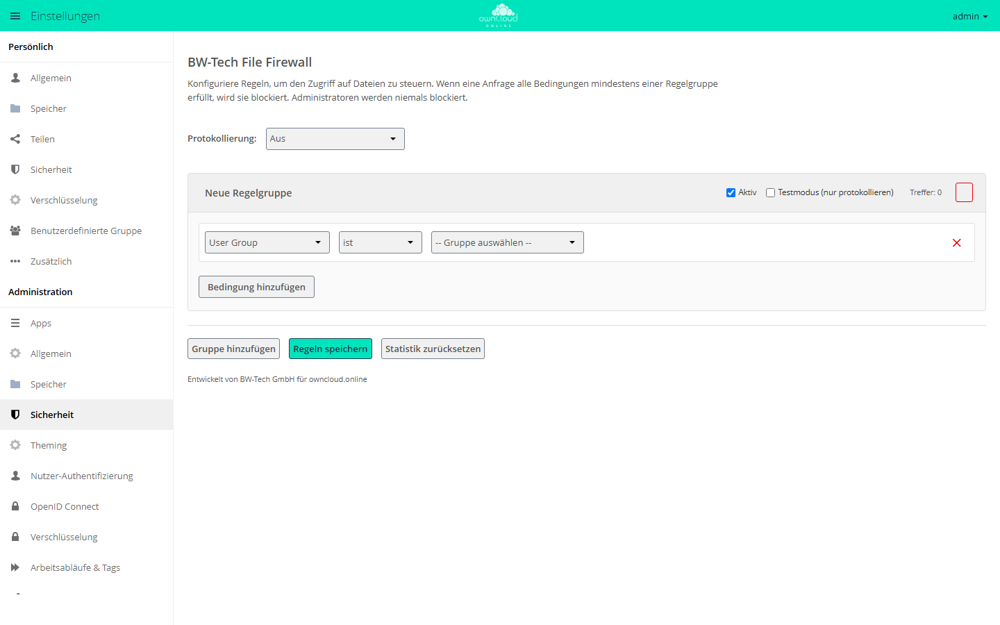

# BW-Tech File Firewall

!!! info "Nur mit API-Schlüssel"
    Der Marketplace zeigt diese App nur Instanzen, in deren Markt ein gültiger
    API-Schlüssel eingetragen ist. Den Schlüssel erhalten Sie auf Anfrage von der
    BW-Tech GmbH. Eintragen: im **Markt** unter *Einstellungen* auf **API
    Schlüssel hinzufügen** klicken, Schlüssel einfügen und **Speichern**
    klicken. Die Schritte im Einzelnen stehen unter „Installation“.
    App-ID `file_firewall`, Version 2.10.4.

Die App `file_firewall` sperrt Dateizugriffe nach Regeln, die Sie festlegen:
nach IP-Bereich, Gruppe, Gerät, Uhrzeit, Dateigröße, Dateityp, Tag oder Art der
Anfrage. Eine Anfrage wird gesperrt, wenn sie alle Bedingungen einer
Regelgruppe erfüllt. Die App richtet sich an Administratoren, die Dateizugriffe
etwa auf das Firmennetz, auf Bürozeiten oder auf bestimmte Geräte beschränken
müssen.

## Voraussetzungen

| Bereich | Anforderung |
| --- | --- |
| owncloud.online | 11.0.x |
| PHP | 8.4 |
| Reverse-Proxy | `trusted_proxies` richtig gesetzt, sonst sehen IP-Regeln nur die Adresse des Proxys, siehe [Reverse-Proxy und TLS](../../administration/reverse-proxy.md) |

## Installation

1. Den API-Schlüssel bei der BW-Tech GmbH anfragen.
2. Im App-Menü links oben **Markt** öffnen. In der linken Spalte unter
   *Einstellungen* auf **API Schlüssel hinzufügen** klicken.
3. Den Schlüssel in das Feld „Dein persönlicher API-Key“ einfügen und
   **Speichern** klicken. Der Markt prüft den Schlüssel beim Marketplace und
   lädt den Katalog neu. Ist der Schlüssel angenommen, heißt der Eintrag in der
   linken Spalte jetzt **Bearbeite API Schlüssel**. Steht dort weiter
   **API Schlüssel hinzufügen**, wurde der Schlüssel abgelehnt und nicht
   gespeichert.
4. Die App „BW-Tech File Firewall“ aufrufen und **Installieren** klicken.

Auf der Kommandozeile:

```bash
sudo -u www-data php8.4 occ config:app:set market key --value '<SCHLÜSSEL>'
sudo -u www-data php8.4 occ market:install file_firewall
```

`market:install` lädt die App, installiert sie und schaltet sie ein. Ist die App
schon vorhanden und nur abgeschaltet, genügt
`sudo -u www-data php8.4 occ app:enable file_firewall`.

Hinweise zum Schlüssel:

- Über die Kommandozeile steht der Schlüssel danach in der Shell-Historie. Mit
  eingeschaltetem [Audit Log](audit_log.md) steht der Befehl samt Schlüssel auch
  im Audit-Protokoll.
- Alternativ tragen Sie den Schlüssel in `config/config.php` ein:
  `'marketplace.key' => '<SCHLÜSSEL>',`. Dieser Eintrag hat Vorrang; in der
  Oberfläche lässt sich der Schlüssel dann nicht mehr ändern.
- Nach `config:app:set` arbeitet der Markt bis zu 30 Minuten mit dem
  zwischengespeicherten Katalog ohne Schlüssel. `market:install` meldet die App
  in dieser Zeit als unbekannt („Unknown app (file_firewall)“ bzw. „Unbekannte
  App (file_firewall)“). Klicken Sie im Markt auf **Cache leeren** oder warten
  Sie die 30 Minuten ab.

Bei der Installation und nach jedem Update übernimmt die App Regeln einer
früheren Firewall-Installation samt Protokollierung, sofern vorhanden: aus
`firewall.rules` in `config/config.php` und aus den App-Werten der App-ID
`firewall`. Hat `file_firewall` schon eigene Regelgruppen, übernimmt sie nichts
und meldet die Zahl der nicht übernommenen Gruppen. Vergleichen Sie dann von
Hand mit `occ firewall:list`.

## Einrichtung

Die Regeln stehen unter **Einstellungen → Administration → Sicherheit**,
Abschnitt „BW-Tech File Firewall“.

<figure markdown="span">
  
  <figcaption>Eine Anfrage wird gesperrt, wenn sie alle Bedingungen einer Regelgruppe erfüllt. „Regeln speichern“ übernimmt die Änderungen.</figcaption>
</figure>

1. **Gruppe hinzufügen** legt eine „Neue Regelgruppe“ an. Geben Sie ihr einen
   Namen. Gesperrte Anwender sehen diesen Namen in der Fehlermeldung.
2. Bedingungstyp, Operator und Wert wählen. **Bedingung hinzufügen** hängt
   weitere Bedingungen an. Gesperrt wird nur, wenn alle zutreffen.
3. Für eine neue Regel „Testmodus (nur protokollieren)“ anhaken. Passende
   Anfragen landen dann nur im Protokoll und im Zähler „Testtreffer“.
4. **Regeln speichern** klicken. Erst dann wirken Änderungen, auch gelöschte
   Gruppen und Bedingungen.

Je Regelgruppe gibt es den Schalter „Aktiv“, den Testmodus und den Zähler
„Treffer“. „Testtreffer“ erscheint, sobald es welche gibt; „Letzter Treffer“
(Zeit in UTC) zeigt der Zähler, wenn Sie mit der Maus darauf zeigen.
**Statistik zurücksetzen** setzt nach einer Rückfrage alle Zähler auf null; das
wirkt sofort, ohne **Regeln speichern**.

„Protokollierung“ steuert, was die App ins Serverprotokoll schreibt:

| Auswahl | Wirkung |
| --- | --- |
| Aus | nichts außer Treffern im Testmodus (Vorgabe) |
| Nur blockierte Anfragen | jede gesperrte Anfrage als Warnung mit Konto, IP-Adresse, URL und Regelgruppe |
| Alle Anfragen | zusätzlich jede durchgelassene Anfrage, auf Stufe Info; sichtbar nur, wenn die Protokollstufe 1 oder niedriger ist |

Treffer im Testmodus schreibt die App immer, unabhängig von dieser Auswahl.

### Bedingungen

| Bedingung | Typ | Operatoren | Wert |
| --- | --- | --- | --- |
| Benutzergruppe | `user_group` | ist, ist nicht | eine Gruppe |
| User-Agent | `user_agent` | entspricht, entspricht nicht | Muster mit `*` am Anfang oder Ende, etwa `*curl*`; ohne `*` muss der ganze User-Agent passen |
| Benutzergerät | `device` | ist, ist nicht | „Android-Client“, „iOS-Client“, „Desktop-Client“, „Andere (Browser usw.)“ |
| IP-Bereich (IPv4) | `ip_range_ipv4` | ist, ist nicht | CIDR, z. B. `192.168.0.0/16` |
| IP-Bereich (IPv6) | `ip_range_ipv6` | ist, ist nicht | CIDR |
| Anfragezeit | `time` | ist, ist nicht | Startzeit, Endzeit, Zeitzone |
| Anfrage-URL | `request_url` | enthält, enthält nicht | Teil der URL |
| Anfragetyp | `request_type` | ist, ist nicht | siehe nächste Tabelle |
| Dateigröße (Upload) | `upload_size` | kleiner als, größer oder gleich | Größe in Bytes |
| Datei-MIME-Typ (Upload) | `file_mimetype` | ist, ist nicht, beginnt mit, beginnt nicht mit, endet mit, endet nicht mit | MIME-Typ, z. B. `application/x-msdownload` |
| Systemtag der Datei | `system_tag` | ist, ist nicht | ein Tag an der Datei oder an einem übergeordneten Ordner |
| Regulärer Ausdruck | `regex` | ist, ist nicht | Ausdruck und Zielfeld (Gruppe, User-Agent, Client-IP, URL oder MIME-Typ) |

Zur Anfragezeit: Die Vorgabe „Serverzeit“ ist in owncloud.online UTC. Für
Bürozeiten wählen Sie eine Zeitzone, etwa `Europe/Berlin`. Ein Zeitfenster darf
über Mitternacht reichen, etwa 18:00 bis 06:00.

Reguläre Ausdrücke schreiben Sie mit Begrenzern (`/geheim/i`) oder ohne
(`geheim\.txt$`, dann ohne Unterscheidung von Groß- und Kleinschreibung).

| Anfragetyp | Wert | Erfasst |
| --- | --- | --- |
| Datei-Upload (PUT/MKCOL/MOVE/COPY) | `upload` | schreibende WebDAV-Anfragen |
| „File Upload incl. Public Links and Bulk Upload (file content only)“ | `file_upload` | das Hochladen von Dateiinhalt, auch über öffentliche Links und Bulk-Upload |
| Datei-Download (GET) | `download` | jedes Lesen von Dateiinhalt: Downloads, auch als ZIP, Vorschaubilder, Versionen, Papierkorb, Texteditor, Galerie |
| WebDAV-Durchsuchen (PROPFIND) | `webdav` | Verzeichnislisten (PROPFIND) und andere WebDAV-Anfragen ohne Dateiinhalt, etwa OPTIONS; nicht DELETE |
| „WebDAV, any method (remote.php)“ | `webdav_any` | jeden Dateizugriff über `remote.php` |
| Öffentliche Linkfreigabe | `public` | Zugriffe über öffentliche Links, auch Vorschau und WebDAV |
| API-Anfrage | `api` | Dateizugriffe während eines OCS- oder API-Aufrufs |
| Andere | `other` | alles Übrige, etwa DELETE |

Zwei Anfragetypen sind nicht übersetzt; die Oberfläche zeigt sie englisch.

Eigene Clients mit Branding ordnen Sie in `config/config.php` einem Gerätetyp zu.
Die App vergleicht das Muster mit dem User-Agent, ohne Groß- und
Kleinschreibung zu unterscheiden. `*` am Anfang heißt „endet mit“, `*` am Ende
„beginnt mit“, `*` an beiden Enden „enthält“; ohne `*` muss der ganze
User-Agent übereinstimmen. Der Name des Clients steht meist mitten im
User-Agent, nehmen Sie deshalb in der Regel `*name*`. Den genauen User-Agent
finden Sie im Zugriffsprotokoll des Webservers.

```php
'firewall.branded_clients' => [
    '*meinefirma-android*' => 'android_branded',
    '*meinefirma-ios*' => 'ios_branded',
    '*meinefirma-desktop*' => 'desktop_branded',
],
```

Danach bietet die Bedingung „Benutzergerät“ zusätzlich die Einträge „… (mit
Branding)“, „Alle Clients mit Branding“ und „Alle Clients ohne Branding“.

### Kommandozeile

```bash
# Regeln anzeigen (Protokollierung, Gruppen, Bedingungen, Zähler)
sudo -u www-data php8.4 occ firewall:list
sudo -u www-data php8.4 occ firewall:list --output=json

# Zugriffe außerhalb des Firmennetzes sperren
sudo -u www-data php8.4 occ firewall:add-rule "Nur Firmennetz" \
  -c "ip_range_ipv4:is_not:10.0.0.0/8"

# Uploads der Gruppe Extern nach Feierabend sperren, erst im Testmodus
sudo -u www-data php8.4 occ firewall:add-rule "Extern nach Feierabend" \
  -c "user_group:is:extern" \
  -c "request_type:is:upload" \
  -c "time:is:18:00-06:00@Europe/Berlin" \
  --test-mode

# erste Regelgruppe der Liste löschen (Index 0)
sudo -u www-data php8.4 occ firewall:delete-rule 0

# Regeln sichern und wieder einspielen
sudo -u www-data php8.4 occ firewall:export /tmp/firewall-regeln.json
sudo -u www-data php8.4 occ firewall:import /tmp/firewall-regeln.json
sudo -u www-data php8.4 occ firewall:import --replace /tmp/firewall-regeln.json
```

Eine Bedingung schreiben Sie als `typ:operator:wert`. Die Operatoren heißen auf
der Kommandozeile `is`, `is_not`, `matches`, `not_matches`, `contains`,
`not_contains`, `less`, `greater_equal`, `begins_with`, `not_begins_with`,
`ends_with` und `not_ends_with`. `--disabled` legt eine Gruppe abgeschaltet an.

Ein Zeitfenster schreiben Sie als `HH:MM-HH:MM`, wahlweise mit `@<zeitzone>`.
Eine unbekannte Zeitzone verwirft die App ohne Meldung, dann gilt UTC. Bei
`regex` hängen Sie das Zielfeld mit `|` an, etwa
`-c 'regex:is:geheim|request_url'`; ein `|` im Ausdruck selbst geht deshalb nur
über die Oberfläche. Zielfelder sind `user_group`, `user_agent`,
`ip_range_ipv4`, `ip_range_ipv6`, `request_url` und `file_mimetype`.

`firewall:list` nummeriert die Gruppen ab 1 („Rule Group 1“),
`firewall:delete-rule` zählt ab 0. Die erste Gruppe der Liste löschen Sie also
mit `firewall:delete-rule 0`. Der Befehl fragt nicht nach.

`firewall:import` hängt die Gruppen der Datei an; `--replace` ersetzt alle
vorhandenen. Steht in der Datei ein `logLevel`, übernimmt der Import auch die
Protokollierung. Die Datei muss für den Webserver-Benutzer lesbar sein. Legen
Sie Exporte nicht im Installationsverzeichnis ab.

### REST-API

Für Skripte gibt es eine OCS-Schnittstelle unter
`/ocs/v2.php/apps/file_firewall/api/v1`. Sie verlangt die Anmeldung eines
Administratorkontos per Basic Auth und die Kopfzeile `OCS-APIREQUEST: true`.
Hat das Konto die Zwei-Faktor-Anmeldung eingeschaltet, melden Sie sich mit
einem App-Passwort an.

| Methode und Pfad | Zweck |
| --- | --- |
| `GET /rules` | alle Regelgruppen lesen |
| `POST /rules` | alle Regelgruppen ersetzen (Parameter `rules` als JSON, wahlweise `logLevel` 0 bis 2) |
| `DELETE /rules/<index>` | eine Regelgruppe löschen; der Index zählt ab 0 |
| `GET /groups`, `GET /systemtags` | Gruppen und Systemtags für Bedingungen |
| `POST /stats/reset` | Zähler zurücksetzen |

```bash
curl -u admin -H "OCS-APIREQUEST: true" \
  "https://cloud.example.com/ocs/v2.php/apps/file_firewall/api/v1/rules?format=json"
```

`POST /rules` ersetzt die komplette Liste. Um eine Gruppe hinzuzufügen, lesen Sie
die Regeln zuerst und schicken sie mit der neuen Gruppe zurück.

## Nutzung

Gesperrte Zugriffe über WebDAV, also aus Desktop-Client, mobilen Apps oder einem
verbundenen Laufwerk, enden mit HTTP 403 und der Meldung
`Blocked by BW-Tech File Firewall: <Name der Regelgruppe>`. Dieselbe Meldung
zeigt die Weboberfläche bei einem gesperrten Upload. Ein gesperrter
öffentlicher Link antwortet ebenfalls mit HTTP 403. Gesperrtes Lesen außerhalb
von WebDAV liefert den Fehler der lesenden App, etwa HTTP 404 bei einem
Vorschaubild oder HTTP 400 im Texteditor.

## Grenzen und Hinweise

- **Administratoren** sperrt die App nie. Prüfen Sie Regeln mit einem normalen
  Konto.
- **Kommandozeile und Cron** sind ausgenommen.
- **Anmeldung.** Die App sperrt Dateizugriffe, nicht die Anmeldung. Anfragen
  ohne Anmeldung prüft sie nur bei öffentlichen Links.
- **OCS-Aufrufe** selbst sperrt die App nicht. Eine Regel vom Typ `api` greift
  nur bei Dateizugriffen während eines solchen Aufrufs. Das Anlegen einer
  Freigabe über OCS bleibt zum Beispiel möglich.
- **Fehler in der Auswertung.** Scheitert die Auswertung einer Regel mit einem
  Fehler, lässt die App die Anfrage durch. Testen Sie neue Regeln im Testmodus
  und lesen Sie das Protokoll.
- **Systemtags** erkennt die App nur bei WebDAV-Zugriffen angemeldeter Konten.
  Bei ZIP-Downloads der Weboberfläche (Ordner, Mehrfachauswahl) und bei
  öffentlichen Links greift die Bedingung „Systemtag der Datei“ nicht.
- **IP-Regeln hinter einem Reverse-Proxy** brauchen `trusted_proxies`, sonst
  zählt für alle Anfragen die Adresse des Proxys.
- **Namen der Regelgruppen** sehen gesperrte Anwender in der Fehlermeldung.
  Wählen Sie Namen, die nach außen passen.
- **Gespeichert** werden Regeln, Protokollierung und Zähler als App-Werte in der
  Datenbank. Eine Datenbanksicherung enthält sie; `occ firewall:export` liefert
  sie zusätzlich als JSON-Datei.
