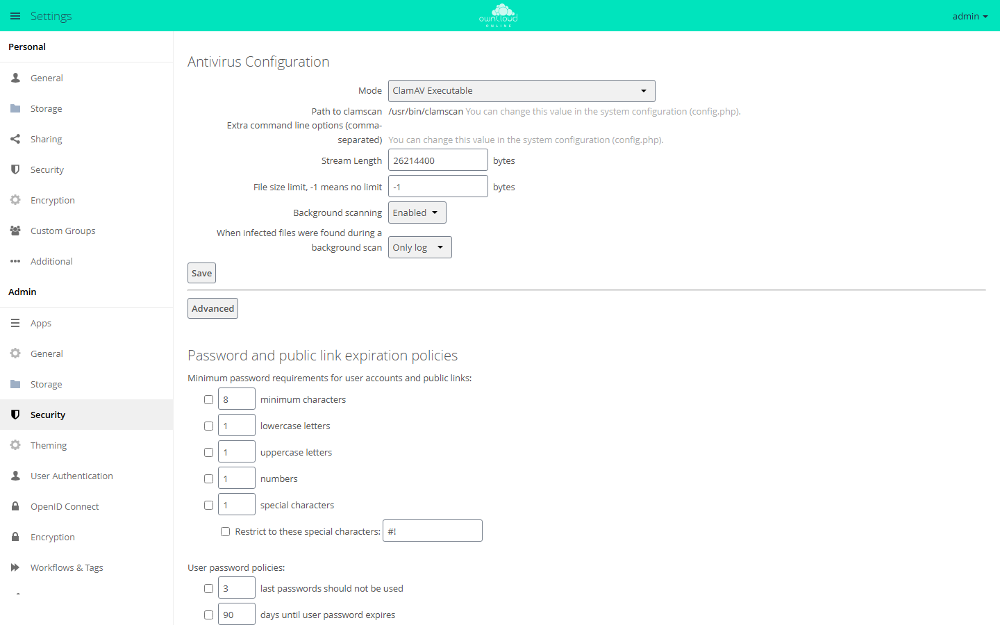

# Anti-Virus

The `files_antivirus` app has a virus scanner check every uploaded file before
owncloud.online stores it. If the scanner reports malware, the app rejects the
upload. A background job also checks files that are already stored. The app
is useful wherever files arrive from outside sources, for example through
public links or from guests.

!!! note "Availability"
    Listed in the Marketplace, no API key needed. App ID `files_antivirus`,
    version 1.3.11. Name in the Market: "Anti-Virus".

## Requirements

| Area | Requirement |
| --- | --- |
| owncloud.online | 11.x |
| PHP | 8.4 or later |
| Virus scanner | ClamAV, either as the `clamd` service (TCP or Unix socket) or as the `clamscan` program |
| Cron | for checking stored files, see [Background jobs (cron)](../../administration/background-jobs.en.md) |

For production, use `clamd`. The service keeps the signatures in memory.
`clamscan` loads them again for every file, which slows down every upload
noticeably.

On Debian and Ubuntu, the `clamav-daemon` package installs the `clamd` service
and automatic signature updates:

```bash
sudo apt install clamav-daemon
sudo systemctl status clamav-daemon
```

Right after the installation, the service starts only once `freshclam` has
downloaded the signatures. If `systemctl status` still reports it as inactive,
wait a few minutes and then start it with `sudo systemctl start clamav-daemon`.

The web server user (usually `www-data`) must be allowed to open the service's
socket.

## Installation

Install ClamAV before the app. The app then finds the scanner on its own:
during installation it tries `localhost:3310` (TCP) first, then the socket
`/var/run/clamav/clamd.ctl`, and otherwise stays on "ClamAV Executable". This
check runs only once. If `clamd` was not running at that time, set the mode by
hand afterwards (see "Configuration").

In the web interface: open **Market** from the app menu in the top left, go to
the "Anti-Virus" app, and click **Install**.

On the command line:

```bash
sudo -u www-data php8.4 occ market:install files_antivirus
```

`market:install` downloads, installs, and enables the app. If the app is
already present but disabled, run
`sudo -u www-data php8.4 occ app:enable files_antivirus`.

## Configuration

The settings are under **Settings → Admin → Security**, in the "Antivirus
Configuration" section. **Save** stores the values and immediately runs a test
scan with the EICAR test file, a harmless file that every scanner reports as
infected. If the scanner does not detect it, the page shows "Test scan was
unsuccessful. Please recheck antivirus settings."

<figure markdown="span">
  
  <figcaption>Under "Antivirus Configuration" you choose the mode and what happens with infected files. The path to clamscan is set in config.php.</figcaption>
</figure>

| Field | Key | Default | Meaning |
| --- | --- | --- | --- |
| Mode | `av_mode` | `executable` | "ClamAV Daemon (Unix Socket)" (`socket`), "ClamAV Daemon (TCP Socket)" (`daemon`), or "ClamAV Executable" (`executable`) |
| Socket | `av_socket` | `/var/run/clamav/clamd.ctl` | socket of `clamd`, `socket` mode only |
| Host, Port | `av_host`, `av_port` | `localhost`, `3310` | address of `clamd`, `daemon` mode only |
| Stream Length | `av_stream_max_length` | `26214400` | bytes per connection to the scanner; must not be larger than `StreamMaxLength` in `clamd.conf` |
| File size limit, -1 means no limit | `av_max_file_size` | `-1` | limit in bytes; the app does not scan larger uploads |
| Background scanning | `av_scan_background` | `true` | "Enabled" or "Disabled" |
| When infected files were found during a background scan | `av_infected_action` | `only_log` | "Only log" (`only_log`) or "Delete file" (`delete`) |

The keys are app values of the `files_antivirus` app. On the command line, for
example for socket mode:

```bash
sudo -u www-data php8.4 occ config:app:set files_antivirus av_mode --value socket
sudo -u www-data php8.4 occ config:app:set files_antivirus av_socket --value /var/run/clamav/clamd.ctl
```

The test scan runs only when you save in the web interface, not after
`config:app:set`.

Two values live only in `config/config.php`. The web interface shows them
("Path to clamscan", "Extra command line options (comma-separated)") but cannot
change them:

```php
'files_antivirus.av_path' => '/usr/bin/clamscan',
'files_antivirus.av_cmd_options' => '',
```

`av_cmd_options` takes several options separated by commas.

### Rules

**Advanced** → "Rules" defines how the app interprets the scanner's response: in
"ClamAV Executable" mode by the exit status of `clamscan`, in the daemon modes
by the output of `clamd`. Each rule maps a value to a status: "Clean",
"Infected", or "Unchecked". The shipped rules fit ClamAV. If they were changed
by mistake, **Reset to defaults** restores them.

## Usage

Users notice the app only when an upload is rejected:

| Situation | Message |
| --- | --- |
| The scanner reports malware. | "Virus %s is detected in the file. Upload cannot be completed." |
| The scan returns no result. | "The file could not be checked for viruses. Upload cannot be completed, please try again." |
| The scanner cannot be reached. | "Either the antivirus app is misconfigured or the external antivirus service is not accessible. …" |

If the `activity` app is enabled, the owner also sees the entry "File %s is
infected with %s".

## What happens when a file is infected

| Case | Reaction |
| --- | --- |
| Upload by a logged-in account | upload rejected, written parts deleted, warning in the log with the virus name, account, and path, activity entry |
| Upload through a public link | upload rejected before anything is written; warning in the log, no activity entry |
| Background scan with "Only log" | file stays in place; log entry "File is infected." and activity entry, again on every run |
| Background scan with "Delete file" | file is deleted; log entry "Infected file deleted." and activity entry |

"When infected files were found during a background scan" does not apply to
uploads. An infected upload is always rejected.

## Limits and notes

- **A scanner outage blocks uploads.** If the scanner cannot be reached or
  stops in the middle of a scan, the app rejects the upload. This also affects
  saving in the text editor and generating previews. Monitor `clamd` like the
  web server.
- **Size limit.** The app stores uploads above `av_max_file_size` without
  scanning them. For uploads through public links, it scans only the
  beginning, up to this limit. The background scan skips larger files.
- **Chunked uploads.** The app does not scan the single chunks but the
  assembled file.
- **Background scan.** The job runs at most every 15 minutes and checks 10
  files per run, about 960 per day, so a large number of existing files takes a
  long time. A changed file is scanned again because its ETag changes. The job
  checks only files in the accounts' home storage, not external storage, and
  skips empty files and folders.
- **Infected files left in place with "Only log"** are scanned again on every
  run, and each time the app writes a log entry and an activity entry. Since
  the job handles only 10 files per run, such files slow down the scan of the
  remaining files; with ten or more of them, the background scan can stop
  making progress altogether. Remove reported files promptly or choose
  "Delete file".
- **S3 primary storage.** An object store has no partial files. If the new
  version of an existing file is rejected, the app removes the file itself,
  bypassing the trash bin. The file is missing until it is uploaded again.
- **Calendars and contacts** are stored in the database and are not scanned.
- **ICAP.** The "Mode" list also contains three ICAP modes. They require a
  license key that owncloud.online does not offer. Without a valid license,
  they work for 24 hours at most; after that, the app runs in "ClamAV
  Executable" mode. If `clamscan` is not installed, every upload then fails.
  Use ClamAV.
- **Moving to another server.** Mode, addresses, and rules come along with the
  database. If they point to a scanner that the new server cannot reach, every
  upload fails. Check the settings right after the move. The app does not take
  over `av_path` and `av_cmd_options` from very old databases; add them to
  `config/config.php` yourself if you need them.

More on modes, background scanning, and upload speed:
[Virus scanning](../../administration/antivirus.en.md).

## Troubleshooting

The app writes to the server log with the app ID `files_antivirus`. File sizes,
reasons for skipped scans, and scanner responses appear only at the debug level:

```bash
sudo -u www-data php8.4 occ log:manage --level debug
```

Set the level back afterwards, see
[Server log and error messages](../../administration/logging.en.md).

| Symptom | Cause | Fix |
| --- | --- | --- |
| "Test scan was unsuccessful. Please recheck antivirus settings." | The scanner cannot be reached or does not detect the EICAR file. | Check that `clamd` is running, that the socket or host and port are correct, and that signatures are loaded |
| Log: "Could not connect to socket …" or "Could not connect to host …" | `clamd` is not running, or the web server user is not allowed to open the socket. | Start the service, check the socket permissions |
| Log: "Unexpected response to ping …" or "Unexpected response to version …" | No ClamAV service answers at that address. | Correct the socket path or host and port |
| Log: "The antivirus executable could not be found at path …" | `files_antivirus.av_path` points nowhere. | Correct the path in `config/config.php` |
| Log: "Failed to write a chunk. Check if Stream Length matches StreamMaxLength in ClamAV daemon settings" | Stream Length is larger than `StreamMaxLength` of `clamd`. | Align both values |
| Log: "No matching rules. Please check antivirus rules." | The rules are empty or changed. | **Advanced** → **Reset to defaults** |
| Log: "No valid license found for icap scanner …" | An ICAP mode is selected. | Select a ClamAV mode |
| Debug log: "Scanning is skipped." | The file is larger than the file size limit, or a single chunk of a chunked upload arrives. | Raise the limit or set `-1`; for chunked uploads this is normal, the assembled file is scanned |
