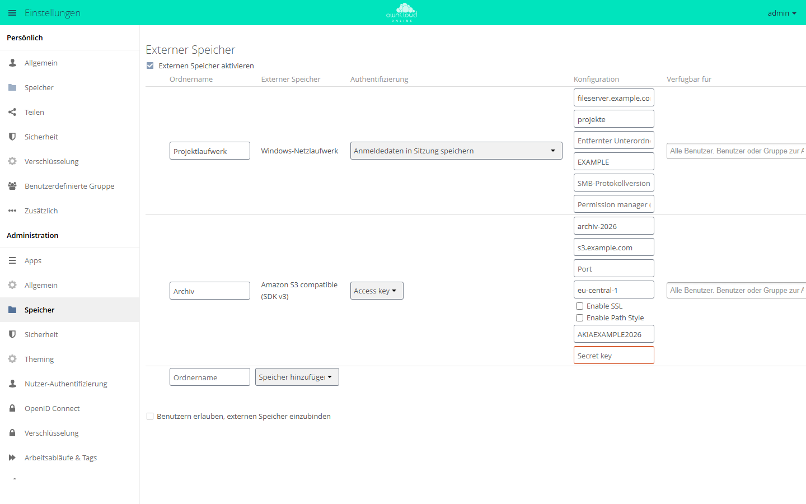

# External Storage: S3

!!! note "Öffentlich im Marktplatz"
    Die App ist ohne API-Schlüssel im Marktplatz sichtbar und lässt sich direkt
    über den Markt installieren. Diese Seite beschreibt Version 2.2.1.

Die App bindet einen Bucket aus Amazon S3 oder einem S3-kompatiblen
Objektspeicher als Ordner in die Dateiansicht ein. Die Dateien bleiben im
Bucket. Zugriff, Freigaben und Synchronisation laufen über owncloud.online.
Jeden Einhängepunkt richten Sie in der Oberfläche oder mit `occ` ein,
`config.php` bleibt unverändert.

Soll S3 alle Dateien der Instanz aufnehmen statt nur einzelner Ordner, ist
[S3 Primary Object Storage](files_primary_s3.md) die passende App.

## Voraussetzungen {#voraussetzungen}

| Komponente | Anforderung |
| --- | --- |
| owncloud.online | 11.x |
| PHP | 8.4 oder neuer |
| Kern-App | `files_external`, eingeschaltet |
| Objektspeicher | Amazon S3 oder S3-kompatibel, zum Beispiel MinIO oder Ceph RGW |
| Netz | Der Server erreicht den Endpunkt des Objektspeichers |
| Zugangsdaten | Access Key und Secret Key für den Bucket |

## Installation {#installation}

Im App-Menü **Markt** öffnen, *External Storage: S3* suchen und *Installieren*
wählen. Auf der Kommandozeile, im Installationsverzeichnis von owncloud.online:

```bash
# Kern-App für externe Speicher einschalten
sudo -u www-data php8.4 occ app:enable files_external

# App aus dem Marktplatz installieren, dabei wird sie eingeschaltet
sudo -u www-data php8.4 occ market:install files_external_s3

# nur nötig, wenn die App schon vorhanden, aber ausgeschaltet ist
sudo -u www-data php8.4 occ app:enable files_external_s3
```

Externe Speicher müssen außerdem eingeschaltet sein. Das ist das Häkchen
*Externen Speicher aktivieren* unter **Einstellungen → Administration →
Speicher** oder dieser Befehl:

```bash
sudo -u www-data php8.4 occ config:app:set core enable_external_storage --value yes
```

## Einrichtung {#einrichtung}

### In der Oberfläche

1. **Einstellungen → Administration → Speicher** öffnen, Abschnitt *Externer
   Speicher*.
2. Unter *Ordnername* den Namen eintragen, unter dem der Bucket in der
   Dateiansicht erscheint.
3. Bei *Speicher hinzufügen* den Eintrag *Amazon S3 compatible (SDK v3)*
   wählen. Als Authentifizierung steht *Access key* fest.
4. Die Felder unter *Konfiguration* ausfüllen, siehe Tabelle.
5. Unter *Verfügbar für* Konten oder Gruppen eintragen. Bleibt das Feld leer,
   gilt der Speicher für alle Konten.

Die App bringt keine Übersetzungen mit. Die Feldnamen erscheinen deshalb auch
in der deutschen Oberfläche auf Englisch.

| Feld | Pflicht | Bedeutung | Vorgabe |
| --- | --- | --- | --- |
| *Bucket* | ja | Name des Buckets | – |
| *Hostname* | nein | Hostname des Endpunkts, ohne `https://` und ohne Pfad, zum Beispiel `s3.example.com` | `s3.amazonaws.com` |
| *Port* | nein | Port des Endpunkts | 443 mit SSL, 80 ohne |
| *Region* | nein | Region des Buckets | `eu-west-1` |
| *Enable SSL* | nein | Verbindung über HTTPS | aus |
| *Enable Path Style* | nein | Adressen der Form `host/bucket` statt `bucket.host`. MinIO und Ceph brauchen das meist | aus |
| *Access key* | ja | Access Key ID | – |
| *Secret key* | ja | Secret Access Key | – |

*Enable SSL* ist nicht vorbelegt. Ohne Häkchen spricht der Server den
Objektspeicher unverschlüsselt über HTTP an, ohne Portangabe auf Port 80.
Setzen Sie das Häkchen für Amazon S3 und für jeden Endpunkt, der HTTPS
spricht.

Fehlt der Bucket, legt die App ihn beim ersten Zugriff an. Dafür braucht der
Schlüssel das Recht, Buckets anzulegen. Hat er es nicht, legen Sie den Bucket
vorher beim Anbieter an.



*Die Art des Speichers wählen Sie unter „Speicher hinzufügen“. Jede Art hat
eigene Felder, rot markiert sind leere Pflichtfelder.*

Über das Zahnrad am Ende der Zeile öffnen sich die *Erweiterten
Einstellungen*. Zwei davon sind für S3 wichtig:

| Option | Vorgabe | Hinweis |
| --- | --- | --- |
| *Freigaben einschalten* | aus | Ohne Häkchen können Anwender Dateien aus dem Bucket nicht teilen |
| *Auf Änderungen überprüfen* | *Einmal bei jedem Direktzugriff* | Schreibt nur owncloud.online in den Bucket, spart die Einstellung *Nie* Anfragen an den Speicher |

### Mit occ

Einhängepunkt anlegen. Der Befehl gibt die ID des neuen Speichers aus:

```bash
sudo -u www-data php8.4 occ files_external:create /Archiv files_external_s3 amazons3::accesskey \
  -c bucket=archiv-2026 \
  -c hostname=s3.example.com \
  -c region=eu-central-1 \
  -c use_ssl=true \
  -c use_path_style=true \
  -c key=<ACCESS_KEY> \
  -c secret=<SECRET_KEY>
```

Der Secret Key landet so in der Shell-Historie. Wer das vermeiden will, trägt
ihn in der Oberfläche ein.

Werte ändern und die Verbindung prüfen. `3` steht hier für die ID aus
`files_external:list`:

```bash
sudo -u www-data php8.4 occ files_external:list
sudo -u www-data php8.4 occ files_external:config 3 port 9000
sudo -u www-data php8.4 occ files_external:config 3 use_path_style true
sudo -u www-data php8.4 occ files_external:verify 3
```

Konten, Gruppen und Einhängeoptionen setzen Sie wie bei jedem externen
Speicher mit `files_external:applicable` und `files_external:option`. Alle
Befehle stehen unter [Externe Speicher](../../administration/external-storage.md).

### Speicher durch Anwender einbinden lassen

Setzen Sie unter **Einstellungen → Administration → Speicher** das Häkchen
*Benutzern erlauben, externen Speicher einzubinden* und haken Sie darunter
*Amazon S3 compatible (SDK v3)* an. Anwender finden dasselbe Formular dann
unter **Einstellungen → Persönlich → Speicher**.

## Nutzung {#nutzung}

Der Bucket erscheint als Ordner in der Dateiansicht und unter *Externer
Speicher* in der linken Leiste. Anwender laden Dateien hoch und herunter,
verschieben, löschen und synchronisieren sie wie in jedem anderen Ordner.
Teilen geht nur, wenn der Administrator *Freigaben einschalten* gesetzt hat.

## Grenzen und Hinweise {#grenzen}

- Ordner gibt es in S3 nicht. Die App legt dafür leere Objekte an, deren Name
  auf `/` endet. Löscht jemand einen Ordner, entfernt die App alle Objekte
  unter diesem Präfix, in Stapeln. Bei Ordnern mit vielen Objekten dauert das
  entsprechend.
- Die interne Speicher-ID bildet die App nur aus dem Bucket-Namen
  (`amazon::<bucket>`). Zwei Einbindungen mit gleichem Bucket-Namen teilen
  sich deshalb einen Dateicache, auch wenn sie auf verschiedene Dienste
  zeigen. Geben Sie jedem eingebundenen Bucket einen eigenen Namen.
- Für Vorschaubilder lädt der Server die Datei aus dem Bucket. Bei vielen
  großen Bildern kann es sinnvoll sein, *Vorschau aktivieren* in den
  erweiterten Einstellungen abzuschalten.

## Fehlersuche {#fehlersuche}

| Symptom | Ursache | Abhilfe |
| --- | --- | --- |
| *Amazon S3 compatible (SDK v3)* fehlt bei *Speicher hinzufügen* | `files_external` oder `files_external_s3` ausgeschaltet | `occ app:enable files_external`, dann `occ app:enable files_external_s3` |
| Rotes Statussymbol am Anfang der Zeile | Schlüssel, Bucket oder Endpunkt falsch, oder der Server erreicht den Endpunkt nicht | Mauszeiger auf das Symbol halten, der Tooltip nennt den Fehler. Ein Klick auf das Symbol prüft erneut. Außerdem `occ files_external:verify <id>` und die Verbindung vom Server zum Endpunkt prüfen |
| `Creation of bucket failed` im Serverprotokoll | Die App fragt den Bucket beim Verbinden ab. Scheitert das, hält sie ihn für nicht vorhanden und versucht ihn anzulegen. Häufige Gründe: Access Key oder Secret Key falsch, dem Schlüssel fehlt das Recht `s3:ListBucket` für den Bucket, oder der Bucket fehlt wirklich und der Schlüssel darf keine Buckets anlegen | Schlüssel und Rechte prüfen. Fehlt der Bucket, ihn beim Anbieter anlegen |
| Ordner bleibt leer | Bei MinIO oder Ceph fehlt *Enable Path Style*, oder *Hostname* und *Port* passen nicht zum Endpunkt | *Enable Path Style* setzen, Hostname und Port prüfen |
| TLS-Fehler | Endpunkt spricht nur HTTP, oder sein Zertifikat ist ungültig | *Enable SSL* abschalten und den Port anpassen, oder das Zertifikat des Endpunkts reparieren |

Verbindungsfehler stehen mit Ursache im Serverprotokoll, siehe
[Serverprotokoll und Fehlermeldungen](../../administration/logging.md).
