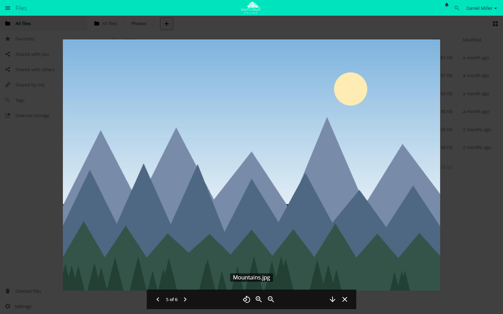

# Media Viewer

!!! note "Available on the Marketplace"
    The app is listed on the Marketplace without an API key and installs
    directly from the Market app. This page covers version 1.1.4.

The Media Viewer shows pictures and videos in the browser, full screen, with
paging, rotating, zooming, and video controls. It works in the file list and
in public links to folders. Pictures come from the server's preview
generation. Videos play straight from storage in the browser.

## Requirements {#voraussetzungen}

| Component | Requirement |
| --- | --- |
| owncloud.online | 11.0 to 11.99 |
| PHP | 8.4 or later. For PNG, JPEG, WebP, GIF, BMP, and X-Bitmap, the `gd` extension is enough as long as the picture is at most 6016 pixels wide and high |
| `imagick` | for SVG, TIFF, HEIC/HEIF, and SGI, and for photos wider or taller than 6016 pixels |
| Previews | turned on (`enable_previews`, default `true`). Without previews, every picture stays blank |
| `ffmpeg` or `avconv` | only for video thumbnails in the file list, not for playback |
| Browser | must be able to play the video codec |

## Installation {#installation}

Open **Market** from the app menu, search for *Media Viewer*, and click
*Install*. On the command line:

```bash
# install the app from the Marketplace; this also enables it
sudo -u www-data php8.4 occ market:install files_mediaviewer

# only needed if the app is present but disabled
sudo -u www-data php8.4 occ app:enable files_mediaviewer
```

## Setup {#einrichtung}

The app has no settings page and no keys of its own. The preview settings in
`config/config.php` control what it can show:

| Key | Default | Effect |
| --- | --- | --- |
| `enable_previews` | `true` | `false` turns previews off. Every picture then stays blank |
| `enabledPreviewProviders` | see below | Active preview providers. They decide which picture types the viewer offers |
| `preview_max_x` | `2048` | Maximum preview width in pixels |
| `preview_max_y` | `2048` | Maximum preview height in pixels |
| `preview_max_scale_factor` | `2` | How much small pictures are scaled up. `1` turns scaling up off |

Without an entry of your own, these providers are active: `OC\Preview\MarkDown`,
`OC\Preview\MP3`, `OC\Preview\TXT`, `OC\Preview\PNG`, `OC\Preview\JPEG`,
`OC\Preview\WEBP`, `OC\Preview\GIF`, `OC\Preview\BMP`, `OC\Preview\Heic`,
`OC\Preview\XBitmap`, and `OC\Preview\SGI`.

If you set `enabledPreviewProviders` yourself, your list replaces the default
completely. So include the providers you want to keep. This example keeps all
default providers and adds SVG and TIFF:

```php
'enable_previews' => true,
'enabledPreviewProviders' => [
    'OC\\Preview\\MarkDown',
    'OC\\Preview\\MP3',
    'OC\\Preview\\TXT',
    'OC\\Preview\\PNG',
    'OC\\Preview\\JPEG',
    'OC\\Preview\\WEBP',
    'OC\\Preview\\GIF',
    'OC\\Preview\\BMP',
    'OC\\Preview\\Heic',
    'OC\\Preview\\XBitmap',
    'OC\\Preview\\SGI',
    'OC\\Preview\\SVG',
    'OC\\Preview\\TIFF',
],
```

Video thumbnails in the file list also need the `OC\Preview\Movie` provider
and `ffmpeg` or `avconv` on the server. This has no effect on playback in the
viewer.

The browser receives the list of supported types when the page loads. After a
change, reload the Files app.

### Supported formats

| Kind | Types |
| --- | --- |
| Video | `video/mp4`, `video/webm`, `video/ogg`, `video/quicktime`. MP4 is the most reliable, the others depend on the browser |
| Picture | every `image/…` type with an active preview provider |

A video gets the viewer action only if the browser can play its type.
Otherwise, clicking the file downloads it.

## Usage {#nutzung}

Click a picture or video to open the viewer. In the file's *…* menu, the entry
is *Open in Media Viewer*. The viewer shows all matching files of the folder
one after another:

- Move between files with the arrow buttons, by swiping, or with the left and
  right arrow keys. `Esc` closes the viewer.
- Pictures: rotate in 90-degree steps, zoom in, zoom out, download.
- Videos: play, replay from the start, mute, full screen, jump to a position
  on the progress bar.



*The Media Viewer shows the pictures in a folder one after another. Open it
with "…" and "Open in Media Viewer".*

## Limits and notes {#grenzen}

- **Together with Gallery:** Media Viewer and [Gallery](gallery.en.md) both
  register as the default action for pictures. If both are enabled, clicking a
  picture usually opens the Gallery slideshow, because Gallery registers its
  action later. Users then reach the Media Viewer with *…* and
  *Open in Media Viewer*. Videos still open in the Media Viewer.
- The viewer does not load pictures in their original size but as previews.
  Depending on the window width, it requests 1024 to 3840 pixels, and
  `preview_max_x` and `preview_max_y` cap this at 2048. For sharper pictures on
  large screens, raise both values.
- Pictures larger than 50 MB (`preview_max_filesize_image`) get no preview and
  therefore stay blank in the viewer.
- Videos are not converted. If the browser cannot play a codec, the only fix is
  to convert the file to MP4 (H.264/AAC).

## Troubleshooting {#fehlersuche}

| Symptom | Cause | Fix |
| --- | --- | --- |
| Clicking a picture downloads the file | No preview provider is active for the MIME type, so the app offers no action | Add the provider to `enabledPreviewProviders`, install `imagick` if needed, reload the page |
| The picture stays blank, "Failed to load image data" | The preview does not respond, for example because `enable_previews` is `false` or no preview can be created for the file | Check `enable_previews` and the provider list, then the server log |
| A video has no viewer action and clicking downloads it | The browser cannot play the codec, or the type is not one of the four video types | Convert the file to MP4 (H.264/AAC) or use a browser with a suitable codec |
| The video does not start, "Failed to load video data" | Fetching the file directly fails, for example because a proxy does not support range requests or read permission is missing | Check the proxy configuration and the share permissions |
| Large photos stay blank, smaller ones show up | The picture is wider or taller than 6016 pixels and `imagick` is missing, or the file is larger than 50 MB | Install `imagick`. For larger files, raise `preview_max_filesize_image` in `config/config.php` (value in MB, `-1` for no limit) |
| Pictures look blurry | Previews are capped at 2048 pixels, small originals are scaled up | Raise `preview_max_x` and `preview_max_y`, set `preview_max_scale_factor` to `1` |
