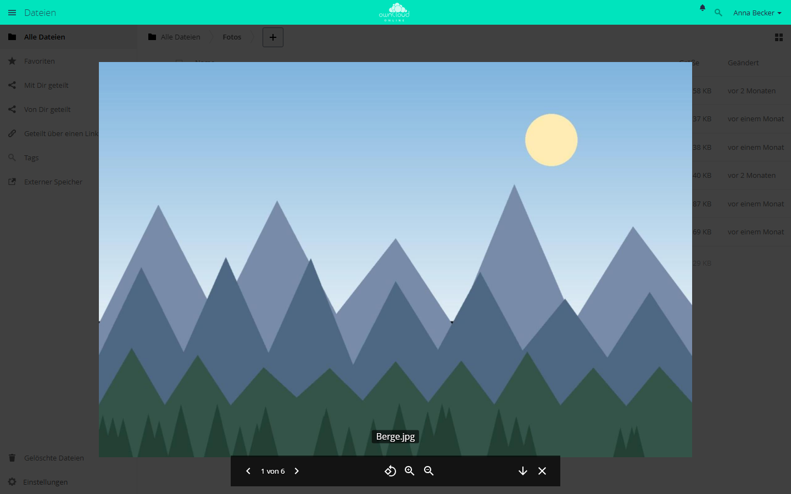

# Media Viewer

!!! note "Öffentlich im Marktplatz"
    Die App ist ohne API-Schlüssel im Marktplatz sichtbar und lässt sich direkt
    über den Markt installieren. Diese Seite beschreibt Version 1.1.4.

Der Media Viewer zeigt Bilder und Videos im Browser an, als Vollbild mit
Blättern, Drehen, Zoomen und Video-Steuerung. Er arbeitet in der Dateiliste
und in öffentlichen Links auf Ordner. Bilder kommen aus der Vorschau des
Servers, Videos spielt der Browser direkt aus dem Speicher ab.

## Voraussetzungen {#voraussetzungen}

| Komponente | Anforderung |
| --- | --- |
| owncloud.online | 11.0 bis 11.99 |
| PHP | 8.4 oder neuer. Für PNG, JPEG, WebP, GIF, BMP und X-Bitmap genügt die Erweiterung `gd`, solange das Bild höchstens 6016 Pixel breit und hoch ist |
| `imagick` | für SVG, TIFF, HEIC/HEIF und SGI sowie für Fotos, die breiter oder höher als 6016 Pixel sind |
| Vorschau | eingeschaltet (`enable_previews`, Vorgabe `true`). Ohne Vorschau bleibt jedes Bild leer |
| `ffmpeg` oder `avconv` | nur für Vorschaubilder von Videos in der Dateiliste, nicht für die Wiedergabe |
| Browser | muss den Video-Codec abspielen können |

## Installation {#installation}

Im App-Menü **Markt** öffnen, *Media Viewer* suchen und *Installieren* wählen.
Auf der Kommandozeile:

```bash
# App aus dem Marktplatz installieren, dabei wird sie eingeschaltet
sudo -u www-data php8.4 occ market:install files_mediaviewer

# nur nötig, wenn die App schon vorhanden, aber ausgeschaltet ist
sudo -u www-data php8.4 occ app:enable files_mediaviewer
```

## Einrichtung {#einrichtung}

Die App hat keine Einstellungsseite und keine eigenen Schlüssel. Was sie
anzeigen kann, steuern die Vorschau-Einstellungen in `config/config.php`:

| Schlüssel | Vorgabe | Wirkung |
| --- | --- | --- |
| `enable_previews` | `true` | `false` schaltet die Vorschau ab. Dann bleibt jedes Bild leer |
| `enabledPreviewProviders` | siehe unten | aktive Vorschau-Anbieter. Sie bestimmen, welche Bildtypen der Viewer anbietet |
| `preview_max_x` | `2048` | größte Breite einer Vorschau in Pixeln |
| `preview_max_y` | `2048` | größte Höhe einer Vorschau in Pixeln |
| `preview_max_scale_factor` | `2` | wie stark kleine Bilder hochgerechnet werden. `1` schaltet das Hochrechnen ab |

Ohne eigenen Eintrag sind diese Anbieter aktiv: `OC\Preview\MarkDown`,
`OC\Preview\MP3`, `OC\Preview\TXT`, `OC\Preview\PNG`, `OC\Preview\JPEG`,
`OC\Preview\WEBP`, `OC\Preview\GIF`, `OC\Preview\BMP`, `OC\Preview\Heic`,
`OC\Preview\XBitmap` und `OC\Preview\SGI`.

Setzen Sie `enabledPreviewProviders` selbst, ersetzt Ihre Liste die Vorgabe
vollständig. Nehmen Sie deshalb auch die Anbieter auf, die Sie behalten wollen.
Dieses Beispiel behält alle Anbieter der Vorgabe und ergänzt SVG und TIFF:

```php
'enable_previews' => true,
'enabledPreviewProviders' => [
    'OC\\Preview\\MarkDown',
    'OC\\Preview\\MP3',
    'OC\\Preview\\TXT',
    'OC\\Preview\\PNG',
    'OC\\Preview\\JPEG',
    'OC\\Preview\\WEBP',
    'OC\\Preview\\GIF',
    'OC\\Preview\\BMP',
    'OC\\Preview\\Heic',
    'OC\\Preview\\XBitmap',
    'OC\\Preview\\SGI',
    'OC\\Preview\\SVG',
    'OC\\Preview\\TIFF',
],
```

Vorschaubilder von Videos in der Dateiliste brauchen zusätzlich den Anbieter
`OC\Preview\Movie` und `ffmpeg` oder `avconv` auf dem Server. Auf die
Wiedergabe im Viewer hat das keinen Einfluss.

Die Liste der anzeigbaren Typen bekommt der Browser beim Laden der Seite. Nach
einer Änderung laden Sie die Dateiansicht neu.

### Unterstützte Formate

| Art | Typen |
| --- | --- |
| Video | `video/mp4`, `video/webm`, `video/ogg`, `video/quicktime`. MP4 läuft am zuverlässigsten, die anderen hängen vom Browser ab |
| Bild | alle `image/…`-Typen, für die ein Vorschau-Anbieter aktiv ist |

Ein Video bekommt nur dann die Aktion des Viewers, wenn der Browser den Typ
abspielen kann. Sonst lädt ein Klick die Datei herunter.

## Nutzung {#nutzung}

Ein Klick auf ein Bild oder Video öffnet den Viewer. Im Menü *…* der Datei
heißt der Eintrag *Mit Media Viewer öffnen*. Der Viewer zeigt alle passenden
Dateien des Ordners nacheinander:

- Blättern über die Pfeile, per Wischgeste oder mit den Pfeiltasten. `Esc`
  schließt den Viewer.
- Bilder: drehen in Schritten von 90 Grad, vergrößern, verkleinern,
  herunterladen.
- Videos: abspielen, von vorn beginnen, Ton aus, Vollbild, Sprung über die
  Fortschrittsleiste.



*Der Media Viewer zeigt die Bilder eines Ordners nacheinander. Sie öffnen ihn
über „…“ und „Mit Media Viewer öffnen“.*

## Grenzen und Hinweise {#grenzen}

- **Zusammen mit der Galerie:** Media Viewer und [Galerie](gallery.md) tragen
  sich beide als Standardaktion für Bilder ein. Sind beide eingeschaltet,
  öffnet ein Klick auf ein Bild in der Regel die Diashow der Galerie, weil
  diese ihre Aktion später einträgt. Den Media Viewer erreichen Sie dann über
  *…* und *Mit Media Viewer öffnen*. Videos öffnet weiter der Media Viewer.
- Bilder lädt der Viewer nicht im Original, sondern als Vorschau. Er fordert je
  nach Fensterbreite 1024 bis 3840 Pixel an, `preview_max_x` und
  `preview_max_y` begrenzen auf 2048. Für schärfere Bilder auf großen
  Bildschirmen erhöhen Sie beide Werte.
- Bilder über 50 MB (`preview_max_filesize_image`) bekommen keine Vorschau
  und bleiben deshalb im Viewer leer.
- Videos werden nicht umgewandelt. Spielt der Browser einen Codec nicht ab,
  hilft nur eine Umwandlung nach MP4 (H.264/AAC).

## Fehlersuche {#fehlersuche}

| Symptom | Ursache | Abhilfe |
| --- | --- | --- |
| Klick auf ein Bild lädt die Datei herunter | Für den MIME-Typ ist kein Vorschau-Anbieter aktiv, deshalb bietet die App keine Aktion an | Anbieter in `enabledPreviewProviders` eintragen, gegebenenfalls `imagick` installieren, Seite neu laden |
| Bild bleibt leer, Meldung „Failed to load image data“ | Die Vorschau antwortet nicht, etwa weil `enable_previews` auf `false` steht oder sich für die Datei keine Vorschau erzeugen lässt | `enable_previews` und die Anbieterliste prüfen, dann das Serverprotokoll |
| Video hat keine Aktion des Viewers, ein Klick lädt es herunter | Der Browser kann den Codec nicht abspielen, oder der Typ gehört nicht zu den vier Videotypen | Datei nach MP4 (H.264/AAC) umwandeln oder einen Browser mit passendem Codec verwenden |
| Video startet nicht, Meldung „Failed to load video data“ | Der direkte Abruf der Datei schlägt fehl, etwa weil ein Proxy keine Teilabrufe (Range) unterstützt oder Leserechte fehlen | Proxy-Konfiguration und Rechte der Freigabe prüfen |
| Große Fotos bleiben leer, kleinere werden angezeigt | Das Bild ist breiter oder höher als 6016 Pixel und `imagick` fehlt, oder die Datei ist größer als 50 MB | `imagick` installieren. Für größere Dateien `preview_max_filesize_image` in `config/config.php` erhöhen (Wert in MB, `-1` ohne Grenze) |
| Bilder wirken unscharf | Vorschau auf 2048 Pixel begrenzt, kleine Vorlagen werden hochgerechnet | `preview_max_x` und `preview_max_y` erhöhen, `preview_max_scale_factor` auf `1` setzen |
