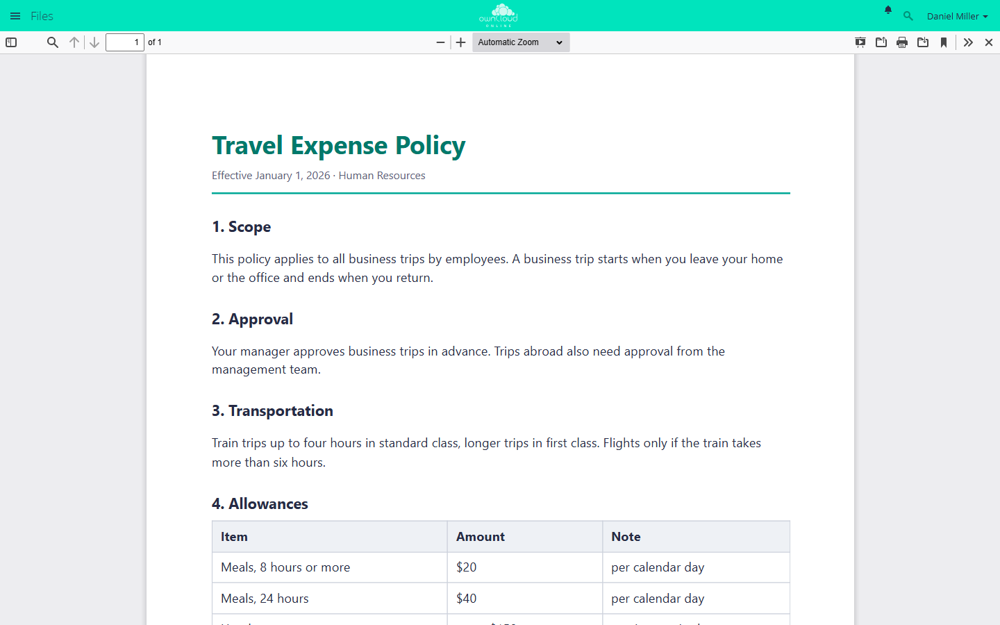

# PDF Viewer

!!! note "Available on the Marketplace"
    The app is listed on the Marketplace without an API key and installs
    directly from the Market app. This page covers version 1.1.2.

The PDF Viewer shows PDF files in the browser instead of downloading them. This
works in the file list and for PDF files shared through a public link. The
viewer is based on PDF.js. Everything runs in the browser, and the file is not
sent to any outside service.

## Requirements {#voraussetzungen}

| Component | Requirement |
| --- | --- |
| owncloud.online | 11.0 to 11.99 |
| PHP | 8.4 or later |
| Browser | A current browser. Internet Explorer and the old, pre-Chromium Edge are not supported |

## Installation {#installation}

Open **Market** from the app menu, search for *PDF Viewer*, and click
*Install*. On the command line:

```bash
# install the app from the Marketplace; this also enables it
sudo -u www-data php8.4 occ market:install files_pdfviewer

# only needed if the app is present but disabled
sudo -u www-data php8.4 occ app:enable files_pdfviewer
```

## Setup {#einrichtung}

There is nothing to configure. If you do not want the viewer, disable the app.
PDF files are then downloaded again:

```bash
sudo -u www-data php8.4 occ app:disable files_pdfviewer
```

## Usage {#nutzung}

Click a PDF file to open the viewer. In the file's *…* menu, the entry is
*Open in PDF Viewer*. The bar at the top offers search in the document, page
navigation, zoom, printing, and download. The X on the far right closes the
viewer.

Recipients of a public link to a PDF file see the document in the browser,
without an account and without downloading it.



*Clicking a PDF file opens it in the browser. Close the viewer at the top
right.*

## Limits and notes {#grenzen}

- If a share does not allow downloads, the viewer does not open the file.
  Instead, it shows the note "This shared file does not have download
  permission …".
- In unsupported browsers, the app does not register itself. Clicking a PDF
  file then downloads it.

## Troubleshooting {#fehlersuche}

| Symptom | Cause | Fix |
| --- | --- | --- |
| The PDF is downloaded instead of shown | App disabled, browser not supported, or another app has taken over the default action for PDF | Check `occ app:list`, use a current browser, disable the competing app |
| Blank page in the viewer | Browser too old, or a browser security policy blocks the display | Use a current browser, check the messages in the browser console |
| "This shared file does not have download permission …" | The share does not allow downloads | Ask the file owner to allow downloads in the share |
