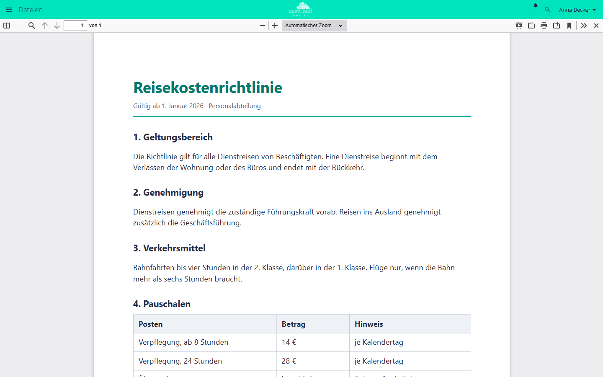

# PDF-Ansicht

!!! note "Öffentlich im Marktplatz"
    Die App ist ohne API-Schlüssel im Marktplatz sichtbar und lässt sich direkt
    über den Markt installieren. Im Markt heißt sie *PDF Viewer*. Diese Seite
    beschreibt Version 1.1.2.

Die PDF-Ansicht zeigt PDF-Dateien im Browser an, statt sie herunterzuladen.
Das gilt in der Dateiliste und für PDF-Dateien, die über einen öffentlichen
Link geteilt sind. Grundlage ist PDF.js. Die Anzeige läuft vollständig im
Browser, die Datei geht an keinen fremden Dienst.

## Voraussetzungen {#voraussetzungen}

| Komponente | Anforderung |
| --- | --- |
| owncloud.online | 11.0 bis 11.99 |
| PHP | 8.4 oder neuer |
| Browser | aktueller Browser. Internet Explorer und Edge in der alten Fassung vor dem Wechsel auf Chromium werden nicht unterstützt |

## Installation {#installation}

Im App-Menü **Markt** öffnen, *PDF Viewer* suchen und *Installieren* wählen.
Auf der Kommandozeile:

```bash
# App aus dem Marktplatz installieren, dabei wird sie eingeschaltet
sudo -u www-data php8.4 occ market:install files_pdfviewer

# nur nötig, wenn die App schon vorhanden, aber ausgeschaltet ist
sudo -u www-data php8.4 occ app:enable files_pdfviewer
```

## Einrichtung {#einrichtung}

Es gibt nichts einzustellen. Wer die Ansicht nicht möchte, schaltet die App
aus. PDF-Dateien werden dann wieder heruntergeladen:

```bash
sudo -u www-data php8.4 occ app:disable files_pdfviewer
```

## Nutzung {#nutzung}

Ein Klick auf eine PDF-Datei öffnet die Ansicht. Im Menü *…* der Datei heißt
der Eintrag *Mit PDF Viewer öffnen*. Die Leiste oben bietet Suche im Dokument,
Seitenwechsel, Zoom, Drucken und Herunterladen. Das Kreuz ganz rechts schließt
die Ansicht.

Empfänger eines öffentlichen Links auf eine PDF-Datei sehen das Dokument im
Browser, ohne Konto und ohne es herunterzuladen.



*Ein Klick auf eine PDF-Datei öffnet sie im Browser. Oben rechts schließen Sie
die Ansicht.*

## Grenzen und Hinweise {#grenzen}

- Hat eine Freigabe kein Download-Recht, öffnet die Ansicht die Datei nicht.
  Stattdessen erscheint der Hinweis „Diese freigegebene Datei hat keine
  Download-Berechtigung …“.
- In nicht unterstützten Browsern trägt sich die App nicht ein. Ein Klick lädt
  die PDF-Datei dann herunter.

## Fehlersuche {#fehlersuche}

| Symptom | Ursache | Abhilfe |
| --- | --- | --- |
| PDF wird heruntergeladen statt angezeigt | App ausgeschaltet, Browser nicht unterstützt, oder eine andere App hat die Standardaktion für PDF übernommen | `occ app:list` prüfen, aktuellen Browser verwenden, konkurrierende App ausschalten |
| Leere Seite in der Ansicht | Browser zu alt, oder eine Sicherheitsrichtlinie des Browsers blockiert die Anzeige | aktuellen Browser verwenden, Meldungen in der Konsole des Browsers prüfen |
| „Diese freigegebene Datei hat keine Download-Berechtigung …“ | Die Freigabe erlaubt kein Herunterladen | Den Besitzer der Datei bitten, das Herunterladen in der Freigabe zu erlauben |
