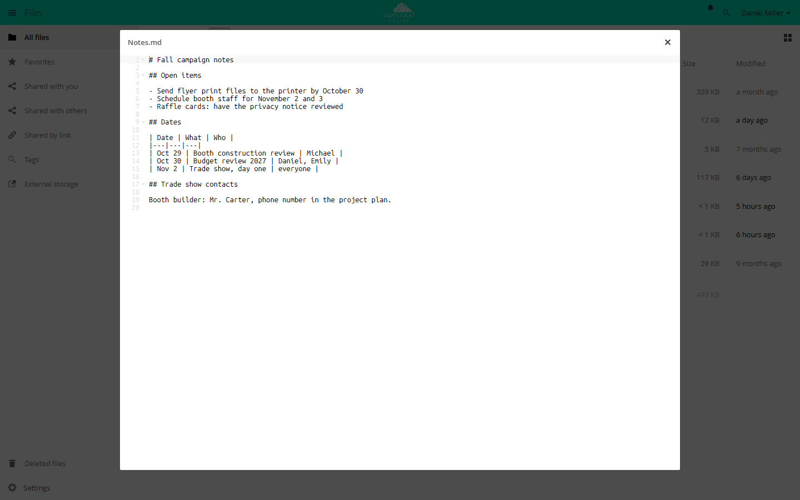

# Text Editor

!!! note "Available on the Marketplace"
    The app is listed on the Marketplace without an API key and installs
    directly from the Market app. This page covers version 2.7.3.

The Text Editor opens text files right in the browser and saves changes back to
the file. Users create new text files from the *+* menu of the file list. The
editor is based on Ace and highlights syntax.

## Requirements {#voraussetzungen}

| Component | Requirement |
| --- | --- |
| owncloud.online | 11.0 to 11.99 |
| PHP | 8.4 or later |

The app needs no other services.

## Installation {#installation}

Open **Market** from the app menu, search for *Text Editor*, and click
*Install*. On the command line:

```bash
# install the app from the Marketplace; this also enables it
sudo -u www-data php8.4 occ market:install files_texteditor

# only needed if the app is present but disabled
sudo -u www-data php8.4 occ app:enable files_texteditor
```

## Setup {#einrichtung}

The app has no settings page, no configuration keys, and no `occ` commands of
its own. These values are fixed in the code:

| Value | Fixed at |
| --- | --- |
| Largest file the editor opens | 4 MiB (4,194,304 bytes) |
| Autosave | three seconds after the last change |
| Character encoding while editing | UTF-8 |

The normal permissions decide who may edit a file. Without write permission,
for example in a share without edit permission, the editor opens the file
read-only.

## Usage {#nutzung}

- **Open:** Click a text file to open the editor. In the file's *…* menu, the
  entry is *Open in Text Editor*.
- **New file:** *+*, then *Text file*. The file is first named
  *New text file.txt* and opens in the editor right away. The entry is not
  available in the public link view.
- **Save:** automatically three seconds after the last change, or right away
  with `Ctrl+S` or `Cmd+S`. An asterisk next to the file name marks unsaved
  changes.
- **Close:** click the X on the right of the bar above the editor. Only then
  does the editor release the lock on the file.
- **Public links:** The editor also works there if the link has write
  permission. For password-protected links, the password must already have
  been entered in the same session.



*Open and edit text files such as .txt and .md directly in the browser.*

### Which files open

What counts is the MIME type owncloud.online assigns to the file. The editor
opens every type that starts with `text/`, plus JSON, XML, YAML, JavaScript,
PHP, and empty files. Syntax highlighting depends on the file extension, for
example `md`, `json`, `xml`, `html`, `css`, `js`, `php`, `py`, `sh`, or `sql`.
For other extensions, the editor opens the file without highlighting.

### Editing at the same time

The Text Editor is not a multi-user editor. Two people edit a file one after
the other, not together:

1. **Lock on open:** Opening a file locks it, if the storage supports
   persistent locks. Others get it read-only, with the note "file is
   read-only, locked by …" and the name of the person holding the lock.
2. **Check on save:** If the file has changed since it was opened, the editor
   does not save and reports "Cannot save file as it has been modified since
   opening". This way, changes made by others are not overwritten.

## Limits and notes {#grenzen}

- The server rejects files larger than 4 MiB: "This file is too big to be
  opened. Please download the file instead." You cannot change this limit.
- Files in other encodings, such as Windows-1252 or ISO-8859-1, are shown
  converted to UTF-8 but open read-only. This keeps the conversion from
  changing the file.
- If someone closes the browser tab instead of the editor, the browser warns
  first. If the warning is ignored, the lock stays until it expires.

## Troubleshooting {#fehlersuche}

| Symptom | Cause | Fix |
| --- | --- | --- |
| "This file is too big to be opened." | File larger than 4 MiB | Download the file, edit it locally, upload it again |
| "file is read-only, locked by …" with someone else's name | That person has the file open in the editor | Wait until they close the editor or the lock expires |
| "file is read-only, locked by …" with your own name, such as "Daniel Miller via Text Editor" | The file is not UTF-8 encoded. The editor shows it converted and holds the lock itself | Close the editor, convert the file to UTF-8 locally, and upload it again |
| "Cannot save file as it has been modified since opening" | The file was changed elsewhere in the meantime | Copy your text, close the editor, open the file again, and add your changes again |
| "file is read-only" without a name | Write permission is missing, for example in a share without edit permission | Check share and folder permissions |
| "Cannot convert the encoding to UTF-8." | Unknown encoding, for example a binary file | Convert the file to UTF-8 locally |
| Clicking the file downloads it | App disabled, or the file's MIME type is not supported | `occ app:enable files_texteditor`, check the file's MIME type |
| "Invalid share token" or "No user found" | Session expired or share removed | Reload the page and log in again, check the link |

The app logs server errors under the name `files_texteditor`, see
[Server log and error messages](../../administration/logging.en.md).
