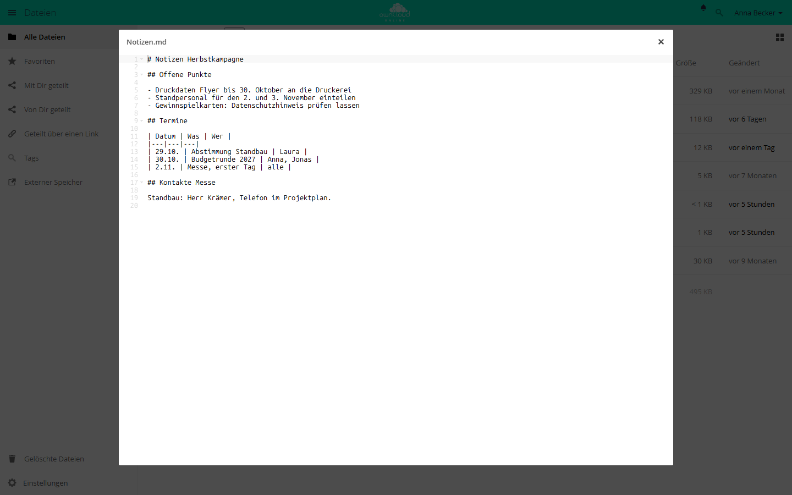

# Texteditor

!!! note "Öffentlich im Marktplatz"
    Die App ist ohne API-Schlüssel im Marktplatz sichtbar und lässt sich direkt
    über den Markt installieren. Im Markt heißt sie *Text Editor*. Diese Seite
    beschreibt Version 2.7.3.

Der Texteditor öffnet Textdateien direkt im Browser und speichert Änderungen in
die Datei zurück. Neue Textdateien legen Anwender über das Menü *+* der
Dateiliste an. Grundlage ist der Editor Ace mit Syntaxhervorhebung.

## Voraussetzungen {#voraussetzungen}

| Komponente | Anforderung |
| --- | --- |
| owncloud.online | 11.0 bis 11.99 |
| PHP | 8.4 oder neuer |

Weitere Dienste braucht die App nicht.

## Installation {#installation}

Im App-Menü **Markt** öffnen, *Text Editor* suchen und *Installieren* wählen.
Auf der Kommandozeile:

```bash
# App aus dem Marktplatz installieren, dabei wird sie eingeschaltet
sudo -u www-data php8.4 occ market:install files_texteditor

# nur nötig, wenn die App schon vorhanden, aber ausgeschaltet ist
sudo -u www-data php8.4 occ app:enable files_texteditor
```

## Einrichtung {#einrichtung}

Die App hat keine Einstellungsseite, keine Konfigurationsschlüssel und keine
eigenen `occ`-Befehle. Fest im Code stehen:

| Wert | Festgelegt auf |
| --- | --- |
| größte Datei, die der Editor öffnet | 4 MiB (4.194.304 Byte) |
| automatisches Speichern | drei Sekunden nach der letzten Änderung |
| Zeichenkodierung beim Bearbeiten | UTF-8 |

Wer eine Datei bearbeiten darf, ergibt sich aus den normalen Rechten. Ohne
Schreibrecht, etwa bei einer Freigabe ohne Bearbeitungsrecht, öffnet der Editor
die Datei nur lesend.

## Nutzung {#nutzung}

- **Öffnen:** Ein Klick auf eine Textdatei öffnet den Editor. Im Menü *…* der
  Datei heißt der Eintrag *In Texteditor öffnen*.
- **Neue Datei:** *+* und dann *Textdatei*. Die Datei heißt zunächst
  *Neue Textdatei.txt* und öffnet sich sofort im Editor. Der Eintrag fehlt in
  der Ansicht öffentlicher Links.
- **Speichern:** automatisch drei Sekunden nach der letzten Änderung, sofort
  mit `Strg+S` oder `Cmd+S`. Ein Sternchen neben dem Dateinamen zeigt
  ungespeicherte Änderungen.
- **Schließen:** über das Kreuz rechts in der Leiste über dem Editor. Erst
  dabei gibt der Editor die Sperre auf der Datei frei.
- **Öffentliche Links:** Der Editor arbeitet auch dort, wenn der Link
  Schreibrechte hat. Bei Links mit Passwort muss das Passwort in derselben
  Sitzung schon eingegeben worden sein.



*Textdateien wie .txt und .md öffnen und bearbeiten Sie direkt im Browser.*

### Welche Dateien sich öffnen lassen

Maßgeblich ist der MIME-Typ, den owncloud.online der Datei zuordnet. Der
Editor öffnet alle Typen, die mit `text/` beginnen, dazu JSON, XML, YAML,
JavaScript, PHP und leere Dateien. Die Syntaxhervorhebung richtet sich nach der
Dateiendung, zum Beispiel `md`, `json`, `xml`, `html`, `css`, `js`, `php`,
`py`, `sh` oder `sql`. Für andere Endungen öffnet der Editor die Datei ohne
Hervorhebung.

### Gleichzeitiges Bearbeiten

Der Texteditor ist kein Mehrbenutzer-Editor. Zwei Personen bearbeiten eine
Datei nacheinander, nicht gemeinsam:

1. **Sperre beim Öffnen:** Wer eine Datei öffnet, sperrt sie, sofern der
   Speicher dauerhafte Sperren unterstützt. Andere bekommen sie nur lesend, mit
   dem Hinweis „Datei ist schreibgeschützt, blockiert von …“ und dem Namen der
   sperrenden Person.
2. **Prüfung beim Speichern:** Hat sich die Datei seit dem Öffnen geändert,
   speichert der Editor nicht und meldet „Die Datei konnte nicht gespeichert
   werden, weil sie seit dem Öffnen verändert worden ist“. Fremde Änderungen
   werden so nicht überschrieben.

## Grenzen und Hinweise {#grenzen}

- Dateien über 4 MiB weist der Server ab: „Diese Datei ist zu groß. Bitte lade
  die Datei stattdessen herunter.“ Die Grenze lässt sich nicht ändern.
- Dateien in anderen Kodierungen, etwa Windows-1252 oder ISO-8859-1, zeigt der
  Editor nach UTF-8 umgerechnet an, öffnet sie aber nur lesend. So verändert
  die Umrechnung die Datei nicht.
- Schließt jemand den Browser-Tab statt des Editors, warnt der Browser vorher.
  Wird die Warnung übergangen, bleibt die Sperre bestehen, bis sie abläuft.

## Fehlersuche {#fehlersuche}

| Symptom | Ursache | Abhilfe |
| --- | --- | --- |
| „Diese Datei ist zu groß.“ | Datei über 4 MiB | Datei herunterladen, lokal bearbeiten, wieder hochladen |
| „Datei ist schreibgeschützt, blockiert von …“ mit dem Namen einer anderen Person | Diese Person hat die Datei im Editor offen | Warten, bis sie den Editor schließt oder die Sperre abläuft |
| „Datei ist schreibgeschützt, blockiert von …“ mit dem eigenen Namen, etwa „Anna Becker via Texteditor“ | Die Datei ist nicht UTF-8 kodiert. Der Editor zeigt sie umgerechnet an und hält die Sperre selbst | Editor schließen, Datei lokal nach UTF-8 umwandeln und wieder hochladen |
| „Die Datei konnte nicht gespeichert werden, weil sie seit dem Öffnen verändert worden ist“ | Die Datei wurde inzwischen an anderer Stelle geändert | Eigenen Text zwischenspeichern, Editor schließen, Datei neu öffnen, Änderungen erneut einfügen |
| „Datei ist schreibgeschützt“ ohne Namen | Das Schreibrecht fehlt, etwa bei einer Freigabe ohne Bearbeitungsrecht | Freigabe- und Ordnerrechte prüfen |
| „Kodierung kann nicht in UTF-8 umgewandelt werden.“ | Kodierung unbekannt, etwa bei Binärdateien | Datei lokal nach UTF-8 umwandeln |
| Klick auf die Datei lädt sie herunter | App ausgeschaltet, oder der MIME-Typ gehört nicht zu den unterstützten | `occ app:enable files_texteditor`, MIME-Typ der Datei prüfen |
| „Ungültiger gemeinsamer Schlüssel“ oder „Kein Benutzer gefunden“ | Sitzung abgelaufen oder Freigabe entfernt | Seite neu laden und erneut anmelden, Link prüfen |

Fehler auf dem Server protokolliert die App unter dem Namen
`files_texteditor`, siehe
[Serverprotokoll und Fehlermeldungen](../../administration/logging.md).
