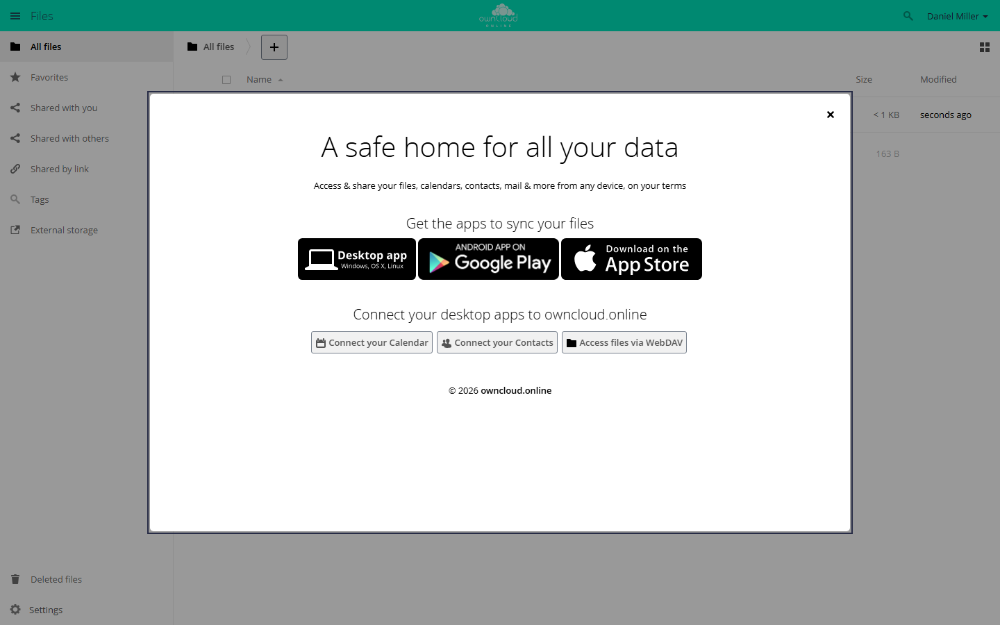

# First run wizard

The app shows every account a welcome window over the Files view after the
first login. It links to the desktop client, Google Play, and the App Store, and
to guides on calendar, contacts, and WebDAV access. Once closed, the window
does not come back on its own, but users can open it again from their personal
settings.

!!! note "Availability"
    Public in the Marketplace, no API key needed. App ID `firstrunwizard`,
    version 1.3.3. Name in the Market: "First run wizard".

## Requirements

| Area | Requirement |
| --- | --- |
| owncloud.online | 11.x |
| PHP | 8.4 or later |

## Installation

In the web interface: open **Market** from the app menu in the top left corner,
search for "First run wizard", and click **Install**.

On the command line:

```bash
sudo -u www-data php8.4 occ market:install firstrunwizard
```

If the app is already installed and only disabled:

```bash
sudo -u www-data php8.4 occ app:enable firstrunwizard
```

After you enable the app, existing accounts also see the window the next time
they open Files. The app only remembers who closed it.

## What users see



*At the first login, a welcome window shows links to the apps.*

| Part of the window | Content |
| --- | --- |
| **Get the apps to sync your files** | links to the desktop client, Google Play, and the App Store |
| **Connect your desktop apps to …** | **Connect your Calendar**, **Connect your Contacts**, and **Access files via WebDAV** lead to this documentation |

Users close the window with the X in the top right corner, with Esc, or by
clicking outside it. After that, it does not appear again. To open it again, go
to **Settings → Personal → General** and click **Show First Run Wizard again**.

## Configuration

The app has no settings page. You set the targets of the three app links in
`config/config.php`. The same targets apply to the app links under
**Settings → Personal → General**.

| Key | Link |
| --- | --- |
| `customclient_desktop` | desktop client |
| `customclient_android` | Google Play |
| `customclient_ios` | App Store |

```bash
sudo -u www-data php8.4 occ config:system:set customclient_desktop --value 'https://example.com/download/'
```

Without your own values, the defaults of the server or of the active theme app
apply.

Show the window again or suppress it:

```bash
# show it again to all accounts that closed it
sudo -u www-data php8.4 occ firstrunwizard:reset-all

# show it again to one account
sudo -u www-data php8.4 occ user:setting <account> firstrunwizard show --value 1

# never show it to one account, for example a service account
sudo -u www-data php8.4 occ user:setting <account> firstrunwizard show --value 0
```

`firstrunwizard:reset-all` is useful after a major change to the interface,
when everyone should see the window once more. The command also resets
accounts for which you turned the window off with `show` set to `0`.

## Limits and notes

- The window appears only in the web interface and only in the Files view. The
  desktop client and the mobile apps do not show it.
- The texts come from the app's translations and follow the account's language.
- Custom texts or links in the window require your own theme app that overrides
  the template `apps/firstrunwizard/templates/wizard.php`. Do not edit the
  template in the app's own directory; an update overwrites it. Because only
  one theme app can be active at a time, this does not work together with the
  [owncloud.online Theme](theme-owncloudonline.en.md).
