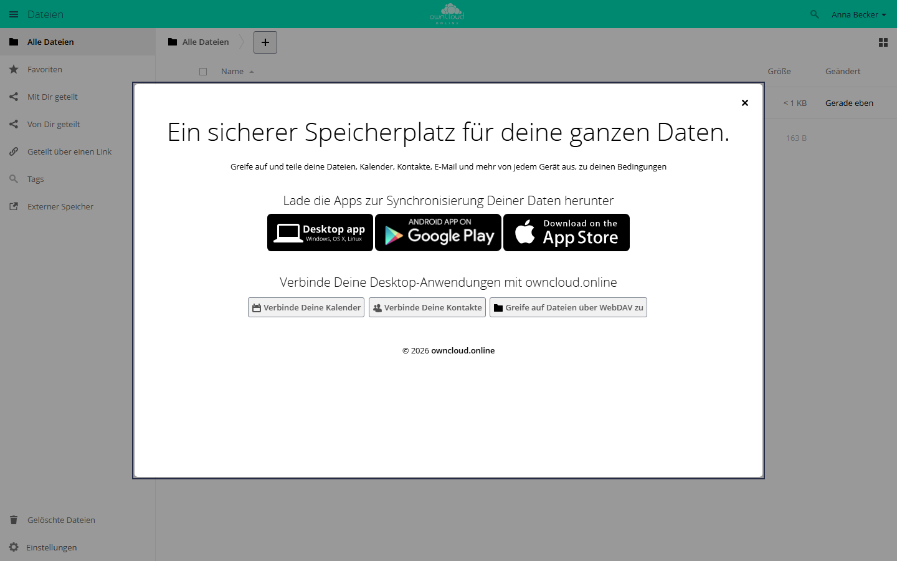

# Willkommensfenster

Die App zeigt jedem Konto nach der ersten Anmeldung ein Begrüßungsfenster über
der Dateiansicht. Es verlinkt den Desktop-Client, Google Play und den App Store
sowie Anleitungen zu Kalender, Kontakten und dem Zugriff per WebDAV. Wer das
Fenster schließt, sieht es nicht wieder, kann es aber in den persönlichen
Einstellungen erneut öffnen.

!!! note "Verfügbarkeit"
    Öffentlich im Marketplace, ohne API-Schlüssel. App-ID `firstrunwizard`,
    Version 1.3.3. Name im Markt: „First run wizard“.

## Voraussetzungen

| Bereich | Anforderung |
| --- | --- |
| owncloud.online | 11.x |
| PHP | 8.4 oder neuer |

## Installation

In der Weboberfläche: im App-Menü links oben **Markt** öffnen, nach
„First run wizard“ suchen und **Installieren** klicken.

Auf der Kommandozeile:

```bash
sudo -u www-data php8.4 occ market:install firstrunwizard
```

Ist die App schon vorhanden und nur abgeschaltet:

```bash
sudo -u www-data php8.4 occ app:enable firstrunwizard
```

Nach dem Einschalten sehen auch bestehende Konten das Fenster, und zwar beim
nächsten Öffnen der Dateien. Die App merkt sich nur, wer es geschlossen hat.

## Was Anwender sehen



*Bei der ersten Anmeldung erscheint ein Begrüßungsfenster mit Links zu den Apps.*

| Bereich im Fenster | Inhalt |
| --- | --- |
| **Lade die Apps zur Synchronisierung Deiner Daten herunter** | Links zum Desktop-Client, zu Google Play und zum App Store |
| **Verbinde Deine Desktop-Anwendungen mit …** | **Verbinde Deine Kalender**, **Verbinde Deine Kontakte** und **Greife auf Dateien über WebDAV zu** führen in diese Dokumentation |

Anwender schließen das Fenster über das Kreuz oben rechts, mit Esc oder per
Klick daneben. Danach erscheint es nicht wieder. Erneut öffnen lässt es sich
unter **Einstellungen → Persönlich → Allgemein** mit
**Den Einrichtungsassistenten erneut anzeigen**.

## Einrichtung

Eine Einstellungsseite hat die App nicht. Die Ziele der drei App-Links legen
Sie in `config/config.php` fest. Dieselben Ziele gelten für die App-Links unter
**Einstellungen → Persönlich → Allgemein**.

| Schlüssel | Link |
| --- | --- |
| `customclient_desktop` | Desktop-Client |
| `customclient_android` | Google Play |
| `customclient_ios` | App Store |

```bash
sudo -u www-data php8.4 occ config:system:set customclient_desktop --value 'https://example.com/download/'
```

Ohne eigene Werte gelten die Vorgaben des Servers beziehungsweise der aktiven
Theme-App.

Das Fenster erneut zeigen oder unterdrücken:

```bash
# allen Konten, die es geschlossen haben, noch einmal zeigen
sudo -u www-data php8.4 occ firstrunwizard:reset-all

# einem Konto noch einmal zeigen
sudo -u www-data php8.4 occ user:setting <konto> firstrunwizard show --value 1

# einem Konto nie zeigen, etwa einem Dienstkonto
sudo -u www-data php8.4 occ user:setting <konto> firstrunwizard show --value 0
```

`firstrunwizard:reset-all` eignet sich etwa nach einer größeren Änderung der
Oberfläche, wenn alle das Fenster noch einmal sehen sollen. Der Befehl erfasst
auch Konten, denen Sie das Fenster mit `show` und `0` abgeschaltet haben.

## Grenzen und Hinweise

- Das Fenster erscheint nur in der Weboberfläche und nur in der Dateiansicht.
  Desktop-Client und Mobil-Apps zeigen es nicht.
- Die Texte kommen aus den Übersetzungen der App und folgen der Sprache des
  Kontos.
- Eigene Texte oder Links im Fenster setzen eine eigene Theme-App voraus, die
  die Vorlage `apps/firstrunwizard/templates/wizard.php` überschreibt. Ändern
  Sie die Vorlage nicht im Verzeichnis der App selbst; ein Update überschreibt
  sie. Weil immer nur eine Theme-App aktiv sein kann, geht das nicht zusammen
  mit dem [owncloud.online Theme](theme-owncloudonline.md).
