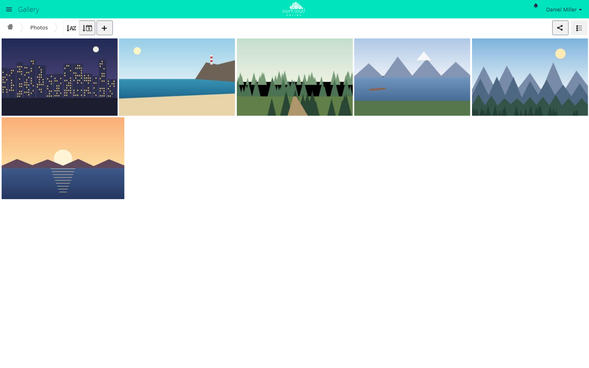

# Gallery

!!! note "Available on the Marketplace"
    The app is listed on the Marketplace without an API key and installs
    directly from the Market app. This page covers version 16.1.9.

Gallery shows the pictures in a folder as an album in a grid. Clicking a
picture opens a slideshow with full screen and zoom. Albums can be shared
through a public link. Recipients see them in the same view, without an
account.

## Requirements {#voraussetzungen}

| Component | Requirement |
| --- | --- |
| owncloud.online | 11.0 to 11.99 |
| PHP | 8.4 or later |
| Previews | turned on. Without a matching preview provider, an album stays empty |
| `imagick` with ImageMagick | for HEIC/HEIF, TIFF, Photoshop, Illustrator, and PostScript, and for photos wider or taller than 6016 pixels. Smaller PNG, JPEG, GIF, BMP, and X-Bitmap files work without it |
| Sharing by link | App `files_sharing` and sharing by link turned on, if you want to share albums publicly |

## Installation {#installation}

Open **Market** from the app menu, search for *Gallery*, and click *Install*.
On the command line:

```bash
# install the app from the Marketplace; this also enables it
sudo -u www-data php8.4 occ market:install gallery

# only needed if the app is present but disabled
sudo -u www-data php8.4 occ app:enable gallery
```

## Setup {#einrichtung}

The app has no settings page of its own. It follows server settings and a
`gallery.cnf` file per album.

### Server settings

| Setting | Where | Effect in Gallery |
| --- | --- | --- |
| *Allow users to share via link* (`shareapi_allow_links`) | **Settings → Admin → Sharing** | Without it, Gallery rejects public requests |
| *Allow public uploads* (`shareapi_allow_public_upload`) | **Settings → Admin → Sharing** | Whether the Gallery share dialog offers uploads through the link |
| `enabledPreviewProviders` | `config/config.php` | Which picture types show up in Gallery |

Which picture types Gallery shows depends on the server's preview providers:

| Media type | Preview provider | Active without an entry of your own |
| --- | --- | --- |
| `image/png`, `image/jpeg`, `image/gif`, `image/bmp`, `image/x-xbitmap` | `OC\Preview\PNG`, `JPEG`, `GIF`, `BMP`, `XBitmap` | yes |
| `image/heic`, `image/heif` | `OC\Preview\Heic` | yes, needs `imagick` |
| `image/tiff` | `OC\Preview\TIFF` | no |
| `application/x-photoshop` | `OC\Preview\Photoshop` | no |
| `application/illustrator` | `OC\Preview\Illustrator` | no |
| `application/postscript` | `OC\Preview\Postscript` | no |
| `image/svg+xml` | `OC\Preview\SVG`, optional | no. What counts is `native_svg: yes` in `gallery.cnf`. Without the provider, the browser draws the file itself |

If you set `enabledPreviewProviders` yourself, your list replaces the default
completely. So include the providers you want to keep. This example keeps all
default providers and adds TIFF, Photoshop, Illustrator, PostScript, and SVG:

```php
'enabledPreviewProviders' => [
    'OC\\Preview\\MarkDown',
    'OC\\Preview\\MP3',
    'OC\\Preview\\TXT',
    'OC\\Preview\\PNG',
    'OC\\Preview\\JPEG',
    'OC\\Preview\\WEBP',
    'OC\\Preview\\GIF',
    'OC\\Preview\\BMP',
    'OC\\Preview\\Heic',
    'OC\\Preview\\XBitmap',
    'OC\\Preview\\SGI',
    'OC\\Preview\\TIFF',
    'OC\\Preview\\Photoshop',
    'OC\\Preview\\Illustrator',
    'OC\\Preview\\Postscript',
    'OC\\Preview\\SVG',
],
```

### Album configuration gallery.cnf

`gallery.cnf` is a YAML file in the album folder. Gallery reads it when the
album opens. Sections with `inherit: yes` also apply to sub-albums. Gallery
reads the `features` section only in the top folder.

```yaml
features:
  native_svg: yes
  external_shares: yes
  background_colour_toggle: yes

sorting:
  type: date
  order: des
  inherit: yes

design:
  background: "#ffffff"
  inherit: yes

information:
  description: "Photos from the factory tour"
  description_link: readme.md
  copyright: "© Example Inc."
  copyright_link: copyright.md
  inherit: yes
```

| Key | Meaning |
| --- | --- |
| `features.native_svg` | `yes` includes SVG files in Gallery |
| `features.external_shares` | `yes` also shows albums from shares mounted from other servers |
| `features.background_colour_toggle` | `yes` shows *Toggle background* in the slideshow, for pictures with transparency |
| `sorting.type` | `date` or `name` |
| `sorting.order` | `asc` or `des` |
| `design.background` | Background color as a hex value |
| `information.description`, `information.copyright` | Markdown text for the *Album information* |
| `information.description_link`, `information.copyright_link` | Name of a Markdown file in the album whose content is shown instead |
| `inherit` | `yes` passes the section on to sub-albums |

Gallery ignores invalid values. If the file is not valid YAML, Gallery shows
*Configuration error*, and the server log names the location.

## Usage {#nutzung}

- **Open:** *Gallery* in the app menu. Every folder with pictures appears as
  an album. Use the path bar to reach sub-albums.
- **Sort:** *Sort by name* and *Sort by date* switch the field and the order.
- **Switch:** *File list* jumps to the same folder in the Files app, and
  *Gallery view* takes you back from there.
- **Slideshow:** Clicking a picture opens it with *Next*, *Previous*, *Play*,
  *Pause*, *Download*, and *Close*. *Delete* and rotating are available only
  outside public galleries and only if you may delete the file.
- **Album information:** appears if the album contains a `gallery.cnf` with a
  description or a copyright notice.
- **Hide a folder:** *Hide Album* in the *+* menu creates a `.nomedia` file in
  the folder. Gallery skips folders that contain this file.
- **Share:** *Share* at the top right opens the share dialog. A public link
  created there points to
  `https://<instance>/index.php/apps/gallery/s/<token>`. Set the password,
  expiration date, and uploads in the share dialog.



*Gallery shows all pictures in a folder as an album. The share icon at the top
right shares the album.*

## Limits and notes {#grenzen}

- **Together with the Media Viewer:** Gallery and the
  [Media Viewer](files_mediaviewer.en.md) both register as the default action
  for pictures in the file list. Gallery usually wins. Users then reach the
  Media Viewer with *…* and *Open in Media Viewer*.
- Without a matching preview provider, an album stays empty, even if it
  contains pictures.
- Gallery does not include WebP and SGI pictures, even if the server creates
  previews for them. In the file list, the Media Viewer opens them if it is
  enabled.
- Pictures larger than 50 MB (`preview_max_filesize_image`) get no preview and
  show up in Gallery only as a gray tile.
- The token in a Gallery link is the same as in the normal link share. If you
  disable Gallery, Gallery links stop working. The same content stays
  available at `https://<instance>/s/<token>` in the normal file view.
- In shared folders, Gallery does not take over links (`description_link`,
  `copyright_link`) from a `gallery.cnf` that sits above the shared folder.

## Troubleshooting {#fehlersuche}

| Symptom | Cause | Fix |
| --- | --- | --- |
| An album stays empty although the folder contains pictures | No preview provider is active for the media type | Add the provider to `enabledPreviewProviders` |
| TIFF, Photoshop, Illustrator, PostScript, or HEIC files are missing | `imagick` or ImageMagick is missing, or the provider is not listed | Install the extension and add the provider |
| PostScript or Illustrator files are missing although `imagick` is installed and the provider is listed | ImageMagick reads these formats through Ghostscript. On Debian and Ubuntu, `/etc/ImageMagick-6/policy.xml` blocks the `PS`, `EPS`, and `PDF` formats by default, or Ghostscript is missing | Install Ghostscript and lift the block in `policy.xml`. Ghostscript has had repeated security vulnerabilities, so lift the block only if you need these formats |
| Large photos show only gray tiles, smaller ones work | The picture is wider or taller than 6016 pixels and `imagick` is missing, or the file is larger than 50 MB | Install `imagick`. For larger files, raise `preview_max_filesize_image` in `config/config.php` (value in MB, `-1` for no limit) |
| SVG files are missing | `features.native_svg` is not set | Add `native_svg: yes` to the `gallery.cnf` in the top folder |
| A folder is missing in Gallery | The folder contains a `.nomedia` file | Remove the file |
| A public Gallery link reports "Sorry, this link doesn't seem to work anymore." with the reason "sharing is disabled" | Sharing by link is turned off | Turn on *Allow users to share via link* |
| No uploads in a public gallery | *Allow public uploads* is off, or the share does not allow uploads | Check the server setting, then the share permissions |
| *Configuration error* instead of the album information | `gallery.cnf` is not valid YAML or contains invalid values | Check the file. The server log names the location |
